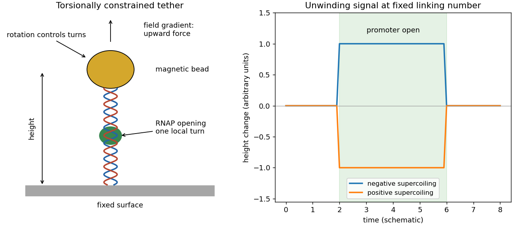

<h1 id="1/a/solution">Solution</h1>

↑ **Parent:** [A](../a.md)

The bacterial [RNA polymerase](../../../../rna-polymerase.md) core associates with a [sigma factor](../../../../sigma-factor.md) to form a holoenzyme. The [sigma factor](../../../../sigma-factor.md) recognizes [promoter](../../../../promoter-genetics.md) features and helps position the [DNA](../../../../deoxyribonucleic-acid.md) and stabilize its opening. Initial binding gives a closed [promoter](../../../../promoter-genetics.md) complex; local [DNA](../../../../deoxyribonucleic-acid.md) unwinding creates an open [promoter](../../../../promoter-genetics.md) complex with the template accessible. Initial [RNA](../../../../ribonucleic-acid.md) synthesis can produce short abortive products while the [RNA polymerase](../../../../rna-polymerase.md) remains attached to the [promoter](../../../../promoter-genetics.md), taking in downstream [DNA](../../../../deoxyribonucleic-acid.md) by scrunching. Growth of the [RNA](../../../../ribonucleic-acid.md) eventually permits [promoter escape](../../../../promoter-escape.md) and productive elongation. The [sigma factor](../../../../sigma-factor.md) changes its interactions during this transition; immediate complete dissociation is not obligatory.

In [magnetic tweezers](../../../../magnetic-tweezers.md), torsionally constrained [DNA](../../../../deoxyribonucleic-acid.md) joins a surface to a magnetic bead. A field gradient applies upward [force](../../../../force-split.md), rotation of the magnets controls the imposed [DNA supercoiling](../../../../dna-supercoiling.md), and optical tracking measures bead height. At suitable modest [force](../../../../force-split.md), [DNA supercoiling](../../../../dna-supercoiling.md) forms writhed loops, shortening the tether. Opening roughly one helical turn at fixed [linking number](../../../../linking-number.md) makes the remaining [DNA](../../../../deoxyribonucleic-acid.md) more positively twisted: $\Delta Tw_{\rm rest}+\Delta Wr=-\Delta Tw_{\rm bubble}$. Thus opening lengthens a negatively supercoiled tether by removing some negative writhe, but shortens a positively supercoiled tether by adding positive writhe. This opposite sign distinguishes unwinding from ordinary compaction, which shortens both tethers. Height-versus-turn calibration converts the two extension changes into an unwinding angle and a compaction contribution. Repeated height transitions give opening and closing dwell times.[Figures 1–3: torsionally constrained tether, opposite-sign extension responses, and approximately one-turn unwinding](../../../../promoter-unwinding-and-promoter-clearance-by-rna-polymerase-detection-by-single-molecule-dna-nanomanipulation-by-andrey-revyakin-and-others.md)

**[Figure 1](#1/a/image-magnetic-tweezers-and-the-opposite-signs-of-the-promoter-opening-signal). Magnetic tweezers and the opposite signs of the promoter opening signal**.

The sketch is a schematic prediction, not a copy of an experimental trace. Opening must be distinguished from [promoter escape](../../../../promoter-escape.md): an unwound [DNA](../../../../deoxyribonucleic-acid.md) region can remain associated with an elongating [RNA polymerase](../../../../rna-polymerase.md).

## ↑ Ancestors (12)

1. [A](../a.md)
2. [1](../../1.md)
3. [2022](../../../2022-split.md)
4. [Past exam of the biological physics course of the University of Oxford](../../../split.md)
5. [Biological physics course of the University of Oxford](../../../../biological-physics-course-of-the-university-of-oxford.md)
6. [Year 4 of the physics course of the University of Oxford](../../../../year-4-of-the-physics-course-of-the-university-of-oxford.md)
7. [Physics course of the University of Oxford](../../../../physics-course-of-the-university-of-oxford.md)
8. [Undergraduate course of the University of Oxford](../../../../undergraduate-course-of-the-university-of-oxford.md)
9. [Course of the University of Oxford](../../../../course-of-the-university-of-oxford.md)
10. [University of Oxford](../../../../university-of-oxford-split.md)
11. [List of universities](../../../../list-of-universities.md)
12. [Codex Wiki](../../../../split.md)
