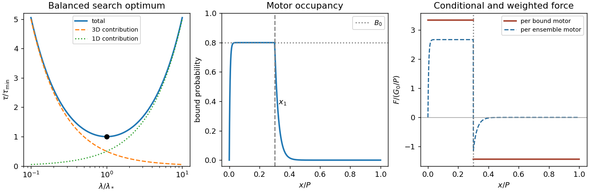

<h1 id="1/c/solution">Solution</h1>

↑ **Parent:** [C](../c.md)

Write $A=V/D_3$ and $B=L/D_1$. The search time is $A/\lambda+B\lambda$: it decreases from infinity at small positive $\lambda$, reaches one minimum, and increases without bound at large $\lambda$ within this idealized model.

During a [facilitated diffusion](../../../../facilitated-diffusion.md) search, roughly $L/\lambda$ separate [DNA](../../../../deoxyribonucleic-acid.md) landing-and-sliding episodes sample a chromosome. A three-dimensional encounter with any chromosomal landing region has characteristic time $V/(D_3L)$, so the total bulk-search contribution is $(L/\lambda)V/(D_3L)=V/(D_3\lambda)$. Each one-dimensional [diffusion](../../../../diffusion.md) excursion lasts order $\lambda^2/D_1$; multiplying by $L/\lambda$ gives $L\lambda/D_1$. Longer sliding therefore reduces the number of bulk relocations but increases time spent repeatedly exploring local [DNA](../../../../deoxyribonucleic-acid.md). Numerical constants and overlap corrections are already omitted in the given model.

Differentiating and using the positive second [derivative](../../../../derivative.md) gives

$$
-\frac{V}{D_3\lambda^2}+\frac{L}{D_1}=0,
\qquad
\boxed{\lambda_* =\sqrt{\frac{VD_1}{LD_3}},\qquad
\tau_{\min}=2\sqrt{\frac{VL}{D_1D_3}}}.
$$

At $\lambda_*$ the two time contributions are equal. The optimum is meaningful only if $\lambda_*$ lies between the microscopic capture scale and the available chromosomal contour length.

A decrease in [DNA](../../../../deoxyribonucleic-acid.md) concentration means a decrease in $L/V$, but its effect on the time is not determined by that ratio alone. At fixed chromosome length $L$, dilution by increasing $V$ increases $\tau$ at fixed $\lambda$ and increases $\tau_{\min}$ as $\sqrt V$; bulk relocation becomes slower. If instead $L$ decreases at fixed $V$, while the target is retained, the stated model predicts a smaller sliding contribution and a smaller optimized time, proportional to $\sqrt L$. In both cases $\lambda_*\propto(L/V)^{-1/2}$. This distinction prevents attributing a unique time trend to concentration without specifying how it changes.

**[Figure 2](#1/c/image-search-time-optimum-and-position-dependent-molecular-motor-binding-and-force). Search-time optimum and position-dependent molecular motor binding and force**.

The left panel normalizes the search law to $\tau/\tau_{\min}=(u+u^{-1})/2$, $u=\lambda/\lambda_*$. The other panels illustrate [b](../../4/b.md) and [c](../../4/c.md).

## ↑ Ancestors (12)

1. [C](../c.md)
2. [1](../../1.md)
3. [2022](../../../2022-split.md)
4. [Past exam of the biological physics course of the University of Oxford](../../../split.md)
5. [Biological physics course of the University of Oxford](../../../../biological-physics-course-of-the-university-of-oxford.md)
6. [Year 4 of the physics course of the University of Oxford](../../../../year-4-of-the-physics-course-of-the-university-of-oxford.md)
7. [Physics course of the University of Oxford](../../../../physics-course-of-the-university-of-oxford.md)
8. [Undergraduate course of the University of Oxford](../../../../undergraduate-course-of-the-university-of-oxford.md)
9. [Course of the University of Oxford](../../../../course-of-the-university-of-oxford.md)
10. [University of Oxford](../../../../university-of-oxford-split.md)
11. [List of universities](../../../../list-of-universities.md)
12. [Codex Wiki](../../../../split.md)
