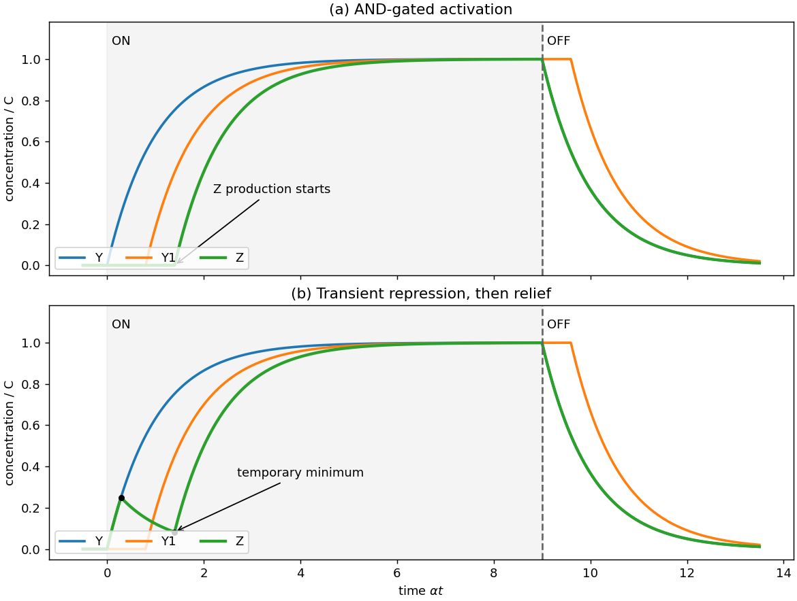

<h1 id="2/a/solution">Solution</h1>

↑ **Parent:** [A](../a.md)

Use the [logic approximation for gene regulation](../../../../logic-approximation-for-gene-regulation.md): production is either $\beta$ or zero, and every species has linear removal rate $\alpha$. Put $C=\beta/\alpha$ and assume zero basal expression, inactive X before time zero, and all required thresholds strictly between $0$ and $C$. The input is $u(t)=1$ for $0<t<T$ and zero otherwise. The common [ordinary differential equation](../../../../ordinary-differential-equation.md) is $\dot c=\beta g-\alpha c$, with Boolean production gate $g$. Both networks therefore have

$$
Y(t)=C(1-e^{-\alpha t})\quad(0<t<T),\qquad
Y(t)=Ce^{-\alpha(t-T)}\quad(t>T),
$$

where the latter uses the stipulated attained [steady state](../../../../steady-state.md). Define the threshold-crossing delay

$$
d(K)=-\alpha^{-1}\ln(1-K/C),\qquad
t_r=d(K_{YZ}),\quad t_1=d(K_{YY1}).
$$

Because $K_{YY1}>K_{YZ}$, $t_1>t_r$. In both networks, $Y_1$ stays zero until $t_1$ and then follows $Y_1=C[1-e^{-\alpha(t-t_1)}]$ until the OFF response. Write $K_A$ for the activation threshold of $Y_1$ on Z in diagram (a), and $K_I$ for the level of $Y_1$ that blocks Y's repression in diagram (b); these thresholds were not supplied numerically.

**Diagram (a).** All three inputs X, Y and $Y_1$ must permit Z production. Since Y has already crossed its Z threshold before $Y_1$ starts, the final permission arrives at

$$
t_a=t_1+d(K_A).
$$

Thus $Z=0$ until $t_a$ and $Z=C[1-e^{-\alpha(t-t_a)}]$ subsequently. Solving $Z=C/2$ gives

$$
\boxed{t_{Z,1/2}=d(K_{YY1})+d(K_A)+\frac{\ln2}{\alpha}}.
$$

For the frequently adopted but extra convention that both required thresholds are $C/2$, this is $3\ln2/\alpha$. At the OFF step, X's direct AND input disappears, so $Z=Ce^{-\alpha(t-T)}$ immediately. Y also decays immediately. $Y_1$ remains at $C$ while Y remains above $K_{YY1}$; it starts decaying at $T+\alpha^{-1}\ln(C/K_{YY1})$. This is a [coherent feed-forward loop](../../../../coherent-feed-forward-loop.md) persistence response: activation is delayed, while removal of the direct required input switches production off promptly.

**Diagram (b).** The production gate is $g_Z=u\,[\neg(Y>K_{YZ})\lor(Y_1>K_I)]$. Z initially rises, Y switches Z production off at $t_r$, and $Y_1$ restores production at $t_b=t_1+d(K_I)$. The continuous solution during the ON phase is

$$
Z(t)=\begin{cases}
C(1-e^{-\alpha t}),&0<t<t_r,\\
C(1-e^{-\alpha t_r})e^{-\alpha(t-t_r)},&t_r<t<t_b,\\
C+[Z(t_b)-C]e^{-\alpha(t-t_b)},&t_b<t<T.
\end{cases}
$$

The [derivative](../../../../derivative.md) changes from positive to negative at $t_r$, and from negative to positive at $t_b$. Consequently the first temporary minimum following the initial pulse occurs at

$$
\boxed{t_{\min}=d(K_{YY1})+d(K_I)}.
$$

Its value is $Z(t_b)=K_{YZ}e^{-\alpha(t_b-t_r)}$. At the OFF step Z again decays immediately because X is required for production, with Y and $Y_1$ behaving as above. If a required threshold is unattainable, these late switching events do not occur; equal production and removal rates alone do not fix threshold values.

**[Figure 3](#2/a/image-logic-approximation-for-gene-regulation-delayed-activation-and-a-transient-repression-window). Logic approximation for gene regulation: delayed activation and a transient repression window**.

The plotted thresholds are explicitly illustrative, with $K_{YZ}/C=0.25$, $K_{YY1}/C=0.55$ and $K_A/C=K_I/C=0.45$.

## ↑ Ancestors (12)

1. [A](../a.md)
2. [2](../../2.md)
3. [2022](../../../2022-split.md)
4. [Past exam of the biological physics course of the University of Oxford](../../../split.md)
5. [Biological physics course of the University of Oxford](../../../../biological-physics-course-of-the-university-of-oxford.md)
6. [Year 4 of the physics course of the University of Oxford](../../../../year-4-of-the-physics-course-of-the-university-of-oxford.md)
7. [Physics course of the University of Oxford](../../../../physics-course-of-the-university-of-oxford.md)
8. [Undergraduate course of the University of Oxford](../../../../undergraduate-course-of-the-university-of-oxford.md)
9. [Course of the University of Oxford](../../../../course-of-the-university-of-oxford.md)
10. [University of Oxford](../../../../university-of-oxford-split.md)
11. [List of universities](../../../../list-of-universities.md)
12. [Codex Wiki](../../../../split.md)
