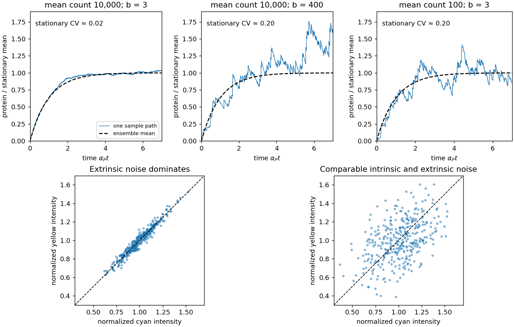

<h1 id="2/c/solution">Solution</h1>

↑ **Parent:** [C](../c.md)

Convert [number density](../../../../number-density.md) into molecule count: $\bar n=X_{P,\mathrm{st}}V$. For the explicitly assumed representative cell volume $V=1\,\mathrm{\mu m^3}$, the two densities correspond to $\bar n=10^4$ and $10^2$. The [concentrations](../../../../concentration.md) alone do not fix fluctuation sizes without a volume.

For activation from zero [messenger RNA](../../../../messenger-rna.md) and [protein](../../../../protein-split.md), solving the two mean rate equations gives

$$
\frac{\langle n_P(t)\rangle}{\bar n}
=1-\frac{\alpha_R e^{-\alpha_Pt}-\alpha_Pe^{-\alpha_Rt}}{\alpha_R-\alpha_P}
\simeq1-e^{-\alpha_Pt}\qquad(t\gg1/\alpha_R).
$$

Thus all three normalized mean curves are almost identical. Sample paths differ. For Poisson [transcription](../../../../transcription-biology.md) with [biological translation](../../../../translation-biology.md) bursts, the stationary [Fano factor](../../../../fano-factor.md) and squared [coefficient of variation](../../../../coefficient-of-variation.md) are

$$
\frac{\operatorname{Var}n_P}{\bar n}=1+\frac{r}{\alpha_R+\alpha_P}
\simeq1+b,\qquad
\mathrm{CV}^2\simeq\frac{1+b}{\bar n}.
$$

One way to obtain the fast-[messenger RNA](../../../../messenger-rna.md) limit is to use burst arrivals at rate $a$, a geometrically distributed burst $B$ with $\langle B\rangle=b$ and $\langle B^2\rangle=b+2b^2$, and independent unit [protein degradation](../../../../protein-degradation.md) at rate $\alpha_Pn$. The first stationary moment gives $ab=\alpha_P\bar n$; the second gives $\operatorname{Var}n=\bar n(1+b)$.

At $\bar n=10^4,b=3$, typical relative fluctuations are $\sqrt{4/10^4}=0.02$ and many small bursts make the trajectory smooth. At $\bar n=10^4,b=400$, they are $\sqrt{401/10^4}\simeq0.20$; individual bursts have mean normalized height $0.04$, with only about $25$ bursts per [protein](../../../../protein-split.md) lifetime. At $\bar n=100,b=3$, the relative fluctuations are again $0.20$, but the typical burst height is $0.03$ and about $33$ bursts occur per lifetime. The latter two examples can look similarly noisy after normalization even though their mean molecule counts differ by two orders of magnitude. Burst arrival times and sizes fluctuate: a high-burst trace is not a periodic sawtooth.

**[Figure 4](#2/c/image-stochastic-gene-expression-trajectories-and-dual-reporter-intrinsic-gene-expression-noise-and-extrinsic-gene-expression-noise). Stochastic gene expression trajectories and dual-reporter intrinsic gene-expression noise and extrinsic gene-expression noise**.

The upper panels are independently simulated burst-arrival and unit-removal processes, shown alongside the common mean. The lower panels illustrate [d](../d.md); their point clouds are schematic, not experimental data.

## ↑ Ancestors (12)

1. [C](../c.md)
2. [2](../../2.md)
3. [2022](../../../2022-split.md)
4. [Past exam of the biological physics course of the University of Oxford](../../../split.md)
5. [Biological physics course of the University of Oxford](../../../../biological-physics-course-of-the-university-of-oxford.md)
6. [Year 4 of the physics course of the University of Oxford](../../../../year-4-of-the-physics-course-of-the-university-of-oxford.md)
7. [Physics course of the University of Oxford](../../../../physics-course-of-the-university-of-oxford.md)
8. [Undergraduate course of the University of Oxford](../../../../undergraduate-course-of-the-university-of-oxford.md)
9. [Course of the University of Oxford](../../../../course-of-the-university-of-oxford.md)
10. [University of Oxford](../../../../university-of-oxford-split.md)
11. [List of universities](../../../../list-of-universities.md)
12. [Codex Wiki](../../../../split.md)
