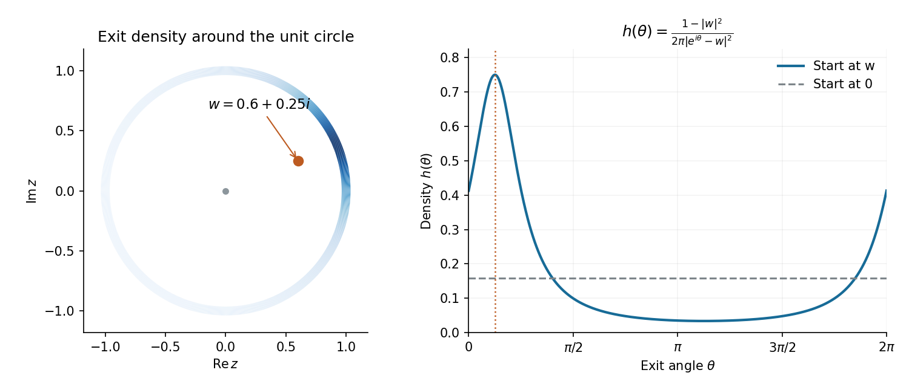

# 2011

↑ **Parent:** [Past exam of the Brownian motion in complex analysis course of the University of Oxford](../past-exam-of-the-brownian-motion-in-complex-analysis-course-of-the-university-of-oxford.md)

Source: [released examination bundle](https://www.whatdotheyknow.com/request/maths_past_papers_3), `Part C 2007 11.pdf`, pages 457–460. All three questions are covered. No mark allocations are printed.

**Table of contents**

- [1](#1)
  - [a](#1/a)
    - [Solution](#1/a/solution)
  - [b](#1/b)
    - [i](#1/b/i)
      - [Solution](#1/b/i/solution)
    - [ii](#1/b/ii)
      - [Solution](#1/b/ii/solution)
- [2](#2)
  - [a](#2/a)
    - [Solution](#2/a/solution)
  - [b](#2/b)
    - [Solution](#2/b/solution)
  - [c](#2/c)
    - [Solution](#2/c/solution)
- [3](#3)
  - [a](#3/a)
    - [Solution](#3/a/solution)
  - [b](#3/b)
    - [i](#3/b/i)
      - [Solution](#3/b/i/solution)
    - [ii](#3/b/ii)
      - [Solution](#3/b/ii/solution)

## 1

↑ **Parent:** [2011](2011.md)

<h3 id="1/a">a</h3>

↑ **Parent:** [1](#1)

<h4 id="1/a/solution">Solution</h4>

↑ **Parent:** [A](#1/a)

Write $Z_t=z+B_t^1+iB_t^2$, where the coordinates are independent standard [Brownian motions](../brownian-motion.md), and write $f=u+iv$. The [Cauchy-Riemann equations](../analysis.md#cauchy-riemann-equations) imply $\Delta u=\Delta v=0$. [Itô's formula](../stochastic-calculus.md#ito-s-lemma) therefore makes

$$
M_t=u(Z_t)-u(z),\qquad N_t=v(Z_t)-v(z)
$$

[continuous local martingales](../martingale.md#continuous-local-martingale). Their [quadratic variations](../stochastic-calculus.md#quadratic-variation) and [quadratic covariation](../stochastic-calculus.md#quadratic-covariation) are

$$
\langle M\rangle_t=\langle N\rangle_t=A_t:=\int_0^t|f'(Z_s)|^2ds,\qquad
\langle M,N\rangle_t=0.
$$

Indeed the two gradient norms are equal to $|f'|$, and their dot product vanishes by the Cauchy-Riemann equations.

The clock is finite at every finite time, since a continuous Brownian path has compact range there and $f'$ is continuous. To show its lifetime is infinite, choose a small disc on which $|f'|^2\geq c>0$; such a disc exists because the [entire function](../holomorphic-function.md#entire-function) is nonconstant. A supporting recurrence result is that planar Brownian motion spends infinite total time in every nonempty open disc almost surely. One proof combines recurrent returns to a smaller disc with the strong Markov property: each visit has a uniformly positive chance of lasting a fixed positive time in the larger disc. Equivalently, use the [divergence of a positive planar Brownian occupation integral](../brownian-motion.md#divergence-of-a-positive-planar-brownian-occupation-integral). Therefore

$$
\boxed{A_t\longrightarrow\infty\quad\text{almost surely}.}
$$

Finally the [common-clock time change of orthogonal local martingales](../martingale.md#common-clock-time-change-of-orthogonal-local-martingales) states that two continuous local martingales starting at zero with common bracket $A$, zero cross bracket, and $A_\infty=\infty$ are the coordinates of a planar Brownian motion evaluated at $A_t$. Applying it gives a [planar Brownian motion](../brownian-motion.md#planar-brownian-motion) $\widetilde Z$ starting at zero with

$$
\boxed{f(Z_t)=f(z)+\widetilde Z_{A_t}.}
$$

This proves [conformal invariance of planar Brownian motion](../brownian-motion.md#conformal-invariance-of-planar-brownian-motion) in the entire-function setting, including the [divergence of the conformal Brownian clock for an entire function](../brownian-motion.md#divergence-of-the-conformal-brownian-clock-for-an-entire-function).

<h3 id="1/b">b</h3>

↑ **Parent:** [1](#1)

<h4 id="1/b/i">i</h4>

↑ **Parent:** [B](#1/b)

<h5 id="1/b/i/solution">Solution</h5>

↑ **Parent:** [I](#1/b/i)

Apply part (a) to the entire function $f(z)=e^{i\theta}z$. Its derivative has modulus one, so its [conformal Brownian clock](../brownian-motion.md#conformal-brownian-clock) is $A_t=t$. Thus

$$
e^{i\theta}Z_t=e^{i\theta}Z_0+\widetilde Z_t,
$$

which is a [planar Brownian motion](../brownian-motion.md#planar-brownian-motion) starting from the rotated initial point. In particular, if the initial point is zero, its law is unchanged. This is [rotational invariance of planar Brownian motion](../brownian-motion.md#rotational-invariance-of-planar-brownian-motion).

<h4 id="1/b/ii">ii</h4>

↑ **Parent:** [B](#1/b)

<h5 id="1/b/ii/solution">Solution</h5>

↑ **Parent:** [Ii](#1/b/ii)

Start a [planar Brownian motion](../brownian-motion.md#planar-brownian-motion) $B$ at zero and apply part (a) to the entire function $f(z)=e^z$. Then

$$
e^{B_t}=1+\widetilde Z_{A_t},\qquad
A_t=\int_0^t e^{2\operatorname{Re}B_s}\,ds.
$$

The left side never vanishes. The clock is continuous, starts at zero, and tends to infinity almost surely, so its range is all nonnegative times. Consequently the complex Brownian motion $1+\widetilde Z_s$ never reaches zero at any time $s$. Every [planar Brownian motion](../brownian-motion.md#planar-brownian-motion) started at one has that same law, hence

$$
\boxed{P(T<\infty)=0.}
$$

This is the [complex exponential construction of planar Brownian motion](../brownian-motion.md#complex-exponential-construction-of-planar-brownian-motion) and proves that a fixed point is a [polar point for planar Brownian motion](../brownian-motion.md#polar-point-for-planar-brownian-motion). The divergence of the clock is essential: it makes this a conclusion about all Brownian times.

## 2

↑ **Parent:** [2011](2011.md)

<h3 id="2/a">a</h3>

↑ **Parent:** [2](#2)

<h4 id="2/a/solution">Solution</h4>

↑ **Parent:** [A](#2/a)

Let $\beta(\theta)=w-e^{i\theta}=|\beta(\theta)|e^{ig(\theta)}$. It is never zero, since $|w|<1$. On the [unit circle](../complex-analysis.md#complex-unit-circle),

$$
e^{i\theta}-w=-\beta(\theta),\qquad
1-\overline w e^{i\theta}=-e^{i\theta}\overline{\beta(\theta)}.
$$

Dividing these identities gives

$$
\boxed{f(e^{i\theta})=e^{-i\theta}\frac{\beta(\theta)}{\overline{\beta(\theta)}}
=\exp\bigl(i(-\theta+2g(\theta))\bigr).}
$$

Any other continuous lift of the argument differs by an integer multiple of $2\pi$, which leaves the exponential unchanged.

<h3 id="2/b">b</h3>

↑ **Parent:** [2](#2)

<h4 id="2/b/solution">Solution</h4>

↑ **Parent:** [B](#2/b)

Differentiate the argument through the nonvanishing curve, using $g'=\operatorname{Im}(\beta'/\beta)$. Since $\beta'=-ie^{i\theta}$,

$$
g'(\theta)=\operatorname{Im}\frac{-ie^{i\theta}(\overline w-e^{-i\theta})}{|w-e^{i\theta}|^2}
=\frac{1-w_1\cos\theta-w_2\sin\theta}{|w-e^{i\theta}|^2}.
$$

Also $|w-e^{i\theta}|^2=1+|w|^2-2(w_1\cos\theta+w_2\sin\theta)$. Subtracting one therefore gives

$$
\boxed{-1+2g'(\theta)=\frac{1-|w|^2}{|w-e^{i\theta}|^2}>0.}
$$

Thus the lifted boundary angle $\phi(\theta)=-\theta+2g(\theta)$ is strictly increasing. Its total change around the circle is $2\pi$, because the [disk automorphism](../topology.md#automorphism-of-the-unit-disk) has boundary degree one. The same total change follows directly from the [winding number](../complex-analysis.md#winding-number) one of $w-e^{i\theta}$. This is the [boundary-angle derivative of a disk automorphism](../topology.md#boundary-angle-derivative-of-a-disk-automorphism).

<h3 id="2/c">c</h3>

↑ **Parent:** [2](#2)

<h4 id="2/c/solution">Solution</h4>

↑ **Parent:** [C](#2/c)

The [disk automorphism](../topology.md#automorphism-of-the-unit-disk) satisfies $f(w)=0$ and maps the unit circle bijectively to itself. Its derivative $(1-|w|^2)/(1-\overline wz)^2$ is bounded above and away from zero on the closed disk. By [conformal invariance of planar Brownian motion](../brownian-motion.md#conformal-invariance-of-planar-brownian-motion), the image path up to the exit time is a time-changed planar Brownian motion started at zero. Its exit point is $f(Z_T)$; the clock changes when it exits, but not where.

The original exit time is finite almost surely. For example, $|Z_{t\wedge T}|^2-2(t\wedge T)$ is a martingale, so $\mathbb E(t\wedge T)\leq(1-|w|^2)/2$. Boundedness of $f'$ makes the image exit clock finite too. By [rotational invariance of planar Brownian motion](../brownian-motion.md#rotational-invariance-of-planar-brownian-motion), the image exit angle is uniform on $[0,2\pi)$.

Let $\Theta=\arg Z_T$. Parts (a) and (b) show that $\phi(\Theta)$ modulo $2\pi$ is uniform, where $\phi$ is strictly increasing and increases by exactly $2\pi$ in one circuit. The one-dimensional change-of-variables formula therefore gives

$$
\boxed{h(\theta)=\frac{\phi'(\theta)}{2\pi}
=\frac1{2\pi}\frac{1-|w|^2}{|w-e^{i\theta}|^2}.}
$$

Its integral is one because the total angle change is $2\pi$. This [harmonic measure](../brownian-motion.md#harmonic-measure) density is the [Poisson kernel for the unit disk](../partial-differential-equation.md#poisson-kernel-for-the-unit-disk) divided by $2\pi$. It is uniform for $w=0$ and concentrates near the boundary point closest to $w$ as $|w|$ increases.

**[Figure 1](#2/c/image-the-disk-exit-angle-density-for-brownian-motion-started-at-w-0-6-plus-0-25i-darker-boundary-arcs-have-greater-density-the-dashed-horizontal-line-is-the-uniform-density-for-a-start-at-the-centre). The disk exit-angle density for Brownian motion started at w=0.6+0.25i. Darker boundary arcs have greater density; the dashed horizontal line is the uniform density for a start at the centre.**

## 3

↑ **Parent:** [2011](2011.md)

<h3 id="3/a">a</h3>

↑ **Parent:** [3](#3)

<h4 id="3/a/solution">Solution</h4>

↑ **Parent:** [A](#3/a)

A bounded [holomorphic function](../holomorphic-function.md) of planar Brownian motion is a local martingale up to exit, because its real and imaginary parts are harmonic and [Itô's formula](../stochastic-calculus.md#ito-s-lemma) has zero drift. Stop before the given $S<T_D$. Localization inside compact subdisks gives the local martingale $f(Z_{t\wedge S}^z)$, and $|f|<1$ makes it bounded. The [bounded local martingale criterion](../martingale.md#bounded-local-martingale-criterion) therefore gives a true martingale.

Exit from the unit disk is finite almost surely, so $S<T_D$ is finite too. Taking $t\to\infty$ and using the [dominated convergence theorem](../measure-theory.md#dominated-convergence-theorem) yields

$$
\boxed{\mathbb E[f(Z_S^z)]=f(z).}
$$

The same proof works for any bounded [holomorphic function](../holomorphic-function.md), after rescaling if needed; it does not require the stopping time itself to be bounded.

<h3 id="3/b">b</h3>

↑ **Parent:** [3](#3)

<h4 id="3/b/i">i</h4>

↑ **Parent:** [B](#3/b)

<h5 id="3/b/i/solution">Solution</h5>

↑ **Parent:** [I](#3/b/i)

Since $f(0)=0$, the function $g(z)=f(z)/z$ extends analytically to zero by $g(0)=f'(0)$. It is bounded on the disk: outside $|z|<1/2$, $|g(z)|\leq2$, while on the closed half-radius disk its analytic extension is continuous and hence bounded.

Fix $z\ne0$ and choose $|z|<r<1$. Let $T_r$ be the first exit time of Brownian motion started at $z$ from the radius-$r$ disk. The bounded analytic martingale identity in part (a) gives

$$
g(z)=\mathbb E_z[g(Z_{T_r})].
$$

On this exit circle, $|g(Z_{T_r})|=|f(Z_{T_r})|/r\leq1/r$. The triangle inequality gives $|g(z)|\leq1/r$. Letting $r\uparrow1$ proves $|g(z)|\leq1$, and therefore

$$
\boxed{|f(z)|\leq|z|\quad\text{for all }z\in D.}
$$

At zero the claim holds by the assumed zero value. This is the [Schwarz lemma](../analysis.md#schwarz-lemma), obtained from Brownian optional stopping rather than an analytic maximum principle.

<h4 id="3/b/ii">ii</h4>

↑ **Parent:** [B](#3/b)

<h5 id="3/b/ii/solution">Solution</h5>

↑ **Parent:** [Ii](#3/b/ii)

Let $z_0\ne0$ be an equality point and set $c=g(z_0)$, so $|c|=1$. For any $|z_0|<r<1$, the same Brownian exit identity gives

$$
1=\operatorname{Re}(\overline c\,g(z_0))
=\mathbb E_{z_0}\operatorname{Re}(\overline c\,g(Z_{T_r})).
$$

Part (i) gives $|g|\leq1$, so the real random variable in the expectation is at most one. Equality of its mean to one forces $g(Z_{T_r})=c$ almost surely. By the scaled version of the exit density from Question 2, every nonempty arc of the exit circle has positive probability. Continuity of $g$ on that circle therefore implies $g=c$ at every boundary point of the radius-$r$ disk.

For any $w$ inside that circle, the Brownian exit identity now gives $g(w)=\mathbb E_wg(Z_{T_r})=c$. Letting $r$ increase to one makes this true throughout $D$. Writing $c=e^{i\theta}$ yields

$$
\boxed{f(w)=we^{i\theta}\quad\text{for all }w\in D.}
$$

This completes the equality case of the [Brownian proof of the Schwarz lemma](../analysis.md#brownian-proof-of-the-schwarz-lemma).

## ↑ Ancestors (9)

1. [Past exam of the Brownian motion in complex analysis course of the University of Oxford](../past-exam-of-the-brownian-motion-in-complex-analysis-course-of-the-university-of-oxford.md)
2. [Brownian motion in complex analysis course of the University of Oxford](../university-of-oxford.md#brownian-motion-in-complex-analysis-course-of-the-university-of-oxford)
3. [Year 4 of the mathematics course of the University of Oxford](../university-of-oxford.md#year-4-of-the-mathematics-course-of-the-university-of-oxford)
4. [Mathematics course of the University of Oxford](../university-of-oxford.md#mathematics-course-of-the-university-of-oxford)
5. [Undergraduate course of the University of Oxford](../university-of-oxford.md#undergraduate-course-of-the-university-of-oxford)
6. [Course of the University of Oxford](../university-of-oxford.md#course-of-the-university-of-oxford)
7. [University of Oxford](../university-of-oxford.md)
8. [List of universities](../README.md#list-of-universities)
9. [Codex Wiki](../README.md)
