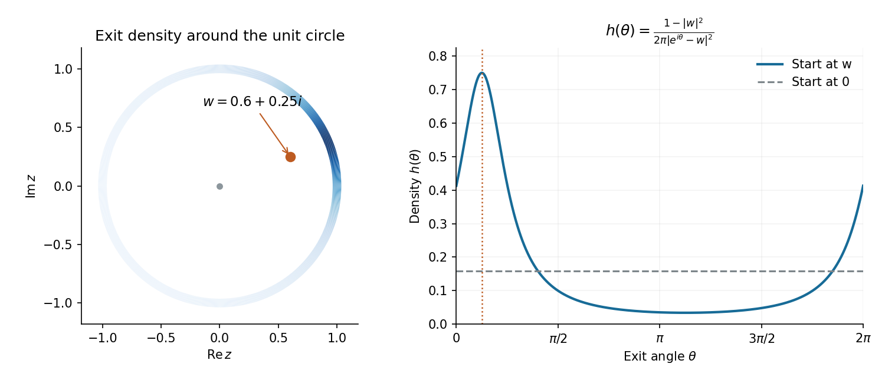

<h1 id="2/c/solution">Solution</h1>

↑ **Parent:** [C](../c.md)

The [disk automorphism](../../../../automorphism-of-the-unit-disk.md) satisfies $f(w)=0$ and maps the unit circle bijectively to itself. Its derivative $(1-|w|^2)/(1-\overline wz)^2$ is bounded above and away from zero on the closed disk. By [conformal invariance of planar Brownian motion](../../../../conformal-invariance-of-planar-brownian-motion.md), the image path up to the exit time is a time-changed planar Brownian motion started at zero. Its exit point is $f(Z_T)$; the clock changes when it exits, but not where.

The original exit time is finite almost surely. For example, $|Z_{t\wedge T}|^2-2(t\wedge T)$ is a martingale, so $\mathbb E(t\wedge T)\leq(1-|w|^2)/2$. Boundedness of $f'$ makes the image exit clock finite too. By [rotational invariance of planar Brownian motion](../../../../rotational-invariance-of-planar-brownian-motion.md), the image exit angle is uniform on $[0,2\pi)$.

Let $\Theta=\arg Z_T$. Parts (a) and (b) show that $\phi(\Theta)$ modulo $2\pi$ is uniform, where $\phi$ is strictly increasing and increases by exactly $2\pi$ in one circuit. The one-dimensional change-of-variables formula therefore gives

$$
\boxed{h(\theta)=\frac{\phi'(\theta)}{2\pi}
=\frac1{2\pi}\frac{1-|w|^2}{|w-e^{i\theta}|^2}.}
$$

Its integral is one because the total angle change is $2\pi$. This [harmonic measure](../../../../harmonic-measure.md) density is the [Poisson kernel for the unit disk](../../../../poisson-kernel-for-the-unit-disk.md) divided by $2\pi$. It is uniform for $w=0$ and concentrates near the boundary point closest to $w$ as $|w|$ increases.

**[Figure 1](#2/c/image-the-disk-exit-angle-density-for-brownian-motion-started-at-w-0-6-plus-0-25i-darker-boundary-arcs-have-greater-density-the-dashed-horizontal-line-is-the-uniform-density-for-a-start-at-the-centre). The disk exit-angle density for Brownian motion started at w=0.6+0.25i. Darker boundary arcs have greater density; the dashed horizontal line is the uniform density for a start at the centre.**

## ↑ Ancestors (12)

1. [C](../c.md)
2. [2](../../2.md)
3. [2011](../../../2011-split.md)
4. [Past exam of the Brownian motion in complex analysis course of the University of Oxford](../../../split.md)
5. [Brownian motion in complex analysis course of the University of Oxford](../../../../brownian-motion-in-complex-analysis-course-of-the-university-of-oxford.md)
6. [Year 4 of the mathematics course of the University of Oxford](../../../../year-4-of-the-mathematics-course-of-the-university-of-oxford.md)
7. [Mathematics course of the University of Oxford](../../../../mathematics-course-of-the-university-of-oxford.md)
8. [Undergraduate course of the University of Oxford](../../../../undergraduate-course-of-the-university-of-oxford.md)
9. [Course of the University of Oxford](../../../../course-of-the-university-of-oxford.md)
10. [University of Oxford](../../../../university-of-oxford-split.md)
11. [List of universities](../../../../list-of-universities.md)
12. [Codex Wiki](../../../../split.md)
