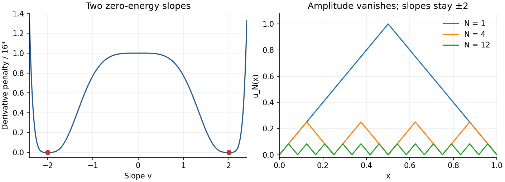

# 2009

↑ **Parent:** [Past exam of the calculus of variations course of the University of Oxford](../past-exam-of-the-calculus-of-variations-course-of-the-university-of-oxford.md)

**Table of contents**

- [1](#1)
  - [a](#1/a)
    - [i](#1/a/i)
      - [Solution](#1/a/i/solution)
    - [ii](#1/a/ii)
      - [Solution](#1/a/ii/solution)
  - [b](#1/b)
    - [i](#1/b/i)
      - [Solution](#1/b/i/solution)
    - [ii](#1/b/ii)
      - [Solution](#1/b/ii/solution)
    - [iii](#1/b/iii)
      - [Solution](#1/b/iii/solution)
- [2](#2)
  - [a](#2/a)
    - [Solution](#2/a/solution)
  - [b](#2/b)
    - [i](#2/b/i)
      - [Solution](#2/b/i/solution)
    - [ii](#2/b/ii)
      - [Solution](#2/b/ii/solution)
    - [iii](#2/b/iii)
      - [Solution](#2/b/iii/solution)
- [3](#3)
  - [a](#3/a)
    - [i](#3/a/i)
      - [Solution](#3/a/i/solution)
    - [ii](#3/a/ii)
      - [Solution](#3/a/ii/solution)
  - [b](#3/b)
    - [i](#3/b/i)
      - [Solution](#3/b/i/solution)
    - [ii](#3/b/ii)
      - [Solution](#3/b/ii/solution)
    - [iii](#3/b/iii)
      - [Solution](#3/b/iii/solution)

## 1

↑ **Parent:** [2009](2009.md)

<h3 id="1/a">a</h3>

↑ **Parent:** [1](#1)

<h4 id="1/a/i">i</h4>

↑ **Parent:** [A](#1/a)

<h5 id="1/a/i/solution">Solution</h5>

↑ **Parent:** [I](#1/a/i)

A [convex function](../real-analysis.md#convex-function) satisfies

$$
\boxed{F((1-t)x+ty)\leq(1-t)F(x)+tF(y)\quad(x,y\in\mathbb R^n,\ 0\leq t\leq1).}
$$

Thus its value on every [line segment](../convex-set.md#line-segment) lies below the chord joining the endpoint values.

<h4 id="1/a/ii">ii</h4>

↑ **Parent:** [A](#1/a)

<h5 id="1/a/ii/solution">Solution</h5>

↑ **Parent:** [Ii](#1/a/ii)

A [strictly convex function](../real-analysis.md#strictly-convex-function) satisfies the same inequality strictly whenever $x\ne y$ and $0<t<1$.

For the unlabelled Hessian criterion, [convexity](../real-analysis.md#convex-function) implies $F(z_0+th)+F(z_0-th)-2F(z_0)\geq0$. Divide by $t^2$ and let $t\to0$ to obtain $h^TD^2F(z_0)h\geq0$ for every $h$. Thus the [Hessian matrix](../multivariable-calculus.md#hessian-matrix) is [positive semidefinite](../quadratic-form.md#positive-semidefinite-matrix).

Conversely, if every Hessian is [positive semidefinite](../quadratic-form.md#positive-semidefinite-matrix), Taylor's [integral](../integral.md) formula with $h=z-z_0$ gives

$$
F(z)-F(z_0)-DF(z_0)\cdot h=\int_0^1(1-t)h^TD^2F(z_0+th)h\,dt\geq0.
$$

The allowed supporting-plane characterization then proves

$$
\boxed{F\text{ convex}\iff D^2F(z)\text{ positive semidefinite for all }z.}
$$

For the [integral](../integral.md) inequality put $m=(b-a)^{-1}\int_a^bu$. The supporting tangent at $m$ gives $F(u(x))\geq F(m)+F'(m)(u(x)-m)$ [almost everywhere](../measure-theory.md#almost-everywhere). Integrating cancels the linear term, so

$$
\boxed{F\left(\frac1{b-a}\int_a^bu\right)\leq\frac1{b-a}\int_a^bF(u).}
$$

This is [Jensen's inequality](../real-analysis.md#jensen-s-inequality). It remains valid with value $+\infty$ on the right: the affine lower bound has [integrable](../measure-theory.md#integrability) negative part, so the extended [integral](../integral.md) is well-defined.

<h3 id="1/b">b</h3>

↑ **Parent:** [1](#1)

<h4 id="1/b/i">i</h4>

↑ **Parent:** [B](#1/b)

<h5 id="1/b/i/solution">Solution</h5>

↑ **Parent:** [I](#1/b/i)

An admissible $\bar u$ is a [global minimizer](../analysis.md#global-minimizer) if

$$
\boxed{I(\bar u)\leq I(v)\quad\text{for every }v\in\mathcal A.}
$$

In particular it attains the [infimum](../real-analysis.md#infimum); no closeness condition on competing admissible functions is imposed.

<h4 id="1/b/ii">ii</h4>

↑ **Parent:** [B](#1/b)

<h5 id="1/b/ii/solution">Solution</h5>

↑ **Parent:** [Ii](#1/b/ii)

The integrand is nonnegative. Define the [Lipschitz](../real-analysis.md#lipschitz-continuity) triangular waves

$$
u_N(x)=2\operatorname{dist}(x,N^{-1}\mathbb Z),\qquad0\leq x\leq1.
$$

They have zero endpoint values, slope $\pm2$ [almost everywhere](../measure-theory.md#almost-everywhere), and height $1/N$. Hence $(u_N'^4-16)^4=0$ [almost everywhere](../measure-theory.md#almost-everywhere). On each of the $N$ equal cells, direct integration of the fourth power of the two affine pieces gives $1/(5N^5)$. Therefore

$$
\boxed{I(u_N)=\frac1{5N^4}\longrightarrow0,\qquad\inf_{\mathcal A}I=0.}
$$

This is an [oscillating minimizing sequence with no minimizer](../calculus-of-variations.md#oscillating-minimizing-sequence-with-no-minimizer).

**[Figure 1](#1/b/ii/image-oscillations-keep-the-derivative-at-the-two-wells-while-the-amplitude-vanishes). Oscillations keep the derivative at the two wells while the amplitude vanishes**.

<h4 id="1/b/iii">iii</h4>

↑ **Parent:** [B](#1/b)

<h5 id="1/b/iii/solution">Solution</h5>

↑ **Parent:** [Iii](#1/b/iii)

If an admissible $u$ attained the [infimum](../real-analysis.md#infimum), nonnegativity and $I(u)=0$ would force $u^4=0$ [almost everywhere](../measure-theory.md#almost-everywhere), so its [continuous](../calculus.md#continuous-function) Sobolev representative would be identically zero. Its [derivative](../calculus.md#derivative) would then vanish [almost everywhere](../measure-theory.md#almost-everywhere), but the other integrand term would equal $16^4>0$. This is impossible. Equivalently, zero energy would simultaneously require $u=0$ and $|u'|=2$ [almost everywhere](../measure-theory.md#almost-everywhere). Thus

$$
\boxed{\text{The infimum zero is not attained}.}
$$

## 2

↑ **Parent:** [2009](2009.md)

<h3 id="2/a">a</h3>

↑ **Parent:** [2](#2)

<h4 id="2/a/solution">Solution</h4>

↑ **Parent:** [A](#2/a)

For fixed-endpoint variations, the [second variation](../calculus-of-variations.md#second-variation) is

$$
q(\varphi)=\delta^2I(\bar u)(\varphi,\varphi)=\left.\frac{d^2}{dt^2}I(\bar u+t\varphi)\right|_{t=0}=\int_a^b(p\varphi'^2+2r\varphi\varphi'+s\varphi^2)dx,
$$

with $p=f_{vv}$, $r=f_{uv}$, $s=f_{uu}$ evaluated along $(x,\bar u,\bar u')$. The [Jacobi equation](../calculus-of-variations.md#jacobi-equation), written without differentiating $r$ separately, is

$$
\boxed{-(pz'+rz)'+rz'+sz=0.}
$$

When $r$ is differentiable this is $-(pz')'+(s-r')z=0$.

[Positive definiteness](../bilinear-form.md#positive-definiteness) means $q(\varphi)>0$ for every nonzero admissible variation. Uniform or [coercive positivity of a second variation](../calculus-of-variations.md#coercive-positivity-of-a-second-variation) is the stronger assertion that $q(\varphi)\geq c\int\varphi'^2$ for some fixed $c>0$. On a fixed-endpoint interval this is equivalent to a positive lower bound in the $W^{1,2}$ norm.

**The strict Legendre implication uses the uniform interpretation of positivity.** If $q\geq c\int\varphi'^2$, localized rapidly oscillating variations show $p(x)\geq c$: otherwise support them in an interval where $p-c<0$, so the [derivative](../calculus.md#derivative) term of $q-c\int\varphi'^2$ is negative of order frequency squared, overwhelming its mixed and zero-order terms. Continuity extends the bound to the endpoints, giving $p>0$ on $[a,b]$. Under mere [positive definiteness](../bilinear-form.md#positive-definiteness) this strict conclusion is false: $f=u^2$ at $\bar u=0$ gives $q=2\int\varphi^2>0$ but $p=0$. In that weaker convention only the ordinary [Legendre necessary condition](../calculus-of-variations.md#legendre-necessary-condition) $p\geq0$ follows. This distinction makes the implication precise.

Under the stated regular condition $p>0$, a [conjugate point](../calculus-of-variations.md#conjugate-point) $c\in(a,b]$ to $a$ is an endpoint admitting a nonzero Jacobi solution with $z(a)=z(c)=0$. The disconjugacy form of the [Jacobi positivity criterion](../calculus-of-variations.md#jacobi-positivity-criterion) says that no such point in $(a,b]$ exists if and only if there is a Jacobi solution strictly positive on all of $[a,b]$.

For the required identity, let that positive solution be $z$ and write $\varphi=zh$. Set $A=pzz'+rz^2$. The [Jacobi equation](../calculus-of-variations.md#jacobi-equation) gives

$$
A'=pz'^2+2rzz'+sz^2.
$$

Expanding the second-variation integrand therefore yields

$$
p\varphi'^2+2r\varphi\varphi'+s\varphi^2=pz^2h'^2+(Ah^2)'.
$$

For compactly supported $\varphi$, the [boundary term](../calculus.md#boundary-term) vanishes, proving

$$
\boxed{\delta^2I(\bar u)(\varphi,\varphi)=\int_a^bpz^2\left[\left(\frac\varphi z\right)'\right]^2dx.}
$$

This is the [Jacobi identity for the second variation](../calculus-of-variations.md#jacobi-identity-for-the-second-variation). The divergence form is also appropriate under the original $C^1$ regularity; with $p>0$, the [Euler-Lagrange equation](../analysis.md#euler-lagrange-equation) gives the usual further regularity along the extremal.

<h3 id="2/b">b</h3>

↑ **Parent:** [2](#2)

<h4 id="2/b/i">i</h4>

↑ **Parent:** [B](#2/b)

<h5 id="2/b/i/solution">Solution</h5>

↑ **Parent:** [I](#2/b/i)

At zero, the sixth-power term has zero second [derivative](../calculus.md#derivative), so

$$
\delta^2I_\lambda(0)(\varphi,\varphi)=2Q_\lambda(\varphi),\qquad Q_\lambda(u)=\int_0^\pi(u'^2-\lambda^2u^2)dx.
$$

For $0<\lambda<1$, the Jacobi solution $z(x)=\cos(\lambda(x-\pi/2))$ is strictly positive on $[0,\pi]$. The preceding identity gives $Q_\lambda(u)=\int z^2[(u/z)']^2>0$ for nonzero zero-trace $u$.

To control the nonlinear remainder, a uniform lower bound follows directly. Let $m=\min z>0$, $K=\max|z'|$, and $v=u/z$. Since $\max z=1$ and $\int v^2\leq(\pi^2/2)\int v'^2$ by the elementary endpoint estimate,

$$
\int u'^2\leq2K^2\int v^2+2\int v'^2\leq(K^2\pi^2+2)\int v'^2.
$$

Thus $Q_\lambda(u)\geq c_\lambda\int u'^2$ with $c_\lambda=m^2/(K^2\pi^2+2)>0$. Also $\int u^6\leq\|u\|_\infty^4(\pi^2/2)\int u'^2$, so

$$
I_\lambda(u)\geq\left(c_\lambda-\frac{\pi^2}{4018}\|u\|_\infty^4\right)\int u'^2.
$$

This is positive for every nonzero admissible $u$ sufficiently close to zero in $W^{1,\infty}$. Therefore **zero has positive [second variation](../calculus-of-variations.md#second-variation) and is a strict weak local minimizer**. No sharp [Poincaré inequality](../sobolev-space.md#poincare-inequality) has been assumed in this proof.

<h4 id="2/b/ii">ii</h4>

↑ **Parent:** [B](#2/b)

<h5 id="2/b/ii/solution">Solution</h5>

↑ **Parent:** [Ii](#2/b/ii)

For every $0<\lambda<1$, positivity in the preceding part gives $\int u'^2\geq\lambda^2\int u^2$ for each fixed admissible $u$. Let $\lambda\uparrow1$ to obtain

$$
\boxed{\int_0^\pi u'^2dx\geq\int_0^\pi u^2dx.}
$$

The sharp constant is attained by $u(x)=\sin x$, consistently with the first [conjugate point](../calculus-of-variations.md#conjugate-point) occurring at the endpoint for $\lambda=1$.

<h4 id="2/b/iii">iii</h4>

↑ **Parent:** [B](#2/b)

<h5 id="2/b/iii/solution">Solution</h5>

↑ **Parent:** [Iii](#2/b/iii)

Choose any nonzero admissible $u_0$ and set $u=\gamma u_0$. Then

$$
I_\lambda(\gamma u_0)=\gamma^2\int_0^\pi(u_0'^2-\lambda^2u_0^2)dx-\frac{\gamma^6}{2009}\int_0^\pi u_0^6dx.
$$

The coefficient of $-\gamma^6$ is strictly positive, so the energy tends to minus infinity as $|\gamma|\to\infty$. Hence

$$
\boxed{\inf_{\mathcal A}I_\lambda=-\infty,\qquad0\text{ is not a global minimizer}.}
$$

## 3

↑ **Parent:** [2009](2009.md)

<h3 id="3/a">a</h3>

↑ **Parent:** [3](#3)

<h4 id="3/a/i">i</h4>

↑ **Parent:** [A](#3/a)

<h5 id="3/a/i/solution">Solution</h5>

↑ **Parent:** [I](#3/a/i)

A [weak local minimizer of a variational integral](../calculus-of-variations.md#weak-local-minimizer-of-a-variational-integral) is an admissible $\bar u$ for which some $\rho>0$ makes $I(v)\geq I(\bar u)$ whenever $v\in\mathcal A$ and $\|v-\bar u\|_{W^{1,\infty}}<\rho$. Both the [function](../function.md) and its [derivative](../calculus.md#derivative) are required to be close.

<h4 id="3/a/ii">ii</h4>

↑ **Parent:** [A](#3/a)

<h5 id="3/a/ii/solution">Solution</h5>

↑ **Parent:** [Ii](#3/a/ii)

A [strong local minimizer of a variational integral](../calculus-of-variations.md#strong-local-minimizer-of-a-variational-integral) is an admissible $\bar u$ for which the same conclusion holds whenever $\|v-\bar u\|_\infty<\rho$. Every strong local minimizer is weak, because Sobolev closeness implies uniform closeness. A [global minimizer](../analysis.md#global-minimizer) is both, and the converse implication from weak to strong is not generally valid.

If the integrand is independent of $u$, a weak local minimizer has vanishing [first variation](../calculus-of-variations.md#first-variation):

$$
\int_a^bf_v(x,\bar u'(x))\varphi'(x)dx=0\quad(\varphi\in C_0^\infty(a,b)).
$$

The bounded [function](../function.md) $h(x)=f_v(x,\bar u'(x))$ therefore has zero [distributional derivative](../distribution-theory.md#distributional-derivative), so is constant [almost everywhere](../measure-theory.md#almost-everywhere). For an elementary test-[function](../function.md) argument, any smooth compactly supported $\psi$ of [integral](../integral.md) zero is the [derivative](../calculus.md#derivative) of a compactly supported smooth $\varphi$. Hence $\int h\psi=0$; subtracting a fixed unit-[integral](../integral.md) [test function](../distribution-theory.md#test-function) from arbitrary tests shows that $h$ agrees with one constant against every test. The fundamental lemma then gives

$$
\boxed{f_v(x,\bar u'(x))=c\quad\text{almost everywhere}.}
$$

This is the [first integral for a variational integrand independent of the function value](../analysis.md#first-integral-for-a-variational-integrand-independent-of-the-function-value).

A [point of convexity](../real-analysis.md#point-of-convexity) $v_0$ of a differentiable real [function](../function.md) $g$ has a globally supporting tangent: $g(v)\geq g(v_0)+g'(v_0)(v-v_0)$ for every $v$. The [Weierstrass necessary condition](../calculus-of-variations.md#weierstrass-necessary-condition) for a strong minimum says that $\bar u'(x)$ is such a point for $v\mapsto f(x,\bar u(x),v)$ for almost every $x$. Equivalently, the [Weierstrass excess function](../calculus-of-variations.md#weierstrass-excess-function) is nonnegative at every trial slope.

<h3 id="3/b">b</h3>

↑ **Parent:** [3](#3)

<h4 id="3/b/i">i</h4>

↑ **Parent:** [B](#3/b)

<h5 id="3/b/i/solution">Solution</h5>

↑ **Parent:** [I](#3/b/i)

**Zero is neither a weak nor a strong local minimizer.** Take $u_\varepsilon(x)=-\varepsilon\sin(\pi x)$. It tends to zero in $W^{1,\infty}$ and has zero endpoint values. Since $\sqrt{1+t}\leq1+t/2$ for $t\geq0$,

$$
I(u_\varepsilon)-I(0)\leq\frac{\varepsilon^2\pi^2}{4}-\frac{4018}{\pi}\varepsilon<0
$$

for sufficiently small positive $\varepsilon$. Thus even weakly close admissible competitors decrease the energy.

<h4 id="3/b/ii">ii</h4>

↑ **Parent:** [B](#3/b)

<h5 id="3/b/ii/solution">Solution</h5>

↑ **Parent:** [Ii](#3/b/ii)

**Zero is neither a weak nor a strong local minimizer.** For any nonzero smooth zero-trace $\varphi$, [Taylor expansion](../calculus.md#taylor-expansion) gives

$$
I(\varepsilon\varphi)-I(0)=\varepsilon^2\left[-\frac12\int(\varphi+\varphi')^2+\frac18\int\varphi'^2+\int\varphi^2\right]+O(\varepsilon^4).
$$

The mixed [integral](../integral.md) $\int\varphi\varphi'=0$ by the endpoint values. Writing $D=\int\varphi'^2$ and $U=\int\varphi^2$, the quadratic coefficient is $-3D/8+U/2$. The elementary estimate $U\leq D/2$ on $[0,1]$ makes this at most $-D/8<0$. Thus arbitrarily small variations decrease the energy. The separate coefficient one on $u^2$ is retained in this calculation.

<h4 id="3/b/iii">iii</h4>

↑ **Parent:** [B](#3/b)

<h5 id="3/b/iii/solution">Solution</h5>

↑ **Parent:** [Iii](#3/b/iii)

**Zero is a strict weak local minimizer, but is not a strong local minimizer.** The [derivative](../calculus.md#derivative) integrand has expansion $\cosh v\cos(v^2)=1+v^2/2+O(v^4)$, so for small $|v|$ it is at least $1+3v^2/8$. [Concavity](../real-analysis.md#concave-function) gives $(1+u^2)^{1/4}\leq1+u^2/4$ for every real $u$. Therefore, when $\|u'\|_\infty$ is small,

$$
I(u)-I(0)\geq\frac38\int_0^1u'^2-\frac12\int_0^1u^2\geq\frac18\int_0^1u'^2,
$$

using $\int u^2\leq\tfrac12\int u'^2$. This proves strict weak minimality.

For the strong claim, let $v_N(x)=\sqrt\pi\,\operatorname{dist}(x,N^{-1}\mathbb Z)$. Its amplitude tends to zero and its [derivative](../calculus.md#derivative) is $\pm\sqrt\pi$ [almost everywhere](../measure-theory.md#almost-everywhere), so the [derivative](../calculus.md#derivative) integrand is the constant $-\cosh\sqrt\pi$. The other integrand term is at most $-2$. Hence

$$
\boxed{I(v_N)\leq-\cosh\sqrt\pi-2<-1=I(0),\qquad\|v_N\|_\infty\to0.}
$$

This disproves strong minimality. The same obstruction is detected by the [Weierstrass necessary condition](../calculus-of-variations.md#weierstrass-necessary-condition), since the supporting-tangent inequality at slope zero fails at $v=\sqrt\pi$.

## ↑ Ancestors (9)

1. [Past exam of the calculus of variations course of the University of Oxford](../past-exam-of-the-calculus-of-variations-course-of-the-university-of-oxford.md)
2. [Calculus of variations course of the University of Oxford](../university-of-oxford.md#calculus-of-variations-course-of-the-university-of-oxford)
3. [Year 4 of the mathematics course of the University of Oxford](../university-of-oxford.md#year-4-of-the-mathematics-course-of-the-university-of-oxford)
4. [Mathematics course of the University of Oxford](../university-of-oxford.md#mathematics-course-of-the-university-of-oxford)
5. [Undergraduate course of the University of Oxford](../university-of-oxford.md#undergraduate-course-of-the-university-of-oxford)
6. [Course of the University of Oxford](../university-of-oxford.md#course-of-the-university-of-oxford)
7. [University of Oxford](../university-of-oxford.md)
8. [List of universities](../README.md#list-of-universities)
9. [Codex Wiki](../README.md)
