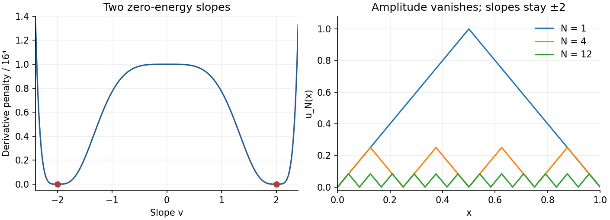

<h1 id="1/b/ii/solution">Solution</h1>

↑ **Parent:** [Ii](../ii.md)

The integrand is nonnegative. Define the [Lipschitz](../../../../../lipschitz-continuity.md) triangular waves

$$
u_N(x)=2\operatorname{dist}(x,N^{-1}\mathbb Z),\qquad0\leq x\leq1.
$$

They have zero endpoint values, slope $\pm2$ [almost everywhere](../../../../../almost-everywhere.md), and height $1/N$. Hence $(u_N'^4-16)^4=0$ [almost everywhere](../../../../../almost-everywhere.md). On each of the $N$ equal cells, direct integration of the fourth power of the two affine pieces gives $1/(5N^5)$. Therefore

$$
\boxed{I(u_N)=\frac1{5N^4}\longrightarrow0,\qquad\inf_{\mathcal A}I=0.}
$$

This is an [oscillating minimizing sequence with no minimizer](../../../../../oscillating-minimizing-sequence-with-no-minimizer.md).

**[Figure 1](#1/b/ii/image-oscillations-keep-the-derivative-at-the-two-wells-while-the-amplitude-vanishes). Oscillations keep the derivative at the two wells while the amplitude vanishes**.

## ↑ Ancestors (13)

1. [Ii](../ii.md)
2. [B](../../b.md)
3. [1](../../../1.md)
4. [2009](../../../../2009-split.md)
5. [Past exam of the calculus of variations course of the University of Oxford](../../../../split.md)
6. [Calculus of variations course of the University of Oxford](../../../../../calculus-of-variations-course-of-the-university-of-oxford.md)
7. [Year 4 of the mathematics course of the University of Oxford](../../../../../year-4-of-the-mathematics-course-of-the-university-of-oxford.md)
8. [Mathematics course of the University of Oxford](../../../../../mathematics-course-of-the-university-of-oxford.md)
9. [Undergraduate course of the University of Oxford](../../../../../undergraduate-course-of-the-university-of-oxford.md)
10. [Course of the University of Oxford](../../../../../course-of-the-university-of-oxford.md)
11. [University of Oxford](../../../../../university-of-oxford-split.md)
12. [List of universities](../../../../../list-of-universities.md)
13. [Codex Wiki](../../../../../split.md)
