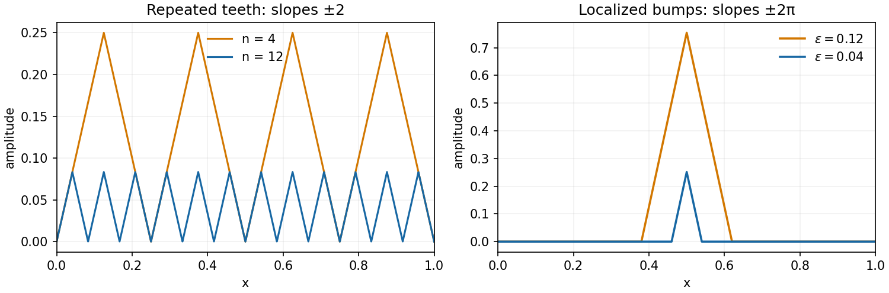

<h1 id="1/b/ii/solution">Solution</h1>

↑ **Parent:** [Ii](../ii.md)

The integrand is nonnegative, so $\inf I\geq0$. For each positive integer $n$, set

$$
u_n(x)=2\operatorname{dist}\left(x,\frac1n\mathbb Z\right),\qquad0\leq x\leq1.
$$

This is a continuous piecewise affine sawtooth with zero endpoints, $0\leq u_n\leq1/n$, and $u_n'=\pm2$ [almost everywhere](../../../../../almost-everywhere.md). It belongs to $W^{1,\infty}$, and $(u_n')^6=64$ [almost everywhere](../../../../../almost-everywhere.md). Therefore

$$
I(u_n)=\int_0^1\bigl(u_n^{2011}+4096u_n^4\bigr)\,dx
\leq n^{-2011}+4096n^{-4}\longrightarrow0.
$$

Together with nonnegativity this proves $\boxed{\inf_{\mathcal A}I=0}$. The functions converge uniformly to zero while their derivatives retain magnitude two; small amplitude does not force small [gradient](../../../../../gradient.md).

**[Figure 1](#1/b/ii/image-uniformly-small-competitors-can-retain-fixed-nonzero-slopes-repeated-teeth-and-a-shrinking-localized-bump). Uniformly small competitors can retain fixed nonzero slopes: repeated teeth and a shrinking localized bump**.

## ↑ Ancestors (13)

1. [Ii](../ii.md)
2. [B](../../b.md)
3. [1](../../../1.md)
4. [2011](../../../../2011-split.md)
5. [Past exam of the calculus of variations course of the University of Oxford](../../../../split.md)
6. [Calculus of variations course of the University of Oxford](../../../../../calculus-of-variations-course-of-the-university-of-oxford.md)
7. [Year 4 of the mathematics course of the University of Oxford](../../../../../year-4-of-the-mathematics-course-of-the-university-of-oxford.md)
8. [Mathematics course of the University of Oxford](../../../../../mathematics-course-of-the-university-of-oxford.md)
9. [Undergraduate course of the University of Oxford](../../../../../undergraduate-course-of-the-university-of-oxford.md)
10. [Course of the University of Oxford](../../../../../course-of-the-university-of-oxford.md)
11. [University of Oxford](../../../../../university-of-oxford-split.md)
12. [List of universities](../../../../../list-of-universities.md)
13. [Codex Wiki](../../../../../split.md)
