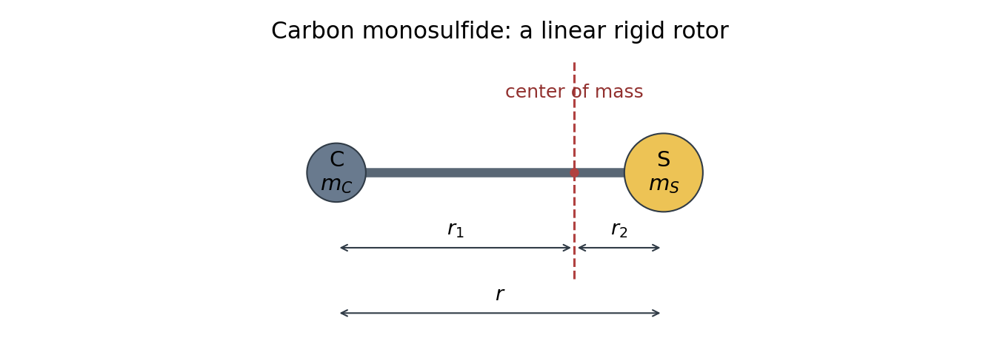

<h1 id="a3/a/i/solution">Solution</h1>

↑ **Parent:** [I](../i.md)

Place the [carbon](../../../../../../carbon.md) and [sulfur](../../../../../../sulfur.md) nuclei on a line separated by $r$, with masses $m_{\rm C}$ and $m_{\rm S}$. The [center of mass](../../../../../../center-of-mass.md) lies between them and closer to the heavier [sulfur](../../../../../../sulfur.md) nucleus. In the [linear rigid rotor](../../../../../../linear-rigid-rotor.md) approximation, $r$ remains fixed while the [molecule](../../../../../../molecule-split.md) rotates.

**[Figure 1](#a3/a/i/image-original-carbon-monosulfide-rotor-diagram-showing-masses-bond-length-and-distances-from-the-center-of-mass). Original carbon monosulfide rotor diagram showing masses, bond length and distances from the center of mass**.

## ↑ Ancestors (14)

1. [I](../i.md)
2. [A](../../a.md)
3. [A3](../../../a3.md)
4. [Paper 1](../../../../paper-1-split.md)
5. [2021](../../../../split.md)
6. [Past exam of the chemistry A course of the University of Cambridge](../../../../../split.md)
7. [Chemistry A course of the University of Cambridge](../../../../../../chemistry-a-course-of-the-university-of-cambridge.md)
8. [Year 2 of the natural sciences course of the University of Cambridge](../../../../../../year-2-of-the-natural-sciences-course-of-the-university-of-cambridge.md)
9. [Year of the natural sciences course of the University of Cambridge](../../../../../../year-of-the-natural-sciences-course-of-the-university-of-cambridge.md)
10. [Natural sciences course of the University of Cambridge](../../../../../../natural-sciences-course-of-the-university-of-cambridge.md)
11. [Course of the University of Cambridge](../../../../../../course-of-the-university-of-cambridge.md)
12. [University of Cambridge](../../../../../../university-of-cambridge-split.md)
13. [List of universities](../../../../../../list-of-universities.md)
14. [Codex Wiki](../../../../../../split.md)
