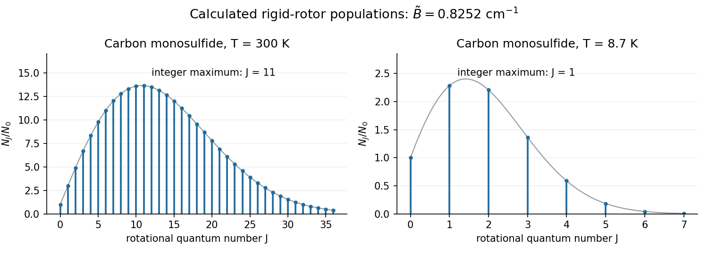

<h1 id="a3/b/i/solution">Solution</h1>

↑ **Parent:** [I](../i.md)

The [rotational state populations](../../../../../../rotational-state-populations.md) start at $N_0/N_0=1$. Their $2J+1$ [statistical weight](../../../../../../statistical-weight.md) factor initially favors higher $J$, while the [Boltzmann factor](../../../../../../boltzmann-factor.md) eventually suppresses them, producing one maximum followed by a tail tending to zero. The physically allowed values occur at integer $J$; a continuous curve only guides the eye.

**[Figure 2](#a3/b/i/image-original-linear-rigid-rotor-populations-for-carbon-monosulfide-at-300-mathrm-k-and-8-7-mathrm-k). Original linear rigid rotor populations for carbon monosulfide at $300\ \mathrm K$ and $8.7\ \mathrm K$**.

## ↑ Ancestors (14)

1. [I](../i.md)
2. [B](../../b.md)
3. [A3](../../../a3.md)
4. [Paper 1](../../../../paper-1-split.md)
5. [2021](../../../../split.md)
6. [Past exam of the chemistry A course of the University of Cambridge](../../../../../split.md)
7. [Chemistry A course of the University of Cambridge](../../../../../../chemistry-a-course-of-the-university-of-cambridge.md)
8. [Year 2 of the natural sciences course of the University of Cambridge](../../../../../../year-2-of-the-natural-sciences-course-of-the-university-of-cambridge.md)
9. [Year of the natural sciences course of the University of Cambridge](../../../../../../year-of-the-natural-sciences-course-of-the-university-of-cambridge.md)
10. [Natural sciences course of the University of Cambridge](../../../../../../natural-sciences-course-of-the-university-of-cambridge.md)
11. [Course of the University of Cambridge](../../../../../../course-of-the-university-of-cambridge.md)
12. [University of Cambridge](../../../../../../university-of-cambridge-split.md)
13. [List of universities](../../../../../../list-of-universities.md)
14. [Codex Wiki](../../../../../../split.md)
