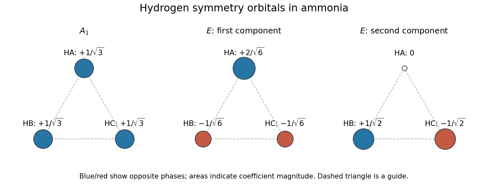

<h1 id="a4/a/iv/solution">Solution</h1>

↑ **Parent:** [Iv](../iv.md)

Neglecting intersite [orbital overlap](../../../../../../orbital-overlap.md), one normalized real set of [symmetry-adapted linear combinations](../../../../../../symmetry-adapted-linear-combination.md) is

$$
\boxed{
\begin{aligned}
\chi_{A_1}&=(s_A+s_B+s_C)/\sqrt3,\\
\chi_{E,1}&=(2s_A-s_B-s_C)/\sqrt6,\\
\chi_{E,2}&=(s_B-s_C)/\sqrt2.
\end{aligned}}
$$

The coefficient vectors are [orthonormal](../../../../../../orthonormal-set.md). The first has equal phase at all three sites; the second opposes site $A$ to $B,C$; the third has zero amplitude at $A$ and opposite phases at $B,C$. Any orthonormal rotation of the two $E$ functions is equally valid. With nonzero intersite [orbital overlap](../../../../../../orbital-overlap.md), normalization must instead use the overlap [matrix](../../../../../../matrix.md).

**[Figure 3](#a4/a/iv/image-original-coefficient-and-phase-sketches-of-the-three-hydrogen-symmetry-orbitals-in-ammonia). Original coefficient-and-phase sketches of the three hydrogen symmetry orbitals in ammonia**.

## ↑ Ancestors (14)

1. [Iv](../iv.md)
2. [A](../../a.md)
3. [A4](../../../a4.md)
4. [Paper 1](../../../../paper-1-split.md)
5. [2021](../../../../split.md)
6. [Past exam of the chemistry A course of the University of Cambridge](../../../../../split.md)
7. [Chemistry A course of the University of Cambridge](../../../../../../chemistry-a-course-of-the-university-of-cambridge.md)
8. [Year 2 of the natural sciences course of the University of Cambridge](../../../../../../year-2-of-the-natural-sciences-course-of-the-university-of-cambridge.md)
9. [Year of the natural sciences course of the University of Cambridge](../../../../../../year-of-the-natural-sciences-course-of-the-university-of-cambridge.md)
10. [Natural sciences course of the University of Cambridge](../../../../../../natural-sciences-course-of-the-university-of-cambridge.md)
11. [Course of the University of Cambridge](../../../../../../course-of-the-university-of-cambridge.md)
12. [University of Cambridge](../../../../../../university-of-cambridge-split.md)
13. [List of universities](../../../../../../list-of-universities.md)
14. [Codex Wiki](../../../../../../split.md)
