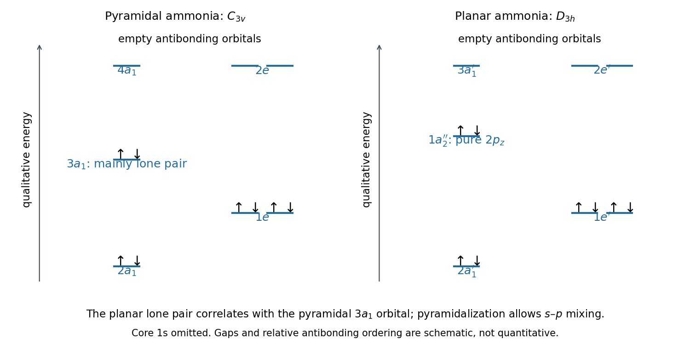

<h1 id="a4/a/v/solution">Solution</h1>

↑ **Parent:** [V](../v.md)

The hydrogen $A_1$ [symmetry orbital](../../../../../../symmetry-adapted-linear-combination.md) mixes with both [nitrogen](../../../../../../nitrogen.md) $2s$ and $2p_z$, giving three $a_1$ [molecular orbitals](../../../../../../molecular-orbital.md). The two hydrogen $E$ functions mix with $(2p_x,2p_y)$, giving a bonding $e$ pair and an antibonding $e$ pair. Eight valence [electrons](../../../../../../electron.md) fill the lower levels as

$$
\boxed{(2a_1)^2(1e)^4(3a_1)^2.}
$$

This uses conventional numbering that reserves $1a_1$ for the omitted [nitrogen](../../../../../../nitrogen.md) core $1s$ orbital. The low $2a_1$ and $1e$ levels provide the principal N–H [bonding molecular orbitals](../../../../../../bonding-orbital.md); the highest occupied $3a_1$ level is the mainly nitrogen [lone pair](../../../../../../lone-pair.md), with some bonding admixture permitted by the pyramidal geometry. Empty $4a_1$ and $2e$ levels are antibonding. Symmetry fixes which orbitals can mix, rather than their quantitative energy separations.

**[Figure 4](#a4/a/v/image-original-qualitative-ammonia-molecular-orbital-diagram-comparing-pyramidal-and-planar-geometries-the-core-orbital-is-omitted). Original qualitative ammonia molecular orbital diagram comparing pyramidal and planar geometries; the core orbital is omitted**.

## ↑ Ancestors (14)

1. [V](../v.md)
2. [A](../../a.md)
3. [A4](../../../a4.md)
4. [Paper 1](../../../../paper-1-split.md)
5. [2021](../../../../split.md)
6. [Past exam of the chemistry A course of the University of Cambridge](../../../../../split.md)
7. [Chemistry A course of the University of Cambridge](../../../../../../chemistry-a-course-of-the-university-of-cambridge.md)
8. [Year 2 of the natural sciences course of the University of Cambridge](../../../../../../year-2-of-the-natural-sciences-course-of-the-university-of-cambridge.md)
9. [Year of the natural sciences course of the University of Cambridge](../../../../../../year-of-the-natural-sciences-course-of-the-university-of-cambridge.md)
10. [Natural sciences course of the University of Cambridge](../../../../../../natural-sciences-course-of-the-university-of-cambridge.md)
11. [Course of the University of Cambridge](../../../../../../course-of-the-university-of-cambridge.md)
12. [University of Cambridge](../../../../../../university-of-cambridge-split.md)
13. [List of universities](../../../../../../list-of-universities.md)
14. [Codex Wiki](../../../../../../split.md)
