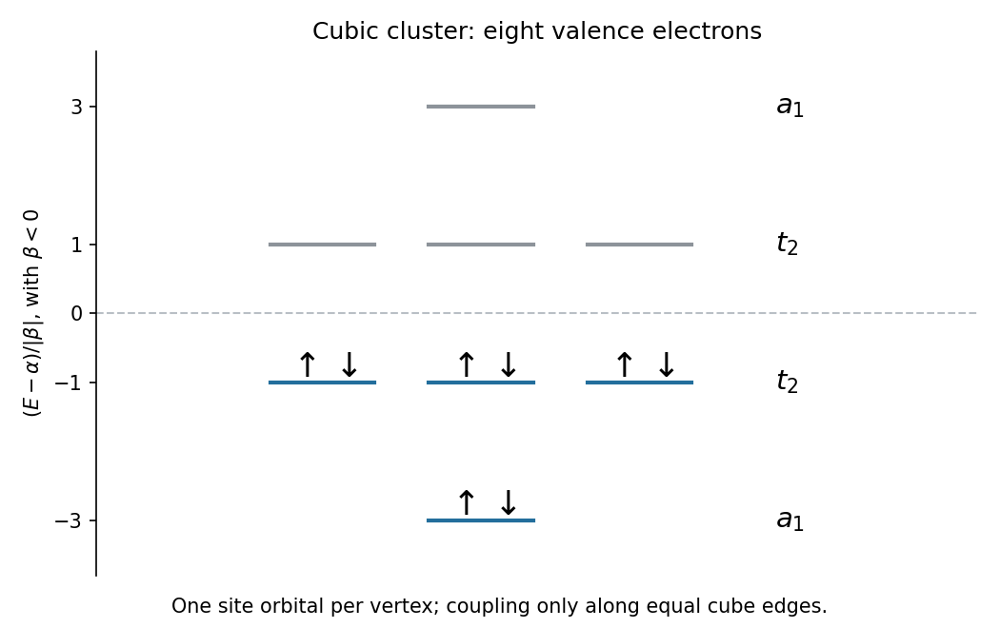

<h1 id="a5/b/iv/solution">Solution</h1>

↑ **Parent:** [Iv](../iv.md)

Use the stipulated common [Hückel Coulomb parameter](../../../../../../huckel-coulomb-parameter.md) $\alpha$, an equal [Hückel resonance integral](../../../../../../huckel-resonance-integral.md) $\beta$ along each cube edge, and zero coupling elsewhere; take an orthonormal site basis. Each lithium vertex has three sodium neighbors. The totally symmetric combinations therefore have the block

$$
H_{A_1}=\begin{pmatrix}\alpha&3\beta\\3\beta&\alpha\end{pmatrix}.
$$

For a coordinate-like $T_2$ combination, the sum of the three neighboring sodium coordinate signs equals the lithium coordinate sign. Thus each of the three equivalent blocks is

$$
H_{T_2}=\begin{pmatrix}\alpha&\beta\\\beta&\alpha\end{pmatrix}.
$$

Their [eigenvalues](../../../../../../eigenvalue.md) give the [cube nearest-neighbour Hückel model](../../../../../../cube-nearest-neighbour-huckel-model.md):

$$
\boxed{E=\alpha+3\beta\ (a_1),\quad\alpha+\beta\ (t_2),\quad
\alpha-\beta\ (t_2),\quad\alpha-3\beta\ (a_1).}
$$

For the bonding convention $\beta<0$ these are in increasing energy order, with [statistical weights](../../../../../../statistical-weight.md) $1,3,3,1$. The eight valence [electrons](../../../../../../electron.md) occupy **$(a_1)^2(t_2)^6$**, filling the four bonding spatial [molecular orbitals](../../../../../../molecular-orbital.md). Their total one-electron energy is $8\alpha+12\beta$. This is a deliberately simplified model: unequal atomic energies or unequal overlaps require a generalized calculation.

**[Figure 5](#a5/b/iv/image-original-cube-nearest-neighbour-huckel-model-energy-levels-and-eight-electron-occupancy). Original cube nearest-neighbour Hückel model energy levels and eight-electron occupancy**.

## ↑ Ancestors (14)

1. [Iv](../iv.md)
2. [B](../../b.md)
3. [A5](../../../a5.md)
4. [Paper 1](../../../../paper-1-split.md)
5. [2021](../../../../split.md)
6. [Past exam of the chemistry A course of the University of Cambridge](../../../../../split.md)
7. [Chemistry A course of the University of Cambridge](../../../../../../chemistry-a-course-of-the-university-of-cambridge.md)
8. [Year 2 of the natural sciences course of the University of Cambridge](../../../../../../year-2-of-the-natural-sciences-course-of-the-university-of-cambridge.md)
9. [Year of the natural sciences course of the University of Cambridge](../../../../../../year-of-the-natural-sciences-course-of-the-university-of-cambridge.md)
10. [Natural sciences course of the University of Cambridge](../../../../../../natural-sciences-course-of-the-university-of-cambridge.md)
11. [Course of the University of Cambridge](../../../../../../course-of-the-university-of-cambridge.md)
12. [University of Cambridge](../../../../../../university-of-cambridge-split.md)
13. [List of universities](../../../../../../list-of-universities.md)
14. [Codex Wiki](../../../../../../split.md)
