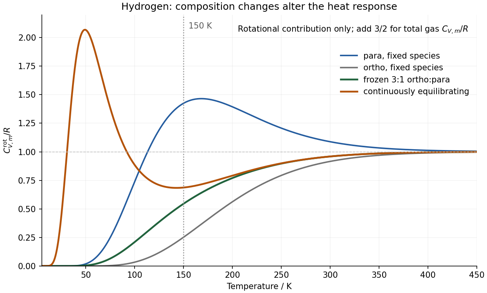
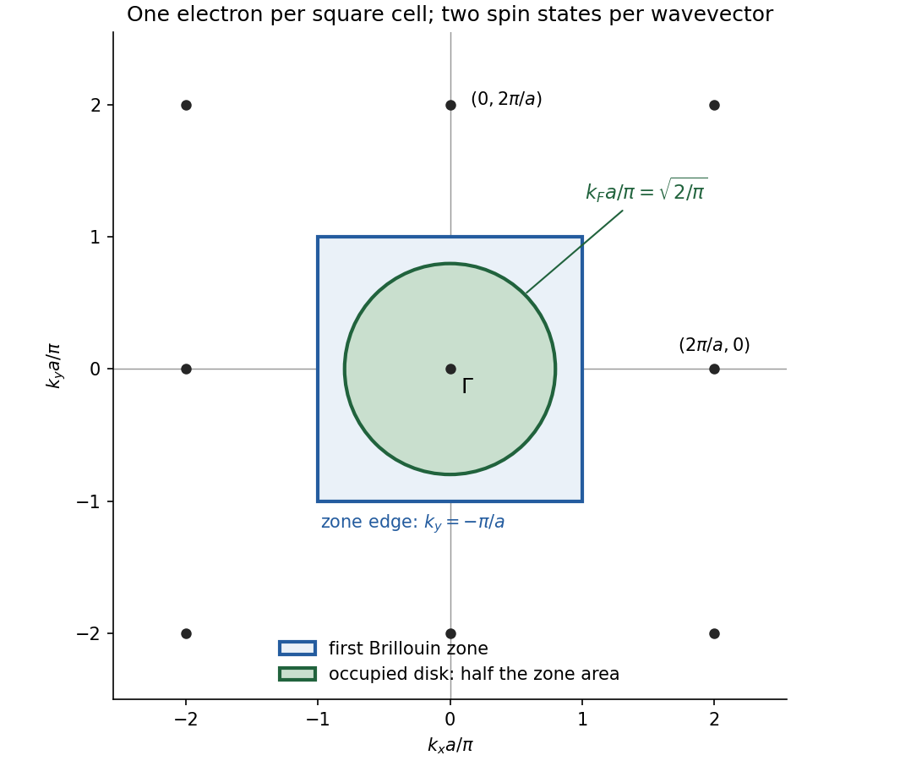

# Paper 2

↑ **Parent:** [2021](../2021.md)

[Original paper, physical pages 78–85 of the released PDF](https://www.whatdotheyknow.com/request/past_papers_for_natural_sciences/response/2258285/attach/3/FOI%202023%20126%20James%20materials%20bundle%201.pdf?cookie_passthrough=1#page=78)

**Table of contents**

- [A6](#a6)
  - [a](#a6/a)
    - [Solution](#a6/a/solution)
  - [b](#a6/b)
    - [Solution](#a6/b/solution)
  - [c](#a6/c)
    - [Solution](#a6/c/solution)
  - [d](#a6/d)
    - [Solution](#a6/d/solution)
  - [e](#a6/e)
    - [Solution](#a6/e/solution)
  - [f](#a6/f)
    - [Solution](#a6/f/solution)
- [A7](#a7)
  - [a](#a7/a)
    - [Solution](#a7/a/solution)
  - [b](#a7/b)
    - [Solution](#a7/b/solution)
  - [c](#a7/c)
    - [Solution](#a7/c/solution)
  - [d](#a7/d)
    - [Solution](#a7/d/solution)
- [A8](#a8)
  - [a](#a8/a)
    - [i](#a8/a/i)
      - [Solution](#a8/a/i/solution)
    - [ii](#a8/a/ii)
      - [Solution](#a8/a/ii/solution)
  - [b](#a8/b)
    - [i](#a8/b/i)
      - [Solution](#a8/b/i/solution)
    - [ii](#a8/b/ii)
      - [Solution](#a8/b/ii/solution)
  - [c](#a8/c)
    - [i](#a8/c/i)
      - [Solution](#a8/c/i/solution)
    - [ii](#a8/c/ii)
      - [Solution](#a8/c/ii/solution)
- [A9](#a9)
  - [a](#a9/a)
    - [i](#a9/a/i)
      - [Solution](#a9/a/i/solution)
    - [ii](#a9/a/ii)
      - [Solution](#a9/a/ii/solution)
    - [iii](#a9/a/iii)
      - [Solution](#a9/a/iii/solution)
  - [b](#a9/b)
    - [i](#a9/b/i)
      - [Solution](#a9/b/i/solution)
    - [ii](#a9/b/ii)
      - [Solution](#a9/b/ii/solution)
    - [iii](#a9/b/iii)
      - [Solution](#a9/b/iii/solution)
  - [c](#a9/c)
    - [i](#a9/c/i)
      - [Solution](#a9/c/i/solution)
    - [ii](#a9/c/ii)
      - [Solution](#a9/c/ii/solution)
    - [iii](#a9/c/iii)
      - [Solution](#a9/c/iii/solution)
- [A10](#a10)
  - [a](#a10/a)
    - [i](#a10/a/i)
      - [Solution](#a10/a/i/solution)
    - [ii](#a10/a/ii)
      - [Solution](#a10/a/ii/solution)
    - [iii](#a10/a/iii)
      - [Solution](#a10/a/iii/solution)
    - [iv](#a10/a/iv)
      - [Solution](#a10/a/iv/solution)
  - [b](#a10/b)
    - [i](#a10/b/i)
      - [Solution](#a10/b/i/solution)
    - [ii](#a10/b/ii)
      - [Solution](#a10/b/ii/solution)
    - [iii](#a10/b/iii)
      - [Solution](#a10/b/iii/solution)

## A6

↑ **Parent:** [Paper 2](paper-2.md)

<h3 id="a6/a">a</h3>

↑ **Parent:** [A6](#a6)

<h4 id="a6/a/solution">Solution</h4>

↑ **Parent:** [A](#a6/a)

Both in-plane orientations minimize the one-site [energy](../../energy.md). Since every [adsorption site](../../physical-chemistry.md#adsorption-site) is occupied, the sites label independent choices even though the molecules are chemically identical. The [ground state](../../quantum-mechanics.md#ground-state) of the whole system therefore has

$$
\boxed{U_{\min}=-N\varepsilon,\qquad\Omega_0=2^N.}
$$

The [ground-state degeneracy](../../quantum-mechanics.md#ground-state-degeneracy) is extensive: independently choosing either in-plane orientation at each site costs no [energy](../../energy.md). There is no extra vacancy or free-translational contribution in this model.

<h3 id="a6/b">b</h3>

↑ **Parent:** [A6](#a6)

<h4 id="a6/b/solution">Solution</h4>

↑ **Parent:** [B](#a6/b)

Write $\beta=(k_{\rm B}T)^{-1}$ and $x=\beta\delta$. The one-site [partition function](../../canonical-ensemble.md#canonical-partition-function) includes both degenerate lower states,

$$
q=e^{\beta\varepsilon}(2+e^{-x}).
$$

The occupied [adsorption sites](../../physical-chemistry.md#adsorption-site) are distinguishable positions, so the [canonical partition function](../../canonical-ensemble.md#canonical-partition-function) is a product, **without an additional $N!$ divisor**:

$$
\boxed{Z_N=q^N=e^{\beta N\varepsilon}(2+e^{-\beta\delta})^N.}
$$

Differentiating $\ln Z_N$ gives the [internal energy](../../internal-energy.md),

$$
\boxed{U=-\left(\frac{\partial\ln Z_N}{\partial\beta}\right)_N
=-N\varepsilon+\frac{N\delta e^{-\beta\delta}}{2+e^{-\beta\delta}}
=-N\varepsilon+\frac{N\delta}{1+2e^{\beta\delta}}.}
$$

The final factor is the population of the perpendicular orientation. The shared binding offset $-\varepsilon$ shifts all [energy levels](../../quantum-mechanics.md#energy-level) equally and does not determine their relative populations.

<h3 id="a6/c">c</h3>

↑ **Parent:** [A6](#a6)

<h4 id="a6/c/solution">Solution</h4>

↑ **Parent:** [C](#a6/c)

At low [temperature](../../temperature.md), the upper orientation has negligible [Boltzmann weight](../../canonical-ensemble.md#boltzmann-factor), whereas at high [temperature](../../temperature.md) all three orientations become equally probable. Consequently

$$
\boxed{U(0)=-N\varepsilon,\qquad U(\infty)=-N\varepsilon+\frac{N\delta}{3}.}
$$

The high-temperature limit is a finite arithmetic mean of three available one-site [energy levels](../../quantum-mechanics.md#energy-level). It is not an unbounded translational or rotational [equipartition](../../canonical-ensemble.md#equipartition-theorem) contribution: the prescribed site model has only three states per molecule. Their common binding offset can keep this limiting [internal energy](../../internal-energy.md) negative without any inconsistency.

<h3 id="a6/d">d</h3>

↑ **Parent:** [A6](#a6)

<h4 id="a6/d/solution">Solution</h4>

↑ **Parent:** [D](#a6/d)

For $k_{\rm B}T\gg\delta$, the [Boltzmann factors](../../canonical-ensemble.md#boltzmann-factor) of the orientations become almost equal, giving $3^N$ nearly equiprobable [microstates](../../statistical-physics.md#microstate). The [Boltzmann entropy](../../entropy.md#boltzmann-s-entropy-formula) of that distribution approaches

$$
\boxed{S_{\max}=Nk_{\rm B}\ln3.}
$$

**The exact limiting value is reached only as $T\to\infty$** for a nonzero splitting. The useful crossover scale is $T\sim\delta/k_{\rm B}$; one needs $T\gg\delta/k_{\rm B}$ for a good saturation approximation. The binding offset $\varepsilon$ is not an additional population scale here because all sites remain occupied and it shifts every orientation equally.

<h3 id="a6/e">e</h3>

↑ **Parent:** [A6](#a6)

<h4 id="a6/e/solution">Solution</h4>

↑ **Parent:** [E](#a6/e)

Using $dx/dT=-x/T$ in the [internal energy](../../internal-energy.md) gives

$$
\boxed{C_V=Nk_{\rm B}\frac{2x^2e^{-x}}{(2+e^{-x})^2},\qquad x=\frac{\delta}{k_{\rm B}T}.}
$$

This is a [Schottky anomaly with unequal degeneracies](../../heat.md#schottky-anomaly-with-unequal-degeneracies), with lower-level [state degeneracy](../../statistical-physics.md#state-degeneracy) two and upper-level [state degeneracy](../../statistical-physics.md#state-degeneracy) one. Its limiting forms are

$$
\boxed{C_V\sim\frac{Nk_{\rm B}}2x^2e^{-x}\quad(T\to0),\qquad
C_V\sim\frac{2Nk_{\rm B}}9x^2\quad(T\to\infty).}
$$

It vanishes at low [temperature](../../temperature.md) because exciting the upper orientation is exponentially unlikely. It also vanishes at high [temperature](../../temperature.md) because the populations have nearly saturated and further heating hardly changes the [internal energy](../../internal-energy.md). Between these limits it has one smooth maximum. The original plot shows its shape; numerical maximization gives $k_{\rm B}T_{\max}/\delta\simeq0.449$ and $C_{\max}/(Nk_{\rm B})\simeq0.241$.

**[Figure 1](#a6/e/image-original-heat-capacity-peak-and-entropy-limits-for-two-lower-orientations-and-one-excited-orientation). Original heat-capacity peak and entropy limits for two lower orientations and one excited orientation**.

<h3 id="a6/f">f</h3>

↑ **Parent:** [A6](#a6)

<h4 id="a6/f/solution">Solution</h4>

↑ **Parent:** [F](#a6/f)

Only the two lower orientations remain populated, giving $2^N$ equiprobable [microstates](../../statistical-physics.md#microstate). Thus

$$
\boxed{\lim_{T\to0}S=Nk_{\rm B}\ln2.}
$$

This [residual entropy](../../entropy.md#residual-entropy) follows from the stipulated independent-site [ground-state degeneracy](../../quantum-mechanics.md#ground-state-degeneracy). The zero-entropy version of the [third law of thermodynamics](../../thermodynamics.md#third-law-of-thermodynamics) presupposes a unique ordered [ground state](../../quantum-mechanics.md#ground-state); that assumption does not hold here. Intermolecular interactions or a small splitting of the two in-plane states could remove this degeneracy, but they are excluded from the given model.

## A7

↑ **Parent:** [Paper 2](paper-2.md)

<h3 id="a7/a">a</h3>

↑ **Parent:** [A7](#a7)

<h4 id="a7/a/solution">Solution</h4>

↑ **Parent:** [A](#a7/a)

Let $\Lambda=h/\sqrt{2\pi mk_{\rm B}T}$ be the [thermal de Broglie wavelength](../../canonical-ensemble.md#thermal-de-broglie-wavelength). The two free momentum components of one adsorbed atom give the phase-space integral

$$
q_{\rm trans}^{(2)}=\frac1{h^2}\int_{\sigma}d^2r\int_{\mathbb R^2}dp_x\,dp_y\,
e^{-\beta(p_x^2+p_y^2)/(2m)}
=\frac{\sigma}{h^2}(2\pi mk_{\rm B}T).
$$

Each momentum integral is a [Gaussian integral](../../integral.md#gaussian-integral), so

$$
\boxed{q_{\rm trans}^{(2)}=\frac{\sigma}{\Lambda^2},\qquad
Z_N^{(2)}=\frac1{N!}\left(\frac{\sigma}{\Lambda^2}\right)^N.}
$$

The second expression is the [classical ideal-gas partition function](../../canonical-ensemble.md#classical-ideal-gas-partition-function) for mobile, indistinguishable surface atoms. Its validity requires a dilute nondegenerate gas, $N\Lambda^2/\sigma\ll1$, and neglects interactions and excited motion normal to the surface. The $N!$ appears here because particles move between positions, unlike the fully occupied fixed-site model of A6.

<h3 id="a7/b">b</h3>

↑ **Parent:** [A7](#a7)

<h4 id="a7/b/solution">Solution</h4>

↑ **Parent:** [B](#a7/b)

For the same atoms in a three-dimensional volume $V$, the one-atom [translational partition function](../../canonical-ensemble.md#translational-partition-function) is $q_{\rm trans}^{(3)}=V/\Lambda^3$. Comparing the same $N$ atoms at the same [temperature](../../temperature.md) cancels the common $N!$ in their [canonical partition functions](../../canonical-ensemble.md#canonical-partition-function). Therefore the molar [adsorption confinement free energy](../../physical-chemistry.md#adsorption-confinement-free-energy), with the sign defined as adsorbed minus free, is

$$
\boxed{\Delta F_m^{\rm trans}=-RT\ln\frac{q_{\rm trans}^{(2)}}{q_{\rm trans}^{(3)}}
=RT\ln\frac{V}{\sigma\Lambda}.}
$$

The logarithm is dimensionless: $V/\sigma$ and $\Lambda$ are both lengths. For a macroscopic gas depth $V/\sigma\gg\Lambda$, confinement **raises the translational [Helmholtz free energy](../../thermodynamic-potential.md#helmholtz-free-energy)**. Equivalently, the translational state count is reduced by a factor $\sigma\Lambda/V$ per atom. The question supplies neither a volume nor an adsorption binding [energy](../../energy.md), so this answer is symbolic and describes the confinement cost, not a numerical net adsorption free [energy](../../energy.md).

For example, a binding [energy](../../energy.md) $D>0$ per atom would supply a separate $-N_{\rm A}D$ to $\Delta F_m$, together with any normal-motion internal contribution retained by a more detailed model. Adsorption can then be favourable despite the loss of free translational phase space. Merely calling the change a loss must not reverse the sign of the explicitly defined $F_{\rm ads}-F_{\rm gas}$.

<h3 id="a7/c">c</h3>

↑ **Parent:** [A7](#a7)

<h4 id="a7/c/solution">Solution</h4>

↑ **Parent:** [C](#a7/c)

A [planar rigid rotor](../../molecule.md#planar-rigid-rotor) has angular eigenfunctions $e^{im\phi}$ and single-valuedness imposes $m=0,\pm1,\pm2,\ldots$. Its [energy](../../energy.md) depends on $m^2$, so if the level is labelled by $J=|m|$, then

$$
\boxed{J=0,1,2,\ldots;\qquad g_0=1,\quad g_J=2\ (J\ge1).}
$$

The two states at $J>0$ represent opposite directions of [angular momentum](../../momentum.md#angular-momentum). If the signed [quantum number](../../quantum-system.md#quantum-number) itself is called $J$, each signed state is counted once instead; one must not both sum over both signs and multiply by two again.

For an unrestricted three-dimensional [linear rigid rotor](../../molecule.md#linear-rigid-rotor), $J=0,1,2,\ldots$ has $M=-J,\ldots,J$ and [state degeneracy](../../statistical-physics.md#state-degeneracy) $2J+1$, with $E_J=\hbar^2J(J+1)/(2I)$. Planar confinement removes one rotational coordinate and changes both the spectrum and degeneracy. These are the spatial counts before [nuclear spin statistics](../../tensor-product-of-quantum-systems.md#nuclear-spin-statistics). For homonuclear [hydrogen](../../chemical-substance.md#hydrogen), the allowed even/odd spatial states must also be paired with the appropriate [parahydrogen](../../molecule.md#parahydrogen) or [orthohydrogen](../../molecule.md#orthohydrogen) nuclear states, as considered explicitly in A8.

<h3 id="a7/d">d</h3>

↑ **Parent:** [A7](#a7)

<h4 id="a7/d/solution">Solution</h4>

↑ **Parent:** [D](#a7/d)

Define $\theta_{\rm rot}=\hbar^2/(2Ik_{\rm B})$. Summing the spatial states counted in part (c),

$$
q_{\rm planar}^{\rm labelled}=\sum_{m=-\infty}^{\infty}e^{-m^2\theta_{\rm rot}/T}
=1+2\sum_{J=1}^{\infty}e^{-J^2\theta_{\rm rot}/T}.
$$

When $T\gg\theta_{\rm rot}$ the closely spaced terms can be replaced by a [Gaussian integral](../../integral.md#gaussian-integral):

$$
\boxed{q_{\rm planar}^{\rm labelled}\simeq\int_{-\infty}^{\infty}
e^{-m^2\theta_{\rm rot}/T}\,dm
=\sqrt{\frac{\pi T}{\theta_{\rm rot}}}
=\frac{\sqrt{8\pi^3Ik_{\rm B}T}}h.}
$$

Here labelled means that the two ends of the molecular axis were distinguished in the angular count. In the usual high-temperature molecular convention that removes equivalent orientations and factors out nuclear-spin multiplicity, divide by the [rotational symmetry number](../../molecule.md#rotational-symmetry-number) $s=2$ for homonuclear [hydrogen](../../chemical-substance.md#hydrogen):

$$
\boxed{q_{\rm rot}^{\rm planar}\simeq\frac1s\sqrt{\frac{\pi T}{\theta_{\rm rot}}},\qquad s=2.}
$$

The full exact [spin isomers of hydrogen](../../molecule.md#spin-isomers-of-hydrogen) count is instead the even-$m$ spatial sum plus three times the odd-$m$ sum; its high-temperature limit is $2\sqrt{\pi T/\theta_{\rm rot}}$, including the four nuclear-spin states. These conventions differ only by temperature-independent factors in this limit. All give $U_{\rm rot,m}=RT/2$ and $C_{V,m}^{\rm rot}=R/2$, consistent with one quadratic rotational degree of freedom. By comparison, the free [linear rigid rotor](../../molecule.md#linear-rigid-rotor) has $q_{\rm rot}\propto T$ and $C_{V,m}^{\rm rot}=R$.

## A8

↑ **Parent:** [Paper 2](paper-2.md)

<h3 id="a8/a">a</h3>

↑ **Parent:** [A8](#a8)

<h4 id="a8/a/i">i</h4>

↑ **Parent:** [A](#a8/a)

<h5 id="a8/a/i/solution">Solution</h5>

↑ **Parent:** [I](#a8/a/i)

The two [protons](../../physics.md#proton) are identical spin-one-half [fermions](../../tensor-product-of-quantum-systems.md#fermion), so the total state is antisymmetric under exchange. In the electronic and vibrational [ground state](../../quantum-mechanics.md#ground-state), an even rotational $J$ has a symmetric spatial wavefunction and therefore uses the antisymmetric nuclear-spin [singlet state](../../angular-momentum-operator.md#singlet-state); odd $J$ uses the symmetric [triplet state](../../angular-momentum-operator.md#spin-one-half-triplet-state). Thus [parahydrogen](../../molecule.md#parahydrogen) has one nuclear-spin state, and [orthohydrogen](../../molecule.md#orthohydrogen) has three. Each rotational level also has spatial [state degeneracy](../../statistical-physics.md#state-degeneracy) $2J+1$.

The [translational partition functions](../../canonical-ensemble.md#translational-partition-function) and all common electronic/vibrational factors cancel in the ratio of equilibrium populations. Using the same zero of [energy](../../energy.md) for the two [spin](../../angular-momentum-operator.md#spin) species gives

$$
\boxed{K=\frac{n_o}{n_p}=\frac{q_o}{q_p}
=\frac{3\sum_{J\ {\rm odd}}(2J+1)e^{-J(J+1)\theta_{\rm rot}/T}}
{\sum_{J\ {\rm even}}(2J+1)e^{-J(J+1)\theta_{\rm rot}/T}}.}
$$

Subtracting the $J=1$ [energy](../../energy.md) separately from all odd levels without restoring that offset in the equilibrium ratio would incorrectly remove the low-temperature preference for [parahydrogen](../../molecule.md#parahydrogen). The [nuclear spin statistics](../../tensor-product-of-quantum-systems.md#nuclear-spin-statistics) account for the factor three, independently of the spatial factor $2J+1$.

<h4 id="a8/a/ii">ii</h4>

↑ **Parent:** [A](#a8/a)

<h5 id="a8/a/ii/solution">Solution</h5>

↑ **Parent:** [Ii](#a8/a/ii)

At low [temperature](../../temperature.md), retain $J=0$ in the even sum and $J=1$ in the odd sum. Their weights are respectively $1$ and $3e^{-2\theta_{\rm rot}/T}$ before the nuclear-spin multiplicity, so

$$
\boxed{K\simeq9e^{-2\theta_{\rm rot}/T}\longrightarrow0\qquad(T\ll\theta_{\rm rot}).}
$$

Equilibrium [hydrogen](../../chemical-substance.md#hydrogen) then becomes almost entirely [parahydrogen](../../molecule.md#parahydrogen). At high [temperature](../../temperature.md), many even and odd rotational levels contribute, and their spatial sums have the same leading value. Hence

$$
\boxed{K\longrightarrow3,\qquad x_o\longrightarrow\frac34,\quad x_p\longrightarrow\frac14
\qquad(T\gg\theta_{\rm rot}).}
$$

This is [normal hydrogen](../../molecule.md#normal-hydrogen). Its familiar high-temperature ratio is a nuclear-spin multiplicity ratio, not the $9:1$ ratio of the two lowest levels. Maintaining conversion is essential: a sample cooled without an effective conversion mechanism can retain its earlier composition instead of following $K(T)$. NBS thermodynamic data distinguish equilibrium composition from [normal hydrogen](../../molecule.md#normal-hydrogen) and compare the state-sum prediction with spectroscopic and thermal evidence.[Section III.2, printed pp. 394–395 and table 12: ortho–para equilibrium and its experimental checks](../../chemistry-bibliography.md#compilation-of-thermal-properties-of-hydrogen-in-its-various-isotopic-and-ortho-para-modifications-by-harold-w-woolley-and-others)

<h3 id="a8/b">b</h3>

↑ **Parent:** [A8](#a8)

<h4 id="a8/b/i">i</h4>

↑ **Parent:** [B](#a8/b)

<h5 id="a8/b/i/solution">Solution</h5>

↑ **Parent:** [I](#a8/b/i)

For a fixed number of non-interacting molecules, $Z_N=q^N/N!$ in the dilute [ideal gas](../../ideal-gas.md) limit. The temperature-independent factorial drops out of the [internal energy](../../internal-energy.md) derivative:

$$
U_m=RT^2\left(\frac{\partial\ln q}{\partial T}\right)_V.
$$

Differentiate once more at fixed volume to obtain

$$
\boxed{\frac{C_{V,m}}R=2T\frac{q'}q
+T^2\left[\frac{q''}q-\left(\frac{q'}q\right)^2\right]
=\frac{d}{dT}\left(T^2\frac{d\ln q}{dT}\right).}
$$

Primes denote fixed-volume derivatives. If $q$ factorizes into translational, rotational and other independent contributions, their [heat capacities](../../heat.md#heat-capacity) add. In particular, the three-dimensional translational factor contributes $3R/2$, while a constant [spin degeneracy](../../statistical-physics.md#spin-degeneracy) factor contributes zero. The formula also follows from the positive [canonical energy variance](../../canonical-ensemble.md#canonical-energy-variance), $C_V=\operatorname{Var}(E)/(k_{\rm B}T^2)$.

<h4 id="a8/b/ii">ii</h4>

↑ **Parent:** [B](#a8/b)

<h5 id="a8/b/ii/solution">Solution</h5>

↑ **Parent:** [Ii](#a8/b/ii)

For a high-temperature [linear rigid rotor](../../molecule.md#linear-rigid-rotor), $q_{\rm rot}=T/\theta_{\rm rot}$ up to temperature-independent symmetry/[spin](../../angular-momentum-operator.md#spin) factors. Therefore $q'/q=1/T$ and $q''=0$, giving

$$
\boxed{\frac{C_{V,m}^{\rm rot}}R=0-1+2=1.}
$$

This agrees with the [equipartition theorem](../../canonical-ensemble.md#equipartition-theorem) for two quadratic rotational coordinates. It is the rotational contribution; adding free three-dimensional translation gives $C_{V,m}=5R/2$ when vibrations remain unexcited. A constant [rotational symmetry number](../../molecule.md#rotational-symmetry-number) does not affect this derivative.

<h3 id="a8/c">c</h3>

↑ **Parent:** [A8](#a8)

<h4 id="a8/c/i">i</h4>

↑ **Parent:** [C](#a8/c)

<h5 id="a8/c/i/solution">Solution</h5>

↑ **Parent:** [I](#a8/c/i)

Apply part (b) to each supplied rotational sum. Multiplying the odd sum by its constant nuclear-spin factor three does not change $q'/q$ or $q''/q$. At the specified [temperature](../../temperature.md) the dimensionless rotational contributions are

$$
\begin{aligned}
\frac{C_{V,m,p}^{\rm rot}}R
&=\frac{22500(3.58\times10^{-5})}{1.165}
-22500\left(\frac{3.76\times10^{-3}}{1.165}\right)^2
+\frac{300(3.76\times10^{-3})}{1.165}
\simeq1.4253,\\
\frac{C_{V,m,o}^{\rm rot}}R
&=\frac{22500(-3.08\times10^{-5})}{0.970}
-22500\left(\frac{7.64\times10^{-3}}{0.970}\right)^2
+\frac{300(7.64\times10^{-3})}{0.970}
\simeq0.25265.
\end{aligned}
$$

Thus the **rotational [heat capacities](../../heat.md#heat-capacity) are $1.425R$ for [parahydrogen](../../molecule.md#parahydrogen) and $0.253R$ for [orthohydrogen](../../molecule.md#orthohydrogen)**. For the total gas [heat capacities](../../heat.md#heat-capacity), including translation and neglecting vibration,

$$
\boxed{C_{V,m,p}\simeq2.925R,\qquad C_{V,m,o}\simeq1.753R.}
$$

The difference is substantial because the permitted rotational ladders differ. The para ladder starts at $J=0$ and next reaches $J=2$, separated by $6k_{\rm B}\theta_{\rm rot}$; its excited population is changing appreciably here. The ortho ladder starts at $J=1$ and next reaches $J=3$, a larger separation of $10k_{\rm B}\theta_{\rm rot}$, so much of the ortho population remains in its lowest rotational manifold. A rotational contribution greater than $R$ is possible in the intermediate quantum regime and is not a violation of high-temperature [equipartition](../../canonical-ensemble.md#equipartition-theorem).

<h4 id="a8/c/ii">ii</h4>

↑ **Parent:** [C](#a8/c)

<h5 id="a8/c/ii/solution">Solution</h5>

↑ **Parent:** [Ii](#a8/c/ii)

For a [frozen ortho-para mixture](../../molecule.md#frozen-ortho-para-mixture), the mole fractions do not change during the heat measurement, and the molar [heat capacity](../../heat.md#heat-capacity) is the composition-weighted average. A high-temperature composition retained on cooling has $x_o=3/4$, $x_p=1/4$, so

$$
\boxed{\frac{C_{V,m}^{\rm rot}}R=\tfrac14(1.425284)+\tfrac34(0.252645)
\simeq0.54581,\qquad C_{V,m}\simeq2.04581R.}
$$

For a mixture that **continues to interconvert and remain in equilibrium** near the specified [temperature](../../temperature.md), use the combined rotational sum and differentiate that sum:

$$
q_{\rm eq}=q_{\rm even}+3q_{\rm odd}=4.075,\qquad
q_{\rm eq}'=0.02668\ {\rm K}^{-1},\qquad
q_{\rm eq}''=-5.66\times10^{-5}\ {\rm K}^{-2}.
$$

Consequently

$$
\boxed{\frac{C_{V,m,\rm eq}^{\rm rot}}R
=\frac{22500(-5.66\times10^{-5})}{4.075}
-22500\left(\frac{0.02668}{4.075}\right)^2
+\frac{300(0.02668)}{4.075}
\simeq0.68716,\qquad C_{V,m,\rm eq}\simeq2.18716R.}
$$

The equilibrium composition itself is $K=3(0.970)/1.165\simeq2.4979$, giving $x_o\simeq0.71411$. Its changing composition supplies a further positive [heat capacity](../../heat.md#heat-capacity): warming converts some lower-energy para molecules into higher-energy ortho molecules. One can isolate this term as

$$
\frac{C_{V,m,\rm eq}^{\rm rot}}R
=x_p\frac{C_{V,m,p}^{\rm rot}}R+x_o\frac{C_{V,m,o}^{\rm rot}}R
+T^2x_px_o\left(\frac{q_{\rm odd}'}{q_{\rm odd}}-\frac{q_{\rm even}'}{q_{\rm even}}\right)^2.
$$

For clarity, if a mixture is first equilibrated at this [temperature](../../temperature.md) and then its composition is frozen during measurement, the conversion term is absent: its rotational value is $0.58789R$ and its total value is $2.08789R$. This is distinct from the [equilibrium heat capacity of interconverting states](../../heat.md#equilibrium-heat-capacity-of-interconverting-states) even though the instantaneous composition is the same. An experiment must specify conversion activity and equilibration time; compare sufficiently slow [temperature](../../temperature.md) steps with a conversion catalyst against a composition-preserving sample, while keeping the same thermal background and checking that the sample has reached the stated [temperature](../../temperature.md).

**[Figure 2](#a8/c/ii/image-original-ideal-rotor-heat-capacities-showing-the-difference-between-frozen-normal-hydrogen-and-continuously-equilibrating-hydrogen). Original ideal-rotor heat capacities showing the difference between frozen normal hydrogen and continuously equilibrating hydrogen**.

## A9

↑ **Parent:** [Paper 2](paper-2.md)

<h3 id="a9/a">a</h3>

↑ **Parent:** [A9](#a9)

<h4 id="a9/a/i">i</h4>

↑ **Parent:** [A](#a9/a)

<h5 id="a9/a/i/solution">Solution</h5>

↑ **Parent:** [I](#a9/a/i)

For the [free electron model](../../physics.md#free-electron-model), the **[Fermi energy](../../quantum-ideal-gas-statistics.md#fermi-energy) is the highest occupied one-electron [energy](../../energy.md) at zero [temperature](../../temperature.md)**, measured relative to the bottom of the free-electron band. The occupied [wavevectors](../../elasticity-physics.md#wavevector) fill a disk in two dimensions or a sphere in three dimensions. The radius is the **[Fermi wavevector](../../quantum-ideal-gas-statistics.md#fermi-wavevector) $k_F$**, with

$$
\boxed{E_F=\frac{\hbar^2k_F^2}{2m_e}.}
$$

Each allowed [wavevector](../../elasticity-physics.md#wavevector) has two [spin](../../angular-momentum-operator.md#spin) states. At nonzero [temperature](../../temperature.md), the [Fermi-Dirac distribution](../../quantum-ideal-gas-statistics.md#fermi-dirac-distribution) rounds the occupation boundary; the zero-temperature [Fermi energy](../../quantum-ideal-gas-statistics.md#fermi-energy) remains a useful density-defined scale and should not be defined as the thermal [energy](../../energy.md) $k_{\rm B}T$.

<h4 id="a9/a/ii">ii</h4>

↑ **Parent:** [A](#a9/a)

<h5 id="a9/a/ii/solution">Solution</h5>

↑ **Parent:** [Ii](#a9/a/ii)

Metallic atomic densities place very many [electrons](../../physics.md#electron) in a small volume. The [Pauli exclusion principle](../../tensor-product-of-quantum-systems.md#pauli-exclusion-principle) prevents all these [fermions](../../tensor-product-of-quantum-systems.md#fermion) occupying the lowest spatial state, so filling the available states produces a [Fermi energy](../../quantum-ideal-gas-statistics.md#fermi-energy) of order electronvolts. At room [temperature](../../temperature.md), $k_{\rm B}T\simeq0.026\ {\rm eV}$, much smaller than that scale. Equivalently, **ordinary metals are at $T\ll T_F=E_F/k_{\rm B}$**, where $T_F$ is the [Fermi temperature](../../quantum-ideal-gas-statistics.md#fermi-temperature). Their [electrons](../../physics.md#electron) are quantum degenerate even at ordinary laboratory temperatures.

<h4 id="a9/a/iii">iii</h4>

↑ **Parent:** [A](#a9/a)

<h5 id="a9/a/iii/solution">Solution</h5>

↑ **Parent:** [Iii](#a9/a/iii)

Let $\mathcal A$ be the total two-dimensional area. There are $\mathcal A/(2\pi)^2$ [wavevector](../../elasticity-physics.md#wavevector) states per reciprocal-space area per [spin](../../angular-momentum-operator.md#spin). Including [spin degeneracy](../../statistical-physics.md#spin-degeneracy) two and filling a disk gives

$$
N_e=2\frac{\mathcal A}{(2\pi)^2}\pi k_F^2
=\frac{\mathcal A k_F^2}{2\pi}.
$$

For areal [number density](../../statistical-physics.md#number-density) $n_e=N_e/\mathcal A$ this yields

$$
\boxed{k_F=\sqrt{2\pi n_e},\qquad E_F=\frac{\pi\hbar^2 n_e}{m_e}.}
$$

The disk is centred at zero [wavevector](../../elasticity-physics.md#wavevector), and its boundary is a [fermi circle](../../fermi-liquid.md#fermi-circle). Omitting the two [spin](../../angular-momentum-operator.md#spin) states would incorrectly double the [energy](../../energy.md) inferred for a given [number density](../../statistical-physics.md#number-density).

<h3 id="a9/b">b</h3>

↑ **Parent:** [A9](#a9)

<h4 id="a9/b/i">i</h4>

↑ **Parent:** [B](#a9/b)

<h5 id="a9/b/i/solution">Solution</h5>

↑ **Parent:** [I](#a9/b/i)

Using $M_{\rm Au}\simeq196.97\ {\rm g\,mol^{-1}}$ and the [Avogadro constant](../../physics.md#avogadro-constant), the areal atom count is

$$
n_{\rm Au}=\frac{1.56\times10^{-6}\ {\rm g}}{196.97\ {\rm g\,mol^{-1}}}
\frac{6.02214\times10^{23}\ {\rm mol^{-1}}}{10^{-4}\ {\rm m^2}}
\simeq4.77\times10^{19}\ {\rm m^{-2}}.
$$

One atom occupies each square cell of area $a^2$, so the inferred [square lattice](../../graph.md#square-lattice) spacing is

$$
\boxed{a=n_{\rm Au}^{-1/2}\simeq1.45\times10^{-10}\ {\rm m}=0.145\ {\rm nm}.}
$$

This uses the given deposited [mass](../../classical-mechanics.md#mass) and the assumed single square layer; it does not substitute a bulk [gold](../../chemical-substance.md#gold) lattice parameter for the measured areal count.

<h4 id="a9/b/ii">ii</h4>

↑ **Parent:** [B](#a9/b)

<h5 id="a9/b/ii/solution">Solution</h5>

↑ **Parent:** [Ii](#a9/b/ii)

One mobile [electron](../../physics.md#electron) per [gold](../../chemical-substance.md#gold) atom gives

$$
\boxed{n_e=n_{\rm Au}\simeq4.77\times10^{19}\ {\rm electrons\,m^{-2}}.}
$$

This is an areal [number density](../../statistical-physics.md#number-density); no layer thickness is required and it should not be converted into a volume density for the two-dimensional model.

<h4 id="a9/b/iii">iii</h4>

↑ **Parent:** [B](#a9/b)

<h5 id="a9/b/iii/solution">Solution</h5>

↑ **Parent:** [Iii](#a9/b/iii)

Substitution in part (a) gives

$$
\boxed{k_F=\sqrt{2\pi(4.77\times10^{19})}\simeq1.73\times10^{10}\ {\rm m^{-1}},}
$$

and

$$
\boxed{E_F=\frac{\pi\hbar^2(4.77\times10^{19})}{m_e}
\simeq1.83\times10^{-18}\ {\rm J}\simeq11.4\ {\rm eV}.}
$$

The conversion uses $1\ {\rm eV}=1.60218\times10^{-19}\ {\rm J}$. These are the predictions of the stipulated two-dimensional [free electron model](../../physics.md#free-electron-model), with the vacuum [electron mass](../../physics.md#electron-mass) and one carrier per inferred square cell.

<h3 id="a9/c">c</h3>

↑ **Parent:** [A9](#a9)

<h4 id="a9/c/i">i</h4>

↑ **Parent:** [C](#a9/c)

<h5 id="a9/c/i/solution">Solution</h5>

↑ **Parent:** [I](#a9/c/i)

The [reciprocal lattice](../../quantum-scattering.md#reciprocal-lattice) is generated by

$$
\boxed{\mathbf b_1=\frac{2\pi}{a}\hat{\mathbf x},\qquad
\mathbf b_2=\frac{2\pi}{a}\hat{\mathbf y},\qquad
\mathbf G_{hk}=h\mathbf b_1+k\mathbf b_2.}
$$

Its points are spaced by $2\pi/a$ along both reciprocal axes. Perpendicular bisectors between the origin and its four nearest reciprocal neighbours enclose the [first Brillouin zone](../../bloch-s-theorem.md#first-brillouin-zone),

$$
\boxed{-\frac\pi a\le k_x\le\frac\pi a,\qquad
-\frac\pi a\le k_y\le\frac\pi a.}
$$

The original drawing labels both the reciprocal-lattice spacing and the nearer zone boundaries. Its shaded disk is the occupied region for one [electron](../../physics.md#electron) per real-space cell.

**[Figure 3](#a9/c/i/image-original-square-reciprocal-lattice-first-brillouin-zone-and-half-filled-spin-degenerate-fermi-disk). Original square reciprocal lattice, first Brillouin zone and half-filled spin-degenerate Fermi disk**.

<h4 id="a9/c/ii">ii</h4>

↑ **Parent:** [C](#a9/c)

<h5 id="a9/c/ii/solution">Solution</h5>

↑ **Parent:** [Ii](#a9/c/ii)

For one [electron](../../physics.md#electron) per square cell, $n_e=1/a^2$, so

$$
\boxed{\frac{k_F}{\pi/a}=\sqrt{\frac2\pi}\simeq0.7979<1.}
$$

Numerically, $\pi/a\simeq2.17\times10^{10}\ {\rm m^{-1}}$ exceeds $k_F\simeq1.73\times10^{10}\ {\rm m^{-1}}$, so the [fermi circle](../../fermi-liquid.md#fermi-circle) lies entirely inside the [first Brillouin zone](../../bloch-s-theorem.md#first-brillouin-zone).

The state-counting explanation is that a spin-degenerate band has two [electron](../../physics.md#electron) states per primitive cell. One [electron](../../physics.md#electron) per cell therefore occupies half of that band. In the circular free-electron approximation the occupied reciprocal-space area is

$$
\frac{\pi k_F^2}{(2\pi/a)^2}=\frac12.
$$

A disk of that area fits inside this square: its radius is less than the distance to an edge. Half filling alone is not a shape-independent theorem that every possible [Fermi surface](../../fermi-liquid.md#fermi-surface) must avoid every zone boundary; the square geometry and circular free-electron dispersion make the statement true here.

<h4 id="a9/c/iii">iii</h4>

↑ **Parent:** [C](#a9/c)

<h5 id="a9/c/iii/solution">Solution</h5>

↑ **Parent:** [Iii](#a9/c/iii)

An isolated spin-degenerate lowest [energy band](../../bloch-s-theorem.md#energy-band) accommodates two [electrons](../../physics.md#electron) per atom when there is one atom per primitive cell. Starting from one per atom, the estimate for filling the band is therefore

$$
\boxed{\text{one additional electron per Au atom}.}
$$

This corresponds to an additional areal carrier count of about $4.77\times10^{19}\ {\rm m^{-2}}$. If a genuine [band gap](../../bloch-s-theorem.md#band-gap) separates the filled first band from the next band, there are no partially occupied band states at low [temperature](../../temperature.md), so ordinary metallic conduction is lost.

Simply touching an edge is insufficient. In the circular approximation first contact would occur at $k_F=\pi/a$, corresponding to $n_ea^2=\pi/2\simeq1.57$ [electrons](../../physics.md#electron) per cell; that is a partly filled band and need not be insulating. Near zone boundaries, the periodic potential reshapes the free-electron contours. The two-electron filling estimate assumes a global gap without overlapping bands, rather than inferring an insulator merely from one local avoided crossing.

## A10

↑ **Parent:** [Paper 2](paper-2.md)

<h3 id="a10/a">a</h3>

↑ **Parent:** [A10](#a10)

<h4 id="a10/a/i">i</h4>

↑ **Parent:** [A](#a10/a)

<h5 id="a10/a/i/solution">Solution</h5>

↑ **Parent:** [I](#a10/a/i)

Assume dilute nondegenerate [electrons](../../physics.md#electron) and [electron holes](../../quantum-mechanics.md#electron-hole), parabolic three-dimensional band edges with the stated scalar [band effective masses](../../bloch-s-theorem.md#band-effective-mass), [spin](../../angular-momentum-operator.md#spin) multiplicity two, one effective valley for each edge, and thermal equilibrium. Take the unchanged host [ground state](../../quantum-mechanics.md#ground-state) to have unit activity and neglect bound excitons. The [effective density of states](../../semiconductor.md#effective-density-of-states) values are

$$
N_c=2\left(\frac{2\pi m_e^*k_{\rm B}T}{h^2}\right)^{3/2},\qquad
N_v=2\left(\frac{2\pi m_h^*k_{\rm B}T}{h^2}\right)^{3/2}.
$$

For a [Fermi level](../../quantum-ideal-gas-statistics.md#fermi-level) $\mu$ between the band edges,

$$
n_e=N_c e^{-(E_c-\mu)/(k_{\rm B}T)},\qquad
n_h=N_v e^{-(\mu-E_v)/(k_{\rm B}T)}.
$$

The factors of $\mu$ cancel on multiplication. With $E_g=E_c-E_v$, the [semiconductor mass-action law](../../semiconductor.md#semiconductor-mass-action-law) is

$$
\boxed{K_n\equiv n_en_h=N_cN_v e^{-E_g/(k_{\rm B}T)}
=4\left(\frac{2\pi k_{\rm B}T}{h^2}\right)^3(m_e^*m_h^*)^{3/2}
e^{-E_g/(k_{\rm B}T)}.}
$$

This density-form equilibrium constant has units $\mathrm{m^{-6}}$. A dimensionless thermodynamic constant uses a specified reference [number density](../../statistical-physics.md#number-density) $n^\circ$, giving $K=K_n/(n^\circ)^2$. The dot representing the host [ground state](../../quantum-mechanics.md#ground-state) is not a freely translating gas species requiring a further gas partition function. For an [intrinsic semiconductor](../../semiconductor.md#intrinsic-semiconductor), [charge neutrality](../../electric-charge.md#charge-neutrality) gives $n_e=n_h=n_i=\sqrt{K_n}$.

<h4 id="a10/a/ii">ii</h4>

↑ **Parent:** [A](#a10/a)

<h5 id="a10/a/ii/solution">Solution</h5>

↑ **Parent:** [Ii](#a10/a/ii)

The equal supplied masses give equal [effective density of states](../../semiconductor.md#effective-density-of-states). At the specified [temperature](../../temperature.md),

$$
N_c=N_v=2\left[\frac{2\pi(0.3m_e)k_{\rm B}(400\ {\rm K})}{h^2}\right]^{3/2}
\simeq6.35\times10^{24}\ {\rm m^{-3}}.
$$

Using the same [energy](../../energy.md) units in the exponential,

$$
n_i=N_c e^{-E_g/(2k_{\rm B}T)}
\simeq(6.35\times10^{24})e^{-0.67/[2(8.61733\times10^{-5})(400)]}
\simeq3.82\times10^{20}\ {\rm m^{-3}}.
$$

For equal [electron](../../physics.md#electron) and hole mobilities, both carriers contribute to the intrinsic [electrical conductivity](../../electric-charge.md#electrical-conductivity):

$$
\boxed{\mu_e=\mu_h=\frac{\sigma}{2en_i}
\simeq\frac{48}{2(1.60218\times10^{-19})(3.82\times10^{20})}
\simeq0.392\ {\rm m^2\,V^{-1}\,s^{-1}}.}
$$

The factor two is essential. A dimensional check gives

$$
\frac{\mathrm{S\,m^{-1}}}{\mathrm{C\,m^{-3}}}
=\frac{\mathrm{A\,V^{-1}\,m^2}}{\mathrm C}
=\mathrm{m^2\,V^{-1}\,s^{-1}},
$$

using $\mathrm A=\mathrm{C\,s^{-1}}$.

<h4 id="a10/a/iii">iii</h4>

↑ **Parent:** [A](#a10/a)

<h5 id="a10/a/iii/solution">Solution</h5>

↑ **Parent:** [Iii](#a10/a/iii)

Substitutional [arsenic](../../chemical-substance.md#arsenic) has one more valence [electron](../../physics.md#electron) than [germanium](../../chemical-substance.md#germanium), so it acts as a [donor impurity](../../semiconductor.md#donor-impurity). Thermal ionization of its shallow bound state supplies mobile conduction-band [electrons](../../physics.md#electron) and leaves fixed positive donor charge. The resulting [n-type semiconductor](../../semiconductor.md#n-type-semiconductor) can have $n_e\gg n_i$ even when only a small fraction of host atoms are replaced. Its [electrical conductivity](../../electric-charge.md#electrical-conductivity) then rises because the mobile carrier count increases; the opposite donor charge preserves macroscopic [charge neutrality](../../electric-charge.md#charge-neutrality).

This argument assumes that the donors are substantially ionized at the measurement [temperature](../../temperature.md) and that the added impurity scattering does not overwhelm the carrier increase. The screened bound-donor picture and its departures from a simple hydrogenic model are described in institutional [semiconductor](../../semiconductor.md) spectroscopy notes.[Chapter 7, sections 7.2–7.3, printed pp. 76–79: hydrogenic impurities and limitations](../../physics-bibliography.md#optical-properties-of-solids-by-mildred-s-dresselhaus)

<h4 id="a10/a/iv">iv</h4>

↑ **Parent:** [A](#a10/a)

<h5 id="a10/a/iv/solution">Solution</h5>

↑ **Parent:** [Iv](#a10/a/iv)

Retain the inferred mobilities and assume one ionized donor per added [arsenic](../../chemical-substance.md#arsenic) atom, negligible compensation, the same [band gap](../../bloch-s-theorem.md#band-gap), and the nondegenerate [semiconductor mass-action law](../../semiconductor.md#semiconductor-mass-action-law). Relative to the intrinsic sample, a conductivity factor $f$ requires

$$
n_e+n_h=2fn_i,\qquad n_en_h=n_i^2.
$$

For complete donor ionization, [charge neutrality](../../electric-charge.md#charge-neutrality) gives $N_D=n_e-n_h$, so

$$
\boxed{N_D=2n_i\sqrt{f^2-1}\simeq2fn_i
\simeq7.64\times10^{23}\ {\rm m^{-3}}
=7.64\times10^{17}\ {\rm cm^{-3}}\quad(f=1000).}
$$

The host atom density, using $M_{\rm Ge}\simeq72.63\ {\rm g\,mol^{-1}}$, is

$$
n_{\rm Ge}=\frac{5.32\times10^6\ {\rm g\,m^{-3}}}{72.63\ {\rm g\,mol^{-1}}}N_{\rm A}
\simeq4.41\times10^{28}\ {\rm m^{-3}}.
$$

Thus the required atomic fraction is

$$
\boxed{\frac{N_D}{n_{\rm Ge}}\simeq1.73\times10^{-5}
\simeq17.3\ \text{atomic ppm},}
$$

approximately one donor per $5.8\times10^4$ host atoms. The [electron](../../physics.md#electron) density must rise to about $2000n_i$, not $1000n_i$, because the original intrinsic sample conducted through both [electrons](../../physics.md#electron) and holes. This is an estimate under unchanged mobility: impurity scattering, incomplete ionization, compensation and band-edge changes can alter it. Here $n_e/N_c\simeq0.12$, so the nondegenerate treatment is an approximation rather than an arbitrarily dilute limit.

<h3 id="a10/b">b</h3>

↑ **Parent:** [A10](#a10)

<h4 id="a10/b/i">i</h4>

↑ **Parent:** [B](#a10/b)

<h5 id="a10/b/i/solution">Solution</h5>

↑ **Parent:** [I](#a10/b/i)

Two derivatives of the free-electron dispersion give

$$
\frac{d^2E_k}{dk^2}=\frac{\hbar^2}{m_e},\qquad
\boxed{m_e^*=m_e.}
$$

The [band effective mass](../../bloch-s-theorem.md#band-effective-mass) becomes the ordinary [electron mass](../../physics.md#electron-mass) when no periodic-potential modification of the quadratic [dispersion relation](../../dispersion-relation.md) is present.

<h4 id="a10/b/ii">ii</h4>

↑ **Parent:** [B](#a10/b)

<h5 id="a10/b/ii/solution">Solution</h5>

↑ **Parent:** [Ii](#a10/b/ii)

Differentiating the [tight binding](../../bloch-s-theorem.md#tight-binding) dispersion produced by the [Hückel method](../../chemistry.md#huckel-method) gives

$$
\frac{dE_k}{dk}=-2\beta a\sin(ka),\qquad
\frac{d^2E_k}{dk^2}=-2\beta a^2\cos(ka).
$$

Hence

$$
\boxed{\frac1{m_e^*(k)}=-\frac{2\beta a^2}{\hbar^2}\cos(ka),\qquad
m_e^*(k)=-\frac{\hbar^2}{2\beta a^2\cos(ka)}.}
$$

Unlike a free particle, the [band effective mass](../../bloch-s-theorem.md#band-effective-mass) depends on [wavevector](../../elasticity-physics.md#wavevector) and can change sign. At an inflection point $\cos(ka)=0$, the inverse [mass](../../classical-mechanics.md#mass) vanishes and the curvature-based [mass](../../classical-mechanics.md#mass) diverges; a quadratic approximation then ceases to describe the dispersion locally. For the usual $\beta<0$ convention, the bottom at $k=0$ has positive [mass](../../classical-mechanics.md#mass) and the top at $k=\pi/a$ has negative [electron mass](../../physics.md#electron-mass). The constant $\alpha$ has no effect on curvature.

<h4 id="a10/b/iii">iii</h4>

↑ **Parent:** [B](#a10/b)

<h5 id="a10/b/iii/solution">Solution</h5>

↑ **Parent:** [Iii](#a10/b/iii)

In a weakly doped [n-type semiconductor](../../semiconductor.md#n-type-semiconductor), the mobile [electrons](../../physics.md#electron) occupy states near the bottom of the [conduction band](../../quantum-mechanics.md#conduction-band). Their local band curvature is positive, so **their [band effective mass](../../bloch-s-theorem.md#band-effective-mass) is positive and approximately constant sufficiently near that minimum**. For the usual $\beta<0$ convention, expand about $k=0$:

$$
E_k\simeq\alpha+2\beta-\beta a^2k^2,
\qquad
\boxed{m_e^*\simeq\frac{\hbar^2}{2|\beta|a^2}>0.}
$$

Stronger overlap gives larger $|\beta|$, greater curvature and a smaller [mass](../../classical-mechanics.md#mass) within this model. Positive $\beta$ simply places the minimum at the zone boundary and again gives a positive edge [mass](../../classical-mechanics.md#mass). A negative [electron mass](../../physics.md#electron-mass) near a band maximum instead motivates the positive-mass [electron hole](../../quantum-mechanics.md#electron-hole) description; it is not the usual conduction-edge situation for an [n-type semiconductor](../../semiconductor.md#n-type-semiconductor). No numerical comparison with $m_e$ follows without values of $a$ and $\beta$.

## ↑ Ancestors (10)

1. [2021](../2021.md)
2. [Past exam of the chemistry A course of the University of Cambridge](../../past-exam-of-the-chemistry-a-course-of-the-university-of-cambridge.md)
3. [Chemistry A course of the University of Cambridge](../../university-of-cambridge.md#chemistry-a-course-of-the-university-of-cambridge)
4. [Year 2 of the natural sciences course of the University of Cambridge](../../university-of-cambridge.md#year-2-of-the-natural-sciences-course-of-the-university-of-cambridge)
5. [Year of the natural sciences course of the University of Cambridge](../../university-of-cambridge.md#year-of-the-natural-sciences-course-of-the-university-of-cambridge)
6. [Natural sciences course of the University of Cambridge](../../university-of-cambridge.md#natural-sciences-course-of-the-university-of-cambridge)
7. [Course of the University of Cambridge](../../university-of-cambridge.md#course-of-the-university-of-cambridge)
8. [University of Cambridge](../../university-of-cambridge.md)
9. [List of universities](../../README.md#list-of-universities)
10. [Codex Wiki](../../README.md)
