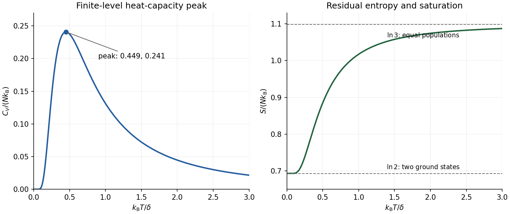

<h1 id="a6/e/solution">Solution</h1>

↑ **Parent:** [E](../e.md)

Using $dx/dT=-x/T$ in the [internal energy](../../../../../internal-energy-split.md) gives

$$
\boxed{C_V=Nk_{\rm B}\frac{2x^2e^{-x}}{(2+e^{-x})^2},\qquad x=\frac{\delta}{k_{\rm B}T}.}
$$

This is a [Schottky anomaly with unequal degeneracies](../../../../../schottky-anomaly-with-unequal-degeneracies.md), with lower-level [state degeneracy](../../../../../state-degeneracy.md) two and upper-level [state degeneracy](../../../../../state-degeneracy.md) one. Its limiting forms are

$$
\boxed{C_V\sim\frac{Nk_{\rm B}}2x^2e^{-x}\quad(T\to0),\qquad
C_V\sim\frac{2Nk_{\rm B}}9x^2\quad(T\to\infty).}
$$

It vanishes at low [temperature](../../../../../temperature-split.md) because exciting the upper orientation is exponentially unlikely. It also vanishes at high [temperature](../../../../../temperature-split.md) because the populations have nearly saturated and further heating hardly changes the [internal energy](../../../../../internal-energy-split.md). Between these limits it has one smooth maximum. The original plot shows its shape; numerical maximization gives $k_{\rm B}T_{\max}/\delta\simeq0.449$ and $C_{\max}/(Nk_{\rm B})\simeq0.241$.

**[Figure 1](#a6/e/image-original-heat-capacity-peak-and-entropy-limits-for-two-lower-orientations-and-one-excited-orientation). Original heat-capacity peak and entropy limits for two lower orientations and one excited orientation**.

## ↑ Ancestors (13)

1. [E](../e.md)
2. [A6](../../a6.md)
3. [Paper 2](../../../paper-2-split.md)
4. [2021](../../../split.md)
5. [Past exam of the chemistry A course of the University of Cambridge](../../../../split.md)
6. [Chemistry A course of the University of Cambridge](../../../../../chemistry-a-course-of-the-university-of-cambridge.md)
7. [Year 2 of the natural sciences course of the University of Cambridge](../../../../../year-2-of-the-natural-sciences-course-of-the-university-of-cambridge.md)
8. [Year of the natural sciences course of the University of Cambridge](../../../../../year-of-the-natural-sciences-course-of-the-university-of-cambridge.md)
9. [Natural sciences course of the University of Cambridge](../../../../../natural-sciences-course-of-the-university-of-cambridge.md)
10. [Course of the University of Cambridge](../../../../../course-of-the-university-of-cambridge.md)
11. [University of Cambridge](../../../../../university-of-cambridge-split.md)
12. [List of universities](../../../../../list-of-universities.md)
13. [Codex Wiki](../../../../../split.md)
