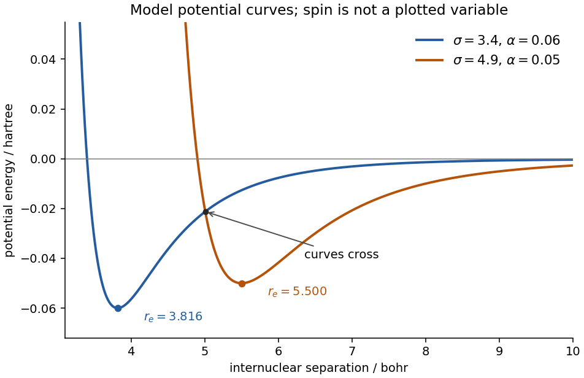

<h1 id="a2/c/ii/solution">Solution</h1>

↑ **Parent:** [Ii](../ii.md)

Differentiate the [Lennard-Jones potential](../../../../../../lennard-jones-potential.md). Its minimum satisfies

$$
-12\sigma^{12}r^{-13}+6\sigma^6r^{-7}=0,
\qquad\boxed{r_e=2^{1/6}\sigma,\quad V(r_e)=-\alpha.}
$$

For [dilithium](../../../../../../dilithium.md), the two wells consequently have

$$
\begin{array}{c|c|c}
(\sigma,\alpha)&r_e\text{ in bohr}&D_e\text{ in hartree}\\\hline
(3.4,0.06)&3.8164&0.060\\
(4.9,0.05)&5.5001&0.050
\end{array}
$$

**Under an additional same-orbital, Hund-type exchange comparison, assign $(3.4,0.06)$ to the triplet and $(4.9,0.05)$ to the singlet:** the lower-energy minimum is associated with the exchange-stabilized [triplet state](../../../../../../spin-one-half-triplet-state.md), as in part (a).

This assignment needs that extra orbital-parentage assumption. A scalar [Lennard-Jones potential](../../../../../../lennard-jones-potential.md) does not itself encode [spin](../../../../../../spin.md), and a common atomic dissociation limit does not specify a unique molecular electronic configuration or spatial symmetry. The two curves even cross at about $5.006$ bohr: neither lies below the other at every separation. Thus **the minima and well depths are determined unambiguously; the [spin](../../../../../../spin.md) labels are a conditional qualitative inference**, rather than a unique consequence of the four supplied parameters. Neither “a triplet must always have a longer bond” nor a universal ordering of unrelated excited states is justified.

**[Figure 1](#a2/c/ii/image-original-comparison-of-the-two-supplied-model-wells-showing-their-minima-and-the-crossing-without-presupposing-spin-labels). Original comparison of the two supplied model wells, showing their minima and the crossing without presupposing spin labels**.

## ↑ Ancestors (14)

1. [Ii](../ii.md)
2. [C](../../c.md)
3. [A2](../../../a2.md)
4. [Paper 1](../../../../paper-1-split.md)
5. [2022](../../../../split.md)
6. [Past exam of the chemistry A course of the University of Cambridge](../../../../../split.md)
7. [Chemistry A course of the University of Cambridge](../../../../../../chemistry-a-course-of-the-university-of-cambridge.md)
8. [Year 2 of the natural sciences course of the University of Cambridge](../../../../../../year-2-of-the-natural-sciences-course-of-the-university-of-cambridge.md)
9. [Year of the natural sciences course of the University of Cambridge](../../../../../../year-of-the-natural-sciences-course-of-the-university-of-cambridge.md)
10. [Natural sciences course of the University of Cambridge](../../../../../../natural-sciences-course-of-the-university-of-cambridge.md)
11. [Course of the University of Cambridge](../../../../../../course-of-the-university-of-cambridge.md)
12. [University of Cambridge](../../../../../../university-of-cambridge-split.md)
13. [List of universities](../../../../../../list-of-universities.md)
14. [Codex Wiki](../../../../../../split.md)
