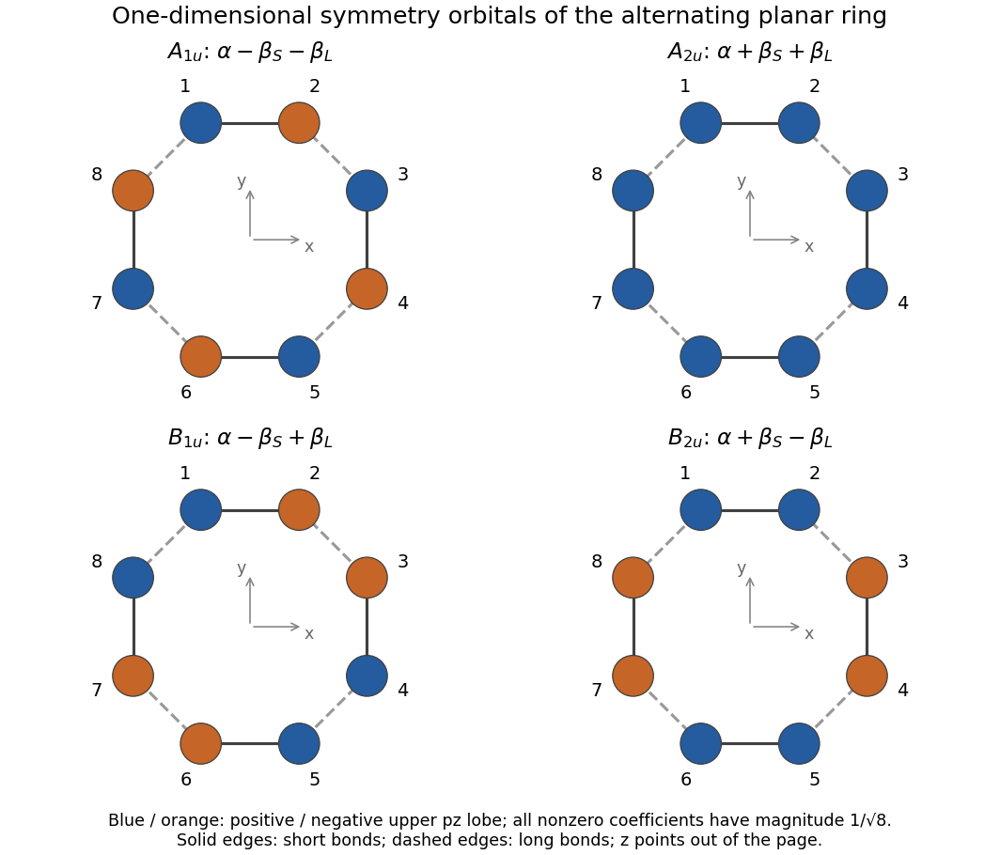

<h1 id="a4/b/i/solution">Solution</h1>

↑ **Parent:** [I](../i.md)

Write $p_j=p_{zj}$ and use the orthonormal basis of the [Hückel method](../../../../../../huckel-method.md). The four normalized one-dimensional [symmetry-adapted linear combinations](../../../../../../symmetry-adapted-linear-combination.md) are

$$
\begin{aligned}
\Phi_{A_{1u}}&=\frac{p_1-p_2+p_3-p_4+p_5-p_6+p_7-p_8}{\sqrt8},\\
\Phi_{A_{2u}}&=\frac{p_1+p_2+p_3+p_4+p_5+p_6+p_7+p_8}{\sqrt8},\\
\Phi_{B_{1u}}&=\frac{p_1-p_2-p_3+p_4+p_5-p_6-p_7+p_8}{\sqrt8},\\
\Phi_{B_{2u}}&=\frac{p_1+p_2-p_3-p_4+p_5+p_6-p_7-p_8}{\sqrt8}.
\end{aligned}
$$

For example, the $xz$ mirror plane exchanges sites $1\leftrightarrow6$, $2\leftrightarrow5$, $3\leftrightarrow4$, $8\leftrightarrow7$, without changing the sign of an individual $p_z$ orbital. The all-positive combination is unchanged by every vertical mirror but changes sign under $\sigma_h$, giving $A_{2u}$. The alternating combination changes sign under both sorts of vertical mirror, as required for $A_{1u}$. The two remaining sign patterns distinguish $B_{1u}$ from $B_{2u}$ in the printed axes. The signs refer to the upper $p_z$ lobes; the lower lobes have opposite [quantum phases](../../../../../../quantum-phase.md), and neither colour denotes an [electric charge](../../../../../../electric-charge-split.md).

For a normalized coefficient vector $\mathbf c$, the [energy](../../../../../../energy-split.md) is

$$
E=\alpha+2\sum_{\langle j,k\rangle}\beta_{jk}c_jc_k.
$$

Every site has one short-bond and one long-bond neighbour. Equivalently, apply the [Hückel method](../../../../../../huckel-method.md) [matrix](../../../../../../matrix.md) to any coefficient and read off its two neighbouring signs. The results are

$$
\boxed{\begin{array}{c|c}
\text{symmetry}&E\\\hline
A_{1u}&\alpha-\beta_S-\beta_L\\
A_{2u}&\alpha+\beta_S+\beta_L\\
B_{1u}&\alpha-\beta_S+\beta_L\\
B_{2u}&\alpha+\beta_S-\beta_L
\end{array}}
$$

With negative resonance integrals and $|\beta_S|>|\beta_L|$, the $A_{2u}$ and $B_{2u}$ levels are occupied, while $B_{1u}$ and $A_{1u}$ are unoccupied in the closed-shell alternating-bond state.

**[Figure 2](#a4/b/i/image-original-phase-patterns-for-the-four-one-dimensional-carbon-ring-symmetry-orbitals-in-the-printed-numbering-and-axes). Original phase patterns for the four one-dimensional carbon-ring symmetry orbitals in the printed numbering and axes**.

## ↑ Ancestors (14)

1. [I](../i.md)
2. [B](../../b.md)
3. [A4](../../../a4.md)
4. [Paper 1](../../../../paper-1-split.md)
5. [2022](../../../../split.md)
6. [Past exam of the chemistry A course of the University of Cambridge](../../../../../split.md)
7. [Chemistry A course of the University of Cambridge](../../../../../../chemistry-a-course-of-the-university-of-cambridge.md)
8. [Year 2 of the natural sciences course of the University of Cambridge](../../../../../../year-2-of-the-natural-sciences-course-of-the-university-of-cambridge.md)
9. [Year of the natural sciences course of the University of Cambridge](../../../../../../year-of-the-natural-sciences-course-of-the-university-of-cambridge.md)
10. [Natural sciences course of the University of Cambridge](../../../../../../natural-sciences-course-of-the-university-of-cambridge.md)
11. [Course of the University of Cambridge](../../../../../../course-of-the-university-of-cambridge.md)
12. [University of Cambridge](../../../../../../university-of-cambridge-split.md)
13. [List of universities](../../../../../../list-of-universities.md)
14. [Codex Wiki](../../../../../../split.md)
