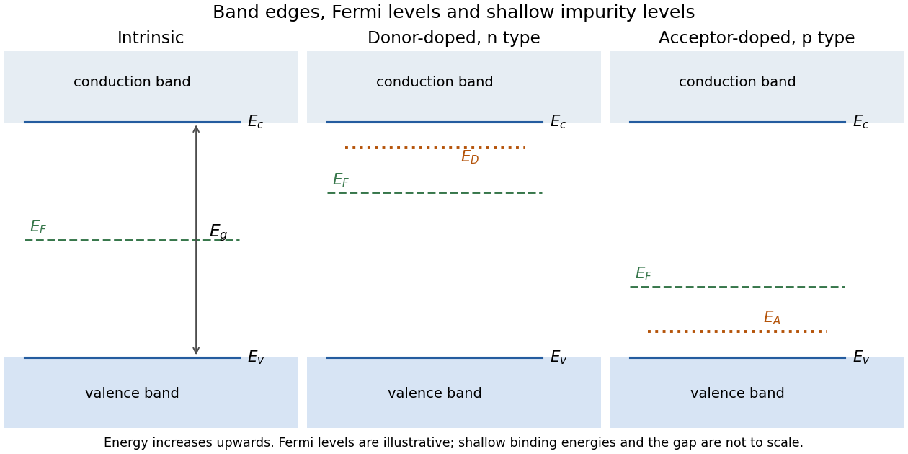

<h1 id="a10/a/i/solution">Solution</h1>

↑ **Parent:** [I](../i.md)

A typical [intrinsic semiconductor](../../../../../../intrinsic-semiconductor.md) has a nearly full [valence band](../../../../../../valence-band.md) ending at $E_v$ and a nearly empty [conduction band](../../../../../../conduction-band.md) starting at $E_c$, separated by

$$
\boxed{E_g=E_c-E_v>0.}
$$

At finite [temperature](../../../../../../temperature-split.md), the equilibrium [Fermi level](../../../../../../fermi-level.md) lies near the middle of the gap. In the nondegenerate parabolic-band approximation,

$$
\boxed{E_F=\frac{E_c+E_v}{2}+\frac{k_{\rm B}T}{2}\ln\frac{N_v}{N_c},}
$$

where $N_c,N_v$ are the two [effective density of states](../../../../../../effective-density-of-states.md) values. Equal densities of states put it exactly at midgap; unequal masses or valley multiplicities shift it slightly. The left panel gives the requested energy-level sketch, with doped cases for comparison.

**[Figure 3](#a10/a/i/image-original-schematic-energy-levels-of-intrinsic-donor-doped-and-acceptor-doped-semiconductors-including-the-intrinsic-fermi-level-and-band-gap). Original schematic energy levels of intrinsic, donor-doped and acceptor-doped semiconductors, including the intrinsic Fermi level and band gap**.

## ↑ Ancestors (14)

1. [I](../i.md)
2. [A](../../a.md)
3. [A10](../../../a10.md)
4. [Paper 2](../../../../paper-2-split.md)
5. [2022](../../../../split.md)
6. [Past exam of the chemistry A course of the University of Cambridge](../../../../../split.md)
7. [Chemistry A course of the University of Cambridge](../../../../../../chemistry-a-course-of-the-university-of-cambridge.md)
8. [Year 2 of the natural sciences course of the University of Cambridge](../../../../../../year-2-of-the-natural-sciences-course-of-the-university-of-cambridge.md)
9. [Year of the natural sciences course of the University of Cambridge](../../../../../../year-of-the-natural-sciences-course-of-the-university-of-cambridge.md)
10. [Natural sciences course of the University of Cambridge](../../../../../../natural-sciences-course-of-the-university-of-cambridge.md)
11. [Course of the University of Cambridge](../../../../../../course-of-the-university-of-cambridge.md)
12. [University of Cambridge](../../../../../../university-of-cambridge-split.md)
13. [List of universities](../../../../../../list-of-universities.md)
14. [Codex Wiki](../../../../../../split.md)
