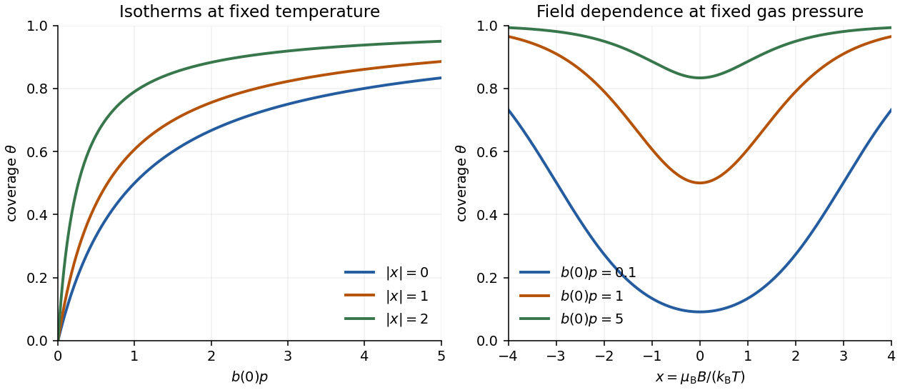

<h1 id="a6/f/solution">Solution</h1>

↑ **Parent:** [F](../f.md)

At fixed [temperature](../../../../../temperature-split.md),

$$
\boxed{b(B)=b(0)\cosh x,\qquad x=\mu_{\rm B}B/(k_{\rm B}T).}
$$

Thus [magnetic-field-dependent Langmuir adsorption](../../../../../magnetic-field-dependent-langmuir-adsorption.md) is even in $B$ and increases with $|B|$. At fixed nonzero gas [pressure](../../../../../pressure-split.md), stronger field increases [surface coverage](../../../../../surface-coverage.md); in an isotherm plot, the half-coverage [pressure](../../../../../pressure-split.md) $p_{1/2}=1/b$ moves to lower [pressure](../../../../../pressure-split.md). The saturation coverage remains one because the number of sites is unchanged.

For weak fields, with $\theta_0=b(0)p/[1+b(0)p]$,

$$
\theta(B)=\theta_0+\frac12\theta_0(1-\theta_0)x^2+O(x^4).
$$

There is no linear small-field change. At large $|x|$, $\cosh x\sim e^{|x|}/2$, and at fixed $p>0$ the coverage approaches one. The field lowers the [free energy](../../../../../thermodynamic-free-energy.md) of the surface [spin](../../../../../spin.md) ensemble relative to the unsplit bulk; simply averaging the two surface energies to $-E_b$ would miss this equilibrium effect.

**[Figure 1](#a6/f/image-original-magnetic-langmuir-isotherms-and-field-dependent-coverage-in-dimensionless-variables). Original magnetic Langmuir isotherms and field-dependent coverage in dimensionless variables**.

## ↑ Ancestors (13)

1. [F](../f.md)
2. [A6](../../a6.md)
3. [Paper 2](../../../paper-2-split.md)
4. [2022](../../../split.md)
5. [Past exam of the chemistry A course of the University of Cambridge](../../../../split.md)
6. [Chemistry A course of the University of Cambridge](../../../../../chemistry-a-course-of-the-university-of-cambridge.md)
7. [Year 2 of the natural sciences course of the University of Cambridge](../../../../../year-2-of-the-natural-sciences-course-of-the-university-of-cambridge.md)
8. [Year of the natural sciences course of the University of Cambridge](../../../../../year-of-the-natural-sciences-course-of-the-university-of-cambridge.md)
9. [Natural sciences course of the University of Cambridge](../../../../../natural-sciences-course-of-the-university-of-cambridge.md)
10. [Course of the University of Cambridge](../../../../../course-of-the-university-of-cambridge.md)
11. [University of Cambridge](../../../../../university-of-cambridge-split.md)
12. [List of universities](../../../../../list-of-universities.md)
13. [Codex Wiki](../../../../../split.md)
