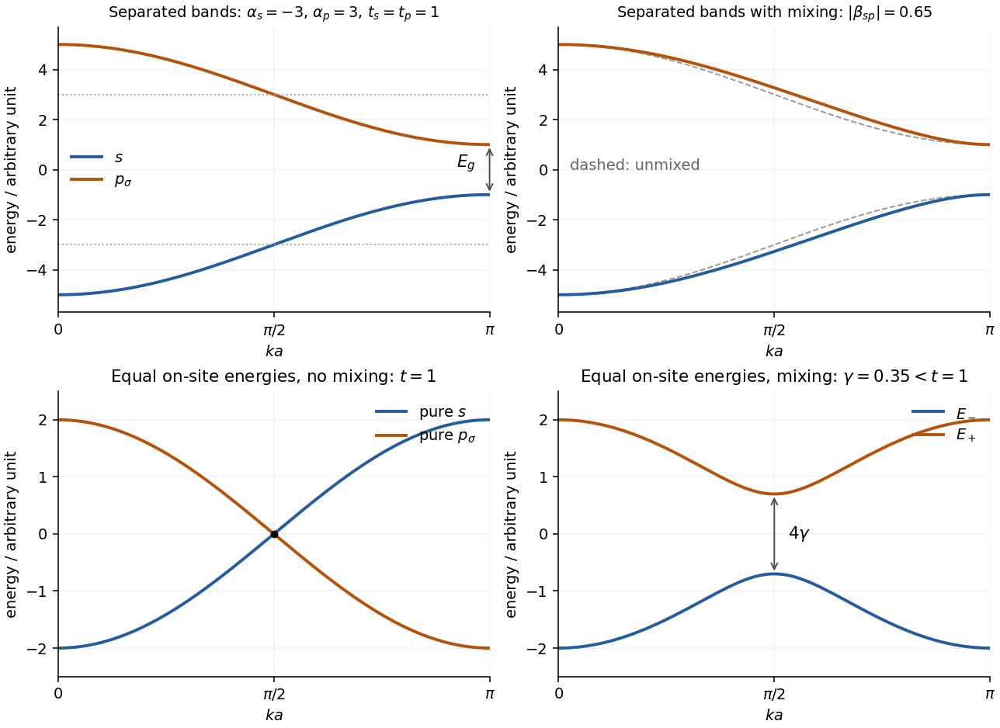

<h1 id="a9/a/ii/solution">Solution</h1>

↑ **Parent:** [Ii](../ii.md)

Write $t_s=|\beta_s|$ and $t_p=|\beta_p|$, so

$$
E_s=\alpha_s-2t_s\cos(ka),\qquad
E_p=\alpha_p+2t_p\cos(ka).
$$

The labelled key points of the two [dispersion relations](../../../../../../dispersion-relation-split.md) are

$$
\begin{array}{c|c|c}
k&E_s&E_p\\\hline
0&\alpha_s-2t_s&\alpha_p+2t_p\\
\pi/(2a)&\alpha_s&\alpha_p\\
\pi/a&\alpha_s+2t_s&\alpha_p-2t_p
\end{array}
$$

The $s$ band rises from centre to boundary and the axial $p$ band falls. The separated-band assumption requires $\alpha_p-\alpha_s>2(t_s+t_p)$. The upper-left panel shows a representative pair, with the other panels supplying the requested comparisons in part (b).

**[Figure 2](#a9/a/ii/image-original-one-dimensional-s-and-axial-p-band-sketches-comparing-separated-bands-mixing-and-the-equal-on-site-energy-special-case). Original one-dimensional s and axial-p band sketches, comparing separated bands, mixing, and the equal-on-site-energy special case**.

## ↑ Ancestors (14)

1. [Ii](../ii.md)
2. [A](../../a.md)
3. [A9](../../../a9.md)
4. [Paper 2](../../../../paper-2-split.md)
5. [2022](../../../../split.md)
6. [Past exam of the chemistry A course of the University of Cambridge](../../../../../split.md)
7. [Chemistry A course of the University of Cambridge](../../../../../../chemistry-a-course-of-the-university-of-cambridge.md)
8. [Year 2 of the natural sciences course of the University of Cambridge](../../../../../../year-2-of-the-natural-sciences-course-of-the-university-of-cambridge.md)
9. [Year of the natural sciences course of the University of Cambridge](../../../../../../year-of-the-natural-sciences-course-of-the-university-of-cambridge.md)
10. [Natural sciences course of the University of Cambridge](../../../../../../natural-sciences-course-of-the-university-of-cambridge.md)
11. [Course of the University of Cambridge](../../../../../../course-of-the-university-of-cambridge.md)
12. [University of Cambridge](../../../../../../university-of-cambridge-split.md)
13. [List of universities](../../../../../../list-of-universities.md)
14. [Codex Wiki](../../../../../../split.md)
