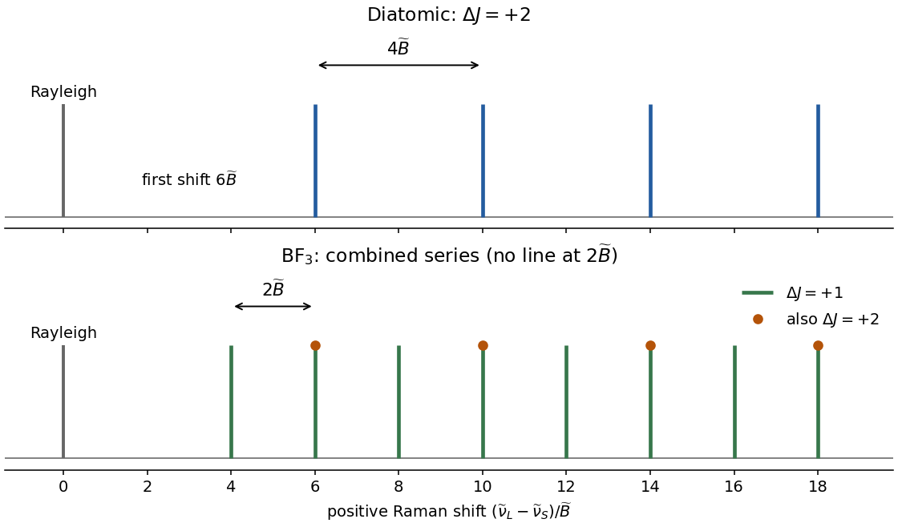
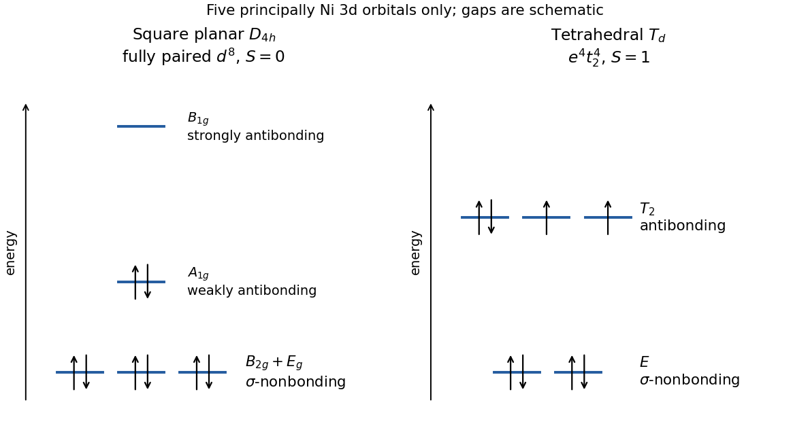
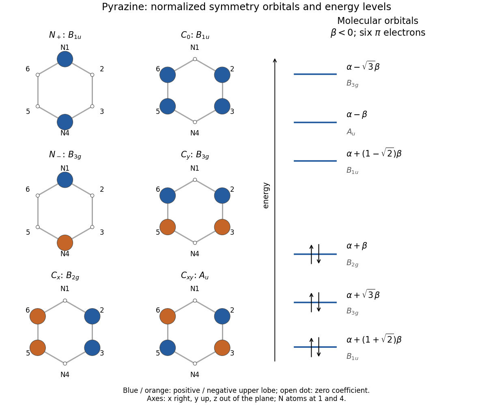

# Paper 1

↑ **Parent:** [2023](../2023.md)

[Original paper, released PDF pages 101–108](https://www.whatdotheyknow.com/request/request_for_nst_past_papers/response/3572306/attach/4/FOI%202026%20862%20Stack%20materials.pdf?cookie_passthrough=1#page=101)

**Table of contents**

- [A1](#a1)
  - [a](#a1/a)
    - [Solution](#a1/a/solution)
  - [b](#a1/b)
    - [Solution](#a1/b/solution)
  - [c](#a1/c)
    - [Solution](#a1/c/solution)
  - [d](#a1/d)
    - [Solution](#a1/d/solution)
- [A2](#a2)
  - [a](#a2/a)
    - [Solution](#a2/a/solution)
  - [b](#a2/b)
    - [i](#a2/b/i)
      - [Solution](#a2/b/i/solution)
    - [ii](#a2/b/ii)
      - [Solution](#a2/b/ii/solution)
    - [iii](#a2/b/iii)
      - [Solution](#a2/b/iii/solution)
- [A3](#a3)
  - [a](#a3/a)
    - [i](#a3/a/i)
      - [Solution](#a3/a/i/solution)
    - [ii](#a3/a/ii)
      - [Solution](#a3/a/ii/solution)
  - [b](#a3/b)
    - [i](#a3/b/i)
      - [Solution](#a3/b/i/solution)
    - [ii](#a3/b/ii)
      - [Solution](#a3/b/ii/solution)
  - [c](#a3/c)
    - [i](#a3/c/i)
      - [Solution](#a3/c/i/solution)
    - [ii](#a3/c/ii)
      - [Solution](#a3/c/ii/solution)
- [A4](#a4)
  - [a](#a4/a)
    - [i](#a4/a/i)
      - [Solution](#a4/a/i/solution)
    - [ii](#a4/a/ii)
      - [Solution](#a4/a/ii/solution)
    - [iii](#a4/a/iii)
      - [Solution](#a4/a/iii/solution)
    - [iv](#a4/a/iv)
      - [Solution](#a4/a/iv/solution)
    - [v](#a4/a/v)
      - [Solution](#a4/a/v/solution)
  - [b](#a4/b)
    - [i](#a4/b/i)
      - [Solution](#a4/b/i/solution)
    - [ii](#a4/b/ii)
      - [Solution](#a4/b/ii/solution)
    - [iii](#a4/b/iii)
      - [Solution](#a4/b/iii/solution)
- [A5](#a5)
  - [a](#a5/a)
    - [i](#a5/a/i)
      - [Solution](#a5/a/i/solution)
    - [ii](#a5/a/ii)
      - [Solution](#a5/a/ii/solution)
  - [b](#a5/b)
    - [i](#a5/b/i)
      - [Solution](#a5/b/i/solution)
    - [ii](#a5/b/ii)
      - [Solution](#a5/b/ii/solution)
    - [iii](#a5/b/iii)
      - [Solution](#a5/b/iii/solution)
    - [iv](#a5/b/iv)
      - [Solution](#a5/b/iv/solution)

## A1

↑ **Parent:** [Paper 1](paper-1.md)

<h3 id="a1/a">a</h3>

↑ **Parent:** [A1](#a1)

<h4 id="a1/a/solution">Solution</h4>

↑ **Parent:** [A](#a1/a)

In [atomic units](../../physics.md#atomic-units), $\hbar=m_e=e=4\pi\varepsilon_0=1$, and the [hydrogen atom](../../mathematical-physics.md#hydrogen-atom) has

$$
\boxed{\hat H\Psi=-\frac{1}{2n^2}\Psi,\qquad
\hat l^2\Psi=l(l+1)\Psi,\qquad \hat l_z\Psi=m\Psi,}
$$

$$
\boxed{\hat s^2\Psi=\frac34\Psi,\qquad \hat s_z\Psi=m_s\Psi.}
$$

The allowed [quantum numbers](../../quantum-system.md#quantum-number) are

$$
n=1,2,\ldots,\qquad l=0,1,\ldots,n-1,\qquad
m=-l,-l+1,\ldots,l,\qquad m_s=\pm\frac12.
$$

Here the fixed [electron spin](../../angular-momentum-operator.md#electron-spin) quantum number is $s=1/2$. The [energy eigenvalues](../../energy-eigenvalue.md) are in hartrees; restoring units gives $\hbar^2l(l+1)$ and $\hbar m$ for the orbital operators and the corresponding factors for [spin](../../angular-momentum-operator.md#spin). The spin-independent hydrogen [Hamiltonian](../../hamiltonian-mechanics.md#hamiltonian) does not split the two [spin](../../angular-momentum-operator.md#spin) projections.

<h3 id="a1/b">b</h3>

↑ **Parent:** [A1](#a1)

<h4 id="a1/b/solution">Solution</h4>

↑ **Parent:** [B](#a1/b)

Keep one normalized [spin](../../angular-momentum-operator.md#spin) function fixed and write $A=1/\sqrt{24}$ and $f_m(\theta,\phi)=\sin\theta\,e^{im\phi}$, with $m=\pm1$. Overall constants and the [spin](../../angular-momentum-operator.md#spin) factor pass unchanged through the spatial operators.

First, in [atomic units](../../physics.md#atomic-units), $\hat l_z=-i\partial_\phi$, so

$$
\hat l_z\Psi=-i(im)\Psi=\boxed{m\Psi}.
$$

For the squared [orbital angular momentum](../../quantum-mechanics.md#orbital-angular-momentum), $\partial_\phi^2f_m=-f_m$ and

$$
\partial_\theta\!\left(\sin\theta\,\partial_\theta f_m\right)
=(\cos^2\theta-\sin^2\theta)e^{im\phi}.
$$

Therefore the two terms of the angular operator give

$$
\hat l^2f_m=
\frac{-\cos^2\theta+\sin^2\theta+1}{\sin\theta}e^{im\phi}
=2\sin\theta e^{im\phi}=2f_m,
$$

using $1-\cos^2\theta=\sin^2\theta$. Thus **$\hat l^2\Psi=2\Psi$**.

Finally, the spatial hydrogen [Hamiltonian](../../hamiltonian-mechanics.md#hamiltonian) is

$$
\hat H=-\frac12\left[\frac{1}{r^2}\partial_r(r^2\partial_r)-\frac{\hat l^2}{r^2}\right]-\frac1r.
$$

For $R=Ar e^{-r/2}$,

$$
R'=A(1-r/2)e^{-r/2},\qquad
\frac1{r^2}\frac{\mathrm d}{\mathrm dr}(r^2R')
=Ae^{-r/2}\left(\frac2r-2+\frac r4\right).
$$

Substitute the already established angular [eigenvalue](../../linear-operator-theory.md#eigenvalue) $l(l+1)=2$:

$$
\hat H(RY\sigma)=AY\sigma e^{-r/2}
\left[-\frac12\left(\frac2r-2+\frac r4\right)+\frac1r-1\right]
=-\frac18RY\sigma.
$$

Hence **$E=-1/8$ hartree**, consistently with $n=2$. The angular calculation must precede the radial substitution if one wants to avoid differentiating the entire product repeatedly.

<h3 id="a1/c">c</h3>

↑ **Parent:** [A1](#a1)

<h4 id="a1/c/solution">Solution</h4>

↑ **Parent:** [C](#a1/c)

Denote the two complex spatial [atomic orbitals](../../chemistry.md#atomic-orbital) by $\psi_+$ and $\psi_-$, retaining the same [spin](../../angular-momentum-operator.md#spin) state. With the phases specified by the supplied [spherical harmonics](../../analysis.md#spherical-harmonic), choose

$$
\boxed{\psi_x=\frac{\psi_- -\psi_+}{\sqrt2},\qquad
\psi_y=\frac{i(\psi_-+\psi_+)}{\sqrt2}.}
$$

The two original [atomic orbitals](../../chemistry.md#atomic-orbital) are [orthonormal](../../inner-product.md#orthonormal-set), so the squared coefficients add to one and these combinations are normalized and mutually [orthogonal](../../inner-product.md#orthogonal-vectors). Explicitly,

$$
\psi_x=\frac{1}{\sqrt{32\pi}}\,x\,e^{-r/2},\qquad
\psi_y=\frac{1}{\sqrt{32\pi}}\,y\,e^{-r/2},
$$

which are real spatial [wavefunctions](../../wave-function.md). An overall sign on either orbital has no physical consequence.

These are the familiar **$2p_x$ and $2p_y$ [p orbitals](../../chemistry.md#p-orbital)**. Each has two lobes of opposite [wavefunction](../../wave-function.md) sign, with an [atomic-orbital nodal plane](../../chemistry.md#atomic-orbital-nodal-plane) through the [atomic nucleus](../../atomic-nucleus.md): $x=0$ for $2p_x$ and $y=0$ for $2p_y$. The sign is a phase convention, not a positive or negative [electric charge](../../electric-charge.md); the [probability density](../../wave-function.md#probability-density) is nonnegative on both lobes.

**[Figure 1](#a1/c/image-original-sections-through-the-real-hydrogen-2p-atomic-orbitals-showing-opposite-phases-and-their-nodal-planes). Original sections through the real hydrogen 2p atomic orbitals, showing opposite phases and their nodal planes**.

<h3 id="a1/d">d</h3>

↑ **Parent:** [A1](#a1)

<h4 id="a1/d/solution">Solution</h4>

↑ **Parent:** [D](#a1/d)

Linearity and the shared $l=1$ angular [eigenvalue](../../linear-operator-theory.md#eigenvalue) give

$$
\boxed{\hat l^2\psi_x=2\psi_x,\qquad\hat l^2\psi_y=2\psi_y.}
$$

Using the relative phases in part (c),

$$
\boxed{\hat l_z\psi_x=i\psi_y,\qquad\hat l_z\psi_y=-i\psi_x.}
$$

Thus each real orbital remains an [energy eigenstate](../../energy-eigenvalue.md#energy-eigenstate) with **$E=-1/8$ hartree** and has definite [orbital angular momentum](../../quantum-mechanics.md#orbital-angular-momentum) magnitude **$\sqrt2\hbar$**, but neither is an [eigenfunction](../../linear-operator-theory.md#eigenfunction) of $\hat l_z$. A measurement of $l_z$ gives **$+\hbar$ or $-\hbar$, each with [probability](../../probability-theory.md#probability) $1/2$**. Its mean is zero and its variance is $\hbar^2$; a zero mean does not mean that a measurement gives zero.

## A2

↑ **Parent:** [Paper 1](paper-1.md)

<h3 id="a2/a">a</h3>

↑ **Parent:** [A2](#a2)

<h4 id="a2/a/solution">Solution</h4>

↑ **Parent:** [A](#a2/a)

Let $\{\phi_j\}$ be a complete [orthonormal eigenbasis](../../linear-operator-theory.md#orthonormal-eigenbasis) of the [Hamiltonian](../../hamiltonian-mechanics.md#hamiltonian), with $H\phi_j=E_j\phi_j$ and $E_j\geq E_0$. Expand a nonzero admissible [trial wavefunction](../../quantum-mechanics.md#trial-wavefunction) as $\widetilde\Psi=\sum_j c_j\phi_j$. Then

$$
\langle\widetilde\Psi|\widetilde\Psi\rangle=\sum_j|c_j|^2,
\qquad
\langle\widetilde\Psi|H|\widetilde\Psi\rangle=\sum_j|c_j|^2E_j.
$$

Consequently

$$
\widetilde E-E_0
=\frac{\sum_j|c_j|^2(E_j-E_0)}{\sum_j|c_j|^2}\geq0,
\qquad\boxed{\widetilde E\geq E_0.}
$$

Every numerator term is nonnegative and the denominator is positive. Equality requires the trial to lie wholly in the [ground-state subspace](../../quantum-mechanics.md#ground-state-subspace); it need not be an individually chosen eigenvector when the ground [energy](../../energy.md) is degenerate. This is the [quantum variational principle](../../quantum-mechanics.md#quantum-variational-principle), and [wavefunction normalization](../../wave-function.md#wavefunction-normalization) before calculation is optional because the quotient removes the overall scale.

<h3 id="a2/b">b</h3>

↑ **Parent:** [A2](#a2)

<h4 id="a2/b/i">i</h4>

↑ **Parent:** [B](#a2/b)

<h5 id="a2/b/i/solution">Solution</h5>

↑ **Parent:** [I](#a2/b/i)

[Wavefunction normalization](../../wave-function.md#wavefunction-normalization) requires $\alpha>0$. For the normalized [probability](../../probability-theory.md#probability) weight proportional to $e^{-\alpha x^2}$, the [Gaussian integral](../../integral.md#gaussian-integral) and its derivatives give

$$
\langle x^2\rangle=\frac1{2\alpha},\qquad
\langle x^4\rangle=\frac3{4\alpha^2}.
$$

Since $\widetilde\Psi''=(\alpha^2x^2-\alpha)\widetilde\Psi$, the [kinetic energy](../../energy.md#kinetic-energy) and [potential energy](../../energy.md#potential-energy) expectations are

$$
\langle T\rangle=\frac\alpha2-\frac{\alpha^2}{2}\langle x^2\rangle=\frac\alpha4,
\qquad
\langle V\rangle=\frac12\langle x^4\rangle=\frac3{8\alpha^2}.
$$

Thus

$$
E(\alpha)=\frac\alpha4+\frac3{8\alpha^2},\qquad
E'(\alpha)=\frac14-\frac3{4\alpha^3}=0
\ \Longrightarrow\ \alpha_*=3^{1/3}.
$$

The second derivative is positive, and the [energy](../../energy.md) diverges at both ends of $\alpha>0$, so this is the global minimum within the [Gaussian function](../../calculus.md#gaussian-function) family. **The best [Gaussian function](../../calculus.md#gaussian-function) upper bound is**

$$
\boxed{E_0\leq E(\alpha_*)=\frac{3^{4/3}}8\simeq0.54084359.}
$$

This is an upper bound, not the exact quartic ground [energy](../../energy.md).

<h4 id="a2/b/ii">ii</h4>

↑ **Parent:** [B](#a2/b)

<h5 id="a2/b/ii/solution">Solution</h5>

↑ **Parent:** [Ii](#a2/b/ii)

**A gives the same optimum:** replacing $\alpha$ by $2\alpha$ merely reparameterizes the same set of positive-width [Gaussian functions](../../calculus.md#gaussian-function), so its best bound is unchanged.

**B is worse as a ground-energy estimate:** it has odd parity and a node at the origin, whereas the [ground state](../../quantum-mechanics.md#ground-state) of this even confining one-dimensional potential is even and nodeless. It is therefore [orthogonal](../../inner-product.md#orthogonal-vectors) to the exact [ground state](../../quantum-mechanics.md#ground-state) and belongs to the odd sector, whose lowest [energy](../../energy.md) is already above the ground [energy](../../energy.md); the extra factor $x$ cannot be removed by varying its width. A separate numerical minimization gives a best value about $1.92372$ for B, well above the original [Gaussian function](../../calculus.md#gaussian-function) bound.

**C can improve the bound:** setting $\beta=0$ recovers every original [Gaussian function](../../calculus.md#gaussian-function), while nonzero $\beta$ adds shape freedom. Minimizing over this larger family can never give a worse optimum, and the additional freedom does lower the quartic-oscillator estimate. Inclusion of a family alone proves “no worse”; improvement is not guaranteed for every conceivable potential, for example one already solved exactly by a [Gaussian function](../../calculus.md#gaussian-function).

<h4 id="a2/b/iii">iii</h4>

↑ **Parent:** [B](#a2/b)

<h5 id="a2/b/iii/solution">Solution</h5>

↑ **Parent:** [Iii](#a2/b/iii)

For any $\alpha>0$, the [Gaussian function](../../calculus.md#gaussian-function) is the exact nodeless ground [wavefunction](../../wave-function.md) of a [quantum harmonic oscillator](../../quantum-harmonic-oscillator.md) with

$$
\boxed{\hat H_{\rm ho}(\alpha)=-\frac12\frac{\mathrm d^2}{\mathrm dx^2}+\frac12\alpha^2x^2,\qquad E_{0,\rm ho}=\frac\alpha2.}
$$

Direct substitution cancels the $x^2$ terms. An additive constant in the potential would simply shift the [eigenvalue](../../linear-operator-theory.md#eigenvalue).

A natural comparison uses the same optimized width as part (i), $\alpha=3^{1/3}$. The harmonic ground [energy](../../energy.md) is then **$0.72112479$**, compared with the quartic [Gaussian function](../../calculus.md#gaussian-function) expectation **$0.54084359$**. For this common normalized trial,

$$
\langle V_{\rm quartic}\rangle=\frac\alpha8,
\qquad \langle V_{\rm ho}\rangle=\frac\alpha4,
$$

while the [kinetic energy](../../energy.md#kinetic-energy) [expectation value](../../quantum-system.md#expectation-value) is $\alpha/4$ in both cases. The quartic potential lies below this harmonic potential for $0<|x|<\alpha$ and above it for $|x|>\alpha$; the difference weighted by the [Gaussian function](../../calculus.md#gaussian-function) is negative, giving the lower expectation.

If the standard unit-frequency oscillator is chosen instead, $\alpha=1$ gives $E_{0,\rm ho}=1/2$, below the optimized quartic upper bound. These are different harmonic comparison potentials, not contradictory answers. Crossing potential curves cannot be ordered globally; the comparison must specify the frequency or [Gaussian function](../../calculus.md#gaussian-function) width used.

**[Figure 2](#a2/b/iii/image-original-comparison-of-the-quartic-potential-with-harmonic-potentials-at-unit-frequency-and-at-the-optimized-gaussian-width). Original comparison of the quartic potential with harmonic potentials at unit frequency and at the optimized Gaussian width**.

## A3

↑ **Parent:** [Paper 1](paper-1.md)

<h3 id="a3/a">a</h3>

↑ **Parent:** [A3](#a3)

<h4 id="a3/a/i">i</h4>

↑ **Parent:** [A](#a3/a)

<h5 id="a3/a/i/solution">Solution</h5>

↑ **Parent:** [I](#a3/a/i)

The gross requirement is **an anisotropic [polarizability tensor](../../electrostatics.md#polarizability-tensor)**, so that changing molecular orientation changes the induced response. A permanent [electric dipole moment](../../electrostatics.md#electric-dipole-moment) is not required; a homonuclear diatomic can therefore have a rotational [Raman scattering](../../optics.md#raman-scattering) spectrum.

For the inelastic lines of a linear [rigid rotor](../../molecule.md#rigid-rotor), the detailed rule is **$\Delta J=\pm2$**, with $J\geq0$. The $\Delta J=0$ contribution is unshifted [Rayleigh scattering](../../electromagnetic-radiation.md#rayleigh-scattering), not a rotational [Stokes Raman scattering](../../optics.md#stokes-raman-scattering) line. [Stokes Raman scattering](../../optics.md#stokes-raman-scattering) has $\Delta J=+2$ because the molecule gains rotational [energy](../../energy.md).

<h4 id="a3/a/ii">ii</h4>

↑ **Parent:** [A](#a3/a)

<h5 id="a3/a/ii/solution">Solution</h5>

↑ **Parent:** [Ii](#a3/a/ii)

For a transition starting at $J$ and ending at $J+2$, the molecule gains

$$
\Delta\widetilde\varepsilon
=\widetilde B\big[(J+2)(J+3)-J(J+1)\big]
=\widetilde B(4J+6).
$$

[Energy](../../energy.md) conservation therefore gives the scattered-light [wavenumbers](../../wave-equation.md#wavenumber)

$$
\boxed{\widetilde\nu_{\rm S}(J)=\widetilde\nu_L-(4J+6)\widetilde B,\qquad J=0,1,2,\ldots.}
$$

The first shifts below the laser are **$6\widetilde B,10\widetilde B,14\widetilde B,18\widetilde B$**. Adjacent Stokes lines are separated by **$4\widetilde B$**, while the first line is $6\widetilde B$ from the Rayleigh line. The figure uses positive [Raman shift](../../optics.md#raman-shift) $\widetilde\nu_L-\widetilde\nu_{\rm S}$; increasing shift means decreasing scattered-light wavenumber.

**[Figure 3](#a3/a/ii/image-original-line-position-sketches-for-the-diatomic-and-bf3-rotational-raman-series-stick-heights-carry-no-intensity-information). Original line-position sketches for the diatomic and BF3 rotational Raman series; stick heights carry no intensity information**.

<h3 id="a3/b">b</h3>

↑ **Parent:** [A3](#a3)

<h4 id="a3/b/i">i</h4>

↑ **Parent:** [B](#a3/b)

<h5 id="a3/b/i/solution">Solution</h5>

↑ **Parent:** [I](#a3/b/i)

All three fluorine atoms are at perpendicular distance $R$ from the axis normal to the molecular plane. Boron lies on the axis, so it contributes zero. Thus

$$
\boxed{I_c=3m_{\rm F}R^2.}
$$

The boron mass does not enter this moment, rather than needing to be approximated or neglected.

<h4 id="a3/b/ii">ii</h4>

↑ **Parent:** [B](#a3/b)

<h5 id="a3/b/ii/solution">Solution</h5>

↑ **Parent:** [Ii](#a3/b/ii)

In the printed geometry, one B–F bond lies along the in-plane axis and contributes zero. The other two fluorines have perpendicular distance $R\sin60^\circ=\sqrt3R/2$; boron is again on the axis. Therefore

$$
\boxed{I_b=2m_{\rm F}\left(\frac{\sqrt3R}{2}\right)^2
=\frac32m_{\rm F}R^2=\frac{I_c}{2}.}
$$

The other in-plane principal moment is the same by threefold symmetry. Hence [Boron trifluoride](../../chemical-substance.md#boron-trifluoride) is an [oblate symmetric top](../../rigid-body-dynamics.md#oblate-symmetric-top) with $I_c>I_b$ and $\widetilde C=\widetilde B/2$.

<h3 id="a3/c">c</h3>

↑ **Parent:** [A3](#a3)

<h4 id="a3/c/i">i</h4>

↑ **Parent:** [C](#a3/c)

<h5 id="a3/c/i/solution">Solution</h5>

↑ **Parent:** [I](#a3/c/i)

Because $\Delta K=0$, the $(\widetilde C-\widetilde B)K^2$ terms cancel between the initial and final states. The two positive-shift branches are consequently

$$
\boxed{\begin{aligned}
\Delta J=+1:&\quad\widetilde\nu_{\rm S}=\widetilde\nu_L-2\widetilde B(J+1),\\
\Delta J=+2:&\quad\widetilde\nu_{\rm S}=\widetilde\nu_L-(4J+6)\widetilde B.
\end{aligned}}
$$

The $+2$ branch gives shifts $6\widetilde B,10\widetilde B,14\widetilde B,\ldots$, as for the diatomic. The $+1$ branch fills in a series spaced by $2\widetilde B$, so the combined nonzero series is **$4\widetilde B,6\widetilde B,8\widetilde B,10\widetilde B,\ldots$**.

There is a boundary qualification to the abbreviated rules printed in the question: for an ordinary symmetric [polarizability tensor](../../electrostatics.md#polarizability-tensor), $\Delta J=\pm1$ has zero strength when $K=0$. Thus $J=0,K=0\to J=1,K=0$ does not produce a $2\widetilde B$ line; the first $+1$ transition can start at $J=1,|K|=1$ and has shift $4\widetilde B$. This follows from the rank-two angular-momentum coupling: the all-zero-projection coupling for $J$ and $J+1$ vanishes because $J+2+(J+1)$ is odd. If one applies only the printed inequalities without this matrix-element restriction, $2\widetilde B$ is a formal position, but its intensity is zero.

The lower panel of the figure in part (a)(ii) marks the two branches and their overlaps. **The useful spacing is $2\widetilde B$, not the diatomic value $4\widetilde B$.**

<h4 id="a3/c/ii">ii</h4>

↑ **Parent:** [C](#a3/c)

<h5 id="a3/c/ii/solution">Solution</h5>

↑ **Parent:** [Ii](#a3/c/ii)

The combined [boron trifluoride](../../chemical-substance.md#boron-trifluoride) series gives

$$
2\widetilde B=0.686\ \mathrm{cm}^{-1},\qquad
\boxed{\widetilde B=0.343\ \mathrm{cm}^{-1}=34.3\ \mathrm m^{-1}.}
$$

Using $I_b=h/(8\pi^2c\widetilde B)$ with the wavenumber in inverse metres,

$$
I_b=\frac{6.62607015\times10^{-34}}
{8\pi^2(2.99792458\times10^8)(34.3)}
=8.16115\times10^{-46}\ \mathrm{kg\,m^2}.
$$

With integer fluorine mass $m_{\rm F}=19u$ and $I_b=3m_{\rm F}R^2/2$,

$$
R=\sqrt{\frac{2I_b}{3(19u)}}
=1.31319\times10^{-10}\ \mathrm m,
\qquad\boxed{R\simeq131\ \mathrm{pm}.}
$$

Using $4\widetilde B$ for the observed spacing would incorrectly treat BF$_3$ as a linear diatomic rotor and overestimate the bond length by $\sqrt2$.

## A4

↑ **Parent:** [Paper 1](paper-1.md)

<h3 id="a4/a">a</h3>

↑ **Parent:** [A4](#a4)

<h4 id="a4/a/i">i</h4>

↑ **Parent:** [A](#a4/a)

<h5 id="a4/a/i/solution">Solution</h5>

↑ **Parent:** [I](#a4/a/i)

For the ideal [tetracyanonickelate(II)](../../chemical-substance.md#tetracyanonickelate-ii) geometries, the [square planar molecular geometry](../../molecule.md#square-planar-molecular-geometry) has **$D_{4h}$**, the [D4h molecular point group](../../euclidean-geometry.md#d4h-molecular-point-group), while the [tetrahedral molecular geometry](../../molecule.md#tetrahedral-molecular-geometry) has **$T_d$**, the [Td molecular point group](../../euclidean-geometry.md#td-molecular-point-group). Collinearity of each Ni–C–N unit means that including the terminal nitrogen atoms does not lower either [point group](../../euclidean-geometry.md#point-group).

For the square, take the Ni–C directions as $+x,+y,-x,-y$ and $z$ perpendicular to the plane. For the tetrahedron, use the conventional cubic axes with ligand directions proportional to $(1,1,1),(1,-1,-1),(-1,1,-1),(-1,-1,1)$. These choices fix the [irreducible representation](../../representation-theory.md#irreducible-representation) labels used below.

<h4 id="a4/a/ii">ii</h4>

↑ **Parent:** [A](#a4/a)

<h5 id="a4/a/ii/solution">Solution</h5>

↑ **Parent:** [Ii](#a4/a/ii)

The angular factors of the nickel $3d$ [atomic orbitals](../../chemistry.md#atomic-orbital) transform like quadratic Cartesian functions. In the [D4h molecular point group](../../euclidean-geometry.md#d4h-molecular-point-group), the assignments are

$$
\boxed{\begin{array}{c|c}
\text{orbital}&D_{4h}\\\hline
d_{z^2}&A_{1g}\\
d_{x^2-y^2}&B_{1g}\\
d_{xy}&B_{2g}\\
(d_{xz},d_{yz})&E_g
\end{array}}
$$

All five are even under [inversion symmetry](../../bloch-s-theorem.md#inversion-symmetry), hence the $g$ suffixes. The pair $(d_{xz},d_{yz})$ is mixed by a quarter-turn and spans a two-dimensional [irreducible representation](../../representation-theory.md#irreducible-representation).

In the [Td molecular point group](../../euclidean-geometry.md#td-molecular-point-group), the corresponding result is

$$
\boxed{(d_{z^2},d_{x^2-y^2})\sim E,\qquad
(d_{xy},d_{xz},d_{yz})\sim T_2.}
$$

There is no inversion label because $T_d$ has no [inversion centre](../../physics.md#inversion-centre). In both cases the dimensions add to five.

<h4 id="a4/a/iii">iii</h4>

↑ **Parent:** [A](#a4/a)

<h5 id="a4/a/iii/solution">Solution</h5>

↑ **Parent:** [Iii](#a4/a/iii)

Choose the phase of each inward-pointing ligand [sigma bond](../../covalent-bond.md#sigma-bond) donor lobe consistently. An operation taking one donor to another then acts as a permutation on the four donor functions. For the square, label these functions $L_1,L_2,L_3,L_4$ cyclically along $+x,+y,-x,-y$. Normalized [symmetry-adapted linear combinations](../../chemistry.md#symmetry-adapted-linear-combination) are

$$
\begin{aligned}
A_{1g}:&\quad(L_1+L_2+L_3+L_4)/2,\\
B_{1g}:&\quad(L_1-L_2+L_3-L_4)/2,\\
E_u:&\quad(L_1-L_3)/\sqrt2,\quad(L_2-L_4)/\sqrt2.
\end{aligned}
$$

Thus the ligand [group representation](../../representation-theory.md#group-representation) is **$\Gamma_\sigma=A_{1g}+B_{1g}+E_u$**. Its [irreducible representations](../../representation-theory.md#irreducible-representation) allow the first two combinations to mix with the matching nickel $d$ [atomic orbitals](../../chemistry.md#atomic-orbital); $E_u$ instead matches nickel $p_x,p_y$.

For the tetrahedron in the vertex order specified above, take

$$
\begin{aligned}
A_1:&\quad(L_1+L_2+L_3+L_4)/2,\\
T_2:&\quad(L_1+L_2-L_3-L_4)/2,\\
&\quad(L_1-L_2+L_3-L_4)/2,\\
&\quad(L_1-L_2-L_3+L_4)/2.
\end{aligned}
$$

The three latter functions transform like $x,y,z$. Hence **$\Gamma_\sigma=A_1+T_2$**. These are four ligand [symmetry-adapted linear combinations](../../chemistry.md#symmetry-adapted-linear-combination), rather than the five metal $d$ functions of part (ii).

<h4 id="a4/a/iv">iv</h4>

↑ **Parent:** [A](#a4/a)

<h5 id="a4/a/iv/solution">Solution</h5>

↑ **Parent:** [Iv](#a4/a/iv)

Each [cyanide](../../chemical-substance.md#cyanide) contributes charge $-1$, so the formal nickel [oxidation state](../../chemical-reaction.md#oxidation-state) is $+2$ and the metal has **$d^8$**. The requested diagram retains only the five principally metal-$3d$ [molecular orbitals](../../chemistry.md#molecular-orbital); the mainly ligand [bonding molecular orbitals](../../chemistry.md#bonding-orbital) lie below them and are omitted.

In the square, $d_{x^2-y^2}$ points directly towards all four ligand donors and gives the highest, strongly [antibonding molecular orbital](../../chemistry.md#antibonding-orbital), $B_{1g}$. The $d_{z^2}$ function also has an allowed $A_{1g}$ interaction, but its in-plane overlap is smaller. Including the allowed nickel $4s$ mixing gives a principally $d$ $A_{1g}$ level with relatively weak antibonding character. The $B_{2g}$ and $E_g$ metal functions have no ligand partner in the [sigma bond](../../covalent-bond.md#sigma-bond) donor basis and are nonbonding in this minimal model. The useful qualitative ordering is therefore

$$
\boxed{D_{4h}:\quad (B_{2g},E_g)_{\rm nb}<A_{1g}<B_{1g}.}
$$

The three nonbonding functions are shown together because the sigma-only model does not determine their finer splitting. Additional electrostatic and [pi backbonding](../../covalent-bond.md#pi-backbonding) interactions can change the ordering of the lower $d$ levels; [molecular symmetry](../../euclidean-geometry.md#molecular-symmetry) alone does not fix these [energy](../../energy.md) gaps.[2022 lecture notes, square-planar sigma-only molecular-orbital discussion, printed pp. 60–61](../../chemistry-bibliography.md#bonding-in-molecules-by-john-e-mcgrady)

In the tetrahedron, the ligand $T_2$ combinations interact with the metal $T_2$ functions, producing higher $d$-derived [antibonding molecular orbitals](../../chemistry.md#antibonding-orbital). The metal $E$ pair has no sigma donor partner and remains nonbonding:

$$
\boxed{T_d:\quad E_{\rm nb}<T_{2,\rm antibonding}.}
$$

The diagram fills both arrangements with eight metal [electrons](../../physics.md#electron); the square is shown in its fully paired state.

**[Figure 4](#a4/a/iv/image-original-qualitative-d-derived-orbital-diagrams-for-square-planar-and-tetrahedral-nickel-ii-with-eight-electrons-and-schematic-energy-gaps). Original qualitative d-derived orbital diagrams for square-planar and tetrahedral nickel(II), with eight electrons and schematic energy gaps**.

<h4 id="a4/a/v">v</h4>

↑ **Parent:** [A](#a4/a)

<h5 id="a4/a/v/solution">Solution</h5>

↑ **Parent:** [V](#a4/a/v)

For $n$ [unpaired electrons](../../chemistry.md#unpaired-electron), the [spin-only magnetic moment](../../electromagnetism.md#spin-only-magnetic-moment) is

$$
\boxed{\mu_{\rm eff}=\sqrt{n(n+2)}\,\mu_{\rm B}
=2\sqrt{S(S+1)}\,\mu_{\rm B},}
$$

where $\mu_{\rm B}$ is the [Bohr magneton](../../electromagnetism.md#bohr-magneton) and the second expression uses $g\simeq2$.

For the square, a large separation of the highest $B_{1g}$ level favours pairing in the lower four [molecular orbitals](../../chemistry.md#molecular-orbital): **$S=0$, $n=0$, $\mu_{\rm eff}=0$**. If the cost of occupying $B_{1g}$ were smaller than the relevant [electron pairing energy](../../chemistry.md#electron-pairing-energy), a [high-spin complex](../../chemistry.md#high-spin-complex) with two [unpaired electrons](../../chemistry.md#unpaired-electron) and $S=1$ could instead occur, giving **$\sqrt8\,\mu_{\rm B}\simeq2.83\,\mu_{\rm B}$**.

For ideal tetrahedral $d^8$, the occupation is $e^4t_2^4$. [Hund's rules](../../chemistry.md#hund-s-rules) distribute four [electrons](../../physics.md#electron) over the three degenerate $t_2$ [molecular orbitals](../../chemistry.md#molecular-orbital) as one pair and two single occupations. Thus **$S=1$ and $\mu_{\rm eff}\simeq2.83\,\mu_{\rm B}$**. Merely increasing the $e$–$t_2$ splitting does not create a conventional paired tetrahedral $d^8$ alternative: four [electrons](../../physics.md#electron) must still occupy $t_2$.

**The absence of [paramagnetism](../../electromagnetism.md#paramagnetism) therefore favours a square-planar, low-spin $d^8$ complex.**

<h3 id="a4/b">b</h3>

↑ **Parent:** [A4](#a4)

<h4 id="a4/b/i">i</h4>

↑ **Parent:** [B](#a4/b)

<h5 id="a4/b/i/solution">Solution</h5>

↑ **Parent:** [I](#a4/b/i)

The [D4h molecular point group](../../euclidean-geometry.md#d4h-molecular-point-group) contains an [inversion centre](../../physics.md#inversion-centre), so [infrared and Raman mutual exclusion](../../euclidean-geometry.md#infrared-and-raman-mutual-exclusion) applies. A [normal mode](../../wave-equation.md#normal-mode) of $u$ parity can have [vibrational infrared activity](../../molecule.md#vibrational-infrared-activity), whereas the quadratic [polarizability tensor](../../electrostatics.md#polarizability-tensor) components responsible for [Raman vibrational activity](../../optics.md#raman-vibrational-activity) have $g$ parity. No individual fundamental can be active in both spectra.

The [Td molecular point group](../../euclidean-geometry.md#td-molecular-point-group) lacks an [inversion centre](../../physics.md#inversion-centre). In particular, $T_2$ [normal modes](../../wave-equation.md#normal-mode) transform both as electric-dipole components and as off-diagonal [polarizability tensor](../../electrostatics.md#polarizability-tensor) components, so they occur in both spectra. **Coincident IR and Raman fundamentals therefore favour the tetrahedral structure; symmetry requires no such coincidences for the square.** Weak or unresolved features can conceal coincidences experimentally, while accidental equality of different frequencies is not a violation of mutual exclusion.

<h4 id="a4/b/ii">ii</h4>

↑ **Parent:** [B](#a4/b)

<h5 id="a4/b/ii/solution">Solution</h5>

↑ **Parent:** [Ii](#a4/b/ii)

There are four internal C–N stretching coordinates. A stretch length is unchanged in sign when a [molecular symmetry operation](../../euclidean-geometry.md#molecular-symmetry-operation) carries a bond to an equivalent bond, so these coordinates have the same permutation [group representation](../../representation-theory.md#group-representation) as the four ligand sigma functions.

For the square,

$$
\Gamma_{\rm CN}=A_{1g}+B_{1g}+E_u.
$$

Only $E_u\sim(x,y)$ has [vibrational infrared activity](../../molecule.md#vibrational-infrared-activity). The $A_{1g}$ and $B_{1g}$ stretches have [Raman vibrational activity](../../optics.md#raman-vibrational-activity). Thus the ideal square gives **one IR feature and two Raman features, with no common fundamental**. The two components of $E_u$ have one frequency, not two different lines.

For the tetrahedron,

$$
\Gamma_{\rm CN}=A_1+T_2.
$$

The $T_2$ stretch is IR active, while both $A_1$ and $T_2$ are Raman active. Thus the tetrahedron also gives **one IR feature and two Raman features**, but **one feature, $T_2$, is shared between the spectra**. Its three components likewise describe three independent displacements at one frequency.

**The separate line counts alone do not distinguish the geometries. Comparing their frequencies does:** the tetrahedral IR C–N feature coincides with one Raman C–N feature, whereas the square has no symmetry-enforced coincidence. This assumes resolved fundamentals and excludes accidental equality of unrelated frequencies.

<h4 id="a4/b/iii">iii</h4>

↑ **Parent:** [B](#a4/b)

<h5 id="a4/b/iii/solution">Solution</h5>

↑ **Parent:** [Iii](#a4/b/iii)

The nine-atom nonlinear ion has **$3N-6=21$ vibrational degrees of freedom**. To construct its displacement [group representation](../../representation-theory.md#group-representation), only atoms left in place by an operation contribute to the [character](../../representation-theory.md#character-of-a-representation). Each such atom contributes the trace of the operation on $(x,y,z)$:

$$
\chi_{3N}(R)=N_{\rm fixed}(R)\,\operatorname{tr}D_{xyz}(R).
$$

For example, reflection in the square's molecular plane fixes all nine atoms and has trace $1$, giving character $9$; inversion fixes nickel alone and has trace $-3$, giving $-3$. [Molecular character reduction](../../euclidean-geometry.md#molecular-character-reduction) uses

$$
n_\lambda=\frac1{|G|}\sum_C |C|\,\chi_{3N}(C)\chi_\lambda(C)^*.
$$

For the [D4h molecular point group](../../euclidean-geometry.md#d4h-molecular-point-group), with primed twofold axes along the Ni–C directions, the class order and displacement characters are

$$
\begin{array}{c|rrrrrrrrrr}
C&E&2C_4&C_2&2C_2'&2C_2''&i&2S_4&\sigma_h&2\sigma_v&2\sigma_d\\\hline
\chi_{3N}&27&1&-1&-5&-1&-3&-1&9&5&1
\end{array}
$$

Reducing and removing translations $A_{2u}+E_u$ and rotations $A_{2g}+E_g$ gives

$$
\boxed{\Gamma_{\rm vib}^{D_{4h}}
=2A_{1g}+A_{2g}+2B_{1g}+2B_{2g}+E_g
+2A_{2u}+2B_{2u}+4E_u.}
$$

The [vibrational infrared activity](../../molecule.md#vibrational-infrared-activity) belongs to $2A_{2u}+4E_u$, giving **six features**. The [Raman vibrational activity](../../optics.md#raman-vibrational-activity) belongs to $2A_{1g}+2B_{1g}+2B_{2g}+E_g$, giving **seven features**. The remaining $A_{2g}+2B_{2u}$ modes are silent. There are **zero shared fundamentals**, by [infrared and Raman mutual exclusion](../../euclidean-geometry.md#infrared-and-raman-mutual-exclusion). Counting dimensions gives $10$ IR-active, $8$ Raman-active and $3$ silent vibrational coordinates, totaling $21$.

For the [Td molecular point group](../../euclidean-geometry.md#td-molecular-point-group), the corresponding calculation starts from

$$
\begin{array}{c|rrrrr}
C&E&8C_3&3C_2&6S_4&6\sigma_d\\\hline
\chi_{3N}&27&0&-1&-1&5
\end{array}
$$

and gives $\Gamma_{3N}=2A_1+2E+2T_1+5T_2$. Subtracting translations $T_2$ and rotations $T_1$ leaves

$$
\boxed{\Gamma_{\rm vib}^{T_d}=2A_1+2E+T_1+4T_2.}
$$

The $4T_2$ fundamentals give **four IR features**. The $2A_1+2E+4T_2$ fundamentals give **eight Raman features**, of which **four coincide with the IR features**. The $T_1$ fundamental is silent. The dimensions are $2+4+3+12=21$.

Thus the predicted IR/Raman/coincidence counts are **$6/7/0$ for the square and $4/8/4$ for the tetrahedron**. These are numbers of distinct ideal fundamental frequencies: each $E$ or $T$ multiplet contributes one feature, and different copies of the same [irreducible representation](../../representation-theory.md#irreducible-representation) generally have different frequencies. Accidental degeneracy, overtones and combination bands are outside this count.

## A5

↑ **Parent:** [Paper 1](paper-1.md)

<h3 id="a5/a">a</h3>

↑ **Parent:** [A5](#a5)

<h4 id="a5/a/i">i</h4>

↑ **Parent:** [A](#a5/a)

<h5 id="a5/a/i/solution">Solution</h5>

↑ **Parent:** [I](#a5/a/i)

Use the printed numbering: site 1 is at the top on $+y$, sites 2 and 3 are on the right, site 4 is at the bottom, and sites 5 and 6 are on the left; $z$ is perpendicular to the ring. Let $\chi_j$ be consistently phased, [orthonormal](../../inner-product.md#orthonormal-set) $p_z$ [atomic orbitals](../../chemistry.md#atomic-orbital) at those sites.

In the [Hückel method](../../chemistry.md#huckel-method), $H_{jj}=\alpha$ and $H_{j,j\pm1}=\beta$, including the 6–1 bond. Set $\lambda=(\varepsilon-\alpha)/\beta$, with the usual $\beta<0$. The cyclic nearest-neighbour [matrix](../../vector-space.md#matrix) has [eigenvalues](../../linear-operator-theory.md#eigenvalue) $\lambda_k=2\cos(2\pi k/6)$. One real, normalized [orthonormal eigenbasis](../../linear-operator-theory.md#orthonormal-eigenbasis) is

$$
\begin{array}{c|c|c|c}
&\text{normalized coefficients on sites }1,\ldots,6&\varepsilon&\text{electrons}\\\hline
\psi_0&(1,1,1,1,1,1)/\sqrt6&\alpha+2\beta&2\\
\psi_{c1}&(2,1,-1,-2,-1,1)/\sqrt{12}&\alpha+\beta&2\\
\psi_{s1}&(0,1,1,0,-1,-1)/2&\alpha+\beta&2\\
\psi_{c2}&(2,-1,-1,2,-1,-1)/\sqrt{12}&\alpha-\beta&0\\
\psi_{s2}&(0,1,-1,0,1,-1)/2&\alpha-\beta&0\\
\psi_3&(1,-1,1,-1,1,-1)/\sqrt6&\alpha-2\beta&0
\end{array}
$$

Each row means $\psi=\sum_jc_j\chi_j$. The three lowest [molecular orbitals](../../chemistry.md#molecular-orbital) hold the six $\pi$ [electrons](../../physics.md#electron). Any real [orthogonal](../../inner-product.md#orthogonal-vectors) mixing within either degenerate pair is an equally valid choice of [molecular orbitals](../../chemistry.md#molecular-orbital); the coefficient vectors specify exactly which sketches are used here.

**[Figure 5](#a5/a/i/image-original-benzene-pi-orbital-energy-diagram-and-six-real-orbital-phase-sketches-in-the-printed-atom-numbering). Original benzene pi-orbital energy diagram and six real orbital phase sketches in the printed atom numbering**.

The coloured circles show the signs and relative magnitudes of the lobes above the molecular plane. The lobes below it have the opposite signs; colours are [quantum phases](../../quantum-system.md#quantum-phase), not [electric charges](../../electric-charge.md).

<h4 id="a5/a/ii">ii</h4>

↑ **Parent:** [A](#a5/a)

<h5 id="a5/a/ii/solution">Solution</h5>

↑ **Parent:** [Ii](#a5/a/ii)

Filling the three [bonding molecular orbitals](../../chemistry.md#bonding-orbital) with two [electrons](../../physics.md#electron) each gives

$$
E_\pi=2(\alpha+2\beta)+4(\alpha+\beta)=6\alpha+8\beta.
$$

Three isolated ethene-like $\pi$ bonds, evaluated with the same [Hückel method](../../chemistry.md#huckel-method) parameters, have $E_{\rm loc}=3\{2(\alpha+\beta)\}=6\alpha+6\beta$. Thus the signed [delocalization energy](../../chemistry.md#delocalization-energy) is

$$
\boxed{\Delta E=E_\pi-E_{\rm loc}=2\beta<0.}
$$

Equivalently, the positive stabilization is **$-2\beta=2|\beta|$**.

[Benzene](../../chemical-substance.md#benzene) has a planar cyclic [conjugated system](../../chemical-bond.md#conjugated-system) with six $\pi$ [electrons](../../physics.md#electron), satisfying the $4n+2$ count with $n=1$. All three bonding $\pi$ [molecular orbitals](../../chemistry.md#molecular-orbital) are filled and the antibonding levels are empty, giving the closed-shell stabilization associated with [aromaticity](../../molecule.md#aromaticity). The conclusion uses the continuous cyclic overlap as well as the [electron](../../physics.md#electron) count.

<h3 id="a5/b">b</h3>

↑ **Parent:** [A5](#a5)

<h4 id="a5/b/i">i</h4>

↑ **Parent:** [B](#a5/b)

<h5 id="a5/b/i/solution">Solution</h5>

↑ **Parent:** [I](#a5/b/i)

**[Pyrazine](../../chemical-substance.md#pyrazine) belongs to $D_{2h}$**, the [D2h point group](../../euclidean-geometry.md#d2h-point-group). With the printed axes, its three twofold axes are $x,y,z$; it also has an [inversion centre](../../physics.md#inversion-centre) and the three coordinate mirror planes. The nitrogen atoms occupy sites 1 and 4 on the $y$ axis. Interchanging carbon and nitrogen is not a [molecular symmetry operation](../../euclidean-geometry.md#molecular-symmetry-operation), so the sixfold [benzene](../../chemical-substance.md#benzene) symmetry is lost.

<h4 id="a5/b/ii">ii</h4>

↑ **Parent:** [B](#a5/b)

<h5 id="a5/b/ii/solution">Solution</h5>

↑ **Parent:** [Ii](#a5/b/ii)

The nitrogen pair and the four-carbon set are separately invariant under the [D2h point group](../../euclidean-geometry.md#d2h-point-group). Construct [symmetry-adapted linear combinations](../../chemistry.md#symmetry-adapted-linear-combination) within these two sets; mixing equivalent representations across the sets is left for the [Hückel method](../../chemistry.md#huckel-method) calculation.

For the nitrogen $p_z$ [atomic orbitals](../../chemistry.md#atomic-orbital), normalized combinations are

$$
\boxed{N_+=\frac{\chi_1+\chi_4}{\sqrt2}\sim B_{1u},\qquad
N_-=\frac{\chi_1-\chi_4}{\sqrt2}\sim B_{3g}.}
$$

For the carbon $p_z$ [atomic orbitals](../../chemistry.md#atomic-orbital), take

$$
\boxed{\begin{aligned}
C_0&=\tfrac12(\chi_2+\chi_3+\chi_5+\chi_6)\sim B_{1u},\\
C_y&=\tfrac12(\chi_2-\chi_3-\chi_5+\chi_6)\sim B_{3g},\\
C_x&=\tfrac12(\chi_2+\chi_3-\chi_5-\chi_6)\sim B_{2g},\\
C_{xy}&=\tfrac12(\chi_2-\chi_3+\chi_5-\chi_6)\sim A_u.
\end{aligned}}
$$

These six functions are [orthonormal](../../inner-product.md#orthonormal-set) under the zero-overlap assumption. The suffixes $x,y,xy$ describe coefficient patterns across the carbon sites; the sign acquired by each underlying $p_z$ function must also be included when assigning an [irreducible representation](../../representation-theory.md#irreducible-representation). In particular, reflection through the molecular plane changes the sign of every function, while inversion sends $\chi_1$ to $-\chi_4$. Ignoring that orbital sign would give incorrect $g/u$ labels.

The complete $\pi$ [group representation](../../representation-theory.md#group-representation) is therefore

$$
\boxed{\Gamma_\pi=2B_{1u}+2B_{3g}+B_{2g}+A_u.}
$$

The diagram shows all six ring [symmetry-adapted linear combinations](../../chemistry.md#symmetry-adapted-linear-combination) and the resulting [energy](../../energy.md) ordering used in part (iii).

**[Figure 6](#a5/b/ii/image-original-normalized-pyrazine-symmetry-orbital-phase-patterns-and-huckel-energy-diagram-with-nitrogen-at-sites-1-and-4). Original normalized pyrazine symmetry-orbital phase patterns and Hückel energy diagram, with nitrogen at sites 1 and 4**.

<h4 id="a5/b/iii">iii</h4>

↑ **Parent:** [B](#a5/b)

<h5 id="a5/b/iii/solution">Solution</h5>

↑ **Parent:** [Iii](#a5/b/iii)

Work with $M=(H-\alpha I)/\beta$. Its nearest-neighbour ring entries are $1$, and its diagonal entries are $1$ on the nitrogen sites and $0$ on the carbon sites. Because $M$ commutes with each [molecular symmetry operation](../../euclidean-geometry.md#molecular-symmetry-operation), it only mixes [symmetry-adapted linear combinations](../../chemistry.md#symmetry-adapted-linear-combination) with the same [irreducible representation](../../representation-theory.md#irreducible-representation).

In the bases $(N_+,C_0)$ and $(N_-,C_y)$, the two nontrivial [matrix](../../vector-space.md#matrix) blocks are

$$
M_{B_{1u}}=\begin{pmatrix}1&\sqrt2\\\sqrt2&1\end{pmatrix},
\qquad
M_{B_{3g}}=\begin{pmatrix}1&\sqrt2\\\sqrt2&-1\end{pmatrix}.
$$

Their [characteristic polynomials](../../linear-operator-theory.md#characteristic-polynomial) are $(1-\lambda)^2-2$ and $\lambda^2-3$. The remaining single-function blocks are $M_{B_{2g}}=1$ and $M_{A_u}=-1$. Thus, ordered from lowest to highest physical [energy](../../energy.md) because $\beta<0$, the [molecular orbitals](../../chemistry.md#molecular-orbital) are

$$
\boxed{\begin{array}{c|c|c}
\varepsilon&\text{irrep}&\text{electrons}\\\hline
\alpha+(1+\sqrt2)\beta&B_{1u}&2\\
\alpha+\sqrt3\beta&B_{3g}&2\\
\alpha+\beta&B_{2g}&2\\
\alpha+(1-\sqrt2)\beta&B_{1u}&0\\
\alpha-\beta&A_u&0\\
\alpha-\sqrt3\beta&B_{3g}&0
\end{array}}
$$

All six levels are nondegenerate in this parametrization. The right-hand ladder of the diagram in part (ii) shows these levels and occupations. The occupied $B_{2g}$ level is the [highest occupied molecular orbital](../../chemistry.md#highest-occupied-molecular-orbital), and the unoccupied $B_{1u}$ level immediately above it is the [lowest unoccupied molecular orbital](../../chemistry.md#lowest-unoccupied-molecular-orbital).

<h4 id="a5/b/iv">iv</h4>

↑ **Parent:** [B](#a5/b)

<h5 id="a5/b/iv/solution">Solution</h5>

↑ **Parent:** [Iv](#a5/b/iv)

The six $\pi$ [electrons](../../physics.md#electron) give the [Hückel method](../../chemistry.md#huckel-method) [energy](../../energy.md)

$$
E_\pi=2\{\alpha+(1+\sqrt2)\beta\}
+2(\alpha+\sqrt3\beta)+2(\alpha+\beta)
=6\alpha+(4+2\sqrt2+2\sqrt3)\beta.
$$

The appropriate localized reference contains **two C=N $\pi$ bonds and one C=C $\pi$ bond**. Three C=C bonds would incorrectly replace the nitrogen one-centre parameters. For one isolated C=N pair, the dimensionless [matrix](../../vector-space.md#matrix) is

$$
\begin{pmatrix}1&1\\1&0\end{pmatrix},
$$

whose [eigenvalues](../../linear-operator-theory.md#eigenvalue) are $(1\pm\sqrt5)/2$. Since $\beta<0$, the occupied [bonding molecular orbital](../../chemistry.md#bonding-orbital) has [energy](../../energy.md) $\alpha+(1+\sqrt5)\beta/2$. Two doubly occupied C=N bonds and one doubly occupied C=C bond consequently give

$$
E_{\rm loc}=2\{2\alpha+(1+\sqrt5)\beta\}+2(\alpha+\beta)
=6\alpha+(4+2\sqrt5)\beta.
$$

Therefore the signed [delocalization energy](../../chemistry.md#delocalization-energy) is

$$
\boxed{\Delta E=2(\sqrt2+\sqrt3-\sqrt5)\beta
\simeq1.82039\beta<0.}
$$

The positive stabilization is **$1.82039|\beta|$**, smaller than the [benzene](../../chemical-substance.md#benzene) value $2|\beta|$ in the stated model but still stabilizing.

**[Pyrazine](../../chemical-substance.md#pyrazine) is aromatic:** its planar cyclic [conjugated system](../../chemical-bond.md#conjugated-system) contains six $\pi$ [electrons](../../physics.md#electron) and has a filled set of three bonding $\pi$ [molecular orbitals](../../chemistry.md#molecular-orbital). Each ring nitrogen contributes one $p_z$ [electron](../../physics.md#electron); its in-plane [lone pair](../../covalent-bond.md#lone-pair) is outside this $\pi$ system. The heteroatoms change orbital energies and coefficients without interrupting cyclic conjugation or the $4n+2$ count. [Aromaticity](../../molecule.md#aromaticity) does not require the stabilization to equal [benzene](../../chemical-substance.md#benzene)'s.

## ↑ Ancestors (10)

1. [2023](../2023.md)
2. [Past exam of the chemistry A course of the University of Cambridge](../../past-exam-of-the-chemistry-a-course-of-the-university-of-cambridge.md)
3. [Chemistry A course of the University of Cambridge](../../university-of-cambridge.md#chemistry-a-course-of-the-university-of-cambridge)
4. [Year 2 of the natural sciences course of the University of Cambridge](../../university-of-cambridge.md#year-2-of-the-natural-sciences-course-of-the-university-of-cambridge)
5. [Year of the natural sciences course of the University of Cambridge](../../university-of-cambridge.md#year-of-the-natural-sciences-course-of-the-university-of-cambridge)
6. [Natural sciences course of the University of Cambridge](../../university-of-cambridge.md#natural-sciences-course-of-the-university-of-cambridge)
7. [Course of the University of Cambridge](../../university-of-cambridge.md#course-of-the-university-of-cambridge)
8. [University of Cambridge](../../university-of-cambridge.md)
9. [List of universities](../../README.md#list-of-universities)
10. [Codex Wiki](../../README.md)
