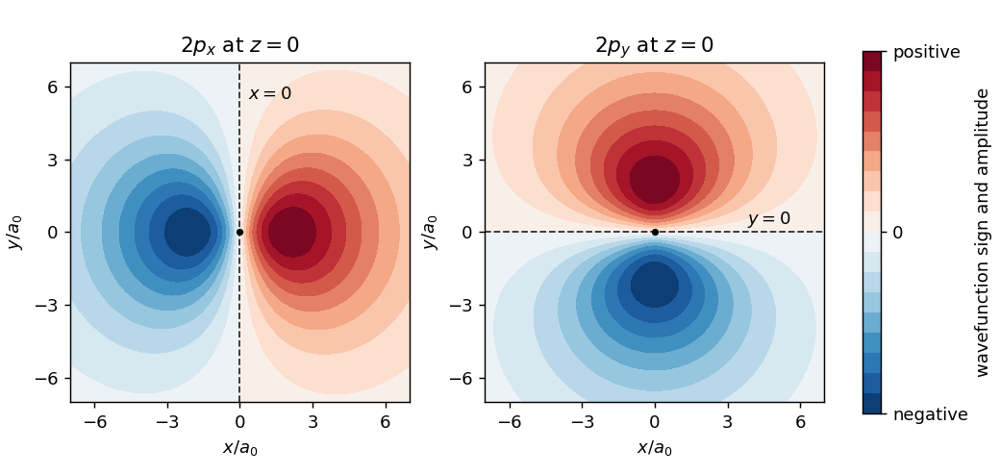

<h1 id="a1/c/solution">Solution</h1>

↑ **Parent:** [C](../c.md)

Denote the two complex spatial [atomic orbitals](../../../../../atomic-orbital.md) by $\psi_+$ and $\psi_-$, retaining the same [spin](../../../../../spin.md) state. With the phases specified by the supplied [spherical harmonics](../../../../../spherical-harmonic.md), choose

$$
\boxed{\psi_x=\frac{\psi_- -\psi_+}{\sqrt2},\qquad
\psi_y=\frac{i(\psi_-+\psi_+)}{\sqrt2}.}
$$

The two original [atomic orbitals](../../../../../atomic-orbital.md) are [orthonormal](../../../../../orthonormal-set.md), so the squared coefficients add to one and these combinations are normalized and mutually [orthogonal](../../../../../orthogonal-vectors.md). Explicitly,

$$
\psi_x=\frac{1}{\sqrt{32\pi}}\,x\,e^{-r/2},\qquad
\psi_y=\frac{1}{\sqrt{32\pi}}\,y\,e^{-r/2},
$$

which are real spatial [wavefunctions](../../../../../wave-function-split.md). An overall sign on either orbital has no physical consequence.

These are the familiar **$2p_x$ and $2p_y$ [p orbitals](../../../../../p-orbital.md)**. Each has two lobes of opposite [wavefunction](../../../../../wave-function-split.md) sign, with an [atomic-orbital nodal plane](../../../../../atomic-orbital-nodal-plane.md) through the [atomic nucleus](../../../../../atomic-nucleus-split.md): $x=0$ for $2p_x$ and $y=0$ for $2p_y$. The sign is a phase convention, not a positive or negative [electric charge](../../../../../electric-charge-split.md); the [probability density](../../../../../probability-density.md) is nonnegative on both lobes.

**[Figure 1](#a1/c/image-original-sections-through-the-real-hydrogen-2p-atomic-orbitals-showing-opposite-phases-and-their-nodal-planes). Original sections through the real hydrogen 2p atomic orbitals, showing opposite phases and their nodal planes**.

## ↑ Ancestors (13)

1. [C](../c.md)
2. [A1](../../a1.md)
3. [Paper 1](../../../paper-1-split.md)
4. [2023](../../../split.md)
5. [Past exam of the chemistry A course of the University of Cambridge](../../../../split.md)
6. [Chemistry A course of the University of Cambridge](../../../../../chemistry-a-course-of-the-university-of-cambridge.md)
7. [Year 2 of the natural sciences course of the University of Cambridge](../../../../../year-2-of-the-natural-sciences-course-of-the-university-of-cambridge.md)
8. [Year of the natural sciences course of the University of Cambridge](../../../../../year-of-the-natural-sciences-course-of-the-university-of-cambridge.md)
9. [Natural sciences course of the University of Cambridge](../../../../../natural-sciences-course-of-the-university-of-cambridge.md)
10. [Course of the University of Cambridge](../../../../../course-of-the-university-of-cambridge.md)
11. [University of Cambridge](../../../../../university-of-cambridge-split.md)
12. [List of universities](../../../../../list-of-universities.md)
13. [Codex Wiki](../../../../../split.md)
