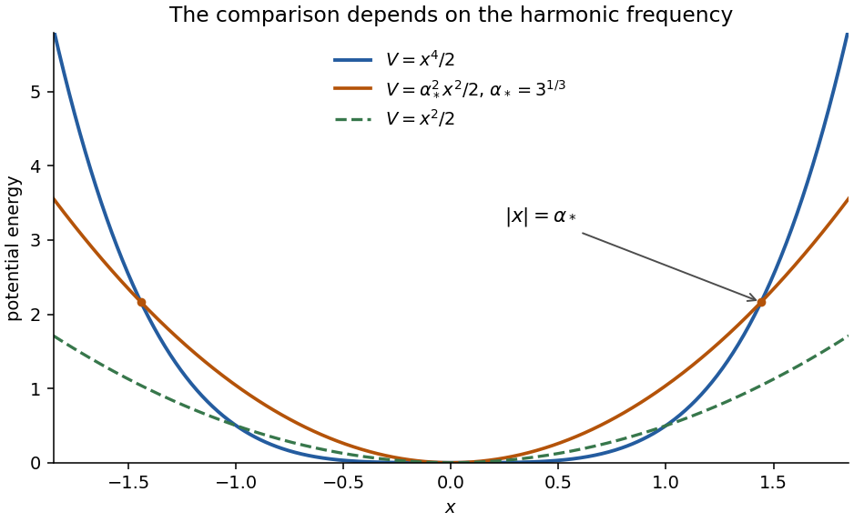

<h1 id="a2/b/iii/solution">Solution</h1>

↑ **Parent:** [Iii](../iii.md)

For any $\alpha>0$, the [Gaussian function](../../../../../../gaussian-function.md) is the exact nodeless ground [wavefunction](../../../../../../wave-function-split.md) of a [quantum harmonic oscillator](../../../../../../quantum-harmonic-oscillator-split.md) with

$$
\boxed{\hat H_{\rm ho}(\alpha)=-\frac12\frac{\mathrm d^2}{\mathrm dx^2}+\frac12\alpha^2x^2,\qquad E_{0,\rm ho}=\frac\alpha2.}
$$

Direct substitution cancels the $x^2$ terms. An additive constant in the potential would simply shift the [eigenvalue](../../../../../../eigenvalue.md).

A natural comparison uses the same optimized width as part (i), $\alpha=3^{1/3}$. The harmonic ground [energy](../../../../../../energy-split.md) is then **$0.72112479$**, compared with the quartic [Gaussian function](../../../../../../gaussian-function.md) expectation **$0.54084359$**. For this common normalized trial,

$$
\langle V_{\rm quartic}\rangle=\frac\alpha8,
\qquad \langle V_{\rm ho}\rangle=\frac\alpha4,
$$

while the [kinetic energy](../../../../../../kinetic-energy.md) [expectation value](../../../../../../expectation-value.md) is $\alpha/4$ in both cases. The quartic potential lies below this harmonic potential for $0<|x|<\alpha$ and above it for $|x|>\alpha$; the difference weighted by the [Gaussian function](../../../../../../gaussian-function.md) is negative, giving the lower expectation.

If the standard unit-frequency oscillator is chosen instead, $\alpha=1$ gives $E_{0,\rm ho}=1/2$, below the optimized quartic upper bound. These are different harmonic comparison potentials, not contradictory answers. Crossing potential curves cannot be ordered globally; the comparison must specify the frequency or [Gaussian function](../../../../../../gaussian-function.md) width used.

**[Figure 2](#a2/b/iii/image-original-comparison-of-the-quartic-potential-with-harmonic-potentials-at-unit-frequency-and-at-the-optimized-gaussian-width). Original comparison of the quartic potential with harmonic potentials at unit frequency and at the optimized Gaussian width**.

## ↑ Ancestors (14)

1. [Iii](../iii.md)
2. [B](../../b.md)
3. [A2](../../../a2.md)
4. [Paper 1](../../../../paper-1-split.md)
5. [2023](../../../../split.md)
6. [Past exam of the chemistry A course of the University of Cambridge](../../../../../split.md)
7. [Chemistry A course of the University of Cambridge](../../../../../../chemistry-a-course-of-the-university-of-cambridge.md)
8. [Year 2 of the natural sciences course of the University of Cambridge](../../../../../../year-2-of-the-natural-sciences-course-of-the-university-of-cambridge.md)
9. [Year of the natural sciences course of the University of Cambridge](../../../../../../year-of-the-natural-sciences-course-of-the-university-of-cambridge.md)
10. [Natural sciences course of the University of Cambridge](../../../../../../natural-sciences-course-of-the-university-of-cambridge.md)
11. [Course of the University of Cambridge](../../../../../../course-of-the-university-of-cambridge.md)
12. [University of Cambridge](../../../../../../university-of-cambridge-split.md)
13. [List of universities](../../../../../../list-of-universities.md)
14. [Codex Wiki](../../../../../../split.md)
