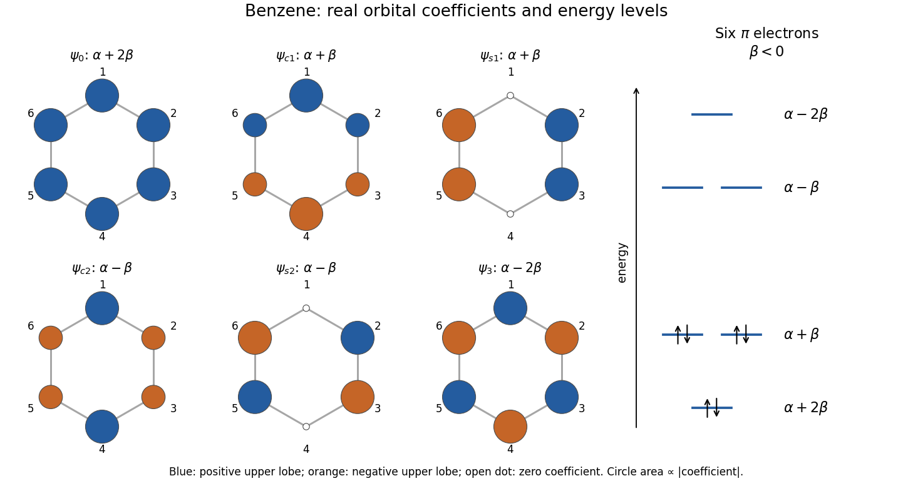

<h1 id="a5/a/i/solution">Solution</h1>

↑ **Parent:** [I](../i.md)

Use the printed numbering: site 1 is at the top on $+y$, sites 2 and 3 are on the right, site 4 is at the bottom, and sites 5 and 6 are on the left; $z$ is perpendicular to the ring. Let $\chi_j$ be consistently phased, [orthonormal](../../../../../../orthonormal-set.md) $p_z$ [atomic orbitals](../../../../../../atomic-orbital.md) at those sites.

In the [Hückel method](../../../../../../huckel-method.md), $H_{jj}=\alpha$ and $H_{j,j\pm1}=\beta$, including the 6–1 bond. Set $\lambda=(\varepsilon-\alpha)/\beta$, with the usual $\beta<0$. The cyclic nearest-neighbour [matrix](../../../../../../matrix.md) has [eigenvalues](../../../../../../eigenvalue.md) $\lambda_k=2\cos(2\pi k/6)$. One real, normalized [orthonormal eigenbasis](../../../../../../orthonormal-eigenbasis.md) is

$$
\begin{array}{c|c|c|c}
&\text{normalized coefficients on sites }1,\ldots,6&\varepsilon&\text{electrons}\\\hline
\psi_0&(1,1,1,1,1,1)/\sqrt6&\alpha+2\beta&2\\
\psi_{c1}&(2,1,-1,-2,-1,1)/\sqrt{12}&\alpha+\beta&2\\
\psi_{s1}&(0,1,1,0,-1,-1)/2&\alpha+\beta&2\\
\psi_{c2}&(2,-1,-1,2,-1,-1)/\sqrt{12}&\alpha-\beta&0\\
\psi_{s2}&(0,1,-1,0,1,-1)/2&\alpha-\beta&0\\
\psi_3&(1,-1,1,-1,1,-1)/\sqrt6&\alpha-2\beta&0
\end{array}
$$

Each row means $\psi=\sum_jc_j\chi_j$. The three lowest [molecular orbitals](../../../../../../molecular-orbital.md) hold the six $\pi$ [electrons](../../../../../../electron.md). Any real [orthogonal](../../../../../../orthogonal-vectors.md) mixing within either degenerate pair is an equally valid choice of [molecular orbitals](../../../../../../molecular-orbital.md); the coefficient vectors specify exactly which sketches are used here.

**[Figure 5](#a5/a/i/image-original-benzene-pi-orbital-energy-diagram-and-six-real-orbital-phase-sketches-in-the-printed-atom-numbering). Original benzene pi-orbital energy diagram and six real orbital phase sketches in the printed atom numbering**.

The coloured circles show the signs and relative magnitudes of the lobes above the molecular plane. The lobes below it have the opposite signs; colours are [quantum phases](../../../../../../quantum-phase.md), not [electric charges](../../../../../../electric-charge-split.md).

## ↑ Ancestors (14)

1. [I](../i.md)
2. [A](../../a.md)
3. [A5](../../../a5.md)
4. [Paper 1](../../../../paper-1-split.md)
5. [2023](../../../../split.md)
6. [Past exam of the chemistry A course of the University of Cambridge](../../../../../split.md)
7. [Chemistry A course of the University of Cambridge](../../../../../../chemistry-a-course-of-the-university-of-cambridge.md)
8. [Year 2 of the natural sciences course of the University of Cambridge](../../../../../../year-2-of-the-natural-sciences-course-of-the-university-of-cambridge.md)
9. [Year of the natural sciences course of the University of Cambridge](../../../../../../year-of-the-natural-sciences-course-of-the-university-of-cambridge.md)
10. [Natural sciences course of the University of Cambridge](../../../../../../natural-sciences-course-of-the-university-of-cambridge.md)
11. [Course of the University of Cambridge](../../../../../../course-of-the-university-of-cambridge.md)
12. [University of Cambridge](../../../../../../university-of-cambridge-split.md)
13. [List of universities](../../../../../../list-of-universities.md)
14. [Codex Wiki](../../../../../../split.md)
