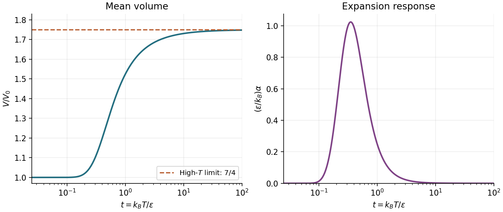
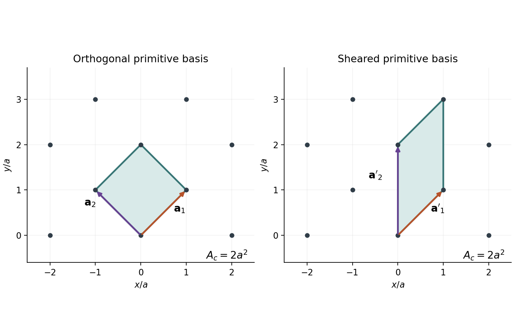
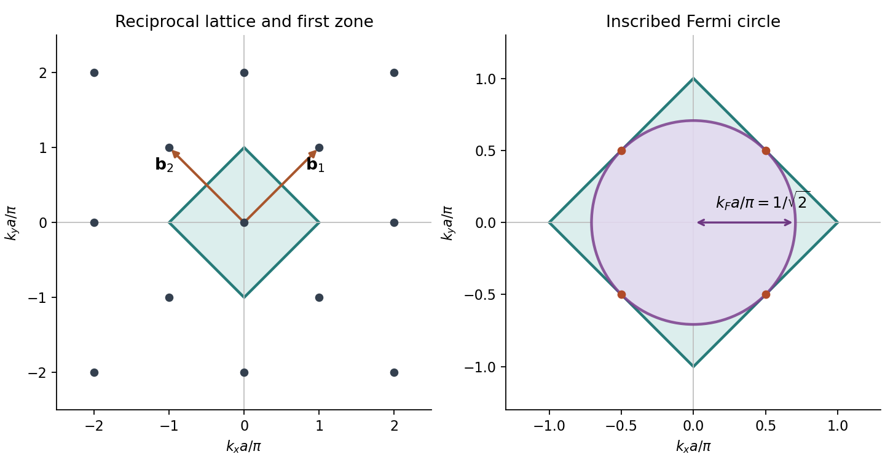
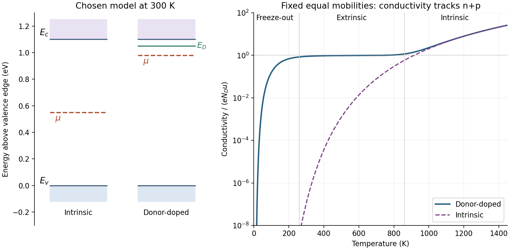

# Paper 2

↑ **Parent:** [2023](../2023.md)

[Original paper, released PDF pages 109–117](https://www.whatdotheyknow.com/request/request_for_nst_past_papers/response/3572306/attach/4/FOI%202026%20862%20Stack%20materials.pdf?cookie_passthrough=1#page=109)

**Table of contents**

- [A6](#a6)
  - [a](#a6/a)
    - [Solution](#a6/a/solution)
  - [b](#a6/b)
    - [Solution](#a6/b/solution)
  - [c](#a6/c)
    - [Solution](#a6/c/solution)
  - [d](#a6/d)
    - [i](#a6/d/i)
      - [Solution](#a6/d/i/solution)
    - [ii](#a6/d/ii)
      - [Solution](#a6/d/ii/solution)
    - [iii](#a6/d/iii)
      - [Solution](#a6/d/iii/solution)
- [A7](#a7)
  - [a](#a7/a)
    - [Solution](#a7/a/solution)
  - [b](#a7/b)
    - [Solution](#a7/b/solution)
  - [c](#a7/c)
    - [Solution](#a7/c/solution)
  - [d](#a7/d)
    - [Solution](#a7/d/solution)
- [A8](#a8)
  - [a](#a8/a)
    - [i](#a8/a/i)
      - [Solution](#a8/a/i/solution)
    - [ii](#a8/a/ii)
      - [Solution](#a8/a/ii/solution)
  - [b](#a8/b)
    - [Solution](#a8/b/solution)
  - [c](#a8/c)
    - [i](#a8/c/i)
      - [Solution](#a8/c/i/solution)
    - [ii](#a8/c/ii)
      - [Solution](#a8/c/ii/solution)
- [A9](#a9)
  - [a](#a9/a)
    - [i](#a9/a/i)
      - [Solution](#a9/a/i/solution)
    - [ii](#a9/a/ii)
      - [Solution](#a9/a/ii/solution)
    - [iii](#a9/a/iii)
      - [Solution](#a9/a/iii/solution)
    - [iv](#a9/a/iv)
      - [Solution](#a9/a/iv/solution)
  - [b](#a9/b)
    - [i](#a9/b/i)
      - [Solution](#a9/b/i/solution)
    - [ii](#a9/b/ii)
      - [Solution](#a9/b/ii/solution)
    - [iii](#a9/b/iii)
      - [Solution](#a9/b/iii/solution)
    - [iv](#a9/b/iv)
      - [Solution](#a9/b/iv/solution)
    - [v](#a9/b/v)
      - [Solution](#a9/b/v/solution)
    - [vi](#a9/b/vi)
      - [Solution](#a9/b/vi/solution)
- [A10](#a10)
  - [a](#a10/a)
    - [i](#a10/a/i)
      - [Solution](#a10/a/i/solution)
    - [ii](#a10/a/ii)
      - [Solution](#a10/a/ii/solution)
    - [iii](#a10/a/iii)
      - [Solution](#a10/a/iii/solution)
    - [iv](#a10/a/iv)
      - [Solution](#a10/a/iv/solution)
    - [v](#a10/a/v)
      - [Solution](#a10/a/v/solution)
  - [b](#a10/b)
    - [i](#a10/b/i)
      - [Solution](#a10/b/i/solution)
    - [ii](#a10/b/ii)
      - [Solution](#a10/b/ii/solution)

## A6

↑ **Parent:** [Paper 2](paper-2.md)

<h3 id="a6/a">a</h3>

↑ **Parent:** [A6](#a6)

<h4 id="a6/a/solution">Solution</h4>

↑ **Parent:** [A](#a6/a)

Let $\varepsilon_s$ be the energy of one adsorbed atom, using the same energy reference as the gas-phase value $\varepsilon_0$. For equivalent, noninteracting [adsorption sites](../../physical-chemistry.md#adsorption-site), choosing the occupied positions gives

$$
\Omega(M,N_1)=\binom{M}{N_1}=\frac{M!}{N_1!(M-N_1)!}.
$$

Every configuration has energy $N_1\varepsilon_s$, so the [canonical lattice-gas partition function](../../statistical-physics.md#canonical-lattice-gas-partition-function) is

$$
\boxed{Z_{N_1}=\binom{M}{N_1}e^{-\beta N_1\varepsilon_s}},\qquad \beta=\frac1{k_BT}.
$$

There is no further $1/N_1!$ factor: the combinatorial choice already counts indistinguishable adsorbates correctly. The [Helmholtz free energy](../../thermodynamic-potential.md#helmholtz-free-energy), using [Stirling's approximation](../../real-analysis.md#stirling-formula) for a macroscopic number of occupied and empty sites, is

$$
A_s\simeq N_1\varepsilon_s+k_BT\left[N_1\ln N_1+(M-N_1)\ln(M-N_1)-M\ln M\right].
$$

Hence the adsorbed-phase [chemical potential](../../chemical-potential.md) at fixed $T,M$ is

$$
\mu_s=\left(\frac{\partial A_s}{\partial N_1}\right)_{T,M}
=\varepsilon_s+k_BT\ln\frac{N_1}{M-N_1}
=\varepsilon_s+k_BT\ln\frac{\theta_1}{1-\theta_1}.
$$

The logarithm comes from configurational entropy: adding an atom is less favorable when vacancies are scarce. In the gas, the stipulated expression can be written

$$
\mu_g=\varepsilon_0+k_BT\ln\frac{p\Lambda^3}{k_BT},\qquad
\Lambda=\frac{h}{\sqrt{2\pi m k_BT}},
$$

where $\Lambda$ is the [thermal de Broglie wavelength](../../canonical-ensemble.md#thermal-de-broglie-wavelength). Equality of [chemical potentials](../../chemical-potential.md) at [chemical equilibrium](../../chemical-potential.md#chemical-equilibrium) gives

$$
\frac{\theta_1}{1-\theta_1}=\frac{p\Lambda^3}{k_BT}
 e^{(\varepsilon_0-\varepsilon_s)/(k_BT)}=bp.
$$

Therefore

$$
\boxed{\theta_1=\frac{bp}{1+bp}},\qquad
\boxed{b=\frac{\Lambda^3}{k_BT}e^{(\varepsilon_0-\varepsilon_s)/(k_BT)}}.
$$

The [binding energy](../../energy.md#binding-energy) $E_b=\varepsilon_0-\varepsilon_s$ is positive for favorable binding. The units of $b$ are inverse pressure, making $bp$ dimensionless. Choosing the adsorbed energy as zero simply sets $\varepsilon_s=0$ and leaves the same physics; it must not remove the relative [binding energy](../../energy.md#binding-energy). This is the [Langmuir isotherm](../../physical-chemistry.md#langmuir-adsorption-model), with low-pressure linear uptake and high-pressure monolayer saturation.

<h3 id="a6/b">b</h3>

↑ **Parent:** [A6](#a6)

<h4 id="a6/b/solution">Solution</h4>

↑ **Parent:** [B](#a6/b)

At [chemical equilibrium](../../chemical-potential.md#chemical-equilibrium), [adsorption](../../physical-chemistry.md#adsorption) and [desorption](../../physical-chemistry.md#desorption) balance:

$$
(1-\theta_1)Mp k_a=\theta_1Mk_d.
$$

Canceling $M$ and rearranging gives

$$
\frac{\theta_1}{1-\theta_1}=\frac{k_a}{k_d}p=K_{\rm ads}p,
\qquad
\boxed{\theta_1=\frac{K_{\rm ads}p}{1+K_{\rm ads}p}}.
$$

Thus **$K_{\rm ads}=b$** when the kinetic and thermodynamic descriptions refer to the same ideal surface and energy convention. In particular,

$$
\frac{k_a}{k_d}=\frac{\Lambda^3}{k_BT}
 e^{(\varepsilon_0-\varepsilon_s)/(k_BT)}.
$$

The ratio fixes the [adsorption isotherm](../../physical-chemistry.md#adsorption-isotherm), while the individual [rate constants](../../chemical-kinetics.md#rate-constant) also determine relaxation toward equilibrium. Here $k_a$ has units of inverse pressure per time and $k_d$ of inverse time, so $K_{\rm ads}$ is dimensional. This equivalent-site arrival/departure argument is the simple case of the [Langmuir adsorption model](../../physical-chemistry.md#langmuir-adsorption-model).[theoretical part, Case I, pp. 1368–1370: equivalent elementary surface spaces and equilibrium adsorption](../../chemistry-bibliography.md#the-adsorption-of-gases-on-plane-surfaces-of-glass-mica-and-platinum-by-irving-langmuir)

<h3 id="a6/c">c</h3>

↑ **Parent:** [A6](#a6)

<h4 id="a6/c/solution">Solution</h4>

↑ **Parent:** [C](#a6/c)

For the [uniform-binding multilayer adsorption model](../../physical-chemistry.md#uniform-binding-multilayer-adsorption-model), $\theta_j$ describes sites of **exactly** height $j$, not the fraction whose height is at least $j$. At equilibrium the upward and downward fluxes on each adjacent pair of heights balance:

$$
k_a p\theta_{j-1}=k_d\theta_j,\qquad j\geq1.
$$

For completeness, stationarity alone gives a height-independent probability current; the reflecting boundary at height zero sets that current to zero. This justifies pairwise balance for a normalizable equilibrium distribution.

Writing $x=K_{\rm ads}p$ gives the recurrence $\theta_j=x\theta_{j-1}$. Successive substitution then yields

$$
\theta_1=x\theta_0,\qquad \theta_2=x^2\theta_0,\qquad
\boxed{\theta_j=x^j\theta_0=(K_{\rm ads}p)^j\theta_0}.
$$

An equilibrium [geometric distribution](../../discrete-probability-distribution.md#geometric-distribution) of unbounded heights requires $0\leq x<1$. The first-layer-only [Langmuir adsorption model](../../physical-chemistry.md#langmuir-adsorption-model) instead truncates the allowed heights at one, which changes the normalization and removes this convergence restriction.

<h3 id="a6/d">d</h3>

↑ **Parent:** [A6](#a6)

<h4 id="a6/d/i">i</h4>

↑ **Parent:** [D](#a6/d)

<h5 id="a6/d/i/solution">Solution</h5>

↑ **Parent:** [I](#a6/d/i)

Normalizing the [geometric distribution](../../discrete-probability-distribution.md#geometric-distribution) requires

$$
1=\theta_0\sum_{j=0}^{\infty}x^j=\frac{\theta_0}{1-x},
\qquad \theta_0=1-x,\qquad 0\leq x<1.
$$

There are $M\theta_j$ sites containing $j$ atoms each. Therefore the expected total population is

$$
N_{\rm ads}=M\sum_{j=1}^{\infty}j\theta_j
=M(1-x)\sum_{j=1}^{\infty}jx^j
=M(1-x)\frac{x}{(1-x)^2}.
$$

Consequently

$$
\boxed{N_{\rm ads}=\frac{Mx}{1-x}
=\frac{M K_{\rm ads}p}{1-K_{\rm ads}p}}.
$$

The quantity counted is the total number of atoms in every layer. The number of nonempty columns is instead $M(1-\theta_0)=Mx$.

<h4 id="a6/d/ii">ii</h4>

↑ **Parent:** [D](#a6/d)

<h5 id="a6/d/ii/solution">Solution</h5>

↑ **Parent:** [Ii](#a6/d/ii)

Dividing the total adsorbed population by the number of underlying [adsorption sites](../../physical-chemistry.md#adsorption-site) gives

$$
\boxed{\theta_{\rm tot}=\frac{N_{\rm ads}}{M}=\frac{bp}{1-bp}},\qquad
\boxed{b=K_{\rm ads}=\frac{k_a}{k_d}},\qquad 0\leq bp<1.
$$

This multilayer uptake can exceed one because it is a mean column height. The occupied-site fraction remains $1-\theta_0=bp<1$. If each layer has the same [binding energy](../../energy.md#binding-energy) and microscopic states assumed in the single-layer calculation, the corresponding thermodynamic expression for $b$ is also the one obtained there; the kinetic ratio is the definition supplied by this multilayer model.

<h4 id="a6/d/iii">iii</h4>

↑ **Parent:** [D](#a6/d)

<h5 id="a6/d/iii/solution">Solution</h5>

↑ **Parent:** [Iii](#a6/d/iii)

**The model allows unlimited column height without weakening the binding or reducing the upward rate as a column grows.** As $bp\to1^-$, successive heights become nearly equally probable and the mean height diverges. At $bp=1$, the putative height weights cannot even be normalized; for $bp>1$ they increase with height and no finite stationary uptake exists.

This is a condensation-like failure of the unbounded-layer idealization, rather than a monolayer reaching its capacity. Finite gas supply, finite geometrical capacity, altered layer binding and interactions can modify or limit the actual uptake. The divergent expression is an equilibrium result only below its convergence threshold.

## A7

↑ **Parent:** [Paper 2](paper-2.md)

<h3 id="a7/a">a</h3>

↑ **Parent:** [A7](#a7)

<h4 id="a7/a/solution">Solution</h4>

↑ **Parent:** [A](#a7/a)

Choose the ground-state energy as zero and write $x=\varepsilon/(k_BT)$. The [molecular partition function](../../canonical-ensemble.md#molecular-partition-function) must sum individual states, so the triply degenerate excited level contributes three [Boltzmann factors](../../canonical-ensemble.md#boltzmann-factor):

$$
\boxed{q=1+3e^{-x}}.
$$

The probabilities of occupying the two **levels** are

$$
\boxed{P_0=\frac1{1+3e^{-x}}},\qquad
\boxed{P_1=\frac{3e^{-x}}{1+3e^{-x}}}.
$$

Each of the three individual excited states has probability $e^{-x}/q$. At high temperature the four states become equiprobable, so the two levels have probabilities $1/4$ and $3/4$, not $1/2$ each. This is the distinction between a level and its [state degeneracy](../../statistical-physics.md#state-degeneracy).

<h3 id="a7/b">b</h3>

↑ **Parent:** [A7](#a7)

<h4 id="a7/b/solution">Solution</h4>

↑ **Parent:** [B](#a7/b)

Use the [additive-volume two-level system](../../canonical-ensemble.md#additive-volume-two-level-system) implicit in the model: each excited particle increases the volume by the same increment. The difference between the two endpoint volumes is $V_0$, so that increment is $v=V_0/N$.

If $N_1$ particles are excited, $V=V_0+(V_0/N)N_1$. Linearity of the expectation gives $\langle N_1\rangle=NP_1$, hence

$$
\boxed{V(T)=V_0\left(1+\frac{3e^{-x}}{1+3e^{-x}}\right)
=V_0\frac{1+6e^{-x}}{1+3e^{-x}}}.
$$

As $T\to0$, $V\to V_0$. As $T\to\infty$, only three quarters of the particles are excited on average, giving $V\to7V_0/4$, rather than the all-excited endpoint $2V_0$. These limits also check the inclusion of [state degeneracy](../../statistical-physics.md#state-degeneracy).

<h3 id="a7/c">c</h3>

↑ **Parent:** [A7](#a7)

<h4 id="a7/c/solution">Solution</h4>

↑ **Parent:** [C](#a7/c)

The definition uses a fixed reference volume, so it is a [reference-volume thermal expansion coefficient](../../thermodynamics.md#reference-volume-thermal-expansion-coefficient):

$$
\alpha=\frac{d}{dT}\frac{V(T)}{V_0}=\frac{dP_1}{dT}.
$$

Let $y=3e^{-\varepsilon/(k_BT)}$. Since

$$
\frac{dy}{dT}=\frac{\varepsilon}{k_BT^2}y,
\qquad \frac{d}{dy}\frac{y}{1+y}=\frac1{(1+y)^2},
$$

we obtain

$$
\boxed{\alpha(T)=\frac{\varepsilon}{k_BT^2}
\frac{3e^{-\varepsilon/(k_BT)}}{\left(1+3e^{-\varepsilon/(k_BT)}\right)^2}}.
$$

It is positive and has units of inverse temperature. Equivalently, $\alpha=[\varepsilon/(k_BT^2)]P_1(1-P_1)$: the response reflects changes in the thermally occupied excited population. The usual instantaneous fractional [thermal expansion coefficient](../../thermodynamics.md#coefficient-of-thermal-expansion) $V^{-1}dV/dT$ would instead equal $\alpha V_0/V$; substituting that different definition would change the answer.

**[Figure 1](#a7/c/image-degeneracy-limits-the-high-temperature-volume-of-the-two-level-model). Degeneracy limits the high-temperature volume of the two-level model**. Original dimensionless calculation with $t=k_BT/\varepsilon$. The plotted expansion response is $(\varepsilon/k_B)\alpha$. The high-temperature volume approaches $7V_0/4$, with vanishing response at both temperature extremes.

<h3 id="a7/d">d</h3>

↑ **Parent:** [A7](#a7)

<h4 id="a7/d/solution">Solution</h4>

↑ **Parent:** [D](#a7/d)

At low temperature, $x=\varepsilon/(k_BT)\gg1$, so the denominator in the exact expression approaches one:

$$
\boxed{\alpha\sim\frac{3\varepsilon}{k_BT^2}
 e^{-\varepsilon/(k_BT)}\longrightarrow0\quad(T\to0)}.
$$

The exponential suppression dominates the $T^{-2}$ factor. Almost all particles remain in the ground state, so very little volume change is thermally accessible.

At high temperature, $e^{-x}\to1$, and therefore

$$
\boxed{\alpha\sim\frac{3\varepsilon}{16k_BT^2}
\longrightarrow0\quad(T\to\infty)}.
$$

The excited fraction has already approached $3/4$, so further heating barely changes it. Both limits are consistent with a bounded [two-level system](../../canonical-ensemble.md#two-level-system); the high-temperature vanishing does not imply that ordinary materials cease expanding when additional levels or other mechanisms become accessible.

## A8

↑ **Parent:** [Paper 2](paper-2.md)

<h3 id="a8/a">a</h3>

↑ **Parent:** [A8](#a8)

<h4 id="a8/a/i">i</h4>

↑ **Parent:** [A](#a8/a)

<h5 id="a8/a/i/solution">Solution</h5>

↑ **Parent:** [I](#a8/a/i)

For an ideal mixture, the [Helmholtz free energy](../../thermodynamic-potential.md#helmholtz-free-energy) is a sum over species. At fixed $T,V$ and all other populations, the [molecular partition function](../../canonical-ensemble.md#molecular-partition-function) $q_i$ does not depend on $N_i$. Differentiating the contribution written using each species' own energy reference gives

$$
\frac{\partial}{\partial N_i}\left[-N_i k_BT\ln q_i+k_BT(N_i\ln N_i-N_i)\right]
=-k_BT\ln q_i+k_BT\ln N_i.
$$

The desired additive energy term requires a consistent [energy reference in molecular partition functions](../../canonical-ensemble.md#energy-reference-in-molecular-partition-functions). Let $\varepsilon^{0,i}$ be the energy per molecule of species $i$ in its reference state, measured relative to a common chemical energy zero, and let $q_i$ sum excitations above that reference. Then

$$
q_i^{\rm abs}=e^{-\varepsilon^{0,i}/(k_BT)}q_i,
\qquad
A_i=N_i\varepsilon^{0,i}-N_i k_BT\ln q_i+k_BT(N_i\ln N_i-N_i).
$$

Therefore

$$
\boxed{\mu_i=\left(\frac{\partial A}{\partial N_i}\right)_{T,V,N_{j\ne i}}
=\varepsilon^{0,i}-k_BT\ln\frac{q_i}{N_i}}.
$$

One convenient choice is each species' rovibrational ground state, so the molecular reference includes its [zero-point energy](../../quantum-harmonic-oscillator.md#zero-point-energy). A different consistent reference is possible, but the corresponding [partition function](../../canonical-ensemble.md#canonical-partition-function) must change. The offset cannot arise from differentiation of a formula that has already omitted it, and it must not be counted twice. These [chemical potentials](../../chemical-potential.md) are per particle; molar expressions instead use the [molar gas constant](../../ideal-gas.md#molar-gas-constant).

<h4 id="a8/a/ii">ii</h4>

↑ **Parent:** [A](#a8/a)

<h5 id="a8/a/ii/solution">Solution</h5>

↑ **Parent:** [Ii](#a8/a/ii)

For an ideal gas, translation makes the [molecular partition function](../../canonical-ensemble.md#molecular-partition-function) proportional to volume. Define the [molecular partition function density](../../canonical-ensemble.md#molecular-partition-function-density) and number concentration by

$$
f_i=\frac{q_i}{V},\qquad c_i=\frac{N_i}{V}.
$$

Then

$$
\boxed{\mu_i=\varepsilon^{0,i}-k_BT\ln\frac{f_i}{c_i}}.
$$

Both $f_i$ and $c_i$ have units of inverse volume, so their ratio is dimensionless. If concentrations are specified in moles per volume instead, replace $c_i$ in this microscopic expression by $N_A$ times that molar concentration, with consistent volume units.

<h3 id="a8/b">b</h3>

↑ **Parent:** [A8](#a8)

<h4 id="a8/b/solution">Solution</h4>

↑ **Parent:** [B](#a8/b)

At [chemical equilibrium](../../chemical-potential.md#chemical-equilibrium), $\mu_{\rm AB}=\mu_{\rm A}+\mu_{\rm B}$. Using the number-concentration form gives

$$
0=\Delta\varepsilon_0-k_BT\ln\left[
\frac{f_{\rm A}f_{\rm B}}{f_{\rm AB}}
\frac{c_{\rm AB}}{c_{\rm A}c_{\rm B}}\right],
\qquad
\Delta\varepsilon_0=\varepsilon^{0,\rm A}+\varepsilon^{0,\rm B}-\varepsilon^{0,\rm AB}.
$$

Here $\Delta\varepsilon_0$ is the reaction energy between the chosen molecular reference states. Rearranging,

$$
\frac{c_{\rm A}c_{\rm B}}{c_{\rm AB}}
=\frac{f_{\rm A}f_{\rm B}}{f_{\rm AB}}e^{-\Delta\varepsilon_0/(k_BT)}.
$$

Define the [dimensionless concentration equilibrium constant](../../chemical-potential.md#dimensionless-concentration-equilibrium-constant) by

$$
K_c=\frac{(c_{\rm A}/c^\circ)(c_{\rm B}/c^\circ)}{c_{\rm AB}/c^\circ}
=\frac{c_{\rm A}c_{\rm B}}{c_{\rm AB}c^\circ}.
$$

Thus

$$
\boxed{K_c=\frac{f_{\rm A}f_{\rm B}}{f_{\rm AB}}
\frac1{c^\circ}e^{-\Delta\varepsilon_0/(k_BT)}}.
$$

The [standard concentration](../../chemical-potential.md#standard-concentration) $c^\circ$ has the same units as $c_i$. It converts concentration ratios to ideal [thermodynamic activities](../../chemical-potential.md#thermodynamic-activity); changing it changes the numerical dimensionless $K_c$ for this dissociation, which creates an extra particle. The unnormalized quotient $c_{\rm A}c_{\rm B}/c_{\rm AB}$ instead has concentration units.[entries equilibrium constant and standard equilibrium constant: distinguish concentration quotients from the thermodynamic dimensionless standard constant](../../chemistry-bibliography.md#iupac-compendium-of-chemical-terminology-gold-book-by-international-union-of-pure-and-applied-chemistry)

<h3 id="a8/c">c</h3>

↑ **Parent:** [A8](#a8)

<h4 id="a8/c/i">i</h4>

↑ **Parent:** [C](#a8/c)

<h5 id="a8/c/i/solution">Solution</h5>

↑ **Parent:** [I](#a8/c/i)

First construct the energy cost for [heterolysis](../../chemical-bond.md#heterolysis) from the molecular potential minimum. Dissociation to neutral atoms costs $D_e$, ionizing [caesium](../../chemical-substance.md#caesium) costs $I$, and attachment of the electron to [iodine](../../chemical-substance.md#iodine) releases EA. Therefore

$$
\Delta\varepsilon_{\rm min}=D_e+I-\mathrm{EA}=4.36\,\mathrm{eV}.
$$

For the **ground-state reference convention** used above, the initial molecule already has vibrational [zero-point energy](../../quantum-harmonic-oscillator.md#zero-point-energy). Thus its [ground-state dissociation energy](../../chemical-bond.md#ground-state-dissociation-energy) is $D_0=D_e-\tfrac12k_B\theta_{\rm vib}$ and

$$
E_{\rm ZP}=\tfrac12(8.61733\times10^{-5})(172)\,\mathrm{eV}
=0.0074109\,\mathrm{eV},
$$

$$
\boxed{\Delta\varepsilon_0=D_0+I-\mathrm{EA}
=4.35259\,\mathrm{eV}\simeq4.353\,\mathrm{eV}}.
$$

At $3000\,\mathrm K$, $k_BT=0.258520\,\mathrm{eV}$, giving

$$
\boxed{e^{-\Delta\varepsilon_0/(k_BT)}=4.8750\times10^{-8}}.
$$

Alternatively, retaining the molecular minimum as reference gives **$\Delta\varepsilon_{\rm min}=4.36\,\mathrm{eV}$** and a Boltzmann factor **$4.7372\times10^{-8}$**. That convention must use the full [vibrational partition function](../../canonical-ensemble.md#vibrational-partition-function), including $e^{-\theta_{\rm vib}/(2T)}$, in the next part. The ground-state convention instead uses $q_{\rm vib}^0$. Either consistent convention gives the same final [equilibrium constant](../../chemical-potential.md#equilibrium-constant); using the ground-state reaction energy with the full zero-point factor would count the correction twice. The distinction between $D_e$ and $D_0$ is a distinction between initial states, not a change in the dissociation products.[dissociation energy and bond-dissociation energy in theoretical chemistry: well-minimum and ground-state energy conventions](../../chemistry-bibliography.md#iupac-compendium-of-chemical-terminology-gold-book-by-international-union-of-pure-and-applied-chemistry)

<h4 id="a8/c/ii">ii</h4>

↑ **Parent:** [C](#a8/c)

<h5 id="a8/c/ii/solution">Solution</h5>

↑ **Parent:** [Ii](#a8/c/ii)

Use ground-state references and the supplied ideal-gas, rigid-rotor and harmonic-oscillator approximations. The two ions have closed electronic shells; take their electronic ground-state degeneracies and the molecular electronic ground-state degeneracy as one, and neglect higher electronic levels. Consistently treated nuclear-spin factors cancel between the species. Since the molecule is heteronuclear, its [rotational symmetry number](../../molecule.md#rotational-symmetry-number) is one.

Let $\mu_r=m_{\rm Cs}m_{\rm I}/m_{\rm CsI}$ be the [reduced mass](../../classical-mechanics.md#reduced-mass), neglecting the negligible mass correction from electron transfer. The ratio of [translational partition functions](../../canonical-ensemble.md#translational-partition-function) per volume reduces to

$$
\frac{f_{{\rm trans},{\rm Cs}^+}f_{{\rm trans},{\rm I}^-}}
 {f_{{\rm trans},{\rm CsI}}}
=\left(\frac{2\pi\mu_r k_BT}{h^2}\right)^{3/2},
\qquad \frac{\mu_r}{m_u}=\frac{133\times127}{260}=64.9654.
$$

The molecule has additional rotational and vibrational states, whereas the monatomic ions do not. At $3000\,\mathrm K$,

$$
q_{\rm rot}=\frac{3000}{0.0340}=8.82353\times10^4,
\qquad
q_{\rm vib}^0=\frac1{1-e^{-172/3000}}=17.9466,
$$

$$
\left(\frac{2\pi\mu_r k_BT}{h^2}\right)^{3/2}
=1.61698\times10^{34}\,\mathrm{m^{-3}}.
$$

Hence the dimensional equilibrium quotient is

$$
C=\frac{f_{{\rm Cs}^+}f_{{\rm I}^-}}{f_{{\rm CsI}}}
 e^{-\Delta\varepsilon_0/(k_BT)}
=\frac{1.61698\times10^{34}}{(8.82353\times10^4)(17.9466)}
 (4.87497\times10^{-8})\,\mathrm{m^{-3}},
$$

$$
\boxed{C=4.97797\times10^{20}\,\mathrm{m^{-3}}},\qquad
\boxed{K_c=\frac{4.97797\times10^{20}\,\mathrm{m^{-3}}}{c^\circ}}.
$$

The last form makes the unassigned [standard concentration](../../chemical-potential.md#standard-concentration) explicit. For the common choice of $1\,\mathrm{mol\,dm^{-3}}$, the corresponding microscopic reference is $c^\circ=6.02214\times10^{26}\,\mathrm{m^{-3}}$, giving

$$
\boxed{K_c\simeq8.27\times10^{-7}\quad(c^\circ=1\,\mathrm{mol\,dm^{-3}})}.
$$

Equivalently, the dimensional molar quotient is $8.27\times10^{-7}\,\mathrm{mol\,dm^{-3}}$. A pressure-based gas standard is a different convention: taking $c^\circ=p^\circ/(k_BT)$ with $p^\circ=1\,\mathrm{bar}$ would give $2.06\times10^{-4}$, rather than the same numerical constant.

The well-minimum convention gives the identical answer because

$$
\frac{e^{-(D_e+I-\mathrm{EA})/(k_BT)}}
 {e^{-\theta_{\rm vib}/(2T)}q_{\rm vib}^0}
=\frac{e^{-[D_e+I-\mathrm{EA}-k_B\theta_{\rm vib}/2]/(k_BT)}}{q_{\rm vib}^0}.
$$

Constants used here are $h=6.62607015\times10^{-34}\,\mathrm{J\,s}$, $k_B=1.380649\times10^{-23}\,\mathrm{J\,K^{-1}}$, $m_u\simeq1.66053907\times10^{-27}\,\mathrm{kg}$ and $N_A=6.02214076\times10^{23}\,\mathrm{mol^{-1}}$.[fundamental-constant tables: Planck constant, Boltzmann constant, atomic mass constant and Avogadro constant](../../physics-bibliography.md#codata-recommended-values-of-the-fundamental-physical-constants-2022-by-national-institute-of-standards-and-technology)

## A9

↑ **Parent:** [Paper 2](paper-2.md)

<h3 id="a9/a">a</h3>

↑ **Parent:** [A9](#a9)

<h4 id="a9/a/i">i</h4>

↑ **Parent:** [A](#a9/a)

<h5 id="a9/a/i/solution">Solution</h5>

↑ **Parent:** [I](#a9/a/i)

The stipulated conventional cell is a square of side $2a$. Although introduced as a [centered rectangular lattice](../../quantum-scattering.md#centered-rectangular-lattice), this equal-side case is a [square Bravais lattice](../../quantum-scattering.md#square-bravais-lattice) viewed with a rotated primitive basis. A corner-to-center separation is

$$
d_{\rm nn}=\sqrt{a^2+a^2}=\sqrt2\,a,
$$

which is shorter than the $2a$ separation between adjacent conventional corners. Consequently the first contact of equal circles occurs at

$$
2r=d_{\rm nn},\qquad r=\frac{a}{\sqrt2}.
$$

The conventional square represents two [lattice points](../../quantum-scattering.md#lattice-point): one from its four shared corners and one from its center. Its [packing fraction](../../euclidean-geometry.md#packing-fraction) is therefore

$$
\boxed{\eta=\frac{2\pi r^2}{(2a)^2}=\frac{\pi}{4}\simeq0.7854}.
$$

Equivalently, one circle occupies each primitive area $2a^2$. This is square [circle packing](../../euclidean-geometry.md#circle-packing); the drawing does not define a triangular close-packed lattice.

<h4 id="a9/a/ii">ii</h4>

↑ **Parent:** [A](#a9/a)

<h5 id="a9/a/ii/solution">Solution</h5>

↑ **Parent:** [Ii](#a9/a/ii)

A [unit cell](../../quantum-scattering.md#unit-cell) is a repeat region whose lattice translations tile the plane. A [primitive unit cell](../../quantum-scattering.md#primitive-unit-cell) represents exactly one [lattice point](../../quantum-scattering.md#lattice-point) and has the minimum repeat area for a lattice basis.

**Cell A is nonprimitive; cell B is primitive.** A represents two points and has area $4a^2$. B has four shared corner points and no additional interior point, represents one point and has area $2a^2$. Fractional corner counting refers to the tiling, not to fractional physical atoms.

<h4 id="a9/a/iii">iii</h4>

↑ **Parent:** [A](#a9/a)

<h5 id="a9/a/iii/solution">Solution</h5>

↑ **Parent:** [Iii](#a9/a/iii)

Using the printed $x,y$ axes, take a lower vertex of cell B as origin. One allowed pair of [primitive lattice translation vectors](../../quantum-scattering.md#primitive-lattice-translation-vector) is

$$
\boxed{\mathbf a_1=a(\hat{\mathbf x}+\hat{\mathbf y}),\qquad
\mathbf a_2=a(-\hat{\mathbf x}+\hat{\mathbf y})}.
$$

Both vectors connect nearest [lattice points](../../quantum-scattering.md#lattice-point), have length $\sqrt2a$, and are perpendicular. Their determinant has magnitude $2a^2$, consistent with a primitive area. Exchanging them or reversing their directions gives equivalent basis conventions; the corresponding [reciprocal lattice vectors](../../quantum-scattering.md#reciprocal-lattice-vector) must then use the same convention.

<h4 id="a9/a/iv">iv</h4>

↑ **Parent:** [A](#a9/a)

<h5 id="a9/a/iv/solution">Solution</h5>

↑ **Parent:** [Iv](#a9/a/iv)

A visibly different primitive parallelogram is generated by

$$
\boxed{\mathbf a'_1=\mathbf a_1=a(1,1),\qquad
\mathbf a'_2=\mathbf a_1+\mathbf a_2=a(0,2)}.
$$

Its vertices, relative to one lattice point, are $(0,0)$, $(a,a)$, $(a,3a)$ and $(0,2a)$. Its area is

$$
\boxed{A'_c=\left|\det\begin{pmatrix}a&0\\a&2a\end{pmatrix}\right|=2a^2}.
$$

The basis change has integer matrix $\begin{pmatrix}1&1\\0&1\end{pmatrix}$ with determinant one. It is invertible over the integers, so the new vectors generate every original lattice point, not merely a sublattice. The cell is therefore primitive despite being sheared relative to cell B.

**[Figure 2](#a9/a/iv/image-two-primitive-bases-generate-the-same-centered-square-lattice). Two primitive bases generate the same centered-square lattice**. Original coordinate construction from the derived translation vectors, with axes measured in units of $a$. The left cell uses the diagonal orthogonal basis; the right uses a determinant-one shear. Both highlighted parallelograms have area $2a^2$ and one lattice point per cell.

<h3 id="a9/b">b</h3>

↑ **Parent:** [A9](#a9)

<h4 id="a9/b/i">i</h4>

↑ **Parent:** [B](#a9/b)

<h5 id="a9/b/i/solution">Solution</h5>

↑ **Parent:** [I](#a9/b/i)

For direct-lattice points $x_n=na$, a [lattice-periodic plane wave](../../quantum-scattering.md#lattice-periodic-plane-wave) must have the same phase at every translated lattice point:

$$
e^{iG(x+a)}=e^{iGx},\qquad e^{iGa}=1.
$$

Thus $Ga=2\pi m$, with integer $m$, and the [reciprocal lattice](../../quantum-scattering.md#reciprocal-lattice) is

$$
\boxed{G_m=\frac{2\pi m}{a},\qquad m\in\mathbb Z}.
$$

Its spacing is $2\pi/a$. These plane waves execute an integer number of complete cycles within a direct-lattice period, so their wavelength magnitudes are $a/|m|$ for $m\ne0$.

A general electronic Bloch wave need not itself be lattice-periodic: wavevectors differing by $G_m$ have the same translation phase. The [reciprocal lattice](../../quantum-scattering.md#reciprocal-lattice) labels that equivalence, while a large finite specimen with [periodic boundary conditions](../../differential-equation.md#periodic-boundary-conditions) has a much finer grid of allowed electronic wavevectors.

<h4 id="a9/b/ii">ii</h4>

↑ **Parent:** [B](#a9/b)

<h5 id="a9/b/ii/solution">Solution</h5>

↑ **Parent:** [Ii](#a9/b/ii)

Construct [Bragg planes](../../quantum-scattering.md#bragg-plane) by taking the midpoints between the reciprocal origin and the other [reciprocal lattice](../../quantum-scattering.md#reciprocal-lattice) points. In one dimension these are points at $k=m\pi/a$, for nonzero integer $m$.

The **[first Brillouin zone](../../bloch-s-theorem.md#first-brillouin-zone)** is the interval bounded by the nearest two such points:

$$
\boxed{-\frac{\pi}{a}\leq k\leq\frac{\pi}{a}}.
$$

The **[second Brillouin zone](../../bloch-s-theorem.md#second-brillouin-zone)** consists of the next intervals on both sides:

$$
\boxed{-\frac{2\pi}{a}\leq k\leq-\frac{\pi}{a}
\quad\text{or}\quad
\frac{\pi}{a}\leq k\leq\frac{2\pi}{a}}.
$$

Boundary points may be assigned to one adjacent zone to avoid double counting. The first zone is reached from the origin without crossing a Bragg point; the second is reached after crossing one. Each zone has total length $2\pi/a$. In particular, the two separated pieces of the second zone are not the entire translated first-zone interval centered at $2\pi/a$.

<h4 id="a9/b/iii">iii</h4>

↑ **Parent:** [B](#a9/b)

<h5 id="a9/b/iii/solution">Solution</h5>

↑ **Parent:** [Iii](#a9/b/iii)

With the chosen basis, let $\mathbf b_1=(u,v)$. The [reciprocal lattice](../../quantum-scattering.md#reciprocal-lattice) conditions give

$$
a(u+v)=2\pi,\qquad a(-u+v)=0,
$$

so $u=v=\pi/a$. Similarly, $\mathbf a_1\cdot\mathbf b_2=0$ and $\mathbf a_2\cdot\mathbf b_2=2\pi$ give

$$
\boxed{\mathbf b_1=\frac{\pi}{a}(1,1),\qquad
\mathbf b_2=\frac{\pi}{a}(-1,1)}.
$$

All reciprocal points are

$$
\mathbf G=m\mathbf b_1+n\mathbf b_2
=\frac{\pi}{a}(m-n,m+n),\qquad m,n\in\mathbb Z.
$$

Thus, in coordinates measured in $\pi/a$, the two integer coordinates have the same parity. The [reciprocal lattice](../../quantum-scattering.md#reciprocal-lattice) is another rotated [square Bravais lattice](../../quantum-scattering.md#square-bravais-lattice), with nearest-neighbor spacing $\sqrt2\pi/a$.

**[Figure 3](#a9/b/iii/image-reciprocal-lattice-first-zone-and-the-inscribed-fermi-circle). Reciprocal lattice, first zone and the inscribed Fermi circle**. Original construction in coordinates $k_xa/\pi$ and $k_ya/\pi$. The reciprocal points have integer coordinates of the same parity. The shaded diamond is the origin-centered Wigner-Seitz cell; the circle has radius $1/\sqrt2$ in these units and touches its four sides.

<h4 id="a9/b/iv">iv</h4>

↑ **Parent:** [B](#a9/b)

<h5 id="a9/b/iv/solution">Solution</h5>

↑ **Parent:** [Iv](#a9/b/iv)

The [first Brillouin zone](../../bloch-s-theorem.md#first-brillouin-zone) is the origin-centered [Wigner-Seitz cell](../../quantum-scattering.md#wigner-seitz-cell) of the [reciprocal lattice](../../quantum-scattering.md#reciprocal-lattice). Its nearest reciprocal points are $\pm\mathbf b_1$ and $\pm\mathbf b_2$. The perpendicular bisectors follow from

$$
|\mathbf k|^2=|\mathbf k-\mathbf G|^2
\quad\Longleftrightarrow\quad
\mathbf k\cdot\mathbf G=\frac{|\mathbf G|^2}{2}.
$$

Consequently the zone is

$$
\boxed{|k_x+k_y|\leq\frac{\pi}{a},\qquad
|k_y-k_x|\leq\frac{\pi}{a}}.
$$

It is the diamond with vertices

$$
\boxed{(\pi/a,0),\ (0,\pi/a),\ (-\pi/a,0),\ (0,-\pi/a)}.
$$

The reciprocal-space sketch above shows these boundaries. Its area is $2\pi^2/a^2=(2\pi)^2/A_c$, where $A_c=2a^2$. This area check rules out mistakenly using the nonprimitive conventional cell to define a smaller first zone.

<h4 id="a9/b/v">v</h4>

↑ **Parent:** [B](#a9/b)

<h5 id="a9/b/v/solution">Solution</h5>

↑ **Parent:** [V](#a9/b/v)

For an isotropic two-dimensional free-electron model, the occupied states form a disk centered at the reciprocal origin. Its [Fermi circle](../../fermi-liquid.md#fermi-circle) first touches a zone side when its radius equals half the distance to a nearest reciprocal point:

$$
\boxed{k_F=\frac{|\mathbf b_1|}{2}
=\frac{\pi}{\sqrt2\,a}}.
$$

The contact points have coordinates $(\pm\pi/(2a),\pm\pi/(2a))$ with all four sign combinations. The distance to a zone vertex is $\pi/a$, which is larger; that distance would describe contact with a corner after the circle had already crossed a side.

<h4 id="a9/b/vi">vi</h4>

↑ **Parent:** [B](#a9/b)

<h5 id="a9/b/vi/solution">Solution</h5>

↑ **Parent:** [Vi](#a9/b/vi)

There are $L$ primitive cells and therefore $L$ [lattice points](../../quantum-scattering.md#lattice-point). The specified reciprocal-space density $LA_c/(2\pi)^2$ counts distinct allowed wavevectors; each supports two electron [spin](../../angular-momentum-operator.md#spin) states. Filling the disk at zero temperature gives

$$
N_e=2\frac{LA_c}{(2\pi)^2}\,\pi k_F^2.
$$

Using $A_c=2a^2$ and $k_F^2=\pi^2/(2a^2)$,

$$
\boxed{\frac{N_e}{L}=\frac{A_c k_F^2}{2\pi}
=\frac{\pi}{2}\simeq1.571\text{ electrons per lattice point}}.
$$

The circle fills a fraction $\pi/4$ of the first-zone area, while one spin-degenerate band has two states per primitive cell; these give the same result. A single-spin count would instead be $\pi/4$, omitting the physical twofold [spin degeneracy](../../statistical-physics.md#spin-degeneracy) of this model. The circle has only just reached the sides, so the zone corners remain unfilled: first contact does not mean filling the entire first band.

## A10

↑ **Parent:** [Paper 2](paper-2.md)

<h3 id="a10/a">a</h3>

↑ **Parent:** [A10](#a10)

<h4 id="a10/a/i">i</h4>

↑ **Parent:** [A](#a10/a)

<h5 id="a10/a/i/solution">Solution</h5>

↑ **Parent:** [I](#a10/a/i)

The [density of states](../../quantum-ideal-gas-statistics.md#density-of-states) $D(E)$ counts available one-electron states: $D(E)\,dE$ is the number with energies in $[E,E+dE]$. It describes the spectrum, irrespective of whether those states contain electrons.

The [density of occupied states](../../quantum-ideal-gas-statistics.md#density-of-occupied-states) additionally weights each state by the [Fermi-Dirac distribution](../../quantum-ideal-gas-statistics.md#fermi-dirac-distribution):

$$
\boxed{Z(E)=D(E)f(E)}.
$$

Thus $Z(E)\,dE$ is the mean number of electrons in that energy interval, and $N_e=\int Z(E)\,dE$. State and electron densities must use the same normalization, including whether they are extensive or per volume and whether $D$ already includes [spin degeneracy](../../statistical-physics.md#spin-degeneracy). The symbol $Z(E)$ here denotes occupied density, not a canonical [partition function](../../canonical-ensemble.md#canonical-partition-function).

<h4 id="a10/a/ii">ii</h4>

↑ **Parent:** [A](#a10/a)

<h5 id="a10/a/ii/solution">Solution</h5>

↑ **Parent:** [Ii](#a10/a/ii)

**The finite-temperature [Fermi level](../../quantum-ideal-gas-statistics.md#fermi-level) lies at the middle of the gap in the stipulated symmetric intrinsic model:**

$$
\boxed{\mu=\frac{E_c+E_v}{2}}.
$$

Here $E_v$ is the valence-band maximum and $E_c$ the conduction-band minimum. Thermal promotion creates one [conduction electron](../../quantum-mechanics.md#conduction-electron) and one [electron hole](../../quantum-mechanics.md#electron-hole), so [charge neutrality](../../electric-charge.md#charge-neutrality) requires $n=p$. Equal constant densities of states in broad, symmetric bands give equal populations when the distances $E_c-\mu$ and $\mu-E_v$ are equal.

This is a statement about the [chemical potential](../../chemical-potential.md), not an available electron state in the gap. Unequal band densities of states would shift the [intrinsic Fermi level](../../semiconductor.md#intrinsic-fermi-level) away from exact midgap; the equality follows from the symmetry assumed here.

<h4 id="a10/a/iii">iii</h4>

↑ **Parent:** [A](#a10/a)

<h5 id="a10/a/iii/solution">Solution</h5>

↑ **Parent:** [Iii](#a10/a/iii)

Heating promotes electrons across the [band gap](../../bloch-s-theorem.md#band-gap), creating mobile [conduction electrons](../../quantum-mechanics.md#conduction-electron) and [electron holes](../../quantum-mechanics.md#electron-hole). Their contributions add:

$$
\boxed{\sigma=e(nu_e+pu_h)},
$$

where $u_e,u_h$ are the [electron mobility](../../electric-charge.md#electron-mobility) and [hole mobility](../../electric-charge.md#hole-mobility), and $e$ is the positive elementary-charge magnitude. The increase in [carrier density](../../electric-charge.md#carrier-density) gives the rising [electrical conductivity](../../electric-charge.md#electrical-conductivity) in the intrinsic activation regime. Mobility need not itself increase with temperature; the model attributes the dominant increase to carrier generation.

<h4 id="a10/a/iv">iv</h4>

↑ **Parent:** [A](#a10/a)

<h5 id="a10/a/iv/solution">Solution</h5>

↑ **Parent:** [Iv](#a10/a/iv)

Let $D$ be the equal constant [density of states](../../quantum-ideal-gas-statistics.md#density-of-states) per unit volume and energy in each band. In the [nondegenerate semiconductor](../../semiconductor.md#nondegenerate-semiconductor) regime, the conduction-band occupation is

$$
f(E)\simeq e^{-(E-\mu)/(k_BT)}.
$$

For bands broad compared with $k_BT$, integrating above the conduction edge gives

$$
n=D\int_{E_c}^{\infty}e^{-(E-\mu)/(k_BT)}\,dE
=Dk_BT\,e^{-(E_c-\mu)/(k_BT)}.
$$

The valence-hole integral similarly gives $p=Dk_BT\,e^{-(\mu-E_v)/(k_BT)}$. Midgap $\mu$ therefore implies

$$
\boxed{n=p\simeq Dk_BT\,e^{-E_g/(2k_BT)}},\qquad E_g=E_c-E_v.
$$

Inserting the carrier densities into the transport expression yields

$$
\sigma\simeq\underbrace{eDk_BT(u_e+u_h)}_{\sigma_0(T)}
 e^{-E_g/(2k_BT)}.
$$

**On treating the algebraic and mobility prefactor as approximately constant, the requested leading activation law is**

$$
\boxed{\sigma\propto e^{-E_g/(2k_BT)}}.
$$

The factor $1/2$ is essential: an intrinsic excitation creates an electron–hole pair, and charge neutrality places the [chemical potential](../../chemical-potential.md) halfway across the symmetric gap. The conduction-electron population is governed by $E_c-\mu=E_g/2$, not by replacing this separation with the full gap.

There is a qualification to the proportionality as printed. A literal [constant-density-of-states intrinsic semiconductor](../../semiconductor.md#constant-density-of-states-intrinsic-semiconductor) with temperature-independent mobilities retains the additional factor $T$. Indeed, using the full [Fermi-Dirac distribution](../../quantum-ideal-gas-statistics.md#fermi-dirac-distribution) gives

$$
n=p=Dk_BT\ln\left(1+e^{-E_g/(2k_BT)}\right),
$$

which reduces to the expression above when $E_g\gg k_BT$. Thus the pure exponential is an activation approximation, not an exact consequence of constant DOS alone. A mobility sum proportional to $T^{-1}$ would cancel the leading algebraic factor.

<h4 id="a10/a/v">v</h4>

↑ **Parent:** [A](#a10/a)

<h5 id="a10/a/v/solution">Solution</h5>

↑ **Parent:** [V](#a10/a/v)

Using the requested exponential law with a temperature-independent prefactor,

$$
\ln\frac{\sigma(420)}{\sigma(400)}
=\frac{E_g}{2k_B}\left(\frac1{400}-\frac1{420}\right).
$$

The conductivity ratio is two, so

$$
\boxed{E_g=\frac{2k_B\ln2}{1/400-1/420}}
=\frac{2(8.61733\times10^{-5})\ln2}{1/400-1/420}\,\mathrm{eV},
$$

$$
\boxed{E_g\simeq1.0035\,\mathrm{eV}\simeq1.00\,\mathrm{eV}}.
$$

The denominator is positive, as required for a positive gap and rising conductivity. If one instead retains the constant-DOS factor $T$ while keeping mobility constant, the inferred gap becomes

$$
E_g=\frac{2k_B\ln[2(400/420)]}{1/400-1/420}
\simeq0.933\,\mathrm{eV}.
$$

That is a different prefactor model; **$1.00\,\mathrm{eV}$ is the estimate from the relation specified for this part.**

<h3 id="a10/b">b</h3>

↑ **Parent:** [A10](#a10)

<h4 id="a10/b/i">i</h4>

↑ **Parent:** [B](#a10/b)

<h5 id="a10/b/i/solution">Solution</h5>

↑ **Parent:** [I](#a10/b/i)

[Arsenic](../../chemical-substance.md#arsenic) has five valence electrons, whereas [silicon](../../chemical-substance.md#silicon) has four. A substitutional arsenic atom can therefore supply an extra electron after participating in the silicon bonding network. It acts as a shallow [donor impurity](../../semiconductor.md#donor-impurity), introducing a localized level $E_D$ just below the [conduction band](../../quantum-mechanics.md#conduction-band). Ionizing that donor costs much less energy than excitation across the full [band gap](../../bloch-s-theorem.md#band-gap).

At the lowest temperatures, donor electrons remain bound and the [valence band](../../quantum-mechanics.md#valence-band) is filled. Mobile-carrier populations are negligible: this is [dopant freeze-out](../../semiconductor.md#dopant-freeze-out). Initial heating releases donor electrons into the [conduction band](../../quantum-mechanics.md#conduction-band), producing a rapid rise in conductivity governed by the shallow-donor energy scale. The positive ionized donor charge compensates the released electronic charge; the bulk need not acquire net charge.

At intermediate temperatures, nearly all donors are ionized but intrinsic electron–hole generation is still small. In an uncompensated sample,

$$
n\simeq N_D,\qquad p\ll n,\qquad \sigma\simeq eN_Du_e,
$$

where $N_D$ is donor number density. The supply of donor electrons is finite, so further heating cannot keep creating them. This is the **extrinsic plateau** under the approximation of weakly varying mobility, and its [carrier density](../../electric-charge.md#carrier-density) is much larger than that of the undoped sample at the same temperature. In real material, scattering changes mobility, so donor exhaustion alone predicts a carrier-density plateau rather than guaranteeing perfectly flat conductivity.

At higher temperatures, intrinsic generation becomes comparable to and then exceeds the donor contribution. Once $n_i\gg N_D$, the populations approach $n\simeq p\simeq n_i$, and activation across the main gap causes the steeper rise. The relevant regimes are therefore **freeze-out, donor exhaustion, and intrinsic excitation**, not three successive types of dopant.

**[Figure 4](#a10/b/i/image-donor-occupation-fermi-level-position-and-three-conductivity-regimes). Donor occupation, Fermi-level position and three conductivity regimes**. Original illustrative model, not measurements of arsenic-doped silicon. The right panel solves charge neutrality with partial donor ionization and intrinsic carriers, assuming fixed equal electron and hole mobilities. Chosen parameters are $E_g=1.10\,\mathrm{eV}$, donor binding $0.050\,\mathrm{eV}$ and $N_c=N_v=100N_D(T/300\,\mathrm K)^{3/2}$. The left panel illustrates the resulting room-temperature energy ordering, including a Fermi level below the donor level.

<h4 id="a10/b/ii">ii</h4>

↑ **Parent:** [B](#a10/b)

<h5 id="a10/b/ii/solution">Solution</h5>

↑ **Parent:** [Ii](#a10/b/ii)

**The ambient-temperature [Fermi level](../../quantum-ideal-gas-statistics.md#fermi-level) is raised into the upper part of the gap, toward the conduction-band edge, relative to intrinsic silicon.** The sample is an [n-type semiconductor](../../semiconductor.md#n-type-semiconductor): ionized donors supply many more [conduction electrons](../../quantum-mechanics.md#conduction-electron) than the intrinsic population.

For a nondegenerate, substantially ionized sample with negligible acceptors, $n\simeq N_D$. With [effective density of states](../../semiconductor.md#effective-density-of-states) $N_c$, the conduction-band relation gives

$$
n=N_c e^{-(E_c-\mu)/(k_BT)},
\qquad
\boxed{\mu\simeq E_c-k_BT\ln\frac{N_c}{N_D}}.
$$

Because a few ppm normally gives $N_D\ll N_c$ at ambient temperature, the [chemical potential](../../chemical-potential.md) remains below the conduction-band edge rather than entering it as in a strongly [degenerate semiconductor](../../semiconductor.md#degenerate-semiconductor). Its precise position requires the dopant density, [density of states](../../quantum-ideal-gas-statistics.md#density-of-states) and degree of ionization; the broad qualitative shift is fixed by donor doping.

It is **not necessary for $\mu$ to lie between the donor level and the conduction edge**. In a substantially ionized nondegenerate sample, the [chemical potential](../../chemical-potential.md) can lie below the shallow donor level, as in the illustrative diagram. Donor ionization is determined by the level's occupation relative to $\mu$; a finite-temperature Fermi level is not the highest filled one-electron level of every individual configuration.

## ↑ Ancestors (10)

1. [2023](../2023.md)
2. [Past exam of the chemistry A course of the University of Cambridge](../../past-exam-of-the-chemistry-a-course-of-the-university-of-cambridge.md)
3. [Chemistry A course of the University of Cambridge](../../university-of-cambridge.md#chemistry-a-course-of-the-university-of-cambridge)
4. [Year 2 of the natural sciences course of the University of Cambridge](../../university-of-cambridge.md#year-2-of-the-natural-sciences-course-of-the-university-of-cambridge)
5. [Year of the natural sciences course of the University of Cambridge](../../university-of-cambridge.md#year-of-the-natural-sciences-course-of-the-university-of-cambridge)
6. [Natural sciences course of the University of Cambridge](../../university-of-cambridge.md#natural-sciences-course-of-the-university-of-cambridge)
7. [Course of the University of Cambridge](../../university-of-cambridge.md#course-of-the-university-of-cambridge)
8. [University of Cambridge](../../university-of-cambridge.md)
9. [List of universities](../../README.md#list-of-universities)
10. [Codex Wiki](../../README.md)
