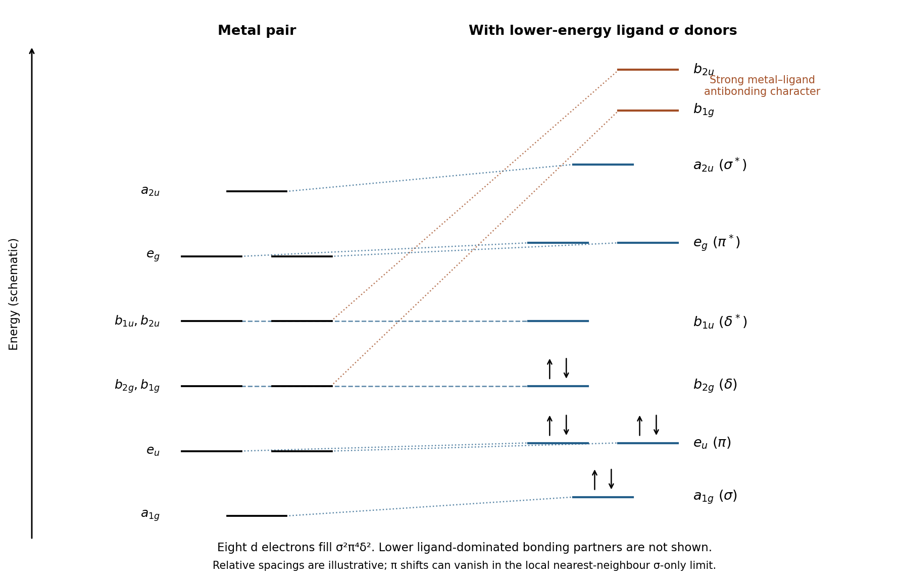

# Paper 1

↑ **Parent:** [2024](../2024.md)

[Original paper, released PDF pages 136–141](https://www.whatdotheyknow.com/request/request_for_nst_past_papers/response/3572306/attach/4/FOI%202026%20862%20Stack%20materials.pdf?cookie_passthrough=1#page=136)

**Table of contents**

- [A1](#a1)
  - [a](#a1/a)
    - [i](#a1/a/i)
      - [Solution](#a1/a/i/solution)
    - [ii](#a1/a/ii)
      - [Solution](#a1/a/ii/solution)
    - [iii](#a1/a/iii)
      - [Solution](#a1/a/iii/solution)
    - [iv](#a1/a/iv)
      - [Solution](#a1/a/iv/solution)
    - [v](#a1/a/v)
      - [Solution](#a1/a/v/solution)
  - [b](#a1/b)
    - [i](#a1/b/i)
      - [Solution](#a1/b/i/solution)
    - [ii](#a1/b/ii)
      - [Solution](#a1/b/ii/solution)
    - [iii](#a1/b/iii)
      - [Solution](#a1/b/iii/solution)
    - [iv](#a1/b/iv)
      - [Solution](#a1/b/iv/solution)
- [A2](#a2)
  - [a](#a2/a)
    - [Solution](#a2/a/solution)
  - [b](#a2/b)
    - [Solution](#a2/b/solution)
  - [c](#a2/c)
    - [Solution](#a2/c/solution)
  - [d](#a2/d)
    - [Solution](#a2/d/solution)
  - [e](#a2/e)
    - [Solution](#a2/e/solution)
- [A3](#a3)
  - [a](#a3/a)
    - [i](#a3/a/i)
      - [Solution](#a3/a/i/solution)
    - [ii](#a3/a/ii)
      - [Solution](#a3/a/ii/solution)
    - [iii](#a3/a/iii)
      - [Solution](#a3/a/iii/solution)
  - [b](#a3/b)
    - [i](#a3/b/i)
      - [Solution](#a3/b/i/solution)
    - [ii](#a3/b/ii)
      - [Solution](#a3/b/ii/solution)
    - [iii](#a3/b/iii)
      - [Solution](#a3/b/iii/solution)
    - [iv](#a3/b/iv)
      - [Solution](#a3/b/iv/solution)
- [A4](#a4)
  - [a](#a4/a)
    - [i](#a4/a/i)
      - [Solution](#a4/a/i/solution)
    - [ii](#a4/a/ii)
      - [Solution](#a4/a/ii/solution)
    - [iii](#a4/a/iii)
      - [Solution](#a4/a/iii/solution)
  - [b](#a4/b)
    - [i](#a4/b/i)
      - [Solution](#a4/b/i/solution)
    - [ii](#a4/b/ii)
      - [Solution](#a4/b/ii/solution)
    - [iii](#a4/b/iii)
      - [Solution](#a4/b/iii/solution)
  - [c](#a4/c)
    - [i](#a4/c/i)
      - [Solution](#a4/c/i/solution)
    - [ii](#a4/c/ii)
      - [Solution](#a4/c/ii/solution)
- [A5](#a5)
  - [a](#a5/a)
    - [i](#a5/a/i)
      - [Solution](#a5/a/i/solution)
    - [ii](#a5/a/ii)
      - [Solution](#a5/a/ii/solution)
    - [iii](#a5/a/iii)
      - [Solution](#a5/a/iii/solution)
    - [iv](#a5/a/iv)
      - [Solution](#a5/a/iv/solution)
  - [b](#a5/b)
    - [i](#a5/b/i)
      - [Solution](#a5/b/i/solution)
    - [ii](#a5/b/ii)
      - [Solution](#a5/b/ii/solution)
    - [iii](#a5/b/iii)
      - [Solution](#a5/b/iii/solution)
    - [iv](#a5/b/iv)
      - [Solution](#a5/b/iv/solution)

## A1

↑ **Parent:** [Paper 1](paper-1.md)

<h3 id="a1/a">a</h3>

↑ **Parent:** [A1](#a1)

<h4 id="a1/a/i">i</h4>

↑ **Parent:** [A](#a1/a)

<h5 id="a1/a/i/solution">Solution</h5>

↑ **Parent:** [I](#a1/a/i)

Inside the [infinite square well](../../quantum-mechanics.md#infinite-square-well), the stationary [wavefunctions](../../wave-function.md) can be chosen real:

$$
\boxed{\Psi_n(x)=C_n\sin\frac{n\pi x}{a},\qquad n=1,2,3,\ldots,\quad 0<x<a.}
$$

They vanish outside the well and at its impenetrable endpoints. A sine meets the left boundary condition; the right one requires $\sin(n\pi)=0$. The putative $n=0$ function is identically zero, so it is not a [quantum state](../../quantum-system.md#quantum-state). The constants $C_n$ are fixed by [wavefunction normalization](../../wave-function.md#wavefunction-normalization).

<h4 id="a1/a/ii">ii</h4>

↑ **Parent:** [A](#a1/a)

<h5 id="a1/a/ii/solution">Solution</h5>

↑ **Parent:** [Ii](#a1/a/ii)

[Wavefunction normalization](../../wave-function.md#wavefunction-normalization) requires unit total probability:

$$
1=\int_0^a|\Psi_n(x)|^2\,\mathrm dx
=|C_n|^2\int_0^a\frac{1-\cos(2n\pi x/a)}2\,\mathrm dx
=|C_n|^2\frac a2.
$$

Choosing an irrelevant overall phase to be zero gives

$$
\boxed{\Psi_n(x)=\sqrt{\frac2a}\sin\frac{n\pi x}{a}.}
$$

The amplitude has units of inverse square root length, so $|\Psi_n|^2\,\mathrm dx$ is dimensionless.

<h4 id="a1/a/iii">iii</h4>

↑ **Parent:** [A](#a1/a)

<h5 id="a1/a/iii/solution">Solution</h5>

↑ **Parent:** [Iii](#a1/a/iii)

Within the well, the potential is zero and the [Hamiltonian](../../quantum-system.md#hamiltonian-quantum-mechanics) is purely kinetic:

$$
\boxed{\hat H=-\frac{\hbar^2}{2m}\frac{\mathrm d^2}{\mathrm dx^2}.}
$$

The infinite walls are encoded in the operator's boundary conditions $\Psi(0)=\Psi(a)=0$, rather than differentiated as part of the interior expression. Since

$$
\Psi_n''(x)=-\left(\frac{n\pi}{a}\right)^2\Psi_n(x),
$$

we obtain

$$
\hat H\Psi_n=\boxed{\frac{n^2\pi^2\hbar^2}{2ma^2}}\Psi_n,
\qquad \boxed{E_n=\frac{n^2h^2}{8ma^2}}.
$$

These positive [energy eigenvalues](../../energy-eigenvalue.md) grow quadratically with the [quantum number](../../quantum-system.md#quantum-number); the [ground state](../../quantum-mechanics.md#ground-state) has a nonzero confinement energy.

<h4 id="a1/a/iv">iv</h4>

↑ **Parent:** [A](#a1/a)

<h5 id="a1/a/iv/solution">Solution</h5>

↑ **Parent:** [Iv](#a1/a/iv)

For distinct positive integers $n,m$, use the product-to-sum identity in the [inner product](../../inner-product.md):

$$
\begin{aligned}
\langle\Psi_m|\Psi_n\rangle
&=\frac2a\int_0^a\sin\frac{m\pi x}{a}\sin\frac{n\pi x}{a}\,\mathrm dx\\
&=\frac1a\int_0^a\left[\cos\frac{(m-n)\pi x}{a}-\cos\frac{(m+n)\pi x}{a}\right]\,\mathrm dx\\
&=\left[\frac{\sin((m-n)\pi x/a)}{(m-n)\pi}-\frac{\sin((m+n)\pi x/a)}{(m+n)\pi}\right]_0^a=0.
\end{aligned}
$$

Every endpoint sine vanishes. For $m=n$, the normalization integral is one; the expression with a denominator $m-n$ should not be substituted directly. Thus **the normalized functions form an orthonormal set**, $\langle\Psi_m|\Psi_n\rangle=\delta_{mn}$.

<h4 id="a1/a/v">v</h4>

↑ **Parent:** [A](#a1/a)

<h5 id="a1/a/v/solution">Solution</h5>

↑ **Parent:** [V](#a1/a/v)

Project the expansion onto one normalized basis function. [Orthogonality](../../inner-product.md#orthogonal-vectors) removes every other coefficient:

$$
\begin{aligned}
\int_0^a\Psi_m(x)^*f(x)\,\mathrm dx
&=\sum_{n=1}^{\infty}a_n\int_0^a\Psi_m(x)^*\Psi_n(x)\,\mathrm dx\\
&=\sum_{n=1}^{\infty}a_n\delta_{mn}=a_m.
\end{aligned}
$$

Consequently,

$$
\boxed{a_n=\langle\Psi_n|f\rangle
=\sqrt{\frac2a}\int_0^a f(x)\sin\frac{n\pi x}{a}\,\mathrm dx.}
$$

This is a [Fourier sine series](../../fourier-series.md#fourier-sine-series) in normalized form. For a square-integrable $f$, completeness gives convergence in the norm of the function space; pointwise convergence requires the usual additional regularity. If $f$ is a normalized [wavefunction](../../wave-function.md), the [Born rule](../../wave-function.md#born-rule) gives probabilities $|a_n|^2$ and $\sum_n|a_n|^2=1$.

<h3 id="a1/b">b</h3>

↑ **Parent:** [A1](#a1)

<h4 id="a1/b/i">i</h4>

↑ **Parent:** [B](#a1/b)

<h5 id="a1/b/i/solution">Solution</h5>

↑ **Parent:** [I](#a1/b/i)

Set $x=r\phi$ and $a=2\pi r$. The wrapped spatial form is

$$
\Psi_n(r\phi)=\sqrt{\frac2a}\sin\frac{n\phi}{2},\qquad
\frac{\partial^2\Psi_n}{\partial\phi^2}=-\frac{n^2}4\Psi_n.
$$

Hence the differential expression for the [quantum rotor](../../quantum-mechanics.md#quantum-rotor) acts as

$$
\hat H_{\mathrm R}\Psi_n=\frac{n^2\hbar^2}{8I}\Psi_n.
$$

The box expression becomes $E_n=n^2\hbar^2/(8mr^2)$, so consistency gives

$$
\boxed{I=mr^2,}
$$

the [moment of inertia](../../rigid-body-dynamics.md#moment-of-inertia) of a point mass a distance $r$ from the axis. Equivalently, $\partial_x=r^{-1}\partial_\phi$ transforms the kinetic operator directly. Being an eigenfunction of this differential expression is not yet sufficient: the ring boundary conditions must also hold.

For a wavefunction normalized with the angular measure $\mathrm d\phi$, use $\Phi_n(\phi)=\sqrt r\,\Psi_n(r\phi)=\pi^{-1/2}\sin(n\phi/2)$. This change of normalization convention does not change the [energy eigenvalue](../../energy-eigenvalue.md).

<h4 id="a1/b/ii">ii</h4>

↑ **Parent:** [B](#a1/b)

<h5 id="a1/b/ii/solution">Solution</h5>

↑ **Parent:** [Ii](#a1/b/ii)

A smooth [quantum rotor](../../quantum-mechanics.md#quantum-rotor) with no flux or twist requires both

$$
\Phi(\phi+2\pi)=\Phi(\phi),\qquad
\Phi'(\phi+2\pi)=\Phi'(\phi).
$$

For the sine family, $\Phi_n(0)=\Phi_n(2\pi)=0$ holds for every positive integer $n$, but

$$
\Phi_n'(0)=\frac{n}{2\sqrt\pi},\qquad
\Phi_n'(2\pi)=\frac{n}{2\sqrt\pi}(-1)^n.
$$

The derivatives match only for **$\boxed{n=2k,\quad k=1,2,3,\ldots}$**. Equivalently, $\sin[n(\phi+2\pi)/2]=(-1)^n\sin(n\phi/2)$ must be periodic for every $\phi$, not merely vanish at the chosen join. Odd $n$ would produce a cusp in a periodic continuation and do not belong to the smooth free-ring Hamiltonian's domain.

<h4 id="a1/b/iii">iii</h4>

↑ **Parent:** [B](#a1/b)

<h5 id="a1/b/iii/solution">Solution</h5>

↑ **Parent:** [Iii](#a1/b/iii)

Solving $-i\hbar u'(\phi)=\lambda u(\phi)$ gives an exponential. The [periodic boundary condition](../../differential-equation.md#periodic-boundary-conditions) quantizes its phase winding:

$$
\boxed{u_k(\phi)=\frac{e^{ik\phi}}{\sqrt{2\pi}},\quad
\hat l_z u_k=\hbar k u_k,\quad k\in\mathbb Z.}
$$

These are normalized with respect to $\mathrm d\phi$. The corresponding complex [Fourier series](../../fourier-series.md) is

$$
\boxed{f(\phi)=\sum_{k=-\infty}^{\infty}c_k u_k(\phi),\qquad
c_k=\int_0^{2\pi}u_k(\phi)^*f(\phi)\,\mathrm d\phi.}
$$

Unlike the wrapped sine subset, this [orthonormal basis](../../inner-product.md#orthonormal-basis) includes the constant $k=0$ state and both sine and cosine combinations. If one retains arc-length normalization instead, replace $1/\sqrt{2\pi}$ by $1/\sqrt a$ and integrate with $r\,\mathrm d\phi$.

<h4 id="a1/b/iv">iv</h4>

↑ **Parent:** [B](#a1/b)

<h5 id="a1/b/iv/solution">Solution</h5>

↑ **Parent:** [Iv](#a1/b/iv)

For the allowed $n=2k$ states, the normalized standing wave is a [quantum superposition](../../quantum-system.md#quantum-superposition) of two opposite [angular momentum eigenstates](../../angular-momentum-operator.md#angular-momentum-eigenstate):

$$
\Phi_{2k}(\phi)=\frac{\sin(k\phi)}{\sqrt\pi}
=\frac{u_k(\phi)-u_{-k}(\phi)}{i\sqrt2}.
$$

The [Born rule](../../wave-function.md#born-rule) therefore predicts

$$
\boxed{l_z=+k\hbar\ \text{or}\ -k\hbar,\qquad P(+k\hbar)=P(-k\hbar)=\tfrac12.}
$$

The [expectation value](../../quantum-system.md#expectation-value) is zero, but a single measurement never gives zero for these $k\ge1$ states. Their uncertainty is $\Delta l_z=k\hbar$. The two components have the same rotor energy $\hbar^2k^2/(2I)$, so a definite energy does not imply definite angular momentum.

## A2

↑ **Parent:** [Paper 1](paper-1.md)

<h3 id="a2/a">a</h3>

↑ **Parent:** [A2](#a2)

<h4 id="a2/a/solution">Solution</h4>

↑ **Parent:** [A](#a2/a)

Differentiate the Gaussian before substituting into the [Hamiltonian](../../quantum-system.md#hamiltonian-quantum-mechanics):

$$
\Psi_0'=-\alpha x\Psi_0,\qquad
\Psi_0''=(\alpha^2x^2-\alpha)\Psi_0.
$$

Thus

$$
\hat H\Psi_0=\left[\frac{\hbar^2\alpha}{2m}
+\left(\frac{m\omega^2}2-\frac{\hbar^2\alpha^2}{2m}\right)x^2\right]\Psi_0.
$$

An [energy eigenvalue](../../energy-eigenvalue.md) must be independent of $x$, so the coefficient of $x^2$ vanishes. Normalizability requires $\alpha>0$, giving

$$
\boxed{\alpha=\frac{m\omega}{\hbar},\qquad E_0=\frac12\hbar\omega.}
$$

The constant term is the [quantum harmonic oscillator](../../quantum-harmonic-oscillator.md)'s zero-point energy; a Gaussian width $\alpha^{-1/2}$ balances its kinetic and potential contributions.

<h3 id="a2/b">b</h3>

↑ **Parent:** [A2](#a2)

<h4 id="a2/b/solution">Solution</h4>

↑ **Parent:** [B](#a2/b)

For a normalized state and a Hermitian [quantum observable](../../quantum-system.md#observable) $\hat A$, its [quantum uncertainty](../../quantum-system.md#quantum-uncertainty) is the standard deviation of repeated measurement outcomes:

$$
\boxed{\Delta A=\sqrt{\langle(\hat A-\langle A\rangle)^2\rangle}
=\sqrt{\langle A^2\rangle-\langle A\rangle^2}.}
$$

Here $\langle A\rangle=\langle\Psi|\hat A|\Psi\rangle$. It is a property of the state and observable, not an instrumental error; the required moments must be finite.

<h3 id="a2/c">c</h3>

↑ **Parent:** [A2](#a2)

<h4 id="a2/c/solution">Solution</h4>

↑ **Parent:** [C](#a2/c)

In the position representation, $\hat x$ multiplies by $x$ and $\hat p_x=-i\hbar\,\mathrm d/\mathrm dx$. Acting on an arbitrary differentiable test function $f$ shows the [commutator](../../lie-algebra.md#commutator) explicitly:

$$
\begin{aligned}
[\hat x,\hat p_x]f
&=-i\hbar x f'+i\hbar\frac{\mathrm d(xf)}{\mathrm dx}\\
&=-i\hbar xf'+i\hbar(f+xf')=i\hbar f.
\end{aligned}
$$

Therefore $[\hat x,\hat p_x]=i\hbar\hat 1$, whose [expectation value](../../quantum-system.md#expectation-value) is $i\hbar$ in every normalized state in the relevant domains. The [Robertson uncertainty principle](../../quantum-theory.md#robertson-uncertainty-principle) gives

$$
\boxed{\Delta x\,\Delta p_x\ge\frac{\hbar}{2}.}
$$

This is a lower bound, not a claim that every state saturates it.

<h3 id="a2/d">d</h3>

↑ **Parent:** [A2](#a2)

<h4 id="a2/d/solution">Solution</h4>

↑ **Parent:** [D](#a2/d)

The density $|\Psi_0|^2=\sqrt{\alpha/\pi}\,e^{-\alpha x^2}$ is even. Hence $\langle x\rangle=0$; also $\Psi_0'=-\alpha x\Psi_0$ gives $\langle p_x\rangle=i\hbar\alpha\langle x\rangle=0$.

To evaluate the second position moment, differentiate the [Gaussian integral](../../integral.md#gaussian-integral) with respect to its positive parameter:

$$
\begin{aligned}
G(\alpha)&=\int_{-\infty}^{\infty}e^{-\alpha x^2}\,\mathrm dx=\sqrt\pi\,\alpha^{-1/2},\\
\int_{-\infty}^{\infty}x^2e^{-\alpha x^2}\,\mathrm dx
&=-G'(\alpha)=\frac{\sqrt\pi}{2\alpha^{3/2}},\\
\langle x^2\rangle&=\sqrt{\frac\alpha\pi}\frac{\sqrt\pi}{2\alpha^{3/2}}
=\frac1{2\alpha}=\frac{\hbar}{2m\omega}.
\end{aligned}
$$

For the momentum second moment, apply the [momentum operator](../../quantum-mechanics.md#momentum-operator) twice:

$$
\langle p_x^2\rangle=-\hbar^2\int\Psi_0^*\Psi_0''\,\mathrm dx
=\hbar^2\left(\alpha-\alpha^2\langle x^2\rangle\right)
=\frac{\hbar^2\alpha}{2}=\frac{m\hbar\omega}{2}.
$$

Both means vanish, so

$$
\boxed{\Delta x=\sqrt{\frac{\hbar}{2m\omega}},\qquad
\Delta p_x=\sqrt{\frac{m\hbar\omega}{2}},\qquad
\Delta x\,\Delta p_x=\frac\hbar2.}
$$

The [ground state](../../quantum-mechanics.md#ground-state) attains the bound proved above and is therefore a [minimum uncertainty state](../../quantum-theory.md#minimum-uncertainty-state). A wider Gaussian reduces momentum spread while increasing position spread: the product remains at this lower limit. Other states, including excited oscillator eigenstates, generally give a larger product.

<h3 id="a2/e">e</h3>

↑ **Parent:** [A2](#a2)

<h4 id="a2/e/solution">Solution</h4>

↑ **Parent:** [E](#a2/e)

Write $\hat N=\hat a^\dagger\hat a$. The [creation and annihilation operators](../../quantum-harmonic-oscillator.md#creation-and-annihilation-operators) obey

$$
[\hat N,\hat a^\dagger]
=\hat a^\dagger[\hat a,\hat a^\dagger]=\hat a^\dagger,
\qquad
[\hat H,\hat a^\dagger]=\hbar\omega\hat a^\dagger.
$$

Consequently,

$$
\begin{aligned}
\hat H\hat a^\dagger\Psi_0
&=(\hat a^\dagger\hat H+[\hat H,\hat a^\dagger])\Psi_0\\
&=(E_0+\hbar\omega)\hat a^\dagger\Psi_0
=\boxed{\frac32\hbar\omega\,\hat a^\dagger\Psi_0}.
\end{aligned}
$$

The resulting function is not zero: its squared norm is

$$
\|\hat a^\dagger\Psi_0\|^2
=\langle\Psi_0|\hat a\hat a^\dagger|\Psi_0\rangle
=\langle\hat a^\dagger\hat a+1\rangle=1.
$$

Thus **$\hat a^\dagger\Psi_0$ is the normalized first excited state**, up to phase. More generally the [creation operator](../../quantum-harmonic-oscillator.md#creation-operator) raises the energy by one quantum $\hbar\omega$: $\hat a^\dagger|n\rangle=\sqrt{n+1}\,|n+1\rangle$. The factor is required because applying it to a higher state does not preserve normalization.

## A3

↑ **Parent:** [Paper 1](paper-1.md)

<h3 id="a3/a">a</h3>

↑ **Parent:** [A3](#a3)

<h4 id="a3/a/i">i</h4>

↑ **Parent:** [A](#a3/a)

<h5 id="a3/a/i/solution">Solution</h5>

↑ **Parent:** [I](#a3/a/i)

A polar diatomic molecule can absorb microwaves through its permanent [electric dipole moment](../../electrostatics.md#electric-dipole-moment). In the [linear rigid rotor](../../molecule.md#linear-rigid-rotor) approximation,

$$
E_J=hB_0J(J+1),\quad J=0,1,2,\ldots,
\qquad B_0=\frac{h}{8\pi^2I_0}.
$$

The electric-dipole [selection rule](../../atomic-physics.md#selection-rule) is $\Delta J=+1$ in absorption. It gives

$$
\nu_{J\to J+1}=\frac{E_{J+1}-E_J}{h}=2B_0(J+1),
$$

so adjacent lines are separated by $2B_0$. Therefore

$$
\boxed{B_0=\frac{21.999}{2}=10.9995\ \mathrm{GHz}.}
$$

Assign a line near $m\times21.999\ \mathrm{GHz}$ to $J=m-1\to m$ for positive integer $m$. The first member is $0\to1$, the next $1\to2$, and so on; if the recorded window misses the lowest lines, their absolute frequencies fix the integer offset. At high temperature many rotational states are populated, so the strongest line need not be $0\to1$.

This is the leading rotational pattern, not a claim that real ZnF lacks spin or hyperfine structure. Fine splittings and [centrifugal distortion](../../molecule.md#centrifugal-distortion) can perturb the ideal lines; they do not explain the three systematically displaced progressions as economically as vibrational excitation.

<h4 id="a3/a/ii">ii</h4>

↑ **Parent:** [A](#a3/a)

<h5 id="a3/a/ii/solution">Solution</h5>

↑ **Parent:** [Ii](#a3/a/ii)

The two extra progressions are **rotational transitions within thermally populated $v=1$ and $v=2$ vibrational levels**. Isotopic purity rules out attributing them to different isotope masses. Their [rotational constants](../../molecule.md#rotational-constant) are

$$
\boxed{B_1=10.9115\ \mathrm{GHz},\qquad B_2=10.8235\ \mathrm{GHz}.}
$$

The [Boltzmann distribution](../../thermodynamics.md#boltzmann-distribution) makes each higher vibrational manifold less populated, so its rotational spectrum is weaker. A [Morse oscillator](../../quantum-system.md#morse-oscillator) explores larger separations as it is excited: the bond's vibrationally averaged moment of inertia increases and the rotational spacing decreases. More precisely, $B_v$ involves an average of the inverse square separation; it is not simply the inverse square of the mean separation.

The observed decrement is constant to the given precision:

$$
B_0-B_1=B_1-B_2=\boxed{\alpha_e=0.0880\ \mathrm{GHz}}.
$$

This fits the leading [vibration-rotation interaction](../../molecule.md#vibration-rotation-interaction) law $B_v=B_e-\alpha_e(v+\tfrac12)$.

<h4 id="a3/a/iii">iii</h4>

↑ **Parent:** [A](#a3/a)

<h5 id="a3/a/iii/solution">Solution</h5>

↑ **Parent:** [Iii](#a3/a/iii)

An [equilibrium bond length](../../chemical-bond.md#equilibrium-bond-length) requires $B_e$, not merely the ground-vibrational-state constant. Extrapolating the linear [vibration-rotation interaction](../../molecule.md#vibration-rotation-interaction) law gives

$$
B_e=B_0+\frac{\alpha_e}{2}=10.9995+0.0440
=\boxed{11.0435\ \mathrm{GHz}}.
$$

Using integer isotope masses, the [reduced mass](../../classical-mechanics.md#reduced-mass) is

$$
\mu=\frac{64\times19}{64+19}\,u=14.65060\,u
=2.43279\times10^{-26}\ \mathrm{kg}.
$$

For two nuclei $I_e=\mu r_e^2$, so

$$
\boxed{r_e=\sqrt{\frac{h}{8\pi^2\mu B_e}}
=1.76737\times10^{-10}\ \mathrm m\simeq176.7\ \mathrm{pm}.}
$$

Using $B_0$ instead gives $r_0\simeq177.1$ pm, an effective vibrational separation. The small difference is precisely why the weaker vibrational progressions matter when the target is equilibrium geometry. Higher terms in $B_v$ and the rigid-rotor approximation limit this estimate's precision.

<h3 id="a3/b">b</h3>

↑ **Parent:** [A3](#a3)

<h4 id="a3/b/i">i</h4>

↑ **Parent:** [B](#a3/b)

<h5 id="a3/b/i/solution">Solution</h5>

↑ **Parent:** [I](#a3/b/i)

A **[vibrational fundamental](../../molecule.md#vibrational-fundamental)** is the transition $v=0\to1$. A **first [vibrational overtone](../../molecule.md#vibrational-overtone)** is $v=0\to2$. A **[hot band](../../molecule.md#hot-band)** starts from a thermally populated vibrationally excited level, such as $v=1\to2$.

For a strictly harmonic potential and a dipole linear in displacement, the allowed transitions have $\Delta v=\pm1$. A fundamental and a $1\to2$ hot band then share the same frequency, while the overtone has zero intensity. [Anharmonicity](../../wave.md#anharmonicity) separates the adjacent gaps and can give overtone intensity; nonlinear displacement dependence of the dipole can also contribute. A hot band is defined by its lower state, not merely by being weak.

<h4 id="a3/b/ii">ii</h4>

↑ **Parent:** [B](#a3/b)

<h5 id="a3/b/ii/solution">Solution</h5>

↑ **Parent:** [Ii](#a3/b/ii)

The strong band is $0\to1$, while the weak band is the first [vibrational overtone](../../molecule.md#vibrational-overtone) $0\to2$. Let $w=\widetilde\omega_e$ and $q=\widetilde\omega_ex_e$. Subtracting the [Morse oscillator](../../quantum-system.md#morse-oscillator) levels gives

$$
\begin{aligned}
\widetilde\nu_{01}&=w-2q=440.6\ \mathrm{cm^{-1}},\\
\widetilde\nu_{02}&=2w-6q=877.5\ \mathrm{cm^{-1}}.
\end{aligned}
$$

Twice the fundamental is $881.2\ \mathrm{cm^{-1}}$, slightly above the overtone because the higher vibrational gap is smaller. Eliminate $w$:

$$
2q=2(440.6)-877.5=3.7\ \mathrm{cm^{-1}},
$$

so

$$
\boxed{\widetilde\omega_ex_e=1.85\ \mathrm{cm^{-1}},\qquad
\widetilde\omega_e=444.3\ \mathrm{cm^{-1}}.}
$$

The implied dimensionless anharmonicity constant is $x_e\simeq0.004164$. The overtone's weakness follows from its being forbidden in the leading harmonic/linear-dipole model, rather than a lack of population in its lower state.

<h4 id="a3/b/iii">iii</h4>

↑ **Parent:** [B](#a3/b)

<h5 id="a3/b/iii/solution">Solution</h5>

↑ **Parent:** [Iii](#a3/b/iii)

The relevant allowed absorption is $1\to2$. Under the stipulated population-only intensity model, the vibrational levels are nondegenerate and

$$
\frac{I_{12}}{I_{01}}=\frac{N_1}{N_0}
=\exp\left[-\frac{E_1-E_0}{k_{\mathrm B}T}\right]
=\exp\left[-\frac{hc(440.6\ \mathrm{cm^{-1}})}{k_{\mathrm B}T}\right].
$$

Set this ratio to $0.10$ and solve:

$$
\boxed{T=\frac{hc(440.6\ \mathrm{cm^{-1}})}{k_{\mathrm B}\ln10}
=\frac{(1.4387769\ \mathrm{K\,cm})(440.6\ \mathrm{cm^{-1}})}{\ln10}
\simeq275.3\ \mathrm K.}
$$

The energy in the exponential is the measured $0\to1$ gap, not the harmonic constant $444.3\ \mathrm{cm^{-1}}$. At this temperature, $N_2/N_0\simeq0.0102$, so considering the first thermally excited manifold is sensible. Actual band intensity ratios also involve transition moments and rotational structure; the calculation follows the question's simplifying assumption.

<h4 id="a3/b/iv">iv</h4>

↑ **Parent:** [B](#a3/b)

<h5 id="a3/b/iv/solution">Solution</h5>

↑ **Parent:** [Iv](#a3/b/iv)

[Anharmonicity](../../wave.md#anharmonicity) places the $1\to2$ [hot band](../../molecule.md#hot-band) at

$$
\boxed{\widetilde\nu_{12}=w-4q=444.3-4(1.85)=436.9\ \mathrm{cm^{-1}},}
$$

only $3.7\ \mathrm{cm^{-1}}$ below the fundamental. **It can be detected with adequate spectral resolution and signal-to-noise; it is not guaranteed to appear as a separate peak in an unresolved band contour.** The predicted ten-percent population-based intensity is appreciable, but overlapping rotational branches and linewidth can hide it beneath the stronger fundamental. No instrumental resolution or linewidth is supplied, so an unconditional assertion of visibility or invisibility would go beyond the information given.

## A4

↑ **Parent:** [Paper 1](paper-1.md)

<h3 id="a4/a">a</h3>

↑ **Parent:** [A4](#a4)

<h4 id="a4/a/i">i</h4>

↑ **Parent:** [A](#a4/a)

<h5 id="a4/a/i/solution">Solution</h5>

↑ **Parent:** [I](#a4/a/i)

The [molecular symmetry operations](../../euclidean-geometry.md#molecular-symmetry-operation) must be closed under composition. Write the proposed nonidentity operations as $R=C_2$ and $S=\sigma$. Their product $RS$ cannot equal any proposed member:

$$
RS=E\Rightarrow R=S^{-1}=S,\qquad
RS=R\Rightarrow S=E,\qquad
RS=S\Rightarrow R=E.
$$

Each conclusion contradicts the distinct operations stipulated. Therefore **at least a fourth symmetry operation must exist**. For a mirror plane containing the twofold axis, the product generates another mirror plane; for a plane perpendicular to it, the product is inversion. A tilted plane may generate still more operations, but cannot evade group closure.

<h4 id="a4/a/ii">ii</h4>

↑ **Parent:** [A](#a4/a)

<h5 id="a4/a/ii/solution">Solution</h5>

↑ **Parent:** [Ii](#a4/a/ii)

One choice is **the [C2v molecular point group](../../euclidean-geometry.md#c2v-molecular-point-group)**, $\{E,C_2(z),\sigma_{xz},\sigma_{yz}\}$. The additional operation is a second reflection, since

$$
C_2(z)\sigma_{xz}=\sigma_{yz}.
$$

A bent [water](../../chemical-substance.md#water) molecule has this symmetry. Choose the $z$ axis along its bond-angle bisector and put the molecule in the $xz$ plane: reflection in $yz$ exchanges its two hydrogen atoms, while reflection in $xz$ fixes their positions.

<h4 id="a4/a/iii">iii</h4>

↑ **Parent:** [A](#a4/a)

<h5 id="a4/a/iii/solution">Solution</h5>

↑ **Parent:** [Iii](#a4/a/iii)

With $R=C_2(z)$, $S=\sigma_{xz}$ and $T=\sigma_{yz}$, composition gives

$$
\begin{array}{c|cccc}
 &E&R&S&T\\\hline
E&E&R&S&T\\
R&R&E&T&S\\
S&S&T&E&R\\
T&T&S&R&E
\end{array}
$$

Every entry belongs to the set, proving closure. $E$ is the [identity element](../../algebraic-operation.md#identity-element); every element is its own inverse. Associativity follows because these are actual spatial transformations: composing functions is associative. Thus all group axioms hold, and the group is isomorphic to the [Klein four-group](../../finite-group-theory.md#klein-four-group).

For a concrete matrix check, use $E=\operatorname{diag}(1,1,1)$, $R=\operatorname{diag}(-1,-1,1)$, $S=\operatorname{diag}(1,-1,1)$ and $T=\operatorname{diag}(-1,1,1)$. Their matrix products reproduce the table.

<h3 id="a4/b">b</h3>

↑ **Parent:** [A4](#a4)

<h4 id="a4/b/i">i</h4>

↑ **Parent:** [B](#a4/b)

<h5 id="a4/b/i/solution">Solution</h5>

↑ **Parent:** [I](#a4/b/i)

A **[symmetry-closed orbital basis](../../euclidean-geometry.md#symmetry-closed-orbital-basis)**, often called a complete basis in this context, is a linearly independent set whose span is carried into itself by every group operation. No transformed basis function requires a function outside that span. This is completeness for the chosen [group representation](../../representation-theory.md#group-representation), not a claim that a small atomic-orbital set spans the full electronic Hilbert space.

A **representation matrix** $D(g)$ specifies the linear transformation produced by a [molecular symmetry operation](../../euclidean-geometry.md#molecular-symmetry-operation) $g$. With the column convention,

$$
\hat U(g)\phi_j=\sum_i\phi_iD_{ij}(g),\qquad
D(gh)=D(g)D(h).
$$

Its **[character of a representation](../../representation-theory.md#character-of-a-representation)** is the [matrix trace](../../linear-algebra.md#matrix-trace),

$$
\boxed{\chi(g)=\operatorname{tr}D(g)=\sum_iD_{ii}(g).}
$$

The character is unchanged by a simultaneous change of basis and is constant on a [conjugacy class](../../group-action.md#conjugacy-class), which is why character tables have one column per class.

<h4 id="a4/b/ii">ii</h4>

↑ **Parent:** [B](#a4/b)

<h5 id="a4/b/ii/solution">Solution</h5>

↑ **Parent:** [Ii](#a4/b/ii)

Use the ordered basis $(p_x,p_y,p_z)$ at the origin. Choose $z$ as the principal improper-rotation axis, $x,y$ along the two $C_2^\prime$ axes, and the diagonal mirror planes as $x=\pm y$. Use active operations with $\hat U(g)f(\mathbf r)=f(g^{-1}\mathbf r)$, so the matrix columns give the transformed orbitals. For these real p orbitals the matrices are the ordinary vector transformation matrices.

One representative from each [D2d molecular point group](../../euclidean-geometry.md#d2d-molecular-point-group) class is

$$
\begin{aligned}
D(E)&=\begin{pmatrix}1&0&0\\0&1&0\\0&0&1\end{pmatrix},\\
D(S_4^+)&=\begin{pmatrix}0&-1&0\\1&0&0\\0&0&-1\end{pmatrix},\\
D(C_2(z))&=\begin{pmatrix}-1&0&0\\0&-1&0\\0&0&1\end{pmatrix},\\
D(C_2(x))&=\begin{pmatrix}1&0&0\\0&-1&0\\0&0&-1\end{pmatrix},\\
D(\sigma_{x=y})&=\begin{pmatrix}0&1&0\\1&0&0\\0&0&1\end{pmatrix}.
\end{aligned}
$$

For example $S_4^+$ sends $p_x\mapsto p_y$, $p_y\mapsto-p_x$ and $p_z\mapsto-p_z$. Choosing the opposite sense of $S_4$ transposes its xy block but leaves every character and the final decomposition unchanged.

<h4 id="a4/b/iii">iii</h4>

↑ **Parent:** [B](#a4/b)

<h5 id="a4/b/iii/solution">Solution</h5>

↑ **Parent:** [Iii](#a4/b/iii)

Taking the [matrix trace](../../linear-algebra.md#matrix-trace) of those matrices gives

$$
\begin{array}{c|rrrrr}
\text{class}&E&2S_4&C_2&2C_2^\prime&2\sigma_d\\\hline
\chi_p&3&-1&-1&-1&1
\end{array}
$$

The one-dimensional $p_z$ subspace has characters $(1,-1,1,-1,1)$, identifying $B_2$. The pair $(p_x,p_y)$ has characters $(2,0,-2,0,0)$, identifying $E$. Therefore

$$
\boxed{\Gamma_{p_x,p_y,p_z}=B_2\oplus E.}
$$

The dimensions add to three, as required. The $p_x,p_y$ pair must be retained together: a ninety-degree improper rotation mixes them, so either one alone is not a complete symmetry basis.[Printed page 12, $D_{2d}$ vector functions](../../chemistry-bibliography.md#tables-for-group-theory-by-p-w-atkins-and-others)

<h3 id="a4/c">c</h3>

↑ **Parent:** [A4](#a4)

<h4 id="a4/c/i">i</h4>

↑ **Parent:** [C](#a4/c)

<h5 id="a4/c/i/solution">Solution</h5>

↑ **Parent:** [I](#a4/c/i)

Ideal gaseous [phosphorus pentachloride](../../chemical-substance.md#phosphorus-pentachloride) is a trigonal bipyramid with [D3h molecular point group](../../euclidean-geometry.md#d3h-molecular-point-group) symmetry. There are five chlorine sites and three 3p orbitals per site, hence a fifteen-dimensional basis. A moved atom contributes zero to the character; each fixed chlorine contributes the trace of the three-dimensional polar-vector matrix acting on its local p orbitals.

$$
\begin{array}{c|rrrrrr}
\text{class}&E&2C_3&3C_2^\prime&\sigma_h&2S_3&3\sigma_v\\\hline
\text{fixed Cl sites}&5&2&1&3&0&3\\
\operatorname{tr}D_{xyz}&3&0&-1&1&0&1\\
\chi_{15p}&15&0&-1&3&0&3
\end{array}
$$

For example, a $C_2^\prime$ axis through one equatorial chlorine fixes that site but rotates its p-vector basis with trace $1-1-1=-1$. Counting that atom as $+1$ would be incorrect.

Apply [molecular character reduction](../../euclidean-geometry.md#molecular-character-reduction) with class sizes $(1,2,3,1,2,3)$ and group order twelve:

$$
n_\lambda=\frac1{12}\sum_C |C|\chi_{15p}(C)\chi_\lambda(C)^*.
$$

For $A_1^\prime$, this gives $(15-3+3+9)/12=2$; for $E^\prime$, $(30+6)/12=3$. The full result is

$$
\boxed{\Gamma_{15p}=2A_1^\prime\oplus A_2^\prime\oplus3E^\prime
\oplus2A_2^{\prime\prime}\oplus2E^{\prime\prime}.}
$$

The dimension check is $2+1+6+2+4=15$. As an additional transparent separation, the two axial chlorines supply $A_1^\prime+E^\prime+A_2^{\prime\prime}+E^{\prime\prime}$, while the three equatorial ones supply $A_1^\prime+A_2^\prime+2E^\prime+A_2^{\prime\prime}+E^{\prime\prime}$. These are all chlorine 3p orbitals, including both radial and tangential functions; a five-orbital ligand-sigma basis would answer a different question.

<h4 id="a4/c/ii">ii</h4>

↑ **Parent:** [C](#a4/c)

<h5 id="a4/c/ii/solution">Solution</h5>

↑ **Parent:** [Ii](#a4/c/ii)

**The highest expected orbital degeneracy is five.** Ideal [buckminsterfullerene](../../chemical-substance.md#buckminsterfullerene) has [Ih molecular point group](../../euclidean-geometry.md#ih-molecular-point-group) symmetry. Its irreducible orbital representations include five-dimensional $H_g$ and $H_u$ representations; no single-valued orbital irrep has higher dimension.

This counts distinct spatial [molecular orbitals](../../chemistry.md#molecular-orbital). It does not multiply by electron spin, and it excludes accidental coincidences between unrelated irreps. In a real environment, symmetry lowering can split these degeneracies.[Printed page 17, $I_h$ irreducible dimensions](../../chemistry-bibliography.md#tables-for-group-theory-by-p-w-atkins-and-others)

## A5

↑ **Parent:** [Paper 1](paper-1.md)

<h3 id="a5/a">a</h3>

↑ **Parent:** [A5](#a5)

<h4 id="a5/a/i">i</h4>

↑ **Parent:** [A](#a5/a)

<h5 id="a5/a/i/solution">Solution</h5>

↑ **Parent:** [I](#a5/a/i)

**The ideal eclipsed ion has [D4h molecular point group](../../euclidean-geometry.md#d4h-molecular-point-group) symmetry.** Put the Mo–Mo axis along $z$, with the metal atoms at $(0,0,\pm c)$, and orient the four chloride positions around each metal along $\pm x,\pm y$.

There is a $C_4(z)$ axis, perpendicular twofold axes, a horizontal plane through the midpoint, vertical mirror planes and an inversion centre at the bond midpoint. The eclipsed arrangement makes the two chloride squares coincide in projection along $z$. These labels refer to the ideal molecular geometry, rather than small crystal-packing distortions.

<h4 id="a5/a/ii">ii</h4>

↑ **Parent:** [A](#a5/a)

<h5 id="a5/a/ii/solution">Solution</h5>

↑ **Parent:** [Ii](#a5/a/ii)

Let $d_{\mu,A}$ and $d_{\mu,B}$ be corresponding real 4d orbitals on the upper and lower metals, with identical global-axis phases. Their [symmetry-adapted linear combinations](../../chemistry.md#symmetry-adapted-linear-combination) are

$$
\phi_{\mu,\pm}=\frac{d_{\mu,A}\pm d_{\mu,B}}{\sqrt2},
$$

with the normalization shown in the negligible-overlap approximation; including overlap changes the denominator but not the symmetry. Inversion exchanges the centres and each local d orbital has even intrinsic parity, so the plus combinations are gerade and the minus combinations ungerade.

$$
\begin{array}{c|cc|cc}
\text{metal orbital}&\phi_+&\phi_-&\text{Mo--Mo bonding}&\text{Mo--Mo antibonding}\\\hline
d_{z^2}&a_{1g}&a_{2u}&a_{1g}\ (\sigma)&a_{2u}\ (\sigma^*)\\
(d_{xz},d_{yz})&e_g&e_u&e_u\ (\pi)&e_g\ (\pi^*)\\
d_{xy}&b_{2g}&b_{1u}&b_{2g}\ (\delta)&b_{1u}\ (\delta^*)\\
d_{x^2-y^2}&b_{1g}&b_{2u}&b_{1g}\ (\delta)&b_{2u}\ (\delta^*)
\end{array}
$$

The reversal of bonding phase for $d_{xz},d_{yz}$ is important: the facing lobes have opposite signs when the two atomic orbitals share the same global phase convention, so their difference is bonding. Each $e$ irrep is two-dimensional. Thus

$$
\boxed{\Gamma_{10d}=A_{1g}+A_{2u}+B_{1g}+B_{2u}+B_{2g}+B_{1u}+E_g+E_u,}
$$

with total dimension ten. Rotating $x,y$ by $45^\circ$ interchanges the names of the two delta families; all labels here retain the chloride-aligned axes fixed above.

<h4 id="a5/a/iii">iii</h4>

↑ **Parent:** [A](#a5/a)

<h5 id="a5/a/iii/solution">Solution</h5>

↑ **Parent:** [Iii](#a5/a/iii)

Ignoring ligand perturbations initially, end-on $d_{z^2}$ overlap gives the largest [sigma bond](../../covalent-bond.md#sigma-bond) splitting, side-on $d_{xz},d_{yz}$ overlap gives the two [pi bonds](../../covalent-bond.md#pi-bond), and the two four-lobed overlaps give weaker [delta bonds](../../covalent-bond.md#delta-bond). A useful qualitative ordering is

$$
\boxed{a_{1g}(\sigma)<e_u(\pi)<\{b_{2g},b_{1g}\}(\delta)
<\{b_{1u},b_{2u}\}(\delta^*)<e_g(\pi^*)<a_{2u}(\sigma^*).}
$$

The original diagram shows the ten orbitals, including both members of each $e$ level.

**[Figure 1](#a5/a/iii/image-original-qualitative-ordering-of-ten-metal-4d-symmetry-orbitals-before-ligand-perturbation). Original qualitative ordering of ten metal 4d symmetry orbitals before ligand perturbation**.

For the strictly isolated collinear metal pair, cylindrical symmetry makes $d_{xy}$ and $d_{x^2-y^2}$ related by rotation, so the two delta bonding levels are degenerate, as are their antibonding partners. The displayed [D4h molecular point group](../../euclidean-geometry.md#d4h-molecular-point-group) labels anticipate the ligand environment, which can split those different irreps. Symmetry supplies labels and degeneracies; the relative separation of unrelated levels is a qualitative overlap model, not a numerical prediction.

<h4 id="a5/a/iv">iv</h4>

↑ **Parent:** [A](#a5/a)

<h5 id="a5/a/iv/solution">Solution</h5>

↑ **Parent:** [Iv](#a5/a/iv)

Eight chloride ions contribute charge $-8$. For an overall $4-$ charge, the two metals together contribute $+4$, so each is formally Mo(II). [Molybdenum](../../chemical-substance.md#molybdenum) is in group six, giving four d electrons per centre and **eight metal-based electrons in total**.

In the ligand-perturbed configuration developed below, they occupy $\sigma^2\pi^4\delta^2$, with no Mo–Mo antibonding electron. Therefore the formal [bond order](../../chemistry.md#bond-order) is

$$
\boxed{\frac{N_b-N_a}{2}=\frac{8-0}{2}=4.}
$$

This is one [sigma bond](../../covalent-bond.md#sigma-bond), two [pi bonds](../../covalent-bond.md#pi-bond) and one [delta bond](../../covalent-bond.md#delta-bond). Before including ligands, the two ideal delta channels are degenerate and the allocation of their last two electrons is not determined by the bare energy sketch alone; the ligands remove that ambiguity and select the surviving low delta channel. The eight-electron bonding count still gives formal order four.

The occupied bonding groups are experimentally meaningful: molybdenum X-ray emission resolves three metal–metal bonding energy groups in this ion, alongside a deeper metal–chloride bonding feature.[Primary X-ray emission report, abstract and pages 262–263](../../chemistry-bibliography.md#direct-evidence-for-the-quadruple-metal-metal-bond-in-the-octachlorodimolybdenum-ii-ion-using-x-ray-emission-spectroscopy-by-derek-e-haycock-and-others)

<h3 id="a5/b">b</h3>

↑ **Parent:** [A5](#a5)

<h4 id="a5/b/i">i</h4>

↑ **Parent:** [B](#a5/b)

<h5 id="a5/b/i/solution">Solution</h5>

↑ **Parent:** [I](#a5/b/i)

Choose the phase of each inward-pointing ligand sigma donor orbital positive toward its own Mo centre. The eight donors then transform by site permutation. In the usual [D4h molecular point group](../../euclidean-geometry.md#d4h-molecular-point-group) class order their characters are

$$
\begin{array}{c|rrrrrrrrrr}
 &E&2C_4&C_2&2C_2^\prime&2C_2^{\prime\prime}&i&2S_4&\sigma_h&2\sigma_v&2\sigma_d\\\hline
\chi_{8\sigma}&8&0&0&0&0&0&0&0&4&0
\end{array}
$$

Only $E$ and a chloride-containing vertical mirror plane leave ligand functions individually fixed. For example $\sigma_{xz}$ fixes the four donors at $(\pm a,0,\pm c)$ and exchanges the other four; the four fixed functions retain their signs.

[Molecular character reduction](../../euclidean-geometry.md#molecular-character-reduction) gives

$$
\boxed{\Gamma_{8\sigma}=A_{1g}\oplus B_{1g}\oplus E_g
\oplus A_{2u}\oplus B_{2u}\oplus E_u.}
$$

The dimensions sum to $1+1+2+1+1+2=8$. Equivalently, take each square's four combinations: the all-in-phase pattern, the alternating x-versus-y pattern, and a two-dimensional pair. Combine corresponding patterns between upper and lower squares to obtain the six irreps above.

<h4 id="a5/b/ii">ii</h4>

↑ **Parent:** [B](#a5/b)

<h5 id="a5/b/ii/solution">Solution</h5>

↑ **Parent:** [Ii](#a5/b/ii)

A ligand [symmetry orbital](../../chemistry.md#symmetry-adapted-linear-combination) can mix with a metal combination only if their irreps match. Since the donor levels lie below the metal levels, mixing produces a lower ligand-dominated bonding orbital and a **higher metal-dominated antibonding orbital**. In a two-level model with $\epsilon_d>\epsilon_L$,

$$
\Delta\epsilon_d\simeq\frac{|V_{dL}|^2}{\epsilon_d-\epsilon_L}>0.
$$

The requested metal-dominated levels are shown in the right-hand column; the lower ligand-dominated partners are deliberately outside this diagram.

**[Figure 2](#a5/b/ii/image-original-qualitative-effect-of-lower-ligand-sigma-orbitals-on-the-ten-metal-dominated-levels). Original qualitative effect of lower ligand sigma orbitals on the ten metal-dominated levels**.

The $d_{x^2-y^2}$ lobes point directly at the chlorides, so their $b_{1g}$ and $b_{2u}$ combinations are strongly destabilized. The $d_{z^2}$ combinations $a_{1g},a_{2u}$ can also interact through their equatorial density. The $e_u,e_g$ symmetries have ligand partners, so weaker shifts are symmetry-allowed; their local nearest-neighbour sigma overlap vanishes in the ideal planar geometry, making their shifts much smaller in that approximation. Symmetry allowance alone never sets an overlap integral's size.

There are no ligand sigma combinations of $B_{2g}$ or $B_{1u}$ symmetry, so the $d_{xy}$-derived delta pair is unaffected by the stipulated sigma-only mixing. In particular the low $b_{2g}(\delta)$ level survives while the other delta bonding channel becomes strongly metal–ligand antibonding. The plotted spacings and ordering of remote unoccupied levels are schematic; the robust conclusion is the four low Mo–Mo bonding orbitals separated from antibonding or strongly ligand-destabilized orbitals.

<h4 id="a5/b/iii">iii</h4>

↑ **Parent:** [B](#a5/b)

<h5 id="a5/b/iii/solution">Solution</h5>

↑ **Parent:** [Iii](#a5/b/iii)

The ligand field leaves one low [sigma bond](../../covalent-bond.md#sigma-bond) orbital, two low [pi bond](../../covalent-bond.md#pi-bond) orbitals and one low [delta bond](../../covalent-bond.md#delta-bond) orbital. Their closed-shell occupation is

$$
\boxed{(a_{1g})^2(e_u)^4(b_{2g})^2=\sigma^2\pi^4\delta^2.}
$$

It requires eight metal d electrons, or four per Mo, hence Mo(II). With eight $\mathrm{Cl^-}$ ligands, charge balance gives

$$
\boxed{2(+2)+8(-1)=-4.}
$$

Oxidizing removes an electron from a Mo–Mo bonding orbital; reducing populates a higher orbital with Mo–Mo antibonding or strong metal–ligand antibonding character. Thus the $4-$ state has the particularly favourable filled bonding configuration in this model. This is an orbital explanation of a preferred charge, not a claim that charge alone determines solution redox stability independently of counterions or solvent.

The eclipsed geometry also follows naturally from the occupied [delta bond](../../covalent-bond.md#delta-bond): it aligns the four-lobed $d_{xy}$ functions. Twisting the chloride squares toward a staggered geometry reduces this overlap and weakens that contribution to the [quadruple bond](../../covalent-bond.md#quadruple-bond).

<h4 id="a5/b/iv">iv</h4>

↑ **Parent:** [B](#a5/b)

<h5 id="a5/b/iv/solution">Solution</h5>

↑ **Parent:** [Iv](#a5/b/iv)

Take the eight Mo–Cl bond-length changes as a stretching basis. These scalar coordinates have the same permutation representation as the eight sigma donors:

$$
\Gamma_{\mathrm{stretch}}=A_{1g}+B_{1g}+E_g+A_{2u}+B_{2u}+E_u.
$$

[Infrared spectroscopy](../../chemistry.md#infrared-spectroscopy) detects modes transforming as a dipole component: $z$ is $A_{2u}$ and $(x,y)$ is $E_u$. There are therefore **two IR fundamentals**, one $A_{2u}$ and one doubly degenerate $E_u$ frequency.

[Raman spectroscopy](../../optics.md#raman-spectroscopy) detects modes transforming as polarizability components. The relevant modes are $A_{1g}$, $B_{1g}$ and $E_g$, giving **three Raman fundamentals**, of which $E_g$ is doubly degenerate. The remaining $B_{2u}$ stretch is silent in both ordinary spectra.

Thus the prediction is

$$
\boxed{N_{\mathrm{IR}}=2,\qquad N_{\mathrm{Raman}}=3,\qquad
N_{\mathrm{coincident\ modes}}=0.}
$$

The zero follows from [infrared and Raman mutual exclusion](../../euclidean-geometry.md#infrared-and-raman-mutual-exclusion): the molecule has inversion symmetry, dipole components are ungerade, and polarizability components gerade. This counts resolved fundamental frequencies of the ideal ion, not separate lines for degenerate components, isotope splittings or accidental numerical overlaps between distinct modes.

## ↑ Ancestors (10)

1. [2024](../2024.md)
2. [Past exam of the chemistry A course of the University of Cambridge](../../past-exam-of-the-chemistry-a-course-of-the-university-of-cambridge.md)
3. [Chemistry A course of the University of Cambridge](../../university-of-cambridge.md#chemistry-a-course-of-the-university-of-cambridge)
4. [Year 2 of the natural sciences course of the University of Cambridge](../../university-of-cambridge.md#year-2-of-the-natural-sciences-course-of-the-university-of-cambridge)
5. [Year of the natural sciences course of the University of Cambridge](../../university-of-cambridge.md#year-of-the-natural-sciences-course-of-the-university-of-cambridge)
6. [Natural sciences course of the University of Cambridge](../../university-of-cambridge.md#natural-sciences-course-of-the-university-of-cambridge)
7. [Course of the University of Cambridge](../../university-of-cambridge.md#course-of-the-university-of-cambridge)
8. [University of Cambridge](../../university-of-cambridge.md)
9. [List of universities](../../README.md#list-of-universities)
10. [Codex Wiki](../../README.md)
