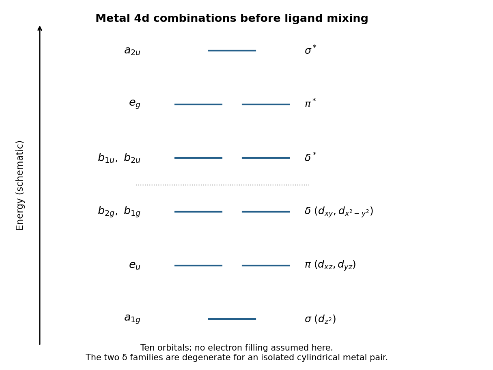

<h1 id="a5/a/iii/solution">Solution</h1>

↑ **Parent:** [Iii](../iii.md)

Ignoring ligand perturbations initially, end-on $d_{z^2}$ overlap gives the largest [sigma bond](../../../../../../sigma-bond.md) splitting, side-on $d_{xz},d_{yz}$ overlap gives the two [pi bonds](../../../../../../pi-bond.md), and the two four-lobed overlaps give weaker [delta bonds](../../../../../../delta-bond.md). A useful qualitative ordering is

$$
\boxed{a_{1g}(\sigma)<e_u(\pi)<\{b_{2g},b_{1g}\}(\delta)
<\{b_{1u},b_{2u}\}(\delta^*)<e_g(\pi^*)<a_{2u}(\sigma^*).}
$$

The original diagram shows the ten orbitals, including both members of each $e$ level.

**[Figure 1](#a5/a/iii/image-original-qualitative-ordering-of-ten-metal-4d-symmetry-orbitals-before-ligand-perturbation). Original qualitative ordering of ten metal 4d symmetry orbitals before ligand perturbation**.

For the strictly isolated collinear metal pair, cylindrical symmetry makes $d_{xy}$ and $d_{x^2-y^2}$ related by rotation, so the two delta bonding levels are degenerate, as are their antibonding partners. The displayed [D4h molecular point group](../../../../../../d4h-molecular-point-group.md) labels anticipate the ligand environment, which can split those different irreps. Symmetry supplies labels and degeneracies; the relative separation of unrelated levels is a qualitative overlap model, not a numerical prediction.

## ↑ Ancestors (14)

1. [Iii](../iii.md)
2. [A](../../a.md)
3. [A5](../../../a5.md)
4. [Paper 1](../../../../paper-1-split.md)
5. [2024](../../../../split.md)
6. [Past exam of the chemistry A course of the University of Cambridge](../../../../../split.md)
7. [Chemistry A course of the University of Cambridge](../../../../../../chemistry-a-course-of-the-university-of-cambridge.md)
8. [Year 2 of the natural sciences course of the University of Cambridge](../../../../../../year-2-of-the-natural-sciences-course-of-the-university-of-cambridge.md)
9. [Year of the natural sciences course of the University of Cambridge](../../../../../../year-of-the-natural-sciences-course-of-the-university-of-cambridge.md)
10. [Natural sciences course of the University of Cambridge](../../../../../../natural-sciences-course-of-the-university-of-cambridge.md)
11. [Course of the University of Cambridge](../../../../../../course-of-the-university-of-cambridge.md)
12. [University of Cambridge](../../../../../../university-of-cambridge-split.md)
13. [List of universities](../../../../../../list-of-universities.md)
14. [Codex Wiki](../../../../../../split.md)
