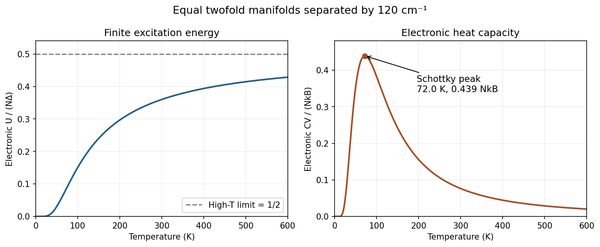
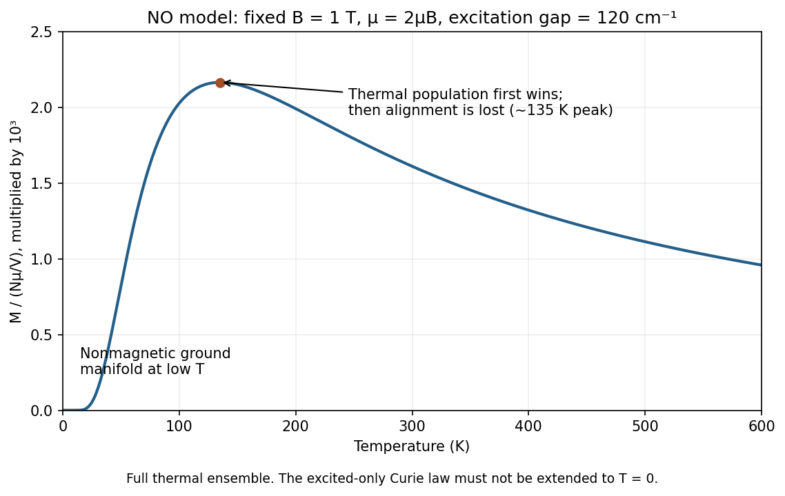
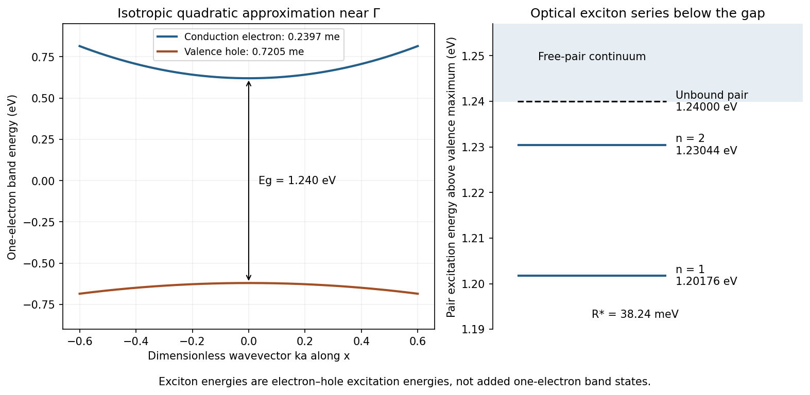

# Paper 2

↑ **Parent:** [2024](../2024.md)

[Original paper, released PDF pages 142–149](https://www.whatdotheyknow.com/request/request_for_nst_past_papers/response/3572306/attach/4/FOI%202026%20862%20Stack%20materials.pdf?cookie_passthrough=1#page=142)

**Table of contents**

- [A6](#a6)
  - [a](#a6/a)
    - [Solution](#a6/a/solution)
  - [b](#a6/b)
    - [Solution](#a6/b/solution)
  - [c](#a6/c)
    - [i](#a6/c/i)
      - [Solution](#a6/c/i/solution)
    - [ii](#a6/c/ii)
      - [Solution](#a6/c/ii/solution)
- [A7](#a7)
  - [a](#a7/a)
    - [i](#a7/a/i)
      - [Solution](#a7/a/i/solution)
    - [ii](#a7/a/ii)
      - [Solution](#a7/a/ii/solution)
  - [b](#a7/b)
    - [i](#a7/b/i)
      - [Solution](#a7/b/i/solution)
    - [ii](#a7/b/ii)
      - [Solution](#a7/b/ii/solution)
    - [iii](#a7/b/iii)
      - [Solution](#a7/b/iii/solution)
    - [iv](#a7/b/iv)
      - [Solution](#a7/b/iv/solution)
  - [c](#a7/c)
    - [i](#a7/c/i)
      - [Solution](#a7/c/i/solution)
    - [ii](#a7/c/ii)
      - [Solution](#a7/c/ii/solution)
    - [iii](#a7/c/iii)
      - [Solution](#a7/c/iii/solution)
    - [iv](#a7/c/iv)
      - [Solution](#a7/c/iv/solution)
- [A8](#a8)
  - [a](#a8/a)
    - [Solution](#a8/a/solution)
  - [b](#a8/b)
    - [Solution](#a8/b/solution)
  - [c](#a8/c)
    - [Solution](#a8/c/solution)
  - [d](#a8/d)
    - [i](#a8/d/i)
      - [Solution](#a8/d/i/solution)
    - [ii](#a8/d/ii)
      - [Solution](#a8/d/ii/solution)
  - [e](#a8/e)
    - [Solution](#a8/e/solution)
- [A9](#a9)
  - [a](#a9/a)
    - [Solution](#a9/a/solution)
  - [b](#a9/b)
    - [Solution](#a9/b/solution)
  - [c](#a9/c)
    - [Solution](#a9/c/solution)
  - [d](#a9/d)
    - [Solution](#a9/d/solution)
  - [e](#a9/e)
    - [Solution](#a9/e/solution)
  - [f](#a9/f)
    - [Solution](#a9/f/solution)
- [A10](#a10)
  - [a](#a10/a)
    - [Solution](#a10/a/solution)
  - [b](#a10/b)
    - [i](#a10/b/i)
      - [Solution](#a10/b/i/solution)
    - [ii](#a10/b/ii)
      - [Solution](#a10/b/ii/solution)
  - [c](#a10/c)
    - [Solution](#a10/c/solution)
  - [d](#a10/d)
    - [Solution](#a10/d/solution)
  - [e](#a10/e)
    - [Solution](#a10/e/solution)
  - [f](#a10/f)
    - [Solution](#a10/f/solution)

## A6

↑ **Parent:** [Paper 2](paper-2.md)

<h3 id="a6/a">a</h3>

↑ **Parent:** [A6](#a6)

<h4 id="a6/a/solution">Solution</h4>

↑ **Parent:** [A](#a6/a)

Treat each species as a dilute classical ideal gas: molecules of the same species are indistinguishable, while different species are distinguishable. Let $N_i$ be the number of molecules of species $i$, $q_i(T,V)$ its [molecular partition function](../../canonical-ensemble.md#molecular-partition-function) with energies measured from a chosen internal reference, and $\varepsilon^{0,i}$ that reference energy per molecule relative to a common chemical energy convention. Then the mixture's [canonical partition function](../../canonical-ensemble.md#canonical-partition-function) factorizes:

$$
Q=\prod_i\frac{q_i^{N_i}}{N_i!}\exp[-\beta N_i\varepsilon^{0,i}],
\qquad \beta=\frac1{k_{\mathrm B}T}.
$$

The $N_i!$ corrects the overcounting of [indistinguishable particles](../../tensor-product-of-quantum-systems.md#indistinguishable-particles). The exponential restores the species-dependent reference energies that matter for reactions. Thus the [Helmholtz free energy](../../thermodynamic-potential.md#helmholtz-free-energy) is

$$
A=-k_{\mathrm B}T\sum_i\left[N_i\ln q_i-\ln(N_i!)\right]
+\sum_iN_i\varepsilon^{0,i}.
$$

Using [Stirling's approximation](../../real-analysis.md#stirling-formula), $\ln(N_i!)\simeq N_i\ln N_i-N_i$, and differentiating at fixed $T,V,N_{j\ne i}$ yields

$$
\boxed{\mu_i=\left(\frac{\partial A}{\partial N_i}\right)_{T,V,N_{j\ne i}}
=-k_{\mathrm B}T\ln\frac{q_i}{N_i}+\varepsilon^{0,i}.}
$$

The ideal-gas $q_i$ does not depend on the number of molecules, so no additional $\partial q_i/\partial N_i$ term appears. These are chemical potentials per molecule; multiply by the [Avogadro constant](../../physics.md#avogadro-constant) for a molar chemical potential. The result assumes the thermodynamic, nondegenerate-gas limit.

<h3 id="a6/b">b</h3>

↑ **Parent:** [A6](#a6)

<h4 id="a6/b/solution">Solution</h4>

↑ **Parent:** [B](#a6/b)

Let $\rho_i=N_i/V$ be a molecular [number density](../../statistical-physics.md#number-density) and define the volume-independent [molecular partition function density](../../canonical-ensemble.md#molecular-partition-function-density) $f_i=q_i/V$. Then $q_i/N_i=f_i/\rho_i$. Also define the reaction reference-energy difference

$$
\Delta\varepsilon_0=\varepsilon^{0,\mathrm C}-\varepsilon^{0,\mathrm A}-\varepsilon^{0,\mathrm B}.
$$

Substitution into the equilibrium chemical-potential relation gives

$$
\begin{aligned}
0&=-k_{\mathrm B}T\ln\frac{f_{\mathrm C}}{\rho_{\mathrm C}}
+k_{\mathrm B}T\ln\frac{f_{\mathrm A}}{\rho_{\mathrm A}}
+k_{\mathrm B}T\ln\frac{f_{\mathrm B}}{\rho_{\mathrm B}}
+\Delta\varepsilon_0,\\
\frac{\rho_{\mathrm C}}{\rho_{\mathrm A}\rho_{\mathrm B}}
&=\frac{f_{\mathrm C}}{f_{\mathrm A}f_{\mathrm B}}
\exp\left(-\frac{\Delta\varepsilon_0}{k_{\mathrm B}T}\right).
\end{aligned}
$$

An [equilibrium constant](../../chemical-potential.md#equilibrium-constant) expressed using concentration activities $a_i=\rho_i/c^\circ$ is dimensionless:

$$
\boxed{K_c=\frac{a_{\mathrm C}}{a_{\mathrm A}a_{\mathrm B}}
=\frac{\rho_{\mathrm C}c^\circ}{\rho_{\mathrm A}\rho_{\mathrm B}}
=\frac{f_{\mathrm C}c^\circ}{f_{\mathrm A}f_{\mathrm B}}e^{-\Delta\varepsilon_0/(k_{\mathrm B}T)}.}
$$

Here every $f_i$ has units $\mathrm{m^{-3}}$, and $c^\circ$ is the chosen [standard concentration](../../chemical-potential.md#standard-concentration), initially one molecule per cubic metre. The factor $c^\circ$ is essential: without it the association quotient has units of volume.

<h3 id="a6/c">c</h3>

↑ **Parent:** [A6](#a6)

<h4 id="a6/c/i">i</h4>

↑ **Parent:** [C](#a6/c)

<h5 id="a6/c/i/solution">Solution</h5>

↑ **Parent:** [I](#a6/c/i)

Use the supplied separable molecular model,

$$
f_i=\left(\frac{2\pi m_i k_{\mathrm B}T}{h^2}\right)^{3/2}
q_{\mathrm{rot},i}\bar q_{\mathrm{vib},i},
$$

with electronic factors unity. The integer masses are $2u$, $28u$ and $30u$. The [rotational symmetry numbers](../../molecule.md#rotational-symmetry-number) are respectively $2,1,2$: rotating either hydrogen or methanal by $180^\circ$ about its appropriate symmetry axis exchanges identical hydrogens, whereas CO has distinct ends.

With the given conversion $k_{\mathrm B}/hc=0.6950\ \mathrm{cm^{-1}\,K^{-1}}$, a spectroscopic constant $\widetilde b$ corresponds to a temperature $\theta=\widetilde b/0.6950$. At $500$ K the partition-function factors are

$$
\begin{array}{c|rrr}
 &\mathrm H_2&\mathrm{CO}&\mathrm{H_2CO}\\\hline
f_{\mathrm{trans}}/\mathrm{m^{-3}}&5.9429\times10^{30}&3.1131\times10^{32}&3.4525\times10^{32}\\
q_{\mathrm{rot}}&2.8484&182.895&1565.83\\
\bar q_{\mathrm{vib}}&1.7804\times10^{-3}&4.4141\times10^{-2}&9.6\times10^{-8}\\
f/\mathrm{m^{-3}}&3.0137\times10^{28}&2.5133\times10^{33}&5.1898\times10^{28}
\end{array}
$$

For instance,

$$
q_{\mathrm{rot},\mathrm{H_2CO}}=\frac{\sqrt\pi}{2}
\left[\frac{(0.6950\times500)^3}{9.4\times1.3\times1.1}\right]^{1/2}
=1565.83.
$$

The [vibrational partition functions](../../canonical-ensemble.md#vibrational-partition-function) here include their zero-point Boltzmann factors. The given reference-energy change must therefore be used consistently with that convention; adding a second vibrational [zero-point energy](../../quantum-harmonic-oscillator.md#zero-point-energy) correction would double count it. Because the numerical energy change is per mole, its exponential uses $RT$, not $k_{\mathrm B}T$:

$$
\exp\left(\frac{18000}{R\times500}\right)=75.9295.
$$

Consequently,

$$
\boxed{K_c=\frac{(5.1898\times10^{28})(1\ \mathrm{m^{-3}})}
{(3.0137\times10^{28})(2.5133\times10^{33})}\,75.9295
\simeq5.20\times10^{-32}.}
$$

This tiny dimensionless value refers to the extremely dilute one-molecule-per-cubic-metre standard state. It is not a concentration-independent statement about the fraction of carbon monoxide converted in a particular cloud. The calculation follows the supplied classical rotational and harmonic vibrational formulas, without adding separate nuclear-spin factors.

<h4 id="a6/c/ii">ii</h4>

↑ **Parent:** [C](#a6/c)

<h5 id="a6/c/ii/solution">Solution</h5>

↑ **Parent:** [Ii](#a6/c/ii)

Convert the new [standard concentration](../../chemical-potential.md#standard-concentration) to the number-density convention:

$$
1\ \mathrm{mol\,dm^{-3}}=10^3N_{\mathrm A}\ \mathrm{m^{-3}}
=6.02214076\times10^{26}\ \mathrm{m^{-3}}.
$$

For this association, $K_c=\rho_{\mathrm{H_2CO}}c^\circ/(\rho_{\mathrm H_2}\rho_{\mathrm{CO}})$, so it is proportional to $c^\circ$. Therefore

$$
\boxed{K_c^{(1\,\mathrm{mol\,dm^{-3}})}
=(5.2026\times10^{-32})(6.02214\times10^{26})
\simeq3.13\times10^{-5}.}
$$

Both dimensionless constants describe the same physical equilibrium; changing the reference changes the numerical activity quotient because two reactant molecules form one product molecule.

## A7

↑ **Parent:** [Paper 2](paper-2.md)

<h3 id="a7/a">a</h3>

↑ **Parent:** [A7](#a7)

<h4 id="a7/a/i">i</h4>

↑ **Parent:** [A](#a7/a)

<h5 id="a7/a/i/solution">Solution</h5>

↑ **Parent:** [I](#a7/a/i)

In [transition state theory](../../chemical-kinetics.md#transition-state-theory), $K^\ddagger$ is the dimensionless equilibrium-like constant for forming the activated complex from the reactants under the chosen standard-state convention. It is not the equilibrium constant for forming the stable product.

$\Delta_{\mathrm r}G^{\circ,\ddagger}$ is the standard [activation free energy](../../chemical-kinetics.md#gibbs-energy-of-activation), $\Delta_{\mathrm r}H^{\circ,\ddagger}$ the standard [activation enthalpy](../../chemical-kinetics.md#activation-enthalpy), and $\Delta_{\mathrm r}S^{\circ,\ddagger}$ the standard [activation entropy](../../chemical-kinetics.md#activation-entropy). Each is the activated-complex quantity minus the corresponding sum for the reactants, with the unstable reaction-coordinate motion treated by the transition-state flux construction.

$[\ ]^\circ=c^\circ$ is the [standard concentration](../../chemical-potential.md#standard-concentration), conventionally $1\ \mathrm{mol\,dm^{-3}}$ for the rate units used here. Its inverse converts the attempt frequency $k_{\mathrm B}T/h$ into the units of a bimolecular [rate constant](../../chemical-kinetics.md#rate-constant). The stated [Eyring equation](../../chemical-kinetics.md#eyring-equation) assumes unit transmission coefficient.

<h4 id="a7/a/ii">ii</h4>

↑ **Parent:** [A](#a7/a)

<h5 id="a7/a/ii/solution">Solution</h5>

↑ **Parent:** [Ii](#a7/a/ii)

Resolve the activation free energy into enthalpy and entropy in the [Eyring equation](../../chemical-kinetics.md#eyring-equation):

$$
k_2=\frac{k_{\mathrm B}T}{hc^\circ}
\exp\left(\frac{\Delta S^{\ddagger\circ}}R\right)
\exp\left(-\frac{\Delta H^{\ddagger\circ}}{RT}\right).
$$

Taking logarithms of numerical values in fixed, consistent units gives

$$
\boxed{\ln\frac{k_2}{T}
=-\frac{\Delta H^{\ddagger\circ}}R\frac1T
+\ln\frac{k_{\mathrm B}}{hc^\circ}
+\frac{\Delta S^{\ddagger\circ}}R.}
$$

Thus for slope $s$ and intercept $b$,

$$
\boxed{\Delta H^{\ddagger\circ}=-Rs,\qquad
\Delta S^{\ddagger\circ}=R\left[b-\ln\frac{k_{\mathrm B}}{hc^\circ}\right].}
$$

The logarithms imply reference units, as made explicit in the supplied numerical plot. Approximate linearity requires the activation parameters and transmission coefficient to vary little over the temperature interval; a significant activation heat-capacity difference produces curvature.

<h3 id="a7/b">b</h3>

↑ **Parent:** [A7](#a7)

<h4 id="a7/b/i">i</h4>

↑ **Parent:** [B](#a7/b)

<h5 id="a7/b/i/solution">Solution</h5>

↑ **Parent:** [I](#a7/b/i)

The slope is $-5130$ K, so the [activation enthalpy](../../chemical-kinetics.md#activation-enthalpy) is

$$
\boxed{\Delta H^{\ddagger\circ}=5130R=42.65\ \mathrm{kJ\,mol^{-1}}.}
$$

For $c^\circ=1\ \mathrm{mol\,dm^{-3}}$, using $k_2$ in $\mathrm{dm^3\,mol^{-1}\,s^{-1}}$ gives the numerical prefactor $k_{\mathrm B}/h=2.08366\times10^{10}\ \mathrm{K^{-1}\,s^{-1}}$. The intercept therefore yields

$$
\boxed{\Delta S^{\ddagger\circ}
=R\left[3.26-\ln(2.08366\times10^{10})\right]
=-170.45\ \mathrm{J\,K^{-1}\,mol^{-1}}.}
$$

The large logarithm must be subtracted; identifying $R\times3.26$ with the [activation entropy](../../chemical-kinetics.md#activation-entropy) would omit the transition-state attempt-frequency factor. Changing rate units without changing the standard-concentration prefactor consistently would also give a spurious entropy.

<h4 id="a7/b/ii">ii</h4>

↑ **Parent:** [B](#a7/b)

<h5 id="a7/b/ii/solution">Solution</h5>

↑ **Parent:** [Ii](#a7/b/ii)

**The large negative [activation entropy](../../chemical-kinetics.md#activation-entropy) is consistent with a strongly organized bimolecular [cycloaddition](../../chemical-reaction.md#cycloaddition).** Two separately translating and rotating molecules must approach with a restricted orientation to form a compact ring-forming transition state. Losing relative positional and orientational freedom lowers entropy.

Internal conformational restrictions and solvent rearrangement can contribute too. In a nonpolar solvent, a simple association picture is more plausible than assigning the whole effect to strong ionic solvation, but the numerical value is not a direct count of molecular orientations alone.

<h4 id="a7/b/iii">iii</h4>

↑ **Parent:** [B](#a7/b)

<h5 id="a7/b/iii/solution">Solution</h5>

↑ **Parent:** [Iii](#a7/b/iii)

The [activation enthalpy](../../chemical-kinetics.md#activation-enthalpy) is obtained from the slope across the measured $1/T$ interval. The [activation entropy](../../chemical-kinetics.md#activation-entropy) comes from the intercept at $1/T=0$, far outside that interval, so a small slope uncertainty can produce a much larger uncertainty in the extrapolated intercept. Slope and intercept errors are consequently strongly correlated.

The entropy is also sensitive to the assumed prefactor and [standard concentration](../../chemical-potential.md#standard-concentration), whereas a constant multiplicative calibration error shifts the intercept without changing the slope. This explains why its inferred precision is often poorer. Since enthalpy and entropy have different units, a claim about which absolute numerical uncertainty is larger requires a stated comparison convention.

<h4 id="a7/b/iv">iv</h4>

↑ **Parent:** [B](#a7/b)

<h5 id="a7/b/iv/solution">Solution</h5>

↑ **Parent:** [Iv](#a7/b/iv)

Use the same transition state and consistent standard states in both directions. Subtracting their definitions gives

$$
\Delta S_f^{\ddagger\circ}=S_{\mathrm{TS}}^\circ-S_{\mathrm R}^\circ,
\qquad
\Delta S_r^{\ddagger\circ}=S_{\mathrm{TS}}^\circ-S_{\mathrm P}^\circ,
$$

so

$$
\boxed{\Delta S_r^{\ddagger\circ}=\Delta S_f^{\ddagger\circ}-\Delta_{\mathrm r}S^\circ.}
$$

Ring-forming association normally has $\Delta_{\mathrm r}S^\circ<0$. Hence **the reverse activation entropy should be more positive, or less negative, than the forward value**: a single adduct approaches a bond-breaking configuration rather than two molecules losing their relative motion. Its precise value and even whether it crosses zero cannot be deduced without the reaction entropy. The reverse elementary reaction is first order, so its [Eyring equation](../../chemical-kinetics.md#eyring-equation) has the corresponding first-order standard-state prefactor.

<h3 id="a7/c">c</h3>

↑ **Parent:** [A7](#a7)

<h4 id="a7/c/i">i</h4>

↑ **Parent:** [C](#a7/c)

<h5 id="a7/c/i/solution">Solution</h5>

↑ **Parent:** [I](#a7/c/i)

For an elementary bimolecular forward step, $v=k_2[\mathrm R_1][\mathrm R_2]$. A liquid solution is much less compressible than a gas, so applying pressure changes its volume and reactant concentrations only modestly. With composition and temperature otherwise fixed, the observed substantial acceleration is therefore most naturally assigned to a change in the [rate constant](../../chemical-kinetics.md#rate-constant).

This is an approximation, not exact incompressibility: for precise pressure kinetics, correct the concentrations for compression and distinguish them from pressure-dependent activities.

<h4 id="a7/c/ii">ii</h4>

↑ **Parent:** [C](#a7/c)

<h5 id="a7/c/ii/solution">Solution</h5>

↑ **Parent:** [Ii](#a7/c/ii)

At fixed temperature, differentiating the [Eyring equation](../../chemical-kinetics.md#eyring-equation) with a pressure-independent prefactor and fixed concentration convention gives

$$
\left(\frac{\partial\ln k_2}{\partial p}\right)_T
=-\frac1{RT}\left(\frac{\partial\Delta G^{\ddagger\circ}}{\partial p}\right)_T.
$$

Since $\mathrm dG=V\,\mathrm dp-S\,\mathrm dT$, the derivative is the difference between the activated complex's [partial molar volume](../../geometry-and-topology.md#partial-molar-volume) and the sum for the reactants:

$$
\boxed{\Delta V^{\ddagger\circ}
=-RT\left(\frac{\partial\ln k_2}{\partial p}\right)_T.}
$$

If [activation volume](../../chemical-kinetics.md#activation-volume) is approximately constant over the pressure range, integration gives

$$
\boxed{\ln k_2(p)=\ln k_2(p_0)-\frac{\Delta V^{\ddagger\circ}}{RT}(p-p_0).}
$$

Thus plot $\ln k_2$ against pressure: its slope is $-\Delta V^{\ddagger\circ}/RT$. Use pressure in pascals for a volume in $\mathrm{m^3\,mol^{-1}}$. The model neglects pressure dependence of the transmission coefficient, substantial changes in mechanism, and strong curvature from a pressure-dependent activation volume. Fixed concentration-unit conventions and compression corrections matter for non-first-order rates.[Definition and concentration-unit qualification](../../chemistry-bibliography.md#volume-of-activation-in-the-iupac-gold-book)

<h4 id="a7/c/iii">iii</h4>

↑ **Parent:** [C](#a7/c)

<h5 id="a7/c/iii/solution">Solution</h5>

↑ **Parent:** [Iii](#a7/c/iii)

Using the numerical rate constants in $\mathrm{dm^3\,mol^{-1}\,s^{-1}}$, the logarithms are

$$
\begin{array}{c|rrrr}
p/\mathrm{atm}&100&300&700&1000\\\hline
\ln k_2&-7.58306&-7.37936&-6.96963&-6.66090
\end{array}
$$

A straight-line least-squares fit is

$$
\boxed{\ln k_2=-7.68621+(1.02471\times10^{-3})(p/\mathrm{atm}).}
$$

Every logarithmic residual has magnitude below $7.2\times10^{-4}$, so the rates follow the fitted exponential to within $0.08\%$; $R^2\simeq0.999997$. Thus a constant [activation volume](../../chemical-kinetics.md#activation-volume) describes these data well.

**[Figure 1](#a7/c/iii/image-original-logarithmic-pressure-rate-fit-and-residuals-for-the-activation-volume-calculation). Original logarithmic pressure-rate fit and residuals for the activation-volume calculation**.

Convert the slope to pascals, using $1\ \mathrm{atm}=101325$ Pa and $T=293.15$ K:

$$
\begin{aligned}
\Delta V^{\ddagger\circ}
&=-R(293.15)\frac{1.02471\times10^{-3}}{101325}\ \mathrm{m^3\,mol^{-1}}\\
&=\boxed{-24.65\ \mathrm{cm^3\,mol^{-1}}}.
\end{aligned}
$$

Multiplying all rates by a common unit-conversion factor changes the intercept but leaves this slope and volume unchanged.

<h4 id="a7/c/iv">iv</h4>

↑ **Parent:** [C](#a7/c)

<h5 id="a7/c/iv/solution">Solution</h5>

↑ **Parent:** [Iv](#a7/c/iv)

**The negative [activation volume](../../chemical-kinetics.md#activation-volume) means the transition state occupies less partial molar volume than the two separated reactants.** Pressure therefore favours reaching it and increases the forward rate, consistent with a compact associative [cycloaddition](../../chemical-reaction.md#cycloaddition) in which new bonds begin to form.

The magnitude, about $25\ \mathrm{cm^3\,mol^{-1}}$, is molecular in scale. It includes packing and solvent reorganization as well as intrinsic bond-length changes, so it should not be interpreted as a simple geometric volume carved out of two rigid molecular surfaces.

## A8

↑ **Parent:** [Paper 2](paper-2.md)

<h3 id="a8/a">a</h3>

↑ **Parent:** [A8](#a8)

<h4 id="a8/a/solution">Solution</h4>

↑ **Parent:** [A](#a8/a)

Set the ground electronic energy to zero and write the excitation energy as $\Delta=hc(120\ \mathrm{cm^{-1}})$, or the characteristic temperature $\theta=\Delta/k_{\mathrm B}=172.65$ K. Counting each doubly degenerate manifold once gives the single-molecule [electronic partition function](../../canonical-ensemble.md#electronic-partition-function)

$$
\boxed{q_{\mathrm{el}}=2+2e^{-\beta\Delta}=2(1+e^{-\theta/T}).}
$$

For $N$ independent molecules the electronic factor is $q_{\mathrm{el}}^N$. Hence the electronic [internal energy](../../internal-energy.md) is

$$
\boxed{U_{\mathrm{el}}=-N\frac{\partial\ln q_{\mathrm{el}}}{\partial\beta}
=\frac{N\Delta e^{-\beta\Delta}}{1+e^{-\beta\Delta}}
=\frac{N\Delta}{1+e^{\theta/T}}.}
$$

The equal degeneracies cancel from the excited-state probability. At low temperature the ground manifold dominates and $U_{\mathrm{el}}\to0$; at high temperature both manifolds have equal populations, giving $U_{\mathrm{el}}\to N\Delta/2$. These are electronic contributions only, excluding translation, rotation and vibration.

<h3 id="a8/b">b</h3>

↑ **Parent:** [A8](#a8)

<h4 id="a8/b/solution">Solution</h4>

↑ **Parent:** [B](#a8/b)

Differentiate the electronic energy at fixed volume:

$$
\boxed{C_{V,\mathrm{el}}=Nk_{\mathrm B}\left(\frac\theta T\right)^2
\frac{e^{\theta/T}}{(1+e^{\theta/T})^2}.}
$$

At $T\to0$, $C_{V,\mathrm{el}}\sim Nk_{\mathrm B}(\theta/T)^2e^{-\theta/T}\to0$: thermal energy is insufficient to populate the upper manifold. At $T\to\infty$, $C_{V,\mathrm{el}}\sim Nk_{\mathrm B}\theta^2/(4T^2)\to0$: the two populations are already approaching equality and the electronic energy has a finite ceiling.

**[Figure 2](#a8/b/image-original-electronic-internal-energy-and-schottky-heat-capacity-curves-for-the-two-manifold-model-from-0-to-600-k). Original electronic internal-energy and Schottky heat-capacity curves for the two-manifold model from 0 to 600 K**.

Between these limits the heat capacity has a [Schottky anomaly](../../heat.md#schottky-anomaly), peaking near $T=\theta/2.399\simeq72.0$ K at $C_{V,\mathrm{el}}\simeq0.439Nk_{\mathrm B}$. The energy rises monotonically toward $N\Delta/2$; its slope is largest at the heat-capacity peak. At 600 K it has not reached its infinite-temperature limit exactly.

<h3 id="a8/c">c</h3>

↑ **Parent:** [A8](#a8)

<h4 id="a8/c/solution">Solution</h4>

↑ **Parent:** [C](#a8/c)

For the two field-sensitive orientations alone, choose the unsplit excited-manifold energy as reference and put $x=\mu B/(k_{\mathrm B}T)$. The restricted single-molecule [partition function](../../canonical-ensemble.md#canonical-partition-function) is

$$
\boxed{q_{\mathrm{mag}}=e^{x}+e^{-x}=2\cosh x,\qquad\mu=2\mu_{\mathrm B}.}
$$

If the ground-manifold zero used above is retained, this restricted contribution is instead $2e^{-\beta\Delta}\cosh x$. The extra factor is independent of $B$, so it does not change magnetization conditional on occupying the excited manifold.

There are two magnetic states total; multiplying this expression by another factor of two would double count them. For the full thermal ensemble, the nonmagnetic ground states must be added:

$$
\boxed{q_{\mathrm{full}}=2+2e^{-\beta\Delta}\cosh x.}
$$

Although the omitted ground-state term has no direct field dependence, it affects normalization inside $\ln q$. Thus the restricted expression describes molecules constrained to the excited manifold; it cannot by itself give the magnetization of all thermally equilibrated NO molecules.

<h3 id="a8/d">d</h3>

↑ **Parent:** [A8](#a8)

<h4 id="a8/d/i">i</h4>

↑ **Parent:** [D](#a8/d)

<h5 id="a8/d/i/solution">Solution</h5>

↑ **Parent:** [I](#a8/d/i)

Following the restricted model in the preceding part, its electronic factor for $N$ independent magnetic molecules is $Q_{\mathrm{mag}}=(2\cosh x)^N$. Its field-dependent [Helmholtz free energy](../../thermodynamic-potential.md#helmholtz-free-energy) is therefore

$$
\boxed{A_{\mathrm{mag}}(B)=-Nk_{\mathrm B}T\ln\left[2\cosh\frac{\mu B}{k_{\mathrm B}T}\right]+A_{\mathrm{ind}},}
$$

where $A_{\mathrm{ind}}$ denotes terms independent of the field. Equivalently, the change from zero field is $A(B)-A(0)=-Nk_{\mathrm B}T\ln\cosh x$. Retaining the excited-state offset simply adds $N\Delta$ to the restricted free energy.

If $N$ instead counts all molecules in thermal equilibrium, the correct electronic expression is

$$
A_{\mathrm{full}}=-Nk_{\mathrm B}T\ln[2+2e^{-\beta\Delta}\cosh x]+A_{\mathrm{ind}}.
$$

The ordinary translational indistinguishability factor is field independent and does not alter either magnetic derivative.

<h4 id="a8/d/ii">ii</h4>

↑ **Parent:** [D](#a8/d)

<h5 id="a8/d/ii/solution">Solution</h5>

↑ **Parent:** [Ii](#a8/d/ii)

Differentiation of the restricted free energy gives the [magnetization](../../electromagnetism.md#magnetization)

$$
\begin{aligned}
M_{\mathrm{restricted}}
&=-\frac1V\left(\frac{\partial A_{\mathrm{mag}}}{\partial B}\right)_{T,V}\\
&=\boxed{\frac{N\mu}{V}\tanh\frac{\mu B}{k_{\mathrm B}T}}.
\end{aligned}
$$

In the weak-field limit $|\mu B|\ll k_{\mathrm B}T$, $\tanh x\simeq x$, so

$$
\boxed{M_{\mathrm{restricted}}\simeq\frac{N\mu^2B}{Vk_{\mathrm B}T}
=\frac{4N\mu_{\mathrm B}^2B}{Vk_{\mathrm B}T}.}
$$

**The printed coefficient is inconsistent with the stated moment $\mu=2\mu_{\mathrm B}$.** The requested expression without the factor four would follow from $\mu=\mu_{\mathrm B}$ in this restricted model. This discrepancy is present in the original PDF, rather than introduced by its transcription.

For completeness, differentiating the full thermal free energy gives

$$
\boxed{M_{\mathrm{full}}=\frac{N\mu}{V}
\frac{e^{-\beta\Delta}\sinh x}{1+e^{-\beta\Delta}\cosh x}.}
$$

Its weak-field form is

$$
\boxed{M_{\mathrm{full}}\simeq\frac{N\mu^2B}{Vk_{\mathrm B}T}
\frac1{1+e^{\theta/T}}
=\frac{4N\mu_{\mathrm B}^2B}{Vk_{\mathrm B}T(1+e^{\theta/T})}.}
$$

At $k_{\mathrm B}T\gg\Delta$ this approaches $2N\mu_{\mathrm B}^2B/(Vk_{\mathrm B}T)$, so restoring the two nonmagnetic ground states does not recover the printed coefficient either. The inverse-temperature [Curie law](../../statistical-physics.md#curie-s-law) form is valid, but the population factor and moment squared must be retained consistently.

<h3 id="a8/e">e</h3>

↑ **Parent:** [A8](#a8)

<h4 id="a8/e/solution">Solution</h4>

↑ **Parent:** [E](#a8/e)

For an ordinary fixed field satisfying $\mu B\ll\Delta$, the ground manifold remains lowest. The [magnetization](../../electromagnetism.md#magnetization) therefore vanishes as $T\to0$: the molecules are overwhelmingly in the stipulated nonmagnetic states. On warming, thermal excitation creates magnetic molecules and initially increases the response. At higher temperature, orientational randomization wins over the growing magnetic population, giving a maximum and then an inverse-temperature tail.

**[Figure 3](#a8/e/image-original-full-ensemble-no-magnetization-for-an-illustrative-fixed-1-t-field-including-the-nonmagnetic-ground-manifold). Original full-ensemble NO magnetization for an illustrative fixed 1 T field, including the nonmagnetic ground manifold**.

In the weak-field regime,

$$
M(T)\simeq\frac{N\mu^2B}{Vk_{\mathrm B}}
\frac1{T(1+e^{\theta/T})}.
$$

Its maximum occurs near $T=\theta/1.2785\simeq135$ K. At high temperature the excited fraction tends to one half, while each magnetic molecule's alignment decreases as $1/T$, so $M\to0$. The low-temperature suppression must be evaluated from the full partition function; extending the weak-field expansion to $T=0$ at a fixed field would exceed its domain.

The sketch assumes the simplified moments stated in the question. For an arbitrarily strong field with $\mu B>\Delta$, an aligned magnetic level crosses below the nonmagnetic states and the low-temperature conclusion changes. Real NO has additional rotational and magnetic structure beyond this deliberately restricted model.

## A9

↑ **Parent:** [Paper 2](paper-2.md)

<h3 id="a9/a">a</h3>

↑ **Parent:** [A9](#a9)

<h4 id="a9/a/solution">Solution</h4>

↑ **Parent:** [A](#a9/a)

In a [face-centered cubic lattice](../../quantum-scattering.md#face-centered-cubic-lattice), nearest neighbours touch along a face diagonal. Four radii span that diagonal, so $\sqrt2\,a=4r$ and

$$
\boxed{a=2\sqrt2\,r.}
$$

Thus

$$
\boxed{a_{\mathrm{Cu}}=3.61473\ \text{Å},\qquad
 a_{\mathrm{Ag}}=4.08425\ \text{Å}.}
$$

The primitive vectors enclose volume $a^3/4$, containing one atom; the conventional cubic cell of volume $a^3$ contains four. Keeping these cell conventions distinct avoids a factor-of-four error in the electron density.

<h3 id="a9/b">b</h3>

↑ **Parent:** [A9](#a9)

<h4 id="a9/b/solution">Solution</h4>

↑ **Parent:** [B](#a9/b)

With one valence electron per atom, the electron [number density](../../statistical-physics.md#number-density) is $n=4/a^3$. For a spin-degenerate, three-dimensional [free electron model](../../physics.md#free-electron-model) at zero temperature,

$$
k_{\mathrm F}=(3\pi^2n)^{1/3},\qquad E_{\mathrm F}=\frac{\hbar^2k_{\mathrm F}^2}{2m_e}.
$$

Substitution gives

$$
\begin{array}{c|rr}
 &\mathrm{Cu}&\mathrm{Ag}\\\hline
n/\mathrm{m^{-3}}&8.4690\times10^{28}&5.8712\times10^{28}\\
k_{\mathrm F}/\mathrm{m^{-1}}&1.35858\times10^{10}&1.20240\times10^{10}\\
E_{\mathrm F}/\mathrm{eV}&7.032&5.508
\end{array}
$$

**Copper has the larger Fermi wavevector and Fermi energy because its smaller cell gives a larger electron density.** The energies are measured from the bottom of the free-electron dispersion, not from vacuum. Treating these real metals as monovalent free-electron systems is the model assumption, not a statement that their filled d bands are absent.

<h3 id="a9/c">c</h3>

↑ **Parent:** [A9](#a9)

<h4 id="a9/c/solution">Solution</h4>

↑ **Parent:** [C](#a9/c)

The reciprocal-space volume inside a spherical [Fermi surface](../../fermi-liquid.md#fermi-surface) is $\mathcal V_{\mathrm F}=4\pi k_{\mathrm F}^3/3$. The first [Brillouin zone](../../bloch-s-theorem.md#brillouin-zone) has volume $(2\pi)^3$ divided by the primitive real-space cell volume:

$$
\mathcal V_{\mathrm{BZ}}=\frac{(2\pi)^3}{a^3/4}=\frac{32\pi^3}{a^3}.
$$

Since $k_{\mathrm F}^3=3\pi^2(4/a^3)$,

$$
\boxed{\mathcal V_{\mathrm F}=\frac{16\pi^3}{a^3}
=\frac12\mathcal V_{\mathrm{BZ}}.}
$$

Numerically,

$$
\begin{array}{c|rr}
 &\mathrm{Cu}&\mathrm{Ag}\\\hline
\mathcal V_{\mathrm F}/\mathrm{m^{-3}}&1.05037\times10^{31}&7.28170\times10^{30}\\
\mathcal V_{\mathrm{BZ}}/\mathrm{m^{-3}}&2.10074\times10^{31}&1.45634\times10^{31}
\end{array}
$$

The half-zone volume reflects one electron per primitive cell and two spin states per Bloch wavevector: a completely filled single band would require two electrons per cell. Volume alone does not establish containment inside the polyhedral zone. Here the nearest reciprocal-lattice points are of type $(111)$, so their zone faces are a distance $\pi\sqrt3/a$ from the origin. The free-electron radius obeys

$$
\frac{k_{\mathrm F}}{\pi\sqrt3/a}=\frac{(12\pi^2)^{1/3}}{\pi\sqrt3}\simeq0.903<1,
$$

so these ideal monovalent spheres fit inside the first zone. Real band structure can distort a Fermi surface into zone-face contacts or necks; that is additional physics beyond the free sphere.

<h3 id="a9/d">d</h3>

↑ **Parent:** [A9](#a9)

<h4 id="a9/d/solution">Solution</h4>

↑ **Parent:** [D](#a9/d)

At zero temperature, states are occupied up to $E_{\mathrm F}$. Write the [density of states](../../quantum-ideal-gas-statistics.md#density-of-states) as $g(E)=C\sqrt E$, including any fixed volume and spin factors in $C$. Then

$$
N=\int_0^{E_{\mathrm F}}C E^{1/2}\,\mathrm dE
=\frac{2C}{3}E_{\mathrm F}^{3/2},
$$

while

$$
U=\int_0^{E_{\mathrm F}}E\,g(E)\,\mathrm dE
=\frac{2C}{5}E_{\mathrm F}^{5/2}.
$$

Dividing eliminates $C$:

$$
\boxed{\langle E\rangle=\frac UN=\frac35E_{\mathrm F}.}
$$

The mean is positive even at absolute zero because the [Pauli exclusion principle](../../tensor-product-of-quantum-systems.md#pauli-exclusion-principle) fills a range of momenta; electrons cannot all occupy the zero-momentum state.

<h3 id="a9/e">e</h3>

↑ **Parent:** [A9](#a9)

<h4 id="a9/e/solution">Solution</h4>

↑ **Parent:** [E](#a9/e)

At fixed $N$, the [Fermi energy](../../quantum-ideal-gas-statistics.md#fermi-energy) scales as $E_{\mathrm F}\propto(N/V)^{2/3}$, so $\partial E_{\mathrm F}/\partial V=-(2/3)E_{\mathrm F}/V$. From $U=3NE_{\mathrm F}/5$,

$$
p=-\left(\frac{\partial U}{\partial V}\right)_N
=\frac25\frac NV E_{\mathrm F}=\frac25nE_{\mathrm F}.
$$

This is the nonrelativistic [electron degeneracy pressure](../../quantum-ideal-gas-statistics.md#electron-degeneracy-pressure). Because $nE_{\mathrm F}\propto V^{-5/3}$,

$$
\boxed{B=-V\left(\frac{\partial p}{\partial V}\right)_{T=0,N}
=\frac53p=\frac23nE_{\mathrm F}.}
$$

The units are energy per volume, hence pressure. Converting the Fermi energies to joules gives the [ideal Fermi gas bulk modulus](../../quantum-ideal-gas-statistics.md#ideal-fermi-gas-bulk-modulus)

$$
\boxed{B_{\mathrm{Cu}}=6.3613\times10^{10}\ \mathrm{Pa}=63.6\ \mathrm{GPa},}
$$

$$
\boxed{B_{\mathrm{Ag}}=3.4543\times10^{10}\ \mathrm{Pa}=34.5\ \mathrm{GPa}.}
$$

These are free-electron model values. The complete mechanical bulk modulus of a real metal also involves the ionic lattice, electronic bands and interactions; the model's positive electron pressure does not by itself explain the equilibrium crystal volume.

<h3 id="a9/f">f</h3>

↑ **Parent:** [A9](#a9)

<h4 id="a9/f/solution">Solution</h4>

↑ **Parent:** [F](#a9/f)

For fixed atom number, volume scales as the cube of the touching-sphere radius. Compressing silver to the stated gold lattice size therefore requires

$$
\frac{V_f}{V_i}=\left(\frac{1.442}{1.444}\right)^3=0.9958506,
$$

a volume decrease of about $0.415\%$. If the [bulk modulus](../../elasticity-physics.md#bulk-modulus) is constant,

$$
\mathrm dp=-B\frac{\mathrm dV}{V},\qquad
\Delta p=B\ln\frac{V_i}{V_f}
=3B\ln\frac{1.444}{1.442}.
$$

Using the silver value derived above gives

$$
\boxed{\Delta p=0.1436\ \mathrm{GPa}\simeq1.44\times10^8\ \mathrm{Pa}.}
$$

For this small compression, $\Delta p\simeq-B\Delta V/V$ gives almost the same estimate. This is an additional pressure relative to the initial standard-pressure state, using the question's free-electron model modulus rather than an empirical silver modulus.

## A10

↑ **Parent:** [Paper 2](paper-2.md)

<h3 id="a10/a">a</h3>

↑ **Parent:** [A10](#a10)

<h4 id="a10/a/solution">Solution</h4>

↑ **Parent:** [A](#a10/a)

A [direct band gap](../../bloch-s-theorem.md#direct-band-gap) has its [conduction band](../../quantum-mechanics.md#conduction-band) minimum and [valence band](../../quantum-mechanics.md#valence-band) maximum at the same [crystal momentum](../../bloch-s-theorem.md#crystal-momentum). Near-edge absorption or emission can therefore conserve momentum with the electron and photon alone, since optical photon momentum is small on the Brillouin-zone scale. An [indirect band gap](../../bloch-s-theorem.md#indirect-band-gap) has its extrema at different wavevectors and normally needs a [phonon](../../quantum-ideal-gas-statistics.md#phonon) or another momentum-transfer process in addition to the photon.

**Direct-gap materials are usually preferred for efficient light emission**, because the radiative transition avoids the extra phonon-assisted process. Their stronger near-edge absorption also permits thinner photovoltaic absorbers. Indirect-gap materials can nevertheless make excellent solar cells: sufficiently thick optical paths, light trapping, long carrier lifetimes and suitable material quality can compensate for weaker absorption. The direct/indirect distinction alone does not rank every device.

This momentum distinction and the difference between bound exciton lines and the free-pair continuum are treated together in the primary effective-mass absorption theory.[Abstract, direct versus phonon-assisted indirect transitions](../../physics-bibliography.md#intensity-of-optical-absorption-by-excitons-by-roger-james-elliott)

<h3 id="a10/b">b</h3>

↑ **Parent:** [A10](#a10)

<h4 id="a10/b/i">i</h4>

↑ **Parent:** [B](#a10/b)

<h5 id="a10/b/i/solution">Solution</h5>

↑ **Parent:** [I](#a10/b/i)

Near the zone centre, $\cos(k_ia)\simeq1-k_i^2a^2/2$. The [tight-binding model](../../bloch-s-theorem.md#tight-binding) becomes

$$
E(\mathbf k)\simeq\alpha+6\beta-\beta a^2(k_x^2+k_y^2+k_z^2).
$$

Only $|\mathbf k|^2$ appears at quadratic order, so the [band effective mass](../../bloch-s-theorem.md#band-effective-mass) tensor is isotropic. Higher-order lattice terms need not be isotropic.

For the conduction band, $\beta_c<0$, so the curvature is positive and

$$
\boxed{m_c^*=\frac{\hbar^2}{2|\beta_c|a^2}=0.2397m_e.}
$$

Here $a=5.42\times10^{-10}$ m and both beta parameters must be converted from eV to joules. The band edges at the zone centre are

$$
E_v=-1.700+6(0.180)=-0.620\ \mathrm{eV},\qquad
E_c=3.866-6(0.541)=0.620\ \mathrm{eV},
$$

so the model has a **direct gap $\boxed{E_g=1.240\ \mathrm{eV}}$**. The mass values describe curvature at these extrema; they are not constant masses throughout the full tight-binding bands.

<h4 id="a10/b/ii">ii</h4>

↑ **Parent:** [B](#a10/b)

<h5 id="a10/b/ii/solution">Solution</h5>

↑ **Parent:** [Ii](#a10/b/ii)

For the valence band, $\beta_v>0$, so the electron curvature is negative. A missing electron is a positive-mass [electron hole](../../quantum-mechanics.md#electron-hole):

$$
\boxed{m_h^*=\frac{\hbar^2}{2\beta_v a^2}=0.7205m_e.}
$$

The quadratic expansion has $E_v(\mathbf k)\simeq E_v(0)-\beta_v a^2|\mathbf k|^2$, so each diagonal electron inverse mass is $-2\beta_v a^2/\hbar^2$. Reversing the sign to describe the missing electron gives the positive hole mass above. As in the conduction calculation, convert beta from eV to joules and use $a=5.42\times10^{-10}$ m; the result applies near the band edge.

<h3 id="a10/c">c</h3>

↑ **Parent:** [A10](#a10)

<h4 id="a10/c/solution">Solution</h4>

↑ **Parent:** [C](#a10/c)

The smaller $|\beta_v|$ gives the valence edge a larger density-of-states prefactor than the conduction edge. If the [Fermi level](../../quantum-ideal-gas-statistics.md#fermi-level) were exactly halfway across the gap, there would therefore be more thermally generated holes than electrons. Charge neutrality in an [intrinsic semiconductor](../../semiconductor.md#intrinsic-semiconductor) requires equal carrier densities, so the chemical potential moves upward: it suppresses holes while increasing electrons.

Explicitly, in the nondegenerate limit,

$$
n=N_c e^{-(E_c-E_i)/(k_{\mathrm B}T)},\qquad
p=N_v e^{-(E_i-E_v)/(k_{\mathrm B}T)},
$$

and $n=p$ gives the [intrinsic Fermi level](../../semiconductor.md#intrinsic-fermi-level)

$$
\boxed{E_i=\frac{E_c+E_v}{2}+\frac{k_{\mathrm B}T}{2}\ln\frac{N_v}{N_c}.}
$$

Since $N_v>N_c$, **the Fermi level lies in the upper half of the gap at finite temperature**.

The supplied inverse-$|\beta|$ density-of-states rule gives the correct ordering. Strictly, an isotropic three-dimensional parabolic band has a prefactor proportional to $(m^*)^{3/2}\propto|\beta|^{-3/2}$, rather than $|\beta|^{-1}$; this changes the size of the displacement but not its sign. At zero temperature the limiting intrinsic expression approaches midgap; a chemical potential in a completely empty gap is not uniquely fixed by carrier neutrality alone.

<h3 id="a10/d">d</h3>

↑ **Parent:** [A10](#a10)

<h4 id="a10/d/solution">Solution</h4>

↑ **Parent:** [D](#a10/d)

Relative electron–hole motion uses the [exciton reduced mass](../../quantum-mechanics.md#exciton-reduced-mass), rather than either band mass alone:

$$
\boxed{\frac{\mu^*}{m_e}
=\frac{(0.239733)(0.720530)}{0.239733+0.720530}
=0.17988.}
$$

In a screened hydrogenic [Wannier-Mott exciton](../../quantum-mechanics.md#wannier-mott-exciton), replace $m_e$ by $\mu^*$ and $\varepsilon_0$ by $\varepsilon_r\varepsilon_0$ in the hydrogen binding-energy scale. Therefore

$$
\boxed{R^*=\frac{\mu^*/m_e}{\varepsilon_r^2}R_{\mathrm H}
=\frac{0.17988}{8^2}(13.6057\ \mathrm{eV})
=0.03824\ \mathrm{eV}.}
$$

The effective Rydberg is an energy here, not a spectroscopic inverse length. Its scale is reduced both by dielectric screening and by the small band reduced mass. The associated radius is about $\varepsilon_r(m_e/\mu^*)a_0=23.5$ Å, several lattice spacings, consistent with using an extended-pair model as a first approximation rather than a tightly localized molecular exciton.

<h3 id="a10/e">e</h3>

↑ **Parent:** [A10](#a10)

<h4 id="a10/e/solution">Solution</h4>

↑ **Parent:** [E](#a10/e)

The [Exciton Rydberg series](../../quantum-mechanics.md#exciton-rydberg-series) lies below the unbound electron–hole threshold:

$$
E_n-E_v=E_g-\frac{R^*}{n^2}.
$$

Using $E_g=1.240$ eV and $R^*=0.038241$ eV gives

$$
\boxed{E_1-E_v=1.20176\ \mathrm{eV},\qquad
E_2-E_v=1.23044\ \mathrm{eV}.}
$$

Their positive [exciton binding energies](../../quantum-mechanics.md#exciton-binding-energy) relative to the continuum are $38.24$ meV and $9.56$ meV, respectively.

**[Figure 4](#a10/e/image-original-near-zone-centre-band-curvatures-and-hydrogenic-exciton-levels-measured-above-the-valence-band-maximum). Original near-zone-centre band curvatures and hydrogenic exciton levels measured above the valence-band maximum**.

These are optical electron–hole excitation energies for negligible centre-of-mass momentum, not new occupied one-electron states inside the valence band. The simple model predicts their locations; observing a particular line also requires a nonzero optical transition matrix element and adequate linewidth.

<h3 id="a10/f">f</h3>

↑ **Parent:** [A10](#a10)

<h4 id="a10/f/solution">Solution</h4>

↑ **Parent:** [F](#a10/f)

At cryogenic temperatures, the [intrinsic carrier concentration](../../semiconductor.md#intrinsic-carrier-concentration) is exponentially small, while a low phonon population permits relatively sharp band-edge and [exciton](../../quantum-mechanics.md#exciton) spectral features. Near room temperature, thermal electron–hole generation increases strongly:

$$
n_i=\sqrt{N_cN_v}\,e^{-E_g/(2k_{\mathrm B}T)}.
$$

This generally raises intrinsic conductivity, although increased [phonon](../../quantum-ideal-gas-statistics.md#phonon) scattering tends to lower the individual carrier mobilities. With a gap of $1.24$ eV, the material remains far from a degenerate metal at room temperature.

For optical structure, compare $k_{\mathrm B}T\simeq25.9$ meV at 300 K with the [exciton binding energies](../../quantum-mechanics.md#exciton-binding-energy). The $n=2$ binding of $9.56$ meV is substantially smaller, so excited bound states are readily thermally disrupted and broadened. The ground binding of $38.24$ meV is larger but only about $1.48k_{\mathrm B}T$: the ground exciton need not disappear completely, yet strong thermal ionization and broadening can weaken its sharp line. A comparison with $k_{\mathrm B}T$ is a useful scale argument, not an exact bound-pair fraction independent of density or lifetime.

Thermal lattice expansion and electron–phonon interactions can also shift a real material's gap and optical edge. The given fixed tight-binding parameters contain no temperature dependence, so they do not determine the magnitude or even a universal sign of that extra gap shift. Within the stated model, the dependable trends are more thermally generated carriers and less distinct excitonic structure on warming.

## ↑ Ancestors (10)

1. [2024](../2024.md)
2. [Past exam of the chemistry A course of the University of Cambridge](../../past-exam-of-the-chemistry-a-course-of-the-university-of-cambridge.md)
3. [Chemistry A course of the University of Cambridge](../../university-of-cambridge.md#chemistry-a-course-of-the-university-of-cambridge)
4. [Year 2 of the natural sciences course of the University of Cambridge](../../university-of-cambridge.md#year-2-of-the-natural-sciences-course-of-the-university-of-cambridge)
5. [Year of the natural sciences course of the University of Cambridge](../../university-of-cambridge.md#year-of-the-natural-sciences-course-of-the-university-of-cambridge)
6. [Natural sciences course of the University of Cambridge](../../university-of-cambridge.md#natural-sciences-course-of-the-university-of-cambridge)
7. [Course of the University of Cambridge](../../university-of-cambridge.md#course-of-the-university-of-cambridge)
8. [University of Cambridge](../../university-of-cambridge.md)
9. [List of universities](../../README.md#list-of-universities)
10. [Codex Wiki](../../README.md)
