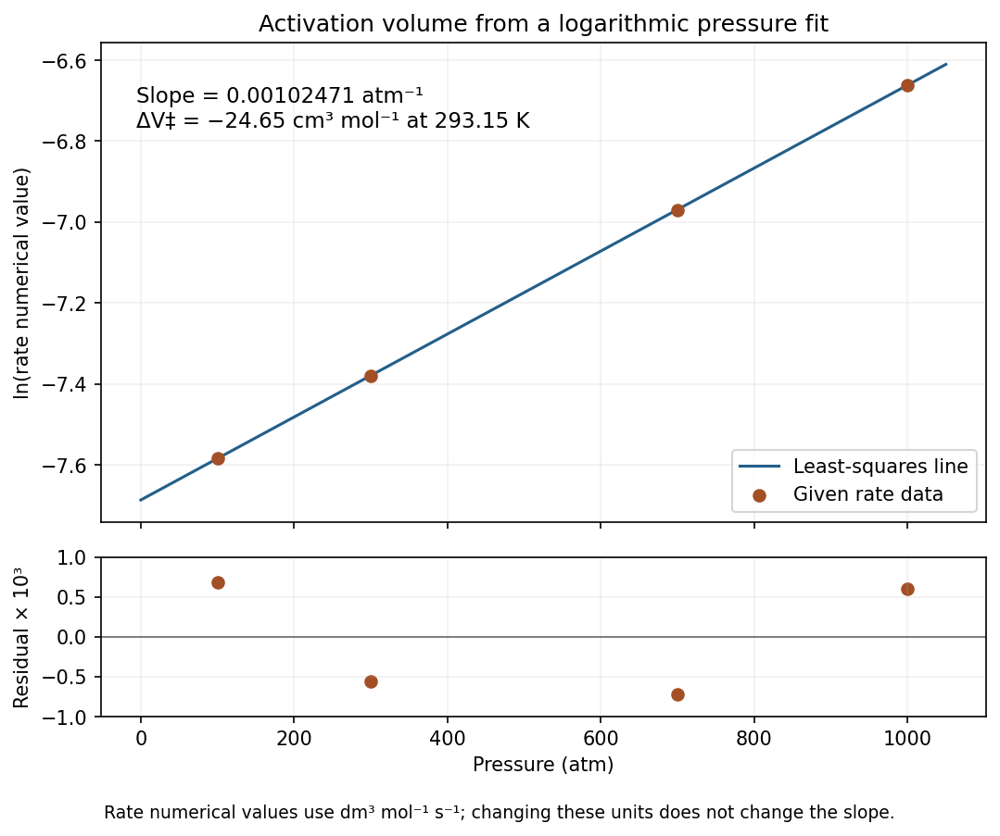

<h1 id="a7/c/iii/solution">Solution</h1>

↑ **Parent:** [Iii](../iii.md)

Using the numerical rate constants in $\mathrm{dm^3\,mol^{-1}\,s^{-1}}$, the logarithms are

$$
\begin{array}{c|rrrr}
p/\mathrm{atm}&100&300&700&1000\\\hline
\ln k_2&-7.58306&-7.37936&-6.96963&-6.66090
\end{array}
$$

A straight-line least-squares fit is

$$
\boxed{\ln k_2=-7.68621+(1.02471\times10^{-3})(p/\mathrm{atm}).}
$$

Every logarithmic residual has magnitude below $7.2\times10^{-4}$, so the rates follow the fitted exponential to within $0.08\%$; $R^2\simeq0.999997$. Thus a constant [activation volume](../../../../../../activation-volume.md) describes these data well.

**[Figure 1](#a7/c/iii/image-original-logarithmic-pressure-rate-fit-and-residuals-for-the-activation-volume-calculation). Original logarithmic pressure-rate fit and residuals for the activation-volume calculation**.

Convert the slope to pascals, using $1\ \mathrm{atm}=101325$ Pa and $T=293.15$ K:

$$
\begin{aligned}
\Delta V^{\ddagger\circ}
&=-R(293.15)\frac{1.02471\times10^{-3}}{101325}\ \mathrm{m^3\,mol^{-1}}\\
&=\boxed{-24.65\ \mathrm{cm^3\,mol^{-1}}}.
\end{aligned}
$$

Multiplying all rates by a common unit-conversion factor changes the intercept but leaves this slope and volume unchanged.

## ↑ Ancestors (14)

1. [Iii](../iii.md)
2. [C](../../c.md)
3. [A7](../../../a7.md)
4. [Paper 2](../../../../paper-2-split.md)
5. [2024](../../../../split.md)
6. [Past exam of the chemistry A course of the University of Cambridge](../../../../../split.md)
7. [Chemistry A course of the University of Cambridge](../../../../../../chemistry-a-course-of-the-university-of-cambridge.md)
8. [Year 2 of the natural sciences course of the University of Cambridge](../../../../../../year-2-of-the-natural-sciences-course-of-the-university-of-cambridge.md)
9. [Year of the natural sciences course of the University of Cambridge](../../../../../../year-of-the-natural-sciences-course-of-the-university-of-cambridge.md)
10. [Natural sciences course of the University of Cambridge](../../../../../../natural-sciences-course-of-the-university-of-cambridge.md)
11. [Course of the University of Cambridge](../../../../../../course-of-the-university-of-cambridge.md)
12. [University of Cambridge](../../../../../../university-of-cambridge-split.md)
13. [List of universities](../../../../../../list-of-universities.md)
14. [Codex Wiki](../../../../../../split.md)
