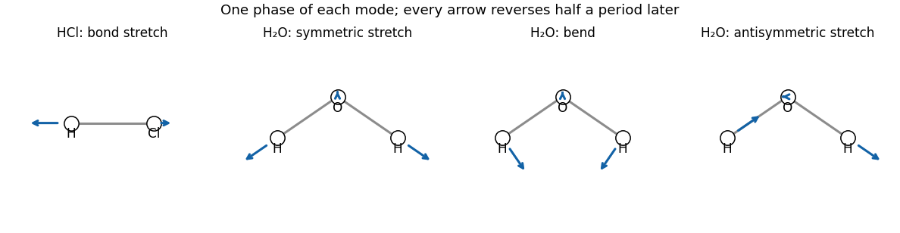

<h1 id="a3/c/i/solution">Solution</h1>

↑ **Parent:** [I](../i.md)

A [diatomic molecule](../../../../../../diatomic-molecule.md) has $3N-5=1$ vibrational [normal mode](../../../../../../normal-mode.md): the bond stretch. For [hydrogen chloride](../../../../../../hydrogen-chloride.md), opposite longitudinal displacements change the [electric dipole moment](../../../../../../electric-dipole-moment.md), so the mode has [vibrational infrared activity](../../../../../../vibrational-infrared-activity.md). The following original sketches show one phase of this motion and the three water modes; arrow lengths are schematic, not mass-weighted amplitudes.

**[Figure 1](#a3/c/i/image-original-sketches-of-the-hydrogen-chloride-stretch-and-the-three-molecular-vibrations-of-water). Original sketches of the hydrogen chloride stretch and the three molecular vibrations of water**.

## ↑ Ancestors (14)

1. [I](../i.md)
2. [C](../../c.md)
3. [A3](../../../a3.md)
4. [Paper 1](../../../../paper-1-split.md)
5. [2025](../../../../split.md)
6. [Past exam of the chemistry A course of the University of Cambridge](../../../../../split.md)
7. [Chemistry A course of the University of Cambridge](../../../../../../chemistry-a-course-of-the-university-of-cambridge.md)
8. [Year 2 of the natural sciences course of the University of Cambridge](../../../../../../year-2-of-the-natural-sciences-course-of-the-university-of-cambridge.md)
9. [Year of the natural sciences course of the University of Cambridge](../../../../../../year-of-the-natural-sciences-course-of-the-university-of-cambridge.md)
10. [Natural sciences course of the University of Cambridge](../../../../../../natural-sciences-course-of-the-university-of-cambridge.md)
11. [Course of the University of Cambridge](../../../../../../course-of-the-university-of-cambridge.md)
12. [University of Cambridge](../../../../../../university-of-cambridge-split.md)
13. [List of universities](../../../../../../list-of-universities.md)
14. [Codex Wiki](../../../../../../split.md)
