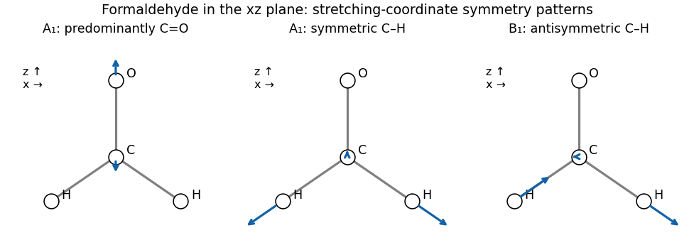

<h1 id="a4/c/i/solution">Solution</h1>

↑ **Parent:** [I](../i.md)

The C=O length is invariant under every operation, so its stretch is $A_1$. If $s_L,s_R$ are the two C–H bond-length changes, their sum and difference give

$$
Q_{\rm CO}\sim A_1,\qquad Q_{\rm CH,s}=\frac{s_L+s_R}{\sqrt2}\sim A_1,\qquad
Q_{\rm CH,a}=\frac{s_L-s_R}{\sqrt2}\sim B_1.
$$

Hence $\boxed{\Gamma_{\rm stretch}=2A_1+B_1}$. These are stretching symmetry coordinates; the two $A_1$ motions can mix in actual [normal modes](../../../../../../normal-mode.md), and mass-weighted atomic motions need not have the schematic arrow lengths below.

**[Figure 2](#a4/c/i/image-original-formaldehyde-stretching-symmetry-sketches-in-the-paper-s-xz-plane). Original formaldehyde stretching symmetry sketches in the paper's $xz$ plane**.

## ↑ Ancestors (14)

1. [I](../i.md)
2. [C](../../c.md)
3. [A4](../../../a4.md)
4. [Paper 1](../../../../paper-1-split.md)
5. [2025](../../../../split.md)
6. [Past exam of the chemistry A course of the University of Cambridge](../../../../../split.md)
7. [Chemistry A course of the University of Cambridge](../../../../../../chemistry-a-course-of-the-university-of-cambridge.md)
8. [Year 2 of the natural sciences course of the University of Cambridge](../../../../../../year-2-of-the-natural-sciences-course-of-the-university-of-cambridge.md)
9. [Year of the natural sciences course of the University of Cambridge](../../../../../../year-of-the-natural-sciences-course-of-the-university-of-cambridge.md)
10. [Natural sciences course of the University of Cambridge](../../../../../../natural-sciences-course-of-the-university-of-cambridge.md)
11. [Course of the University of Cambridge](../../../../../../course-of-the-university-of-cambridge.md)
12. [University of Cambridge](../../../../../../university-of-cambridge-split.md)
13. [List of universities](../../../../../../list-of-universities.md)
14. [Codex Wiki](../../../../../../split.md)
