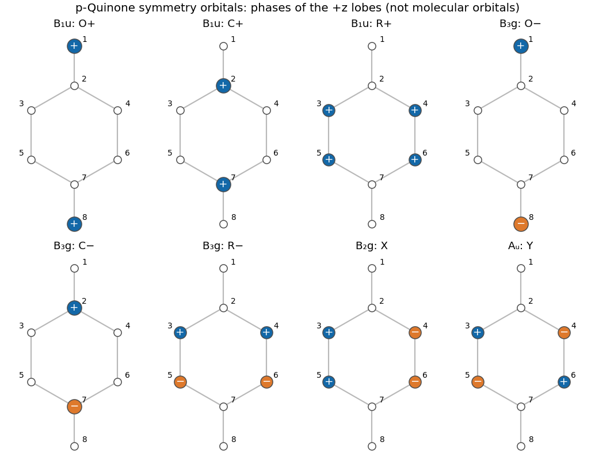

<h1 id="a5/b/solution">Solution</h1>

↑ **Parent:** [B](../b.md)

Write $p_i$ for the orthonormal $2p_z$ [atomic orbital](../../../../../atomic-orbital.md) on numbered site $i$, with every positive lobe pointing along $+z$. A normalized set of [symmetry-adapted linear combinations](../../../../../symmetry-adapted-linear-combination.md) is

$$
\begin{array}{c|c|l}
\text{symmetry}&\text{name}&\text{symmetry orbital}\\\hline
B_{1u}&O_+&(p_1+p_8)/\sqrt2\\
B_{1u}&C_+&(p_2+p_7)/\sqrt2\\
B_{1u}&R_+&(p_3+p_4+p_5+p_6)/2\\
B_{3g}&O_-&(p_1-p_8)/\sqrt2\\
B_{3g}&C_-&(p_2-p_7)/\sqrt2\\
B_{3g}&R_-&(p_3+p_4-p_5-p_6)/2\\
B_{2g}&X&(p_3-p_4+p_5-p_6)/2\\
A_u&Y&(p_3-p_4-p_5+p_6)/2
\end{array}
$$

Each has unit squared coefficient sum, and every distinct pair has zero [inner product](../../../../../inner-product-split.md). The orbital representation therefore reduces to $\boxed{3B_{1u}+3B_{3g}+B_{2g}+A_u}$. For example, the fully symmetric site sum still has $B_{1u}$ orbital symmetry because a $p_z$ orbital itself changes sign under operations that reverse $z$. Ignoring that sign would assign the wrong representations.

**[Figure 3](#a5/b/image-original-phase-maps-of-the-eight-normalized-para-quinone-symmetry-orbitals). Original phase maps of the eight normalized para-quinone symmetry orbitals**. Filled circles label the phases of the $+z$ lobes; the opposite lobe has the opposite phase. White circles mean zero coefficient. Areas scale with coefficient magnitude. Site numbers follow the source paper.

## ↑ Ancestors (13)

1. [B](../b.md)
2. [A5](../../a5.md)
3. [Paper 1](../../../paper-1-split.md)
4. [2025](../../../split.md)
5. [Past exam of the chemistry A course of the University of Cambridge](../../../../split.md)
6. [Chemistry A course of the University of Cambridge](../../../../../chemistry-a-course-of-the-university-of-cambridge.md)
7. [Year 2 of the natural sciences course of the University of Cambridge](../../../../../year-2-of-the-natural-sciences-course-of-the-university-of-cambridge.md)
8. [Year of the natural sciences course of the University of Cambridge](../../../../../year-of-the-natural-sciences-course-of-the-university-of-cambridge.md)
9. [Natural sciences course of the University of Cambridge](../../../../../natural-sciences-course-of-the-university-of-cambridge.md)
10. [Course of the University of Cambridge](../../../../../course-of-the-university-of-cambridge.md)
11. [University of Cambridge](../../../../../university-of-cambridge-split.md)
12. [List of universities](../../../../../list-of-universities.md)
13. [Codex Wiki](../../../../../split.md)
