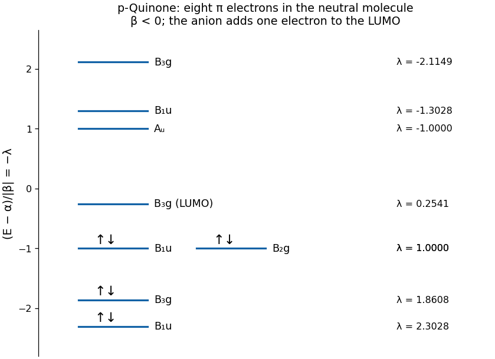

<h1 id="a5/c/solution">Solution</h1>

↑ **Parent:** [C](../c.md)

Set $E=\alpha+\lambda\beta$, with the usual bonding convention $\beta<0$. In the [Hückel method](../../../../../huckel-method.md), the dimensionless matrix $M=(H-\alpha I)/\beta$ has diagonal entries one on oxygen sites 1 and 8, zero on carbon, and unit entries between bonded neighbours. In the bases $(O_+,C_+,R_+)$ and $(O_-,C_-,R_-)$ above, its blocks are

$$
M_{B_{1u}}=\begin{pmatrix}1&1&0\\1&0&\sqrt2\\0&\sqrt2&1\end{pmatrix},\qquad
M_{B_{3g}}=\begin{pmatrix}1&1&0\\1&0&\sqrt2\\0&\sqrt2&-1\end{pmatrix}.
$$

The one-dimensional $B_{2g}$ and $A_u$ blocks have $\lambda=1$ and $-1$, respectively. The [characteristic polynomial](../../../../../characteristic-polynomial.md) of the $B_{1u}$ block factors as

$$
\det(\lambda I-M_{B_{1u}})=(\lambda-1)(\lambda^2-\lambda-3),
$$

so its three [molecular orbital](../../../../../molecular-orbital.md) energies are

$$
\boxed{E_{B_{1u}}=\alpha+\beta,\qquad\alpha+\frac{1+\sqrt{13}}2\beta,\qquad\alpha+\frac{1-\sqrt{13}}2\beta.}
$$

For the $B_{3g}$ block the [matrix trace](../../../../../matrix-trace.md) is zero. Thus its three $\lambda$ values sum to zero, and the pair supplied in the paper gives the remaining one as $-(1.86-2.12)\simeq0.26$. Directly, its secular equation is $\lambda^3-4\lambda+1=0$, whose roots are approximately $1.860806$, $0.254102$ and $-2.114908$. The supplied pair is approximate, so $0.26$ from its trace and $0.2541$ from the exact block should not be mistaken for an additional physical splitting.

All eight energies, ordered from low to high for $\beta<0$, are

$$
\begin{array}{c|c|c}
\lambda&\text{symmetry}&\text{neutral occupancy}\\\hline
2.302776&B_{1u}&2\\
1.860806&B_{3g}&2\\
1&B_{1u}&2\\
1&B_{2g}&2\\
0.254102&B_{3g}&0\\
-1&A_u&0\\
-1.302776&B_{1u}&0\\
-2.114908&B_{3g}&0
\end{array}
$$

The eight $\pi$ electrons fill the four lowest [molecular orbitals](../../../../../molecular-orbital.md). The equality at $\lambda=1$ is an accidental degeneracy of this parameterized model, not a multidimensional representation of $D_{2h}$.

**[Figure 4](#a5/c/image-original-huckel-method-energy-level-diagram-for-neutral-para-quinone-with-eight-pi-electrons-and-its-unoccupied-b-3g-level). Original Hückel method energy-level diagram for neutral para-quinone, with eight $\pi$ electrons and its unoccupied $B_{3g}$ level**.

## ↑ Ancestors (13)

1. [C](../c.md)
2. [A5](../../a5.md)
3. [Paper 1](../../../paper-1-split.md)
4. [2025](../../../split.md)
5. [Past exam of the chemistry A course of the University of Cambridge](../../../../split.md)
6. [Chemistry A course of the University of Cambridge](../../../../../chemistry-a-course-of-the-university-of-cambridge.md)
7. [Year 2 of the natural sciences course of the University of Cambridge](../../../../../year-2-of-the-natural-sciences-course-of-the-university-of-cambridge.md)
8. [Year of the natural sciences course of the University of Cambridge](../../../../../year-of-the-natural-sciences-course-of-the-university-of-cambridge.md)
9. [Natural sciences course of the University of Cambridge](../../../../../natural-sciences-course-of-the-university-of-cambridge.md)
10. [Course of the University of Cambridge](../../../../../course-of-the-university-of-cambridge.md)
11. [University of Cambridge](../../../../../university-of-cambridge-split.md)
12. [List of universities](../../../../../list-of-universities.md)
13. [Codex Wiki](../../../../../split.md)
