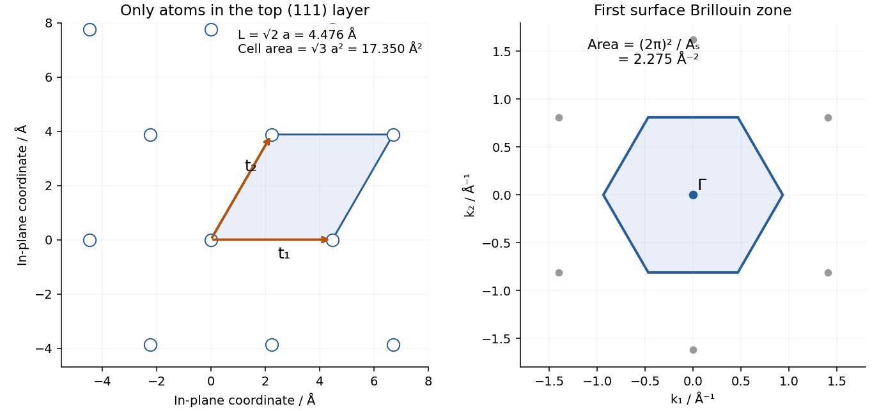
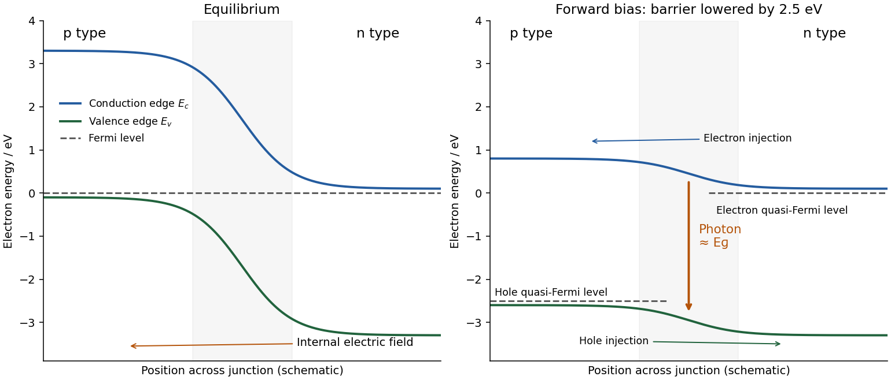

# Paper 2

↑ **Parent:** [2025](../2025.md)

[Original paper, released PDF pages 173–178](https://www.whatdotheyknow.com/request/request_for_nst_past_papers/response/3572306/attach/4/FOI%202026%20862%20Stack%20materials.pdf?cookie_passthrough=1#page=173)

**Table of contents**

- [A6](#a6)
  - [a](#a6/a)
    - [Solution](#a6/a/solution)
  - [b](#a6/b)
    - [i](#a6/b/i)
      - [Solution](#a6/b/i/solution)
    - [ii](#a6/b/ii)
      - [Solution](#a6/b/ii/solution)
  - [c](#a6/c)
    - [i](#a6/c/i)
      - [Solution](#a6/c/i/solution)
    - [ii](#a6/c/ii)
      - [Solution](#a6/c/ii/solution)
    - [iii](#a6/c/iii)
      - [Solution](#a6/c/iii/solution)
- [A7](#a7)
  - [a](#a7/a)
    - [i](#a7/a/i)
      - [Solution](#a7/a/i/solution)
    - [ii](#a7/a/ii)
      - [Solution](#a7/a/ii/solution)
  - [b](#a7/b)
    - [i](#a7/b/i)
      - [Solution](#a7/b/i/solution)
    - [ii](#a7/b/ii)
      - [Solution](#a7/b/ii/solution)
    - [iii](#a7/b/iii)
      - [Solution](#a7/b/iii/solution)
  - [c](#a7/c)
    - [Solution](#a7/c/solution)
- [A8](#a8)
  - [a](#a8/a)
    - [i](#a8/a/i)
      - [Solution](#a8/a/i/solution)
    - [ii](#a8/a/ii)
      - [Solution](#a8/a/ii/solution)
    - [iii](#a8/a/iii)
      - [Solution](#a8/a/iii/solution)
  - [b](#a8/b)
    - [i](#a8/b/i)
      - [Solution](#a8/b/i/solution)
    - [ii](#a8/b/ii)
      - [Solution](#a8/b/ii/solution)
    - [iii](#a8/b/iii)
      - [Solution](#a8/b/iii/solution)
  - [c](#a8/c)
    - [i](#a8/c/i)
      - [Solution](#a8/c/i/solution)
    - [ii](#a8/c/ii)
      - [1](#a8/c/ii/1)
        - [Solution](#a8/c/ii/1/solution)
      - [2](#a8/c/ii/2)
        - [Solution](#a8/c/ii/2/solution)
  - [d](#a8/d)
    - [Solution](#a8/d/solution)
- [A9](#a9)
  - [a](#a9/a)
    - [Solution](#a9/a/solution)
  - [b](#a9/b)
    - [Solution](#a9/b/solution)
  - [c](#a9/c)
    - [Solution](#a9/c/solution)
  - [d](#a9/d)
    - [Solution](#a9/d/solution)
  - [e](#a9/e)
    - [Solution](#a9/e/solution)
  - [f](#a9/f)
    - [Solution](#a9/f/solution)
  - [g](#a9/g)
    - [Solution](#a9/g/solution)
  - [h](#a9/h)
    - [Solution](#a9/h/solution)
- [A10](#a10)
  - [a](#a10/a)
    - [i](#a10/a/i)
      - [Solution](#a10/a/i/solution)
    - [ii](#a10/a/ii)
      - [Solution](#a10/a/ii/solution)
    - [iii](#a10/a/iii)
      - [Solution](#a10/a/iii/solution)
  - [b](#a10/b)
    - [i](#a10/b/i)
      - [Solution](#a10/b/i/solution)
    - [ii](#a10/b/ii)
      - [Solution](#a10/b/ii/solution)
  - [c](#a10/c)
    - [Solution](#a10/c/solution)
  - [d](#a10/d)
    - [i](#a10/d/i)
      - [Solution](#a10/d/i/solution)
    - [ii](#a10/d/ii)
      - [Solution](#a10/d/ii/solution)
  - [e](#a10/e)
    - [Solution](#a10/e/solution)

## A6

↑ **Parent:** [Paper 2](paper-2.md)

<h3 id="a6/a">a</h3>

↑ **Parent:** [A6](#a6)

<h4 id="a6/a/solution">Solution</h4>

↑ **Parent:** [A](#a6/a)

The [internal energy](../../internal-energy.md) is the population-weighted sum of the molecular [energy levels](../../quantum-mechanics.md#energy-level):

$$
U=\sum_i n_i\varepsilon_i=\frac Nq\sum_i\varepsilon_i e^{-\varepsilon_i/kT}.
$$

At fixed [volume](../../geometry-and-topology.md#volume), assume the [energy levels](../../quantum-mechanics.md#energy-level) themselves are temperature-independent. Differentiating the molecular [partition function](../../canonical-ensemble.md#canonical-partition-function) gives

$$
\left(\frac{\partial q}{\partial T}\right)_V
=\frac1{kT^2}\sum_i\varepsilon_i e^{-\varepsilon_i/kT},
\qquad\boxed{U=NkT^2\frac{\partial\log q}{\partial T}}.
$$

Choosing the zero of energy changes $U$ by the corresponding constant per molecule, so the ground-level convention must be consistent throughout.

<h3 id="a6/b">b</h3>

↑ **Parent:** [A6](#a6)

<h4 id="a6/b/i">i</h4>

↑ **Parent:** [B](#a6/b)

<h5 id="a6/b/i/solution">Solution</h5>

↑ **Parent:** [I](#a6/b/i)

Relative to the [ground state](../../quantum-mechanics.md#ground-state), the [quantum harmonic oscillator](../../quantum-harmonic-oscillator.md) levels are $vhc\widetilde\omega$. Put $\theta_v=hc\widetilde\omega/k$. Summing the [geometric series](../../sequence-and-series.md#geometric-series) gives the [vibrational partition function](../../canonical-ensemble.md#vibrational-partition-function) $q=(1-e^{-\theta_v/T})^{-1}$. Therefore the vibrational [internal energy](../../internal-energy.md) is

$$
\boxed{U=\frac{Nk\theta_v}{e^{\theta_v/T}-1}}
=\frac{Nhc\widetilde\omega}{e^{hc\widetilde\omega/kT}-1}.
$$

The omitted [zero-point energy](../../quantum-harmonic-oscillator.md#zero-point-energy) would add $Nhc\widetilde\omega/2$ if absolute oscillator energies were used.

<h4 id="a6/b/ii">ii</h4>

↑ **Parent:** [B](#a6/b)

<h5 id="a6/b/ii/solution">Solution</h5>

↑ **Parent:** [Ii](#a6/b/ii)

“Low” and “high” compare $kT$ with the vibrational spacing $hc\widetilde\omega$, not [temperature](../../temperature.md) with an arbitrary number of kelvin. For $T\ll\theta_v$, occupation of excited levels is exponentially suppressed and

$$
\boxed{U\sim Nk\theta_v e^{-\theta_v/T}\longrightarrow0}.
$$

This vanishing result uses the ground-relative energy zero. For $T\gg\theta_v$, expand $e^{\theta_v/T}-1\sim\theta_v/T$ to obtain

$$
\boxed{U\sim NkT}.
$$

This agrees with [equipartition](../../canonical-ensemble.md#equipartition-theorem): the oscillator has one quadratic kinetic and one quadratic potential term, contributing $kT/2$ each. The corresponding limiting vibrational [heat capacity](../../heat.md#heat-capacity) is zero at low [temperature](../../temperature.md) and $Nk$ at high [temperature](../../temperature.md).

<h3 id="a6/c">c</h3>

↑ **Parent:** [A6](#a6)

<h4 id="a6/c/i">i</h4>

↑ **Parent:** [C](#a6/c)

<h5 id="a6/c/i/solution">Solution</h5>

↑ **Parent:** [I](#a6/c/i)

Subtracting the $v=0$ energy in the [Morse oscillator](../../quantum-system.md#morse-oscillator) gives

$$
\frac{\varepsilon_v-\varepsilon_0}{hc}
=v\widetilde\omega-v(v+1)\widetilde\omega x.
$$

The first three relative wavenumbers are $0$, $213$, and $424\ \mathrm{cm}^{-1}$. Thus, with $\theta_1=213/0.695\ \mathrm K$ and $\theta_2=424/0.695\ \mathrm K$,

$$
\boxed{q_3(T)=1+e^{-\theta_1/T}+e^{-\theta_2/T}},\qquad
\boxed{q_3(100\ \mathrm K)=1.04891}.
$$

This is a three-level [partition function](../../canonical-ensemble.md#canonical-partition-function), as stipulated, rather than an unrestricted sum of the anharmonic formula to arbitrarily large $v$.

<h4 id="a6/c/ii">ii</h4>

↑ **Parent:** [C](#a6/c)

<h5 id="a6/c/ii/solution">Solution</h5>

↑ **Parent:** [Ii](#a6/c/ii)

Differentiating each [Boltzmann factor](../../canonical-ensemble.md#boltzmann-factor) yields

$$
\boxed{\frac{\partial q_3}{\partial T}
=\frac{\theta_1e^{-\theta_1/T}+\theta_2e^{-\theta_2/T}}{T^2}}.
$$

The derivative is positive: warming increases occupation of both excited [energy levels](../../quantum-mechanics.md#energy-level). At $100\ \mathrm K$,

$$
\boxed{\left.\frac{\partial q_3}{\partial T}\right|_{100\,\mathrm K}
=1.56692\times10^{-3}\ \mathrm K^{-1}}.
$$

<h4 id="a6/c/iii">iii</h4>

↑ **Parent:** [C](#a6/c)

<h5 id="a6/c/iii/solution">Solution</h5>

↑ **Parent:** [Iii](#a6/c/iii)

For one mole, $Nk=R$, so the three-level [Morse oscillator](../../quantum-system.md#morse-oscillator) result is

$$
\boxed{U_m=RT^2\frac{q_3'}{q_3}=124.21\ \mathrm{J\,mol^{-1}}}.
$$

For the full [quantum harmonic oscillator](../../quantum-harmonic-oscillator.md) with the given wavenumber,

$$
\boxed{U_{m,\mathrm{harm}}=\frac{R(215/0.695)}{e^{215/(0.695\cdot100)}-1}
=122.16\ \mathrm{J\,mol^{-1}}}.
$$

The specified anharmonic calculation is about $1.7\%$ higher. Anharmonicity lowers the first excitation spacings and increases excited-state occupation. Both results remain small because $100\ \mathrm K$ is well below the vibrational [temperature](../../temperature.md). The comparison also mixes a three-level anharmonic truncation with an infinite harmonic sum; omitted higher Morse levels would make a further small positive correction at this [temperature](../../temperature.md).

## A7

↑ **Parent:** [Paper 2](paper-2.md)

<h3 id="a7/a">a</h3>

↑ **Parent:** [A7](#a7)

<h4 id="a7/a/i">i</h4>

↑ **Parent:** [A](#a7/a)

<h5 id="a7/a/i/solution">Solution</h5>

↑ **Parent:** [I](#a7/a/i)

For identical, non-interacting molecules, the translational [canonical partition function](../../canonical-ensemble.md#canonical-partition-function) is $Q_N=q_{\rm trans}^N/N!$. [Stirling's approximation](../../real-analysis.md#stirling-formula) gives the [Helmholtz free energy](../../thermodynamic-potential.md#helmholtz-free-energy)

$$
A=-NkT\left[\log(q_{\rm trans}/N)+1\right].
$$

At fixed $V$, $q_{\rm trans}\propto T^{3/2}$, so differentiation gives $S=Nk[\log(q_{\rm trans}/N)+5/2]$. For one mole at the standard-state molar [volume](../../geometry-and-topology.md#volume),

$$
\boxed{S_{m,\rm trans}^{\circ}=R\left[\log\left(\frac{q_{m,\rm trans}^{\circ}}{N_A}\right)+\frac52\right]}.
$$

Here the quoted molar translational quantity is per mole, and its ratio to $N_A$ is dimensionless. The derivative defining [entropy](../../entropy.md) is taken at fixed [volume](../../geometry-and-topology.md#volume) before inserting the standard-state [volume](../../geometry-and-topology.md#volume); differentiating along a constant-pressure path would give the wrong additive constant.

<h4 id="a7/a/ii">ii</h4>

↑ **Parent:** [A](#a7/a)

<h5 id="a7/a/ii/solution">Solution</h5>

↑ **Parent:** [Ii](#a7/a/ii)

For a linear [rigid rotor](../../molecule.md#rigid-rotor) in the high-temperature regime, $q_{\rm rot}\propto T$. Its molar rotational [entropy](../../entropy.md) is

$$
\boxed{S_{m,\rm rot}=R(\log q_{\rm rot}+1)}.
$$

The [rotational symmetry number](../../molecule.md#rotational-symmetry-number) must already be included in $q_{\rm rot}$.

<h3 id="a7/b">b</h3>

↑ **Parent:** [A7](#a7)

<h4 id="a7/b/i">i</h4>

↑ **Parent:** [B](#a7/b)

<h5 id="a7/b/i/solution">Solution</h5>

↑ **Parent:** [I](#a7/b/i)

Under the stated vibrational-ground-state approximation and a nondegenerate electronic [ground state](../../quantum-mechanics.md#ground-state), only translation and rotation contribute. Therefore

$$
S_m^{\circ}=R\left[\log\left(\frac{7.966\times10^{30}}{N_A}\right)+\frac52+log(265.4)+1\right]
=\boxed{211.84\ \mathrm{J\,mol^{-1}\,K^{-1}}}.
$$

A temperature-independent ground-state energy, including [zero-point energy](../../quantum-harmonic-oscillator.md#zero-point-energy), contributes no [entropy](../../entropy.md). This estimate deliberately omits thermal vibrational excitation; it need not equal a tabulated value that includes all modes.

<h4 id="a7/b/ii">ii</h4>

↑ **Parent:** [B](#a7/b)

<h5 id="a7/b/ii/solution">Solution</h5>

↑ **Parent:** [Ii](#a7/b/ii)

Use the same standard pressure and [temperature](../../temperature.md), the same bond length, and the same electronic and vibrational-ground-state approximations. The [translational partition function](../../canonical-ensemble.md#translational-partition-function) scales as [mass](../../classical-mechanics.md#mass) to the power $3/2$, giving the factor $(47/44)^{3/2}$. For the original isotopologue, $I=32m_uR^2$ and the [rotational symmetry number](../../molecule.md#rotational-symmetry-number) is two. For the isotope-substituted molecule, the two oxygen ends are distinguishable, so the symmetry number is one. Hence

$$
\frac{q_{\rm rot,new}}{q_{\rm rot,old}}=2\frac{33.91}{32}.
$$

The change in standard molar [entropy](../../entropy.md) is

$$
\Delta S_m=R\left[\frac32\log\frac{47}{44}+\log\left(2\frac{33.91}{32}\right)\right]
=7.0678\ \mathrm{J\,mol^{-1}\,K^{-1}},
$$

so

$$
\boxed{S_{m,\rm new}^{\circ}\simeq218.91\ \mathrm{J\,mol^{-1}\,K^{-1}}}.
$$

This uses a convention omitting a separate nuclear-spin [entropy](../../entropy.md). If nuclear-spin degeneracies are instead included explicitly, the spin-$1/2$ carbon-13 nucleus adds a further $R\log2$ relative to the spin-zero original isotopologue; that convention must be stated rather than silently mixed with the quoted [partition functions](../../canonical-ensemble.md#canonical-partition-function).

<h4 id="a7/b/iii">iii</h4>

↑ **Parent:** [B](#a7/b)

<h5 id="a7/b/iii/solution">Solution</h5>

↑ **Parent:** [Iii](#a7/b/iii)

The substituted molecule has the larger [entropy](../../entropy.md). Increased [mass](../../classical-mechanics.md#mass) and [moment of inertia](../../rigid-body-dynamics.md#moment-of-inertia) reduce translational and rotational spacings and make more states thermally accessible. The largest contribution here is the loss of the twofold rotational indistinguishability of the oxygen ends, contributing $R\log2$. It is a [rotational symmetry number](../../molecule.md#rotational-symmetry-number) correction for one isotope-defined species, not an [entropy of mixing](../../mixture.md#entropy-of-mixing) between different molecules.

<h3 id="a7/c">c</h3>

↑ **Parent:** [A7](#a7)

<h4 id="a7/c/solution">Solution</h4>

↑ **Parent:** [C](#a7/c)

As a first estimate, neglect the small [mass](../../classical-mechanics.md#mass) change and changes in geometry and vibrational populations. Removing an [electron](../../physics.md#electron) creates an unpaired spin, giving at least the spin-only electronic [entropy](../../entropy.md) increase

$$
\boxed{\Delta S_{m,\rm spin}\simeq R\log2=5.76\ \mathrm{J\,mol^{-1}\,K^{-1}}}.
$$

For a more specific estimate, the actual cation ground term is $X\,{}^2\Pi_g$, rather than an orbitally nondegenerate doublet. Ignoring [spin-orbit coupling](../../atomic-physics.md#spin-orbit-interaction), its two orbital components and two spin components give electronic degeneracy four and

$$
\boxed{\Delta S_{m,\rm el}\simeq R\log4=11.53\ \mathrm{J\,mol^{-1}\,K^{-1}}}.
$$

The ground-state assignment is confirmed by state-resolved photoionization measurements.[Measurements restricted to channels leaving the cation in its X 2Πg ground electronic state](../../chemistry-bibliography.md#photoionization-of-co2-experimental-procedure-by-the-national-institute-of-standards-and-technology) Spin-orbit splitting and changed vibrational/rotational constants refine this estimate; the question's supplied [partition functions](../../canonical-ensemble.md#canonical-partition-function) alone do not determine those corrections. The $R\log2$ answer is a spin-only estimate, while $R\log4$ additionally retains the orbital degeneracy.

## A8

↑ **Parent:** [Paper 2](paper-2.md)

<h3 id="a8/a">a</h3>

↑ **Parent:** [A8](#a8)

<h4 id="a8/a/i">i</h4>

↑ **Parent:** [A](#a8/a)

<h5 id="a8/a/i/solution">Solution</h5>

↑ **Parent:** [I](#a8/a/i)

A [potential energy surface](../../chemical-kinetics.md#potential-energy-surface) gives the molecular electronic energy, with nuclear repulsion, as a function of the nuclear coordinates under the [Born-Oppenheimer approximation](../../quantum-mechanics.md#born-oppenheimer-approximation). Its minima describe stable configurations and its saddle regions help identify reaction barriers.

<h4 id="a8/a/ii">ii</h4>

↑ **Parent:** [A](#a8/a)

<h5 id="a8/a/ii/solution">Solution</h5>

↑ **Parent:** [Ii](#a8/a/ii)

A [reaction coordinate](../../chemical-kinetics.md#reaction-coordinate) parametrizes progress along a chosen path on the [potential energy surface](../../chemical-kinetics.md#potential-energy-surface). It usually combines several bond lengths or angles; it need not be one literal bond distance or elapsed time.

<h4 id="a8/a/iii">iii</h4>

↑ **Parent:** [A](#a8/a)

<h5 id="a8/a/iii/solution">Solution</h5>

↑ **Parent:** [Iii](#a8/a/iii)

A [transition state](../../chemical-kinetics.md#transition-state) is the configuration or dividing-surface region associated with passage between reactant and product basins. In the elementary saddle-point picture it is a first-order saddle of the [potential energy surface](../../chemical-kinetics.md#potential-energy-surface): stable against small displacements in transverse directions but unstable along the reaction direction. [Transition state theory](../../chemical-kinetics.md#transition-state-theory) counts forward crossings and, in its simplest form, neglects recrossing.

<h3 id="a8/b">b</h3>

↑ **Parent:** [A8](#a8)

<h4 id="a8/b/i">i</h4>

↑ **Parent:** [B](#a8/b)

<h5 id="a8/b/i/solution">Solution</h5>

↑ **Parent:** [I](#a8/b/i)

The quantities $f_A$ and $f_B$ are molecular [partition functions](../../canonical-ensemble.md#canonical-partition-function) per unit [volume](../../geometry-and-topology.md#volume) for the two reactants, with their internal rotational, vibrational and electronic factors included. Thus their translational factors are $(2\pi m_jkT/h^2)^{3/2}$, rather than those factors multiplied by $V$. Their energy zeros must match the separately displayed barrier convention.

<h4 id="a8/b/ii">ii</h4>

↑ **Parent:** [B](#a8/b)

<h5 id="a8/b/ii/solution">Solution</h5>

↑ **Parent:** [Ii](#a8/b/ii)

The primed $f'_{\rm TS}$ is the corresponding [transition state](../../chemical-kinetics.md#transition-state) [partition function](../../canonical-ensemble.md#canonical-partition-function) per unit [volume](../../geometry-and-topology.md#volume) with the unstable reaction-coordinate degree of freedom omitted. Its replacement by the crossing-frequency factor $kT/h$ is already outside the partition-function ratio. For a diatomic atom-pair transition state, the omitted coordinate is the bond stretch, leaving translation and rotation.

<h4 id="a8/b/iii">iii</h4>

↑ **Parent:** [B](#a8/b)

<h5 id="a8/b/iii/solution">Solution</h5>

↑ **Parent:** [Iii](#a8/b/iii)

The barrier $\Delta\varepsilon_0^{\ddagger}$ is the energy difference between the transition-state reference level and the separated reactant reference levels. Consistent [zero-point energies](../../quantum-harmonic-oscillator.md#zero-point-energy) of stable transverse modes belong in this reference-level difference. It is an energy per reacting pair; a molar activation energy uses $R$ instead of $k$ in the exponential.

<h3 id="a8/c">c</h3>

↑ **Parent:** [A8](#a8)

<h4 id="a8/c/i">i</h4>

↑ **Parent:** [C](#a8/c)

<h5 id="a8/c/i/solution">Solution</h5>

↑ **Parent:** [I](#a8/c/i)

Write $M=m_A+m_B$ and $\mu=m_Am_B/M$. An atom has no rotational or vibrational internal factor under the stated electronic assumption. The transition-state [moment of inertia](../../rigid-body-dynamics.md#moment-of-inertia) is $I=\mu R^2$, so the high-temperature [rigid rotor](../../molecule.md#rigid-rotor) result is

$$
q_{\rm rot,TS}=\frac{8\pi^2\mu R^2kT}{\sigma h^2}.
$$

The translational factors therefore give

$$
\frac{f'_{\rm TS}}{f_Af_B}
=\left(\frac{h^2}{2\pi\mu kT}\right)^{3/2}
\frac{8\pi^2\mu R^2kT}{\sigma h^2}.
$$

Substituting into the [transition state theory](../../chemical-kinetics.md#transition-state-theory) expression and simplifying,

$$
\boxed{k_{\rm 2nd}=\frac{\pi R^2}{\sigma}
\sqrt{\frac{8kT}{\pi\mu}}\,
\exp\left(-\frac{\Delta\varepsilon_0^{\ddagger}}{kT}\right)}.
$$

For distinct atoms, $\sigma=1$. This is a number-density rate coefficient, with units of [volume](../../geometry-and-topology.md#volume) per time. A rate law in molar concentrations uses $N_Ak_{\rm 2nd}$. The derivation assumes a classical high-temperature rotor at the dividing surface and a transmission coefficient of one.

<h4 id="a8/c/ii">ii</h4>

↑ **Parent:** [C](#a8/c)

<h5 id="a8/c/ii/1">1</h5>

↑ **Parent:** [Ii](#a8/c/ii)

<h6 id="a8/c/ii/1/solution">Solution</h6>

↑ **Parent:** [1](#a8/c/ii/1)

If the relevant ground manifolds have electronic degeneracies $g_A$, $g_B$ and $g_{\rm TS}$, and their components are treated as energetically degenerate, multiply the result by

$$
\boxed{\frac{g_{\rm TS}}{g_Ag_B}}.
$$

Only reactive transition-state electronic channels should be counted. Resolved electronic splittings require [electronic partition functions](../../canonical-ensemble.md#electronic-partition-function) rather than simple integer degeneracies.

<h5 id="a8/c/ii/2">2</h5>

↑ **Parent:** [Ii](#a8/c/ii)

<h6 id="a8/c/ii/2/solution">Solution</h6>

↑ **Parent:** [2](#a8/c/ii/2)

For identical atoms, use $\mu=m_A/2$ and the homonuclear [rotational symmetry number](../../molecule.md#rotational-symmetry-number) $\sigma=2$. With a rate defined as reaction events per [volume](../../geometry-and-topology.md#volume) and time, this halves the geometric prefactor relative to distinguishable labelled pairs. Do not independently count both ordered pairs and then add another unrelated factor of two. If the rate is instead defined by disappearance of A, each event consumes two atoms, so $-dn_A/dt=2r$; that rate coefficient is twice the event-rate coefficient.

<h3 id="a8/d">d</h3>

↑ **Parent:** [A8](#a8)

<h4 id="a8/d/solution">Solution</h4>

↑ **Parent:** [D](#a8/d)

Identify the transition-state separation with contact, $R=r_A+r_B$, take distinct atoms so $\sigma=1$, and let $E_A=N_A\Delta\varepsilon_0^{\ddagger}$. Then $\pi R^2=\rho$ and $\Delta\varepsilon_0^{\ddagger}/kT=E_A/RT$, yielding

$$
\boxed{k_{\rm 2nd}=\rho\sqrt{\frac{8kT}{\pi\mu}}e^{-E_A/RT}}.
$$

The velocity factor is the mean relative speed from the [Maxwell-Boltzmann distribution](../../quantum-ideal-gas-statistics.md#maxwell-boltzmann-distribution). Thus this simple [transition state theory](../../chemical-kinetics.md#transition-state-theory) model reproduces the stated [collision theory](../../chemical-kinetics.md#collision-theory) expression. Molecular orientation constraints, quantum transmission and reaction-surface recrossing can invalidate the equality outside these simplifying assumptions.

## A9

↑ **Parent:** [Paper 2](paper-2.md)

<h3 id="a9/a">a</h3>

↑ **Parent:** [A9](#a9)

<h4 id="a9/a/solution">Solution</h4>

↑ **Parent:** [A](#a9/a)

In a [body-centred cubic](../../quantum-scattering.md#body-centered-cubic-lattice) lattice, touching atoms lie along a body diagonal. Its length is $\sqrt3a$ and spans four radii, so

$$
\boxed{r=\frac{\sqrt3a}{4}=1.37049\ \text{\AA}=137.05\ \mathrm{pm}}.
$$

<h3 id="a9/b">b</h3>

↑ **Parent:** [A9](#a9)

<h4 id="a9/b/solution">Solution</h4>

↑ **Parent:** [B](#a9/b)

There are twelve model conduction [electrons](../../physics.md#electron) in the conventional unit cell. Hence $n=12/a^3=3.78495\times10^{29}\ \mathrm m^{-3}$. For a spin-twofold [free electron gas](../../physics.md#free-electron-model),

$$
k_F=(3\pi^2n)^{1/3},\qquad E_F=\frac{\hbar^2k_F^2}{2m_e}.
$$

Numerically,

$$
\boxed{k_F=2.23783\ \text{\AA}^{-1}},\qquad
\boxed{E_F=19.0799\ \mathrm{eV}}.
$$

The six-electron count is the stipulated model; treating transition-metal d states as completely free is an approximation.

<h3 id="a9/c">c</h3>

↑ **Parent:** [A9](#a9)

<h4 id="a9/c/solution">Solution</h4>

↑ **Parent:** [C](#a9/c)

The [Fermi sphere](../../fermi-liquid.md#fermi-sphere) [volume](../../geometry-and-topology.md#volume) in reciprocal space is

$$
\boxed{V_F=\frac{4\pi}3k_F^3=46.9429\ \text{\AA}^{-3}}.
$$

The primitive real-space cell has [volume](../../geometry-and-topology.md#volume) $a^3/2$, so the first [Brillouin zone](../../bloch-s-theorem.md#brillouin-zone) has [volume](../../geometry-and-topology.md#volume)

$$
\boxed{V_{\rm BZ}=\frac{(2\pi)^3}{a^3/2}=15.6476\ \text{\AA}^{-3}},\qquad
\boxed{V_F=3V_{\rm BZ}}.
$$

Each band accommodates two [electrons](../../physics.md#electron) per primitive cell when spin is counted. Six [electrons](../../physics.md#electron) therefore require three such zone-volumes of occupied reciprocal-space states in the free-electron counting picture. The extended-zone sphere is not confined to the first zone; folding it produces multiple bands. It does not imply that the actual [tungsten](../../chemical-substance.md#tungsten) [Fermi surface](../../fermi-liquid.md#fermi-surface) is spherical.

<h3 id="a9/d">d</h3>

↑ **Parent:** [A9](#a9)

<h4 id="a9/d/solution">Solution</h4>

↑ **Parent:** [D](#a9/d)

For $T\ll T_F$, only [electrons](../../physics.md#electron) within an energy window of order $kT$ around the [Fermi energy](../../quantum-ideal-gas-statistics.md#fermi-energy) can change occupation appreciably, because of the [Pauli exclusion principle](../../tensor-product-of-quantum-systems.md#pauli-exclusion-principle). The active fraction is of order $kT/E_F=T/T_F$. Giving each of these [electrons](../../physics.md#electron) energy of order $kT$ estimates an excitation energy $U-U_0\sim N_ekT^2/T_F$, and therefore

$$
\boxed{C_V\sim\frac{2N_ekT}{T_F}}.
$$

Per mole of conduction [electrons](../../physics.md#electron), $N_ek=R$, which is the quoted $2RT/T_F$. Per mole of metal atoms with $z$ model conduction [electrons](../../physics.md#electron) each, the [conduction-electron count in the molar electronic heat capacity](../../physics.md#conduction-electron-count-in-the-molar-electronic-heat-capacity) instead gives $2zRT/T_F$. The numerical factor is only approximate: the [Sommerfeld expansion](../../quantum-ideal-gas-statistics.md#sommerfeld-expansion) gives $C_V=(\pi^2/2)N_ekT/T_F$ for a three-dimensional free-electron gas.

<h3 id="a9/e">e</h3>

↑ **Parent:** [A9](#a9)

<h4 id="a9/e/solution">Solution</h4>

↑ **Parent:** [E](#a9/e)

The [Fermi temperature](../../quantum-ideal-gas-statistics.md#fermi-temperature) is

$$
\boxed{T_F=E_F/k=2.21414\times10^5\ \mathrm K}.
$$

Inserting it into the question's quoted estimate gives

$$
\boxed{\frac{2R(4\ \mathrm K)}{T_F}=3.0041\times10^{-4}\ \mathrm{J\,mol^{-1}\,K^{-1}}}.
$$

As explained in (d), that count is per mole of conduction [electrons](../../physics.md#electron). Using the stipulated six [electrons](../../physics.md#electron) per [tungsten](../../chemical-substance.md#tungsten) atom gives $1.8025\times10^{-3}\ \mathrm{J\,mol^{-1}\,K^{-1}}$ per mole of [tungsten](../../chemical-substance.md#tungsten) in the same rough model. The accurate free-electron [Sommerfeld expansion](../../quantum-ideal-gas-statistics.md#sommerfeld-expansion) coefficient would instead give $4.4474\times10^{-3}\ \mathrm{J\,mol^{-1}\,K^{-1}}$ per mole of [tungsten](../../chemical-substance.md#tungsten). These are different approximations and counting conventions, not three interchangeable exact answers.

<h3 id="a9/f">f</h3>

↑ **Parent:** [A9](#a9)

<h4 id="a9/f/solution">Solution</h4>

↑ **Parent:** [F](#a9/f)

Lattice vibrations contribute a [phonon](../../quantum-ideal-gas-statistics.md#phonon) [heat capacity](../../heat.md#heat-capacity). At temperatures well below the [Debye temperature](../../quantum-ideal-gas-statistics.md#debye-temperature), its leading contribution is proportional to $T^3$, whereas the electronic part is proportional to $T$:

$$
\boxed{C_{V,m}\simeq\gamma T+\beta T^3}.
$$

The lattice term can therefore become important rapidly as [temperature](../../temperature.md) rises, even if the electronic term dominates sufficiently close to zero. At higher [temperature](../../temperature.md) the lattice contribution approaches the [Dulong-Petit law](../../heat.md#dulong-petit-law) value $3R$ per mole of atoms within the harmonic approximation. This is not a claim that the low-temperature $T^3$ law holds at all temperatures.

<h3 id="a9/g">g</h3>

↑ **Parent:** [A9](#a9)

<h4 id="a9/g/solution">Solution</h4>

↑ **Parent:** [G](#a9/g)

The sum of the three primitive vectors is $(a/2)(1,1,1)$, so the surface is a $(111)$ plane. Two in-plane translations are

$$
t_1=a(1,-1,0),\qquad t_2=a(1,0,-1).
$$

They have length $L=\sqrt2a$ and included angle $60^\circ$, giving a triangular top-layer lattice. Body-centred sites lie in offset parallel layers, not as additional sites in this same plane. A primitive surface cell is the rhombus spanned by $t_1,t_2$, of area

$$
\boxed{A_s=|t_1\times t_2|=\sqrt3a^2=17.3503\ \text{\AA}^2}.
$$

**[Figure 1](#a9/g/image-triangular-top-atomic-layer-of-bcc-tungsten-111-and-its-hexagonal-surface-brillouin-zone). Triangular top atomic layer of bcc tungsten (111) and its hexagonal surface Brillouin zone**.

<h3 id="a9/h">h</h3>

↑ **Parent:** [A9](#a9)

<h4 id="a9/h/solution">Solution</h4>

↑ **Parent:** [H](#a9/h)

The [reciprocal lattice](../../quantum-scattering.md#reciprocal-lattice) of a triangular surface lattice is triangular, so its first [Brillouin zone](../../bloch-s-theorem.md#brillouin-zone) is a regular hexagon. Its area is one reciprocal primitive-cell area:

$$
\boxed{A_{\rm BZ}=\frac{(2\pi)^2}{A_s}=2.27537\ \text{\AA}^{-2}}.
$$

The zone has centre-to-corner distance $4\pi/(3L)$ and centre-to-side distance $2\pi/(\sqrt3L)$, consistent with this area. These reciprocal lengths use the convention $t_i\cdot b_j=2\pi\delta_{ij}$.

## A10

↑ **Parent:** [Paper 2](paper-2.md)

<h3 id="a10/a">a</h3>

↑ **Parent:** [A10](#a10)

<h4 id="a10/a/i">i</h4>

↑ **Parent:** [A](#a10/a)

<h5 id="a10/a/i/solution">Solution</h5>

↑ **Parent:** [I](#a10/a/i)

For an intrinsic, nondegenerate [semiconductor](../../semiconductor.md), charge neutrality and the [Boltzmann approximation](../../quantum-ideal-gas-statistics.md#boltzmann-approximation) to the [Fermi-Dirac distribution](../../quantum-ideal-gas-statistics.md#fermi-dirac-distribution) give $n_i=\sqrt{N_CN_V}\exp[-E_g/(2kT)]$. Assume the two polymorphs have equal effective-density-of-states prefactors and retain the quoted [band gaps](../../bloch-s-theorem.md#band-gap) at the [temperature](../../temperature.md) being estimated. Their carrier-density ratio is then

$$
\frac{n_{i,\beta}}{n_{i,\alpha}}\simeq
\exp\left(\frac{3.4-3.2}{2k_BT}\right),
$$

with $k_B$ expressed in eV per kelvin. At $77\ \mathrm K$,

$$
\boxed{n_{i,\beta}/n_{i,\alpha}\simeq3.51\times10^6}.
$$

Both absolute intrinsic densities are extremely small at this [temperature](../../temperature.md); a large ratio does not imply that either material is a good intrinsic conductor. Defects or unintended dopants can dominate real “undoped” specimens.

<h4 id="a10/a/ii">ii</h4>

↑ **Parent:** [A](#a10/a)

<h5 id="a10/a/ii/solution">Solution</h5>

↑ **Parent:** [Ii](#a10/a/ii)

Using the same intrinsic-carrier approximation at $300\ \mathrm K$ gives

$$
\boxed{\frac{n_{i,\beta}}{n_{i,\alpha}}\simeq e^{0.1/(k_B300)}=47.85}.
$$

Similar [mass](../../classical-mechanics.md#mass) density and coordination do not prove equal [electron](../../physics.md#electron) and [hole](../../quantum-mechanics.md#electron-hole) effective masses; this result isolates the exponential band-gap effect.

<h4 id="a10/a/iii">iii</h4>

↑ **Parent:** [A](#a10/a)

<h5 id="a10/a/iii/solution">Solution</h5>

↑ **Parent:** [Iii](#a10/a/iii)

At $500\ \mathrm K$, the same approximation gives

$$
\boxed{\frac{n_{i,\beta}}{n_{i,\alpha}}\simeq e^{0.1/(k_B500)}=10.18}.
$$

As [temperature](../../temperature.md) rises, the relative advantage from a fixed gap difference becomes smaller, even while the intrinsic carrier densities of both phases increase.

<h3 id="a10/b">b</h3>

↑ **Parent:** [A10](#a10)

<h4 id="a10/b/i">i</h4>

↑ **Parent:** [B](#a10/b)

<h5 id="a10/b/i/solution">Solution</h5>

↑ **Parent:** [I](#a10/b/i)

Suitable substitutional donors include **Si on a Ga site** and **O on an N site**. The former replaces a group-III atom with a group-IV atom; the latter replaces a group-V atom with a group-VI atom. Each provides an extra valence [electron](../../physics.md#electron) relative to its host site. Si is a plausible substitutional cation-site dopant, and the compact oxygen atom is compatible with an anion site. Site compatibility matters: merely choosing an element with an extra [electron](../../physics.md#electron) without considering which sublattice it occupies is insufficient.

<h4 id="a10/b/ii">ii</h4>

↑ **Parent:** [B](#a10/b)

<h5 id="a10/b/ii/solution">Solution</h5>

↑ **Parent:** [Ii](#a10/b/ii)

A standard substitutional acceptor choice is **Mg on a Ga site**: a group-II atom replaces group III, leaving one fewer valence [electron](../../physics.md#electron). Its size is sufficiently compatible with the cation sublattice to make substitution plausible. This identifies the intended acceptor chemistry; actual [hole](../../quantum-mechanics.md#electron-hole) density also depends on activation, incomplete ionization and compensation. Size and valence rules alone do not guarantee a shallow, fully ionized acceptor.

<h3 id="a10/c">c</h3>

↑ **Parent:** [A10](#a10)

<h4 id="a10/c/solution">Solution</h4>

↑ **Parent:** [C](#a10/c)

At equilibrium, [electrons](../../physics.md#electron) initially diffuse from the n side and [holes](../../quantum-mechanics.md#electron-hole) from the p side. Recombination leaves ionized donors and acceptors in a [depletion region](../../semiconductor.md#depletion-region), producing an internal electric field and [band bending](../../semiconductor.md#band-bending). The [Fermi level](../../quantum-ideal-gas-statistics.md#fermi-level) is constant across the equilibrium [p-n junction](../../semiconductor.md#p-n-junction). With p material on the left, both band edges lie higher on the p side, as in the left panel.

**[Figure 2](#a10/c/image-equilibrium-and-forward-biased-direct-gap-p-n-junction-energy-bands-with-injection-and-photon-emission). Equilibrium and forward-biased direct-gap p-n junction energy bands, with injection and photon emission**.

Forward bias, with the p side positive relative to n, reduces the injection barrier. [Electrons](../../physics.md#electron) and [holes](../../quantum-mechanics.md#electron-hole) enter the junction region and can recombine radiatively, emitting [photons](../../quantum-mechanics.md#photon) with energy close to the [band gap](../../bloch-s-theorem.md#band-gap). Under bias, separate [electron](../../physics.md#electron) and [hole](../../quantum-mechanics.md#electron-hole) [quasi-Fermi levels](../../chemical-potential.md#quasi-fermi-level) replace a single equilibrium [Fermi level](../../quantum-ideal-gas-statistics.md#fermi-level).

Both [GaN](../../chemical-substance.md#gallium-nitride) polymorphs have a [direct band gap](../../bloch-s-theorem.md#direct-band-gap), so a conduction-band [electron](../../physics.md#electron) and valence-band [hole](../../quantum-mechanics.md#electron-hole) can recombine without a large crystal-momentum change. [Silicon](../../chemical-substance.md#silicon) and [germanium](../../chemical-substance.md#germanium) have [indirect band gaps](../../bloch-s-theorem.md#indirect-band-gap), requiring [phonon](../../quantum-ideal-gas-statistics.md#phonon) assistance for near-edge radiative recombination, which makes efficient band-edge light emission much harder. A direct gap enables the process; defects, carrier confinement and competing nonradiative channels still determine device efficiency.

<h3 id="a10/d">d</h3>

↑ **Parent:** [A10](#a10)

<h4 id="a10/d/i">i</h4>

↑ **Parent:** [D](#a10/d)

<h5 id="a10/d/i/solution">Solution</h5>

↑ **Parent:** [I](#a10/d/i)

Using $E_\gamma=hc/\lambda$ and an ideal band-edge [photon](../../quantum-mechanics.md#photon) energy equal to the quoted gap,

$$
\boxed{\lambda_{\alpha}=\frac{1239.84\ \mathrm{eV\,nm}}{3.4\ \mathrm{eV}}
=364.66\ \mathrm{nm}}.
$$

At low [temperature](../../temperature.md) an [electron](../../physics.md#electron) and [hole](../../quantum-mechanics.md#electron-hole) can form a bound [exciton](../../quantum-mechanics.md#exciton). Its recombination releases approximately $E_g-E_B$, so its wavelength is longer than $hc/E_g$ evaluated using the gap at that same [temperature](../../temperature.md). [GaN](../../chemical-substance.md#gallium-nitride) excitation and emission measurements resolve such excitonic transitions below the fundamental gap.[Photoluminescence-excitation, reflection and emission comparison; separation of [exciton](../../quantum-mechanics.md#exciton) transition energy from the fundamental gap](../../physics-bibliography.md#fundamental-energy-gap-of-gan-from-photoluminescence-excitation-spectra-by-bo-monemar)

<h4 id="a10/d/ii">ii</h4>

↑ **Parent:** [D](#a10/d)

<h5 id="a10/d/ii/solution">Solution</h5>

↑ **Parent:** [Ii](#a10/d/ii)

For the quoted cubic-phase gap,

$$
\boxed{\lambda_{\beta}=\frac{1239.84\ \mathrm{eV\,nm}}{3.2\ \mathrm{eV}}
=387.45\ \mathrm{nm}}.
$$

The same [exciton](../../quantum-mechanics.md#exciton) binding argument can shift the actual emission to longer wavelength; impurity-bound transitions can also lie below the fundamental gap. The comparison must use $E_g$ at the operating [temperature](../../temperature.md). Ordinary temperature-dependent gap changes can shift the band edge in the opposite direction, so the numerical values based on fixed supplied gaps are not universal lower bounds for every cooled device.

<h3 id="a10/e">e</h3>

↑ **Parent:** [A10](#a10)

<h4 id="a10/e/solution">Solution</h4>

↑ **Parent:** [E](#a10/e)

**[GaN](../../chemical-substance.md#gallium-nitride) has a substantial band-gap advantage for high-temperature operation.** Its gap is larger than those of [GaAs](../../chemical-substance.md#gallium-arsenide) and [GaP](../../semiconductor.md#gallium-phosphide), suppressing thermally generated intrinsic carriers through $n_i\propto e^{-E_g/(2kT)}$. A doped junction therefore retains its intended carrier imbalance and can have lower thermally generated leakage over a wider [temperature](../../temperature.md) range, other factors being equal. The wide gap also supports emission at higher [photon](../../quantum-mechanics.md#photon) energies.

This is a materials-based expectation, not a guarantee for every finished device. Dopant activation and compensation, defects, contact stability, heat extraction and nonradiative recombination can set the practical limit. Increasing [temperature](../../temperature.md) also reduces carrier mobility and can broaden or quench light emission. The relevant advantage is reduced intrinsic excitation; a comparison of operating temperatures needs those other device properties too.

## ↑ Ancestors (10)

1. [2025](../2025.md)
2. [Past exam of the chemistry A course of the University of Cambridge](../../past-exam-of-the-chemistry-a-course-of-the-university-of-cambridge.md)
3. [Chemistry A course of the University of Cambridge](../../university-of-cambridge.md#chemistry-a-course-of-the-university-of-cambridge)
4. [Year 2 of the natural sciences course of the University of Cambridge](../../university-of-cambridge.md#year-2-of-the-natural-sciences-course-of-the-university-of-cambridge)
5. [Year of the natural sciences course of the University of Cambridge](../../university-of-cambridge.md#year-of-the-natural-sciences-course-of-the-university-of-cambridge)
6. [Natural sciences course of the University of Cambridge](../../university-of-cambridge.md#natural-sciences-course-of-the-university-of-cambridge)
7. [Course of the University of Cambridge](../../university-of-cambridge.md#course-of-the-university-of-cambridge)
8. [University of Cambridge](../../university-of-cambridge.md)
9. [List of universities](../../README.md#list-of-universities)
10. [Codex Wiki](../../README.md)
