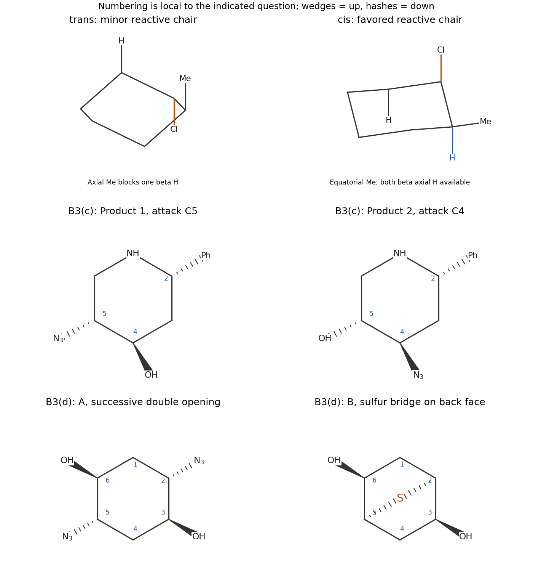
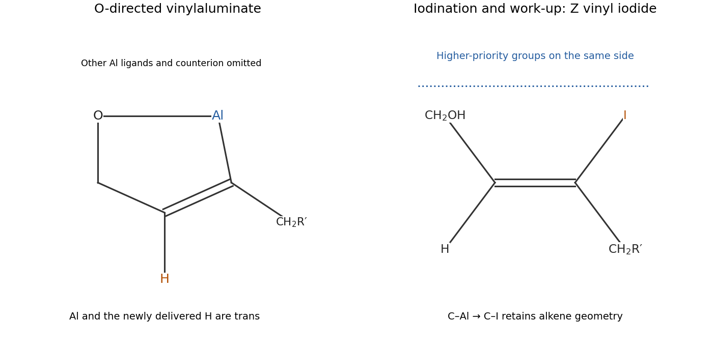
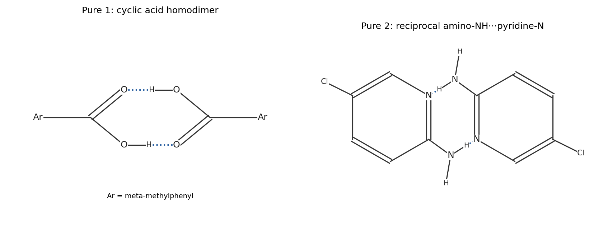

# Paper 1

↑ **Parent:** [2021](../2021.md)

[Original source PDF, physical pages 124–130](https://www.whatdotheyknow.com/request/past_exam_information_of_nst_ib_2/response/3538005/attach/2/FOI%202026%20642%20Cui%20materials%20Part1.pdf?cookie_passthrough=1#page=124)

**Table of contents**

- [B1](#b1)
  - [a](#b1/a)
    - [i](#b1/a/i)
      - [Solution](#b1/a/i/solution)
    - [ii](#b1/a/ii)
      - [Solution](#b1/a/ii/solution)
    - [iii](#b1/a/iii)
      - [Solution](#b1/a/iii/solution)
  - [b](#b1/b)
    - [i](#b1/b/i)
      - [Solution](#b1/b/i/solution)
    - [ii](#b1/b/ii)
      - [Solution](#b1/b/ii/solution)
- [B2](#b2)
  - [a](#b2/a)
    - [i](#b2/a/i)
      - [Solution](#b2/a/i/solution)
    - [ii](#b2/a/ii)
      - [Solution](#b2/a/ii/solution)
  - [b](#b2/b)
    - [Solution](#b2/b/solution)
  - [c](#b2/c)
    - [Solution](#b2/c/solution)
  - [d](#b2/d)
    - [Solution](#b2/d/solution)
- [B3](#b3)
  - [a](#b3/a)
    - [Solution](#b3/a/solution)
  - [b](#b3/b)
    - [Solution](#b3/b/solution)
  - [c](#b3/c)
    - [Solution](#b3/c/solution)
  - [d](#b3/d)
    - [i](#b3/d/i)
      - [Solution](#b3/d/i/solution)
    - [ii](#b3/d/ii)
      - [Solution](#b3/d/ii/solution)
- [B4](#b4)
  - [a](#b4/a)
    - [Solution](#b4/a/solution)
  - [b](#b4/b)
    - [Solution](#b4/b/solution)
  - [c](#b4/c)
    - [Solution](#b4/c/solution)
  - [d](#b4/d)
    - [Solution](#b4/d/solution)
- [B5](#b5)
  - [a](#b5/a)
    - [Solution](#b5/a/solution)
  - [b](#b5/b)
    - [i](#b5/b/i)
      - [Solution](#b5/b/i/solution)
    - [ii](#b5/b/ii)
      - [Solution](#b5/b/ii/solution)
    - [iii](#b5/b/iii)
      - [Solution](#b5/b/iii/solution)
  - [c](#b5/c)
    - [i](#b5/c/i)
      - [Solution](#b5/c/i/solution)
    - [ii](#b5/c/ii)
      - [Solution](#b5/c/ii/solution)
    - [iii](#b5/c/iii)
      - [Solution](#b5/c/iii/solution)

## B1

↑ **Parent:** [Paper 1](paper-1.md)

<h3 id="b1/a">a</h3>

↑ **Parent:** [B1](#b1)

<h4 id="b1/a/i">i</h4>

↑ **Parent:** [A](#b1/a)

<h5 id="b1/a/i/solution">Solution</h5>

↑ **Parent:** [I](#b1/a/i)

**The product is 1,4-dimethoxy-2,5-bis(2-methylbutan-2-yl)[benzene](../../chemical-substance.md#benzene).** Each new substituent is $\mathrm{-C(CH_3)_2CH_2CH_3}$, a [tert-amyl group](../../chemical-substance.md#tert-amyl-group), rather than the unrearranged secondary alkyl group of the [alcohol](../../chemical-substance.md#alcohol). The two substituents are related by the [symmetry](../../physics.md#symmetry-physics) of the ring.

The [proton](../../physics.md#proton) assignments are:

| [chemical shift](../../nuclear-magnetic-resonance.md#chemical-shift) / ppm | Assignment | Reason |
| --- | --- | --- |
| $6.75$ | **Two aromatic H, at positions 3 and 6** | [symmetry](../../physics.md#symmetry-physics) makes them equivalent; neither has an adjacent aromatic H to give a resolved ordinary ortho splitting. |
| $3.79$ | **Two [methoxy groups](../../chemistry.md#methoxy-group), six H** | Equivalent $\mathrm{OCH_3}$ groups give a [NMR singlet](../../nuclear-magnetic-resonance.md#nmr-singlet). |
| $1.81$ | **Two ethyl $\mathrm{CH_2}$ groups, four H** | Each couples to a terminal three-proton [methyl group](../../chemistry.md#methyl-group), giving a [NMR quartet](../../nuclear-magnetic-resonance.md#nmr-quartet). |
| $1.33$ | **Four [methyl groups](../../chemistry.md#methyl-group) attached to the two quaternary benzylic [carbons](../../chemical-substance.md#carbon), twelve H** | These [methyl groups](../../chemistry.md#methyl-group) have no neighboring [methine group](../../chemistry.md#methine-group) [proton](../../physics.md#proton) and give a [NMR singlet](../../nuclear-magnetic-resonance.md#nmr-singlet). |
| $0.65$ | **Two terminal ethyl [methyl groups](../../chemistry.md#methyl-group), six H** | Each couples to two [methylene group](../../chemistry.md#methylene-group) [protons](../../physics.md#proton), giving a [NMR triplet](../../nuclear-magnetic-resonance.md#nmr-triplet) with the same coupling constant as the [NMR quartet](../../nuclear-magnetic-resonance.md#nmr-quartet). |

The integrals add to 30 H. The unusually shielded terminal ethyl methyl signal is compatible with an aryl-containing environment; its [NMR quartet](../../nuclear-magnetic-resonance.md#nmr-quartet)–[NMR triplet](../../nuclear-magnetic-resonance.md#nmr-triplet) partner and integral are the decisive assignment evidence. The [molecular formula](../../chemical-substance.md#molecular-formula) and [degree of unsaturation](../../chemical-substance.md#degree-of-unsaturation), $\mathrm{DBE}=4$, fit a [benzene](../../chemical-substance.md#benzene) ring with saturated side chains.

**[Figure 1](#b1/a/i/image-original-structures-of-the-rearranged-aromatic-alkylation-product-and-dialkylated-beta-ketoester). Original structures of the rearranged aromatic alkylation product and dialkylated beta-ketoester**.

<h4 id="b1/a/ii">ii</h4>

↑ **Parent:** [A](#b1/a)

<h5 id="b1/a/ii/solution">Solution</h5>

↑ **Parent:** [Ii](#b1/a/ii)

[protonation](../../chemical-reaction.md#protonation) of the [alcohol](../../chemical-substance.md#alcohol) converts its OH group into a [water](../../chemical-substance.md#water) [leaving group](../../chemical-reaction.md#leaving-group). Departure of [water](../../chemical-substance.md#water) initially gives the secondary [carbocation](../../chemical-substance.md#carbocation) $\mathrm{CH_3-CH^+-CH(CH_3)_2}$. A **[1,2-hydride shift](../../chemical-substance.md#1-2-hydride-shift)** from the neighboring [methine group](../../chemistry.md#methine-group) transfers its C–H bonding pair to the electron-deficient [carbon](../../chemical-substance.md#carbon):

$$
\mathrm{CH_3-CH^+-CH(CH_3)_2\longrightarrow CH_3CH_2-C^+(CH_3)_2}.
$$

The resulting tertiary [carbocation](../../chemical-substance.md#carbocation) is the tert-amyl [electrophile](../../chemical-reaction.md#electrophile). An aromatic $\pi$ bond of the dimethoxybenzene attacks that [carbon](../../chemical-substance.md#carbon), producing a [Wheland intermediate](../../chemical-reaction.md#arenium-ion). Removal of the [proton](../../physics.md#proton) from the attacked ring [carbon](../../chemical-substance.md#carbon) restores [aromaticity](../../molecule.md#aromaticity) and regenerates acid. Repeating this [Friedel-Crafts alkylation](../../chemical-reaction.md#friedel-crafts-alkylation) at the symmetry-related second site gives the disubstituted product.

The [hydride](../../chemical-substance.md#hydride) migration explains the new ethyl group and the absence of a benzylic [methine group](../../chemistry.md#methine-group) [proton](../../physics.md#proton). Simply attaching the original [alcohol](../../chemical-substance.md#alcohol) skeleton at its OH-bearing [carbon](../../chemical-substance.md#carbon) would not explain the twelve-proton [NMR singlet](../../nuclear-magnetic-resonance.md#nmr-singlet).

<h4 id="b1/a/iii">iii</h4>

↑ **Parent:** [A](#b1/a)

<h5 id="b1/a/iii/solution">Solution</h5>

↑ **Parent:** [Iii](#b1/a/iii)

The [methoxy groups](../../chemistry.md#methoxy-group) activate the [aromatic ring](../../molecule.md#aromatic-ring) by electron donation through [chemical resonance](../../covalent-bond.md#resonance-chemistry) and direct electrophilic substitution ortho and para. Their para positions are already occupied by one another, so the first alkylation occurs at an available ortho position; the four initially vacant positions are equivalent by [symmetry](../../physics.md#symmetry-physics).

After placing the first [tert-amyl group](../../chemical-substance.md#tert-amyl-group) at position 2, **position 5 is favored for the second substitution**. It is para to that bulky group and ortho to the other [methoxy group](../../chemistry.md#methoxy-group). Position 3 is crowded between methoxy and tert-amyl substituents, while position 6 is near the first [tert-amyl group](../../chemical-substance.md#tert-amyl-group) across the intervening methoxy-bearing [carbon](../../chemical-substance.md#carbon). The 2,5 arrangement distributes the bulky groups on opposite parts of the ring and preserves the equivalence seen in the spectrum.

Alkyl groups do not electronically deactivate the ring, so the stopping point needs a steric explanation. After two such substitutions the remaining positions are much more congested, each adjacent to a bulky [tert-amyl group](../../chemical-substance.md#tert-amyl-group) and a [methoxy group](../../chemistry.md#methoxy-group). **Two large substituents are accommodated much more readily than a third**, despite excess [alcohol](../../chemical-substance.md#alcohol). The formula and [NMR](../../nuclear-magnetic-resonance.md) identify this sterically favored disubstitution; they do not imply that a [Friedel-Crafts reaction](../../chemical-reaction.md#friedel-crafts-reaction) always stops after two alkylations.

<h3 id="b1/b">b</h3>

↑ **Parent:** [B1](#b1)

<h4 id="b1/b/i">i</h4>

↑ **Parent:** [B](#b1/b)

<h5 id="b1/b/i/solution">Solution</h5>

↑ **Parent:** [I](#b1/b/i)

Let $\mathrm{Ar}$ denote the 2,5-dimethoxyphenyl group. **A is the doubly C-alkylated [beta-ketoester](../../chemical-substance.md#beta-ketoester)**

$$
\boxed{\mathrm{EtO-C(=O)-C(CH_2CH_2Ar)(CH_2CH_2CH{=}CH_2)-C(=O)-CH_2-O-tBu}}.
$$

The central [carbon](../../chemical-substance.md#carbon) has no [hydrogen](../../chemical-substance.md#hydrogen) after the second step. The [alkene](../../chemical-substance.md#alkene), [ester](../../chemical-substance.md#ester) and tert-butyl [ether](../../chemical-substance.md#ether) remain intact.

[carbonate](../../chemistry.md#carbonate) reversibly removes a [proton](../../physics.md#proton) from the [methylene group](../../chemistry.md#methylene-group) between the two [carbonyl groups](../../chemical-bond.md#carbonyl-group). The resulting resonance-stabilized [enolate](../../chemical-substance.md#enolate) attacks the primary iodoethyl [carbon](../../chemical-substance.md#carbon) of the aryl-containing reagent by an $S_\mathrm N2$ displacement, releasing [iodide](../../chemical-substance.md#iodide). The monoalkylated intermediate still has one [proton](../../physics.md#proton) at the same activated [carbon](../../chemical-substance.md#carbon). A second [deprotonation](../../acid-base-chemistry.md#deprotonation) followed by $S_\mathrm N2$ attack on the primary [bromide](../../chemistry.md#bromide) introduces the but-3-en-1-yl group.

The beta-dicarbonyl position is much more acidic than the [methylene group](../../chemistry.md#methylene-group) next to the [ketone](../../chemical-substance.md#ketone) and [ether](../../chemical-substance.md#ether) at the other end, explaining the alkylation site. Counting the retained [carbon](../../chemical-substance.md#carbon) skeleton gives $\mathrm{C_{24}H_{36}O_6}$, including the two [carbonyl groups](../../chemical-bond.md#carbonyl-group) and one terminal [alkene](../../chemical-substance.md#alkene). The second panel of the original product drawing specifies this connectivity.

<h4 id="b1/b/ii">ii</h4>

↑ **Parent:** [B](#b1/b)

<h5 id="b1/b/ii/solution">Solution</h5>

↑ **Parent:** [Ii](#b1/b/ii)

**The new ring is formed by intramolecular Friedel-Crafts addition to the [ketone](../../chemical-substance.md#ketone).** [titanium tetrachloride](../../chemical-substance.md#titanium-tetrachloride) coordinates the [ketone](../../chemical-substance.md#ketone) [oxygen](../../chemical-substance.md#oxygen) of the cyclic [beta-ketoester](../../chemical-substance.md#beta-ketoester), increasing electrophilicity at that [carbonyl](../../chemical-bond.md#carbonyl-group) [carbon](../../chemical-substance.md#carbon). The nearby electron-rich aryl ring attacks this activated [ketone](../../chemical-substance.md#ketone) at the available position ortho to its ethyl tether.

The electron-flow sequence is: an aromatic $\pi$ bond forms the new aryl–carbonyl-carbon bond, the [ketone](../../chemical-substance.md#ketone) $\pi$ bond moves onto [oxygen](../../chemical-substance.md#oxygen), and loss of the aromatic [proton](../../physics.md#proton) restores [aromaticity](../../molecule.md#aromaticity). The two-carbon tether and the shared quaternary [carbon](../../chemical-substance.md#carbon) make the newly closed carbocycle six-membered. Hydrolytic work-up converts the titanium-bound [alkoxide](../../mathematical-biology.md#alkoxide) into the tertiary [alcohol](../../chemical-substance.md#alcohol).

The [lactone](../../chemical-substance.md#lactone) [carbonyl](../../chemical-bond.md#carbonyl-group) survives. This is an addition to the [ketone](../../chemical-substance.md#ketone) with retention of its [oxygen](../../chemical-substance.md#oxygen) as OH, rather than an acyl substitution that removes that [oxygen](../../chemical-substance.md#oxygen). The pendant terminal [alkene](../../chemical-substance.md#alkene) is not involved. These bond changes account for the fused [aromatic ring](../../molecule.md#aromatic-ring) system and the [alcohol](../../chemical-substance.md#alcohol) in C without needing to assign the new [stereochemistry](../../stereochemistry.md).

## B2

↑ **Parent:** [Paper 1](paper-1.md)

<h3 id="b2/a">a</h3>

↑ **Parent:** [B2](#b2)

<h4 id="b2/a/i">i</h4>

↑ **Parent:** [A](#b2/a)

<h5 id="b2/a/i/solution">Solution</h5>

↑ **Parent:** [I](#b2/a/i)

Number the [enone](../../chemical-substance.md#enone) [carbonyl](../../chemical-bond.md#carbonyl-group) [carbon](../../chemical-substance.md#carbon) C1, the adjacent [alkene](../../chemical-substance.md#alkene) [carbon](../../chemical-substance.md#carbon) C2 and the ethoxy-bearing [alkene](../../chemical-substance.md#alkene) [carbon](../../chemical-substance.md#carbon) C3. In the **bromine-first pathway**, the enol-ether-like $\mathrm{C2{=}C3-OEt}$ unit attacks $\mathrm{Br_2}$ at C2, breaking the Br–Br bond. The intermediate has a new C2–Br bond and positive charge at C3, stabilized as an oxonium [chemical resonance](../../covalent-bond.md#resonance-chemistry) contributor by donation from the ethoxy [oxygen](../../chemical-substance.md#oxygen).

[triethylamine](../../chemical-substance.md#triethylamine) removes the remaining C2 [hydrogen](../../chemical-substance.md#hydrogen). Its C–H bonding pair reforms C2=C3 and neutralizes the oxonium system. The result is **replacement of the vinylic C2–H by C2–Br**, with the original [enone](../../chemical-substance.md#enone) and ethoxy group retained. If [bromide](../../chemistry.md#bromide) first captures the cationic intermediate, the equivalent vicinal dibromide can eliminate HBr to reach the same product.

The ethoxy group makes this [alkene](../../chemical-substance.md#alkene) sufficiently electron-rich for the electrophilic-addition description. It is important to place [bromine](../../chemical-substance.md#bromine) at C2 and restore the [double bond](../../covalent-bond.md#double-bond), rather than stop at a saturated addition product.

<h4 id="b2/a/ii">ii</h4>

↑ **Parent:** [A](#b2/a)

<h5 id="b2/a/ii/solution">Solution</h5>

↑ **Parent:** [Ii](#b2/a/ii)

For an **amine-first pathway**, use [triethylamine](../../chemical-substance.md#triethylamine) as a [nucleophile](../../chemical-reaction.md#nucleophile) in a reversible [conjugate addition](../../chemical-reaction.md#conjugate-addition). Its [lone pair](../../covalent-bond.md#lone-pair) attacks C3 of the [enone](../../chemical-substance.md#enone); [electron](../../physics.md#electron) shifts through C2 and the [carbonyl](../../chemical-bond.md#carbonyl-group) give a zwitterionic [enolate](../../chemical-substance.md#enolate) with a C3–$\mathrm{NEt_3^+}$ bond.

The C2 nucleophilic site of that [enolate](../../chemical-substance.md#enolate) attacks $\mathrm{Br_2}$, installing C2–Br and releasing [bromide](../../chemistry.md#bromide). Removal of C2–H by base then reforms C2=C3 while the C3–N bond breaks back to neutral [triethylamine](../../chemical-substance.md#triethylamine). This addition–bromination–elimination sequence gives the same **C2-brominated [enone](../../chemical-substance.md#enone)** and regenerates the nucleophilic amine, with another base equivalent accepting the eliminated [proton](../../physics.md#proton).

These are alternative formal sequences requested by the question, not a kinetic determination that one must dominate under unspecified conditions. In particular, the amine-first sequence does not require [triethylamine](../../chemical-substance.md#triethylamine) to generate a high concentration of a vinylic [carbanion](../../chemical-substance.md#carbanion) by direct [deprotonation](../../acid-base-chemistry.md#deprotonation).

<h3 id="b2/b">b</h3>

↑ **Parent:** [B2](#b2)

<h4 id="b2/b/solution">Solution</h4>

↑ **Parent:** [B](#b2/b)

**A is a fused five-/six-membered bicyclic diketone containing [sulfur](../../chemical-substance.md#sulfur).** To specify its structure unambiguously, retain the [cyclohexanone](../../chemical-substance.md#cyclohexanone) numbering C1=O, C2 and C3 for the original [alkene](../../chemical-substance.md#alkene). Add the five-membered ring

$$
\boxed{\mathrm{C2-C3-S-CH_2-C(=O)-C2}}.
$$

The original C1 [ketone](../../chemical-substance.md#ketone) remains, and the former methyl-ester [carbonyl](../../chemical-bond.md#carbonyl-group) becomes the second [ketone](../../chemical-substance.md#ketone). The product is drawn in the first panel below.

[methoxide](../../mathematical-biology.md#methoxide) first deprotonates the [thiol](../../chemical-substance.md#thiol). The soft [thiolate](../../chemistry.md#thiolate) attacks the beta [carbon](../../chemical-substance.md#carbon) C3 in a [Michael addition](../../chemical-reaction.md#michael-addition), shifting the [enone](../../chemical-substance.md#enone) [electrons](../../physics.md#electron) onto [oxygen](../../chemical-substance.md#oxygen). The resulting [enolate](../../chemical-substance.md#enolate) is nucleophilic at C2. It then attacks its tethered [ester](../../chemical-substance.md#ester) [carbonyl](../../chemical-bond.md#carbonyl-group) intramolecularly, forming a five-membered ring through a [tetrahedral intermediate](../../chemical-kinetics.md#tetrahedral-intermediate). Collapse expels [methoxide](../../mathematical-biology.md#methoxide). [proton transfers](../../acid-base-chemistry.md#proton-transfer) and work-up give the neutral bicyclic beta-diketone.

The initial **1,4 addition followed by intramolecular Claisen acylation** explains the regiochemistry: it connects C3 to [sulfur](../../chemical-substance.md#sulfur) and C2 to the [ester](../../chemical-substance.md#ester) [carbonyl](../../chemical-bond.md#carbonyl-group), giving a favorable five-membered closure. Addition to the original [ketone](../../chemical-substance.md#ketone) would not give this same enolate-and-ester arrangement. The net loss of [methanol](../../chemical-substance.md#methanol) from the combined starting materials gives the observed $\mathrm{C_8H_{10}O_2S}$ formula.

**[Figure 2](#b2/b/image-original-connectivity-drawings-for-sulfur-annulation-and-the-bridged-iminium-sequence). Original connectivity drawings for sulfur annulation and the bridged iminium sequence**.

<h3 id="b2/c">c</h3>

↑ **Parent:** [B2](#b2)

<h4 id="b2/c/solution">Solution</h4>

↑ **Parent:** [C](#b2/c)

Label the [enamine](../../chemical-substance.md#enamine) [carbon](../../chemical-substance.md#carbon) bonded to [nitrogen](../../chemical-substance.md#nitrogen) C1 and its [alkene](../../chemical-substance.md#alkene) partner C2; C6 is the other [carbon](../../chemical-substance.md#carbon) next to C1. **B is the C-alkylated [iminium ion](../../chemical-substance.md#iminium) [bromide](../../chemistry.md#bromide)**. Its new substituent at C2 is $\mathrm{-CH_2-C(CO_2Et){=}CH_2}$, while C1 is double-bonded to the [pyrrolidine](../../chemical-substance.md#pyrrolidine) [nitrogen](../../chemical-substance.md#nitrogen), which bears positive charge. [bromide](../../chemistry.md#bromide) is the [counterion](../../chemistry.md#counterion), accounting for Br in the [empirical formula](../../chemical-substance.md#empirical-formula) without requiring a retained C–Br bond.

The C2 end of the [enamine](../../chemical-substance.md#enamine) attacks the bromomethyl [carbon](../../chemical-substance.md#carbon) by $S_\mathrm N2$ displacement. Simultaneously, donation of the [nitrogen](../../chemical-substance.md#nitrogen) [lone pair](../../covalent-bond.md#lone-pair) creates the C1=N bond. This is ordinary [enamine](../../chemical-substance.md#enamine) C-alkylation, not N-alkylation.

[proton transfer](../../acid-base-chemistry.md#proton-transfer) removes an alpha [proton](../../physics.md#proton) at C6, converting the [iminium ion](../../chemical-substance.md#iminium) into the [enamine](../../chemical-substance.md#enamine) regioisomer C1=C6. That [enamine](../../chemical-substance.md#enamine) attacks the terminal $\mathrm{CH_2}$ of the tethered acrylate in an intramolecular [Michael addition](../../chemical-reaction.md#michael-addition). [nitrogen](../../chemical-substance.md#nitrogen) donation restores the [iminium ion](../../chemical-substance.md#iminium), and [protonation](../../chemical-reaction.md#protonation) of the [ester](../../chemical-substance.md#ester) [enolate](../../chemical-substance.md#enolate) completes the sequence.

The new bridge is $\mathrm{C2-CH_2-CH(CO_2Et)-CH_2-C6}$. Together with the original ring and its C1 bridge this produces the **bicyclo$[3.3.1]$nonane [iminium ion](../../chemical-substance.md#iminium) skeleton** in C. It retains the [pyrrolidine](../../chemical-substance.md#pyrrolidine) group and the [ester](../../chemical-substance.md#ester); hydrolysis to a [ketone](../../chemical-substance.md#ketone) is not part of the displayed reaction. The second panel of the original annulation figure shows the [chemical atom](../../physics.md#atom-physics) connectivity and distinguishes ionic [bromide](../../chemistry.md#bromide) in B from a covalent [bromine](../../chemical-substance.md#bromine) substituent.

<h3 id="b2/d">d</h3>

↑ **Parent:** [B2](#b2)

<h4 id="b2/d/solution">Solution</h4>

↑ **Parent:** [D](#b2/d)

[copper](../../chemical-substance.md#copper)(I) converts the methyl [grignard reagent](../../chemical-substance.md#grignard-reagent) into a softer organocopper [nucleophile](../../chemical-reaction.md#nucleophile). Methyl undergoes **1,4 addition** to the beta [carbon](../../chemical-substance.md#carbon) of the cycloheptenone, giving a metal [enolate](../../chemical-substance.md#enolate) rather than direct 1,2 addition to the [ketone](../../chemical-substance.md#ketone) [carbonyl](../../chemical-bond.md#carbonyl-group).

The [carbon](../../chemical-substance.md#carbon) nucleophilic site of this [enolate](../../chemical-substance.md#enolate), at the alpha [carbon](../../chemical-substance.md#carbon), attacks the [aldehyde](../../chemical-substance.md#aldehyde) [carbonyl](../../chemical-bond.md#carbonyl-group) in the second reagent. Its C=O $\pi$ [electrons](../../physics.md#electron) move to [oxygen](../../chemical-substance.md#oxygen); [protonation](../../chemical-reaction.md#protonation) of the resulting [alkoxide](../../mathematical-biology.md#alkoxide) gives the beta-hydroxy [ketone](../../chemical-substance.md#ketone) side chain. The cyclic [acetal](../../chemical-substance.md#acetal) is a protected [ketone](../../chemical-substance.md#ketone) and survives these nucleophilic conditions.

The beta [methyl group](../../chemistry.md#methyl-group) shields one face of the cyclic [enolate](../../chemical-substance.md#enolate). Aldol bond formation from the less crowded opposite face places the new alpha side chain **trans to the beta [methyl group](../../chemistry.md#methyl-group)**. Thus the two starred ring centers have an anti relationship; the two mirror-related products are possible from achiral starting materials and reagents. This argument does not assign the separate, unstarred [alcohol](../../chemical-substance.md#alcohol) center, for which the question gives no specified configuration.

**[Figure 3](#b2/d/image-conjugate-methyl-addition-followed-by-opposite-face-aldol-trapping-of-the-cyclic-enolate). Conjugate methyl addition followed by opposite-face aldol trapping of the cyclic enolate**.

## B3

↑ **Parent:** [Paper 1](paper-1.md)

<h3 id="b3/a">a</h3>

↑ **Parent:** [B3](#b3)

<h4 id="b3/a/solution">Solution</h4>

↑ **Parent:** [A](#b3/a)

**There are two, two and four [stereoisomers](../../stereochemistry.md#stereoisomer), respectively; all eight individual [stereoisomers](../../stereochemistry.md#stereoisomer) are [chiral](../../stereochemistry.md#chirality-chemistry).** The drawings below give the mirror pairs. Solid and hashed wedges distinguish opposite faces; ordinary changes between conformers are not counted again.

- The benzyl-substituted alkylidenecyclohexane has an axial stereogenic element. At one end the exocyclic [alkene](../../chemical-substance.md#alkene) presents Ph and H; at the other end the substituted ring [carbon](../../chemical-substance.md#carbon) presents benzyl and H. The ring constrains the intervening paths, so exchanging one end pair gives the nonsuperposable mirror image. There is one enantiomeric pair, rather than an independent ordinary $E/Z$ pair multiplied by a carbon-center count.
- The diphenylspiro compound also has one [axial chirality](../../stereochemistry.md#axial-chirality). The two four-membered rings occupy different, approximately perpendicular planes. Their remote Ph/H substitutions distinguish the two handed arrangements. It gives one enantiomeric pair and no meso form. [axial chirality](../../stereochemistry.md#axial-chirality) of this spiro framework is experimentally established, for example by resolution of its 2,6-dicarboxylic-acid derivatives.[Abstract, isolation of enantiopure spiro derivatives](../../chemistry-bibliography.md#enantiopure-spiro-3-3-heptane-2-6-dicarboxylic-acid-by-hong-zhi-tang-and-others)
- The phospholane has a stereogenic [carbon](../../chemical-substance.md#carbon) at the COOH-bearing position and a pyramidal [phosphorus stereocenter](../../stereochemistry.md#phosphorus-stereocenter). The [phosphorus](../../chemical-substance.md#phosphorus) has three different [carbon](../../chemical-substance.md#carbon) ligands and a [lone pair](../../covalent-bond.md#lone-pair): its two ring paths differ because only one encounters the substituted [carbon](../../chemical-substance.md#carbon) immediately. The four configurations are $(R_P,R_C)$, $(R_P,S_C)$, $(S_P,R_C)$ and $(S_P,S_C)$. The first and last form a mirror pair, as do the middle two. [carbon](../../chemical-substance.md#carbon) and [phosphorus](../../chemical-substance.md#phosphorus) cannot be interchanged by a [symmetry operation](../../euclidean-geometry.md#symmetry-operation), so there is no meso reduction in the count.

Unlike the usual rapidly inverting trialkylamine, a pyramidal [phosphine](../../chemical-substance.md#phosphine) can retain a [phosphorus](../../chemical-substance.md#phosphorus) configuration on an ordinary observational timescale; its two [phosphorus](../../chemical-substance.md#phosphorus) configurations must therefore be included.

**[Figure 4](#b3/a/image-eight-stereoisomers-grouped-into-four-mirror-pairs-with-axial-and-phosphorus-stereochemistry-shown). Eight stereoisomers grouped into four mirror pairs, with axial and phosphorus stereochemistry shown**.

<h3 id="b3/b">b</h3>

↑ **Parent:** [B3](#b3)

<h4 id="b3/b/solution">Solution</h4>

↑ **Parent:** [B](#b3/b)

**Both reactions are [E2 eliminations](../../chemical-reaction.md#e2-elimination) requiring an axial [chloride](../../chemistry.md#chloride) and an axial beta [hydrogen](../../chemical-substance.md#hydrogen) in an [antiperiplanar conformation](../../stereochemistry.md#antiperiplanar-conformation) relative to the C–Cl bond.** The reacting C–H bond supplies the [alkene](../../chemical-substance.md#alkene) $\pi$ bond as the C–Cl bond breaks; [hydroxide](../../chemistry.md#hydroxide) accepts the [proton](../../physics.md#proton).

For the trans-1,2 substrate, the low-energy chair has methyl and [chlorine](../../chemical-substance.md#chlorine) both equatorial. [ring inversion](../../stereochemistry.md#ring-inversion) is needed to place [chlorine](../../chemical-substance.md#chlorine) axial, but this also places methyl axial. The population of the reactive chair is consequently small, explaining the slow reaction. At the methyl-bearing neighboring [carbon](../../chemical-substance.md#carbon) the axial position is occupied by methyl, not [hydrogen](../../chemical-substance.md#hydrogen). Only the other beta [carbon](../../chemical-substance.md#carbon) has the needed anti axial H, so elimination gives **3-methylcyclohexene** rather than the more substituted [alkene](../../chemical-substance.md#alkene).

For the cis substrate, a favorable chair has methyl equatorial and [chlorine](../../chemical-substance.md#chlorine) axial. It can react without paying the axial-methyl penalty, explaining the faster rate. Both adjacent [carbons](../../chemical-substance.md#carbon) now supply an anti axial [hydrogen](../../chemical-substance.md#hydrogen). Removing the H on the methyl-bearing [carbon](../../chemical-substance.md#carbon) gives **1-methylcyclohexene, the major product**; removing the other gives **3-methylcyclohexene, the minor product**. The former has the more substituted [double bond](../../covalent-bond.md#double-bond).

Thus [alkene](../../chemical-substance.md#alkene) stability selects between accessible pathways in the cis case, but it cannot create the missing [antiperiplanar conformation](../../stereochemistry.md#antiperiplanar-conformation) H in the trans case.

**[Figure 5](#b3/b/image-original-stereochemical-maps-for-trans-diaxial-elimination-and-the-epoxide-opening-products). Original stereochemical maps for trans-diaxial elimination and the epoxide-opening products**.

<h3 id="b3/c">c</h3>

↑ **Parent:** [B3](#b3)

<h4 id="b3/c/solution">Solution</h4>

↑ **Parent:** [C](#b3/c)

Number the [nitrogen](../../chemical-substance.md#nitrogen) N1, the phenyl-bearing [carbon](../../chemical-substance.md#carbon) C2, and then continue through C3–C6 around the piperidine. Call the solid-wedge [epoxide](../../chemical-substance.md#epoxide) face up; the [phenyl group](../../chemical-substance.md#phenyl-group) is down in both starting structures. The bulky [phenyl group](../../chemical-substance.md#phenyl-group) favors a pseudoequatorial orientation.

[epoxide](../../chemical-substance.md#epoxide) opening follows the **Fürst-Plattner preference for a chair-like, trans-diaxial opening trajectory**. Attack at the two [epoxide](../../chemical-substance.md#epoxide) [carbons](../../chemical-substance.md#carbon) is not equivalent: the favored route evolves toward an ordinary chair, whereas the alternative demands a less favorable twist/boat-like distortion. Such conformational control of epoxy-2-arylpiperidine opening is supported by synthetic studies.[Scheme 1, chair-like trans-diaxial epoxide opening; applied here with the free-NH conformer](../../chemistry-bibliography.md#1-3-allylic-strain-as-a-strategic-diversification-element-for-constructing-libraries-of-substituted-2-arylpiperidines-by-thomas-c-coombs-and-others)

For the first [epoxide](../../chemical-substance.md#epoxide), **azide attacks C5 from down**, breaking the C5–O bond. The residual C4–O bond is retained, so work-up gives **C5–N3 down and C4–OH up**, with the original C2–Ph down. For the second, down-face [epoxide](../../chemical-substance.md#epoxide), **azide attacks C4 from up**, leaving **C4–N3 up and C5–OH down**. These assignments are shown in the middle row of the original stereochemical map.

In each mechanism an azide terminal [nitrogen](../../chemical-substance.md#nitrogen) attacks the [epoxide](../../chemical-substance.md#epoxide) [carbon](../../chemical-substance.md#carbon), the C–O bonding pair goes to [oxygen](../../chemical-substance.md#oxygen), and [protonation](../../chemical-reaction.md#protonation) gives the [alcohol](../../chemical-substance.md#alcohol). Each attacked center inverts, and the azide and OH are trans. The phenyl-bearing center is unchanged. Reversing the [epoxide](../../chemical-substance.md#epoxide) face changes which [carbon](../../chemical-substance.md#carbon) has the favored axial attack trajectory; a steric rule based only on distance from phenyl misses that conformational effect.

<h3 id="b3/d">d</h3>

↑ **Parent:** [B3](#b3)

<h4 id="b3/d/i">i</h4>

↑ **Parent:** [D](#b3/d)

<h5 id="b3/d/i/solution">Solution</h5>

↑ **Parent:** [I](#b3/d/i)

Number the [cyclohexane](../../chemical-substance.md#cyclohexane) consecutively, putting the top [methylene group](../../chemistry.md#methylene-group) at C1 and the two original [epoxides](../../chemical-substance.md#epoxide) at C2/C3 and C5/C6. Both [epoxide](../../chemical-substance.md#epoxide) [oxygens](../../chemical-substance.md#oxygen) are up.

**A is a diazidocyclohexanediol**, with each [epoxide](../../chemical-substance.md#epoxide) replaced by one azide and one [alcohol](../../chemical-substance.md#alcohol). A standard successive chair-favored opening gives **N3 down at C2 and C5, OH up at C3 and C6**. This is the 1,4-diazido/1,4-diol connectivity drawn in the bottom row of the original map.

For each opening, azide attacks from the face opposite [oxygen](../../chemical-substance.md#oxygen), breaking one C–O bond with inversion at the attacked [carbon](../../chemical-substance.md#carbon). [protonation](../../chemical-reaction.md#protonation) of the two resulting [alkoxides](../../mathematical-biology.md#alkoxide) gives the two OH groups. After the first opening, the preferred [conformation](../../stereochemistry.md#conformation) of the opened portion must be used for the second trans-diaxial opening; simply imposing one unchanged chair on both steps can select the wrong regioisomer.

The elemental change is addition of two $\mathrm{N_3^-}$ groups and two work-up [protons](../../physics.md#proton) to $\mathrm{C_6H_8O_2}$, giving $\mathrm{C_6H_{10}N_6O_2}$. The formula alone would not distinguish alternative positional isomers; the depicted assignment uses the ordinary successive-opening conformational model.

<h4 id="b3/d/ii">ii</h4>

↑ **Parent:** [D](#b3/d)

<h5 id="b3/d/ii/solution">Solution</h5>

↑ **Parent:** [Ii](#b3/d/ii)

[sulfide](../../chemistry.md#sulfide) first opens one [epoxide](../../chemical-substance.md#epoxide) by backside attack, giving a carbon-bound [thiolate](../../chemistry.md#thiolate) and an [alkoxide](../../mathematical-biology.md#alkoxide). Using the same numbering, take this first attack at C2: the C2–S bond is down and C3–O remains up.

The attached [sulfur](../../chemical-substance.md#sulfur) still bears a nucleophilic [lone pair](../../covalent-bond.md#lone-pair) and negative charge. It attacks C5 of the second [epoxide](../../chemical-substance.md#epoxide) **intramolecularly**, breaking C5–O and closing a bridge between C2 and C5. Work-up protonates the [oxygen](../../chemical-substance.md#oxygen) anions at C3 and C6. Thus **B is 7-thiabicyclo$[2.2.1]$heptane-2,5-diol**, with both OH groups on the face opposite the [sulfur](../../chemical-substance.md#sulfur) bridge.

Both C–S bonds are formed by inversion at their attacked [epoxide](../../chemical-substance.md#epoxide) [carbons](../../chemical-substance.md#carbon). Because the original [epoxides](../../chemical-substance.md#epoxide) are cis, both new C–S bonds point to the same opposite face and one [sulfur](../../chemical-substance.md#sulfur) [chemical atom](../../physics.md#atom-physics) can connect them. The 1,4 bridge gives two five-membered sulfur-containing circuits, unlike the more strained closure between nearby 1,3 positions.

The [sulfur](../../chemical-substance.md#sulfur) therefore replaces two separate external [nucleophiles](../../chemical-reaction.md#nucleophile): **two [epoxides](../../chemical-substance.md#epoxide) are opened but only one [sulfur](../../chemical-substance.md#sulfur) [chemical atom](../../physics.md#atom-physics) is incorporated**. Adding that [sulfur](../../chemical-substance.md#sulfur) and two work-up [protons](../../physics.md#proton) gives $\mathrm{C_6H_{10}O_2S}$, consistent with B.

## B4

↑ **Parent:** [Paper 1](paper-1.md)

<h3 id="b4/a">a</h3>

↑ **Parent:** [B4](#b4)

<h4 id="b4/a/solution">Solution</h4>

↑ **Parent:** [A](#b4/a)

The [alcohol](../../chemical-substance.md#alcohol) [oxygen](../../chemical-substance.md#oxygen) attacks [sulfur](../../chemical-substance.md#sulfur) of methanesulfonyl [chloride](../../chemistry.md#chloride), [chloride](../../chemistry.md#chloride) leaves, and [triethylamine](../../chemical-substance.md#triethylamine) removes the O–H [proton](../../physics.md#proton). This gives an **O-mesylate with retention of the [carbon](../../chemical-substance.md#carbon) configuration**: the original [carbon](../../chemical-substance.md#carbon)–[oxygen](../../chemical-substance.md#oxygen) bond has not been displaced.

An accessible chair places the [mesylate](../../chemical-substance.md#mesylate) axial. [triethylamine](../../chemical-substance.md#triethylamine) then removes the anti axial [hydrogen](../../chemical-substance.md#hydrogen) on the [carbon](../../chemical-substance.md#carbon) between the [ketone](../../chemical-substance.md#ketone) and [mesylate](../../chemical-substance.md#mesylate). Its C–H bond forms the new C=C bond while the C–O bond expels [mesylate](../../chemical-substance.md#mesylate). The result is the **conjugated cyclohexenone**.

The neighboring [carbon](../../chemical-substance.md#carbon) on the [acetonide](../../chemical-substance.md#acetonide) side has its relevant axial position occupied by its [oxygen](../../chemical-substance.md#oxygen) substituent, rather than an anti axial [hydrogen](../../chemical-substance.md#hydrogen). The elimination toward the [ketone](../../chemical-substance.md#ketone) is therefore favored both by the trans-diaxial geometry and by [conjugation](../../group-action.md#conjugation) of the resulting [alkene](../../chemical-substance.md#alkene) with C=O. The [acetonide](../../chemical-substance.md#acetonide) remains intact. No inversion of the original [alcohol](../../chemical-substance.md#alcohol) [carbon](../../chemical-substance.md#carbon) is required during [mesylation](../../chemical-reaction.md#mesylation), and it becomes planar during elimination.

<h3 id="b4/b">b</h3>

↑ **Parent:** [B4](#b4)

<h4 id="b4/b/solution">Solution</h4>

↑ **Parent:** [B](#b4/b)

**B is the major product: the newly formed OH is the dashed bond in the printed zigzag structure.** Retain the existing solid-wedge OH and the configuration at the carbamate-bearing [carbon](../../chemical-substance.md#carbon).

[zinc](../../chemical-substance.md#zinc) coordinates the [ketone](../../chemical-substance.md#ketone) [oxygen](../../chemical-substance.md#oxygen) and the adjacent hydroxyl [oxygen](../../chemical-substance.md#oxygen), forming a five-membered O–Zn–O chelate. This constrains rotation around the [carbonyl](../../chemical-bond.md#carbonyl-group)–alpha-carbon bond. In the favored chelated [conformation](../../stereochemistry.md#conformation) the bulky $\mathrm{CH(NHCO_2R')CH_2OR}$ group shields one face of the [ketone](../../chemical-substance.md#ketone), while the alpha [hydrogen](../../chemical-substance.md#hydrogen) leaves the other more accessible. [hydride](../../chemical-substance.md#hydride) attacks from that less crowded face, the [carbonyl](../../chemical-bond.md#carbonyl-group) $\pi$ bond opens onto [oxygen](../../chemical-substance.md#oxygen), and aqueous work-up gives the second [alcohol](../../chemical-substance.md#alcohol).

Mapping this **[Cram chelation model](../../stereochemistry.md#cram-chelation-model)** back onto the printed zigzag gives B, not A. Merely placing a new OH “on the same side” of an unrotated page drawing is not a valid [chelation](../../chemistry.md#chelation) argument: the reactive chelate and that drawing use different [conformations](../../stereochemistry.md#conformation). Zinc-borohydride reductions of alpha-hydroxy [ketones](../../chemical-substance.md#ketone) are experimentally known to favor the corresponding anti-1,2-diol family under [chelation](../../chemistry.md#chelation) control.[Abstract, chelation-controlled zinc-borohydride reductions](../../chemistry-bibliography.md#stereoselective-reduction-of-2-hydroxy-ketones-towards-syn-and-anti-1-2-diols-by-s-m-husain-and-others)

The reagent combination can generate [zinc borohydride](../../chemical-substance.md#zinc-borohydride) and related zinc-associated reducing species. The stereochemical justification is coordination-controlled facial selectivity; it does not require identifying a unique solution aggregate from the reagent list. The quoted yield is not itself a measurement of a 95:5 diastereomeric ratio.

<h3 id="b4/c">c</h3>

↑ **Parent:** [B4](#b4)

<h4 id="b4/c/solution">Solution</h4>

↑ **Parent:** [C](#b4/c)

The first step is a **vinylogous [aldol condensation](../../chemical-reaction.md#aldol-condensation) at C5 of the unsaturated [lactam](../../chemical-substance.md#lactam)**. Number [nitrogen](../../chemical-substance.md#nitrogen) N1, the [lactam](../../chemical-substance.md#lactam) [carbonyl](../../chemical-bond.md#carbonyl-group) C2, and then the methoxy-substituted [alkene](../../chemical-substance.md#alkene) C3=C4 and the [methylene group](../../chemistry.md#methylene-group) C5.

[hydroxide](../../chemistry.md#hydroxide) reversibly removes a C5 [proton](../../physics.md#proton). The resulting [vinylogous enolate](../../chemical-substance.md#vinylogous-enolate) is delocalized through C5–C4–C3–C2–O: it is not necessary to create an unstabilized isolated [carbanion](../../chemical-substance.md#carbanion) beside [nitrogen](../../chemical-substance.md#nitrogen). Its C5 nucleophilic contributor attacks acetone. [protonation](../../chemical-reaction.md#protonation) gives a C5-linked tertiary [alcohol](../../chemical-substance.md#alcohol), $\mathrm{C5-C(OH)(Me)_2}$. Further removal of the remaining C5 [hydrogen](../../chemical-substance.md#hydrogen) and elimination through an aldol-dehydration sequence forms **C5=C(Me)2**, leaving the original methoxy [enol ether](../../chemical-substance.md#enol-ether) in place.

In the second step, **aqueous acid hydrolyses that [enol ether](../../chemical-substance.md#enol-ether) to a [ketone](../../chemical-substance.md#ketone) at C4**. [protonation](../../chemical-reaction.md#protonation) at C3 gives an oxygen-stabilized cation at C4. [water](../../chemical-substance.md#water) attacks C4, [proton transfers](../../acid-base-chemistry.md#proton-transfer) form a hemiacetal-like intermediate, and loss of [methanol](../../chemical-substance.md#methanol) followed by [deprotonation](../../acid-base-chemistry.md#deprotonation) produces C4=O and the C3 [methylene group](../../chemistry.md#methylene-group).

The [lactam](../../chemical-substance.md#lactam) [carbonyl](../../chemical-bond.md#carbonyl-group) and N–H group remain, as does the exocyclic isopropylidene group. This accounts for replacement of the C3=C4–OMe unit by C3H2–C4=O without inserting a new [oxygen](../../chemical-substance.md#oxygen) into the ring skeleton.

<h3 id="b4/d">d</h3>

↑ **Parent:** [B4](#b4)

<h4 id="b4/d/solution">Solution</h4>

↑ **Parent:** [D](#b4/d)

The hydroxyl group first binds [aluminium](../../chemical-substance.md#aluminium), normally by [deprotonation](../../acid-base-chemistry.md#deprotonation) to an [aluminium](../../chemical-substance.md#aluminium) [alkoxide](../../mathematical-biology.md#alkoxide) with release of [hydrogen](../../chemical-substance.md#hydrogen). Coordination also brings [aluminium](../../chemical-substance.md#aluminium) close to the [alkyne](../../chemical-substance.md#alkyne). **[directed trans-hydroalumination](../../chemical-reaction.md#directed-trans-hydroalumination)** then puts [hydride](../../chemical-substance.md#hydride) on the [alkyne](../../chemical-substance.md#alkyne) [carbon](../../chemical-substance.md#carbon) proximal to CH2O and [aluminium](../../chemical-substance.md#aluminium) on the distal [carbon](../../chemical-substance.md#carbon).

One useful mechanistic description has external [hydride](../../chemical-substance.md#hydride) attacking the coordinated [alkyne](../../chemical-substance.md#alkyne) opposite the aluminium-containing face. The resulting [vinylaluminate](../../chemical-substance.md#vinylaluminate) is stabilized by a five-membered O–Al–C–C–CH2 chelate. This is not the ordinary undirected syn addition of a neutral dialkylaluminium [hydride](../../chemical-substance.md#hydride). Propargylic-alcohol-directed trans-hydroalumination with [Red-Al](../../chemical-substance.md#red-al) gives [vinylaluminate](../../chemical-substance.md#vinylaluminate) intermediates that can be intercepted by [electrophiles](../../chemical-reaction.md#electrophile).[Abstract, stereoselective vinylalanate formation from propargylic alcohols](../../chemistry-bibliography.md#trans-hydroalumination-alkylation-one-pot-synthesis-of-trisubstituted-allylic-alcohols-by-neil-f-langille-and-timothy-f-jamison)

[iodine](../../chemical-substance.md#iodine) replaces the distal C–Al bond with C–I without scrambling the [alkene](../../chemical-substance.md#alkene) geometry; aqueous work-up releases the [alcohol](../../chemical-substance.md#alcohol). [hydride](../../chemical-substance.md#hydride) and [iodine](../../chemical-substance.md#iodine) are consequently **trans** across the [alkene](../../chemical-substance.md#alkene), while [iodine](../../chemical-substance.md#iodine) and the CH2OH group are on the same side.

By [Cahn-Ingold-Prelog priority rules](../../stereochemistry.md#cahn-ingold-prelog-priority-rules) priority the product is therefore **$Z$**: CH2OH outranks H at one [alkene](../../chemical-substance.md#alkene) [carbon](../../chemical-substance.md#carbon) and I outranks CH2R' at the other. Describing the two [carbon](../../chemical-substance.md#carbon) chains as trans would not make this an $E$ [alkene](../../chemical-substance.md#alkene), because the [iodine](../../chemical-substance.md#iodine) changes which substituent has higher priority.

**[Figure 6](#b4/d/image-directed-anti-hydroalumination-stereoretentive-iodination-and-the-z-priority-assignment). Directed anti hydroalumination, stereoretentive iodination and the Z priority assignment**.

## B5

↑ **Parent:** [Paper 1](paper-1.md)

<h3 id="b5/a">a</h3>

↑ **Parent:** [B5](#b5)

<h4 id="b5/a/solution">Solution</h4>

↑ **Parent:** [A](#b5/a)

**TODO: user-deferred biology.** This biological subpart is intentionally left unsolved under the current nonbiology-only scope.

<h3 id="b5/b">b</h3>

↑ **Parent:** [B5](#b5)

<h4 id="b5/b/i">i</h4>

↑ **Parent:** [B](#b5/b)

<h5 id="b5/b/i/solution">Solution</h5>

↑ **Parent:** [I](#b5/b/i)

**Two [molecules](../../molecule.md) of the [carboxylic acid](../../chemical-substance.md#carboxylic-acid) form a cyclic carboxylic-acid [dimer](../../molecule.md#dimer).** Let Ar denote the meta-methylphenyl group. One [molecule](../../molecule.md) donates its OH [hydrogen](../../chemical-substance.md#hydrogen) to the other's [carbonyl](../../chemical-bond.md#carbonyl-group) [oxygen](../../chemical-substance.md#oxygen), and the second donates back:  
The two contacts close an eight-membered hydrogen-bonded ring, shown explicitly below.

Both [molecules](../../molecule.md) therefore act once as hydrogen-bond donor and once as hydrogen-bond acceptor, giving two O–H···O=C contacts. This is the conventional self-complementary [dimer](../../molecule.md#dimer) motif; the schematic is not a prediction of every weaker contact in an unprovided [crystal structure](../../physical-chemistry.md#crystal-structure).

**[Figure 7](#b5/b/i/image-original-hydrogen-bonding-structures-for-the-two-pure-compound-homodimers). Original hydrogen-bonding structures for the two pure-compound homodimers**.

<h4 id="b5/b/ii">ii</h4>

↑ **Parent:** [B](#b5/b)

<h5 id="b5/b/ii/solution">Solution</h5>

↑ **Parent:** [Ii](#b5/b/ii)

**Two [molecules](../../molecule.md) of the [aminopyridine](../../molecule.md#aminopyridine) form a self-complementary [dimer](../../molecule.md#dimer) through two N–H···N contacts.** In each direction, one exocyclic amino [hydrogen](../../chemical-substance.md#hydrogen) is the donor and the [pyridine](../../chemical-substance.md#pyridine) ring [nitrogen](../../chemical-substance.md#nitrogen) of the other [molecule](../../molecule.md) is the acceptor.

Orient the two amino/pyridine-N edges toward one another, as in the second panel of the original homodimer drawing. Each [molecule](../../molecule.md) donates one NH and accepts at one ring N; the second amino H remains available for additional packing contacts. The [chlorine](../../chemical-substance.md#chlorine) substituent is retained but is not one of the two principal donor–acceptor sites.

<h4 id="b5/b/iii">iii</h4>

↑ **Parent:** [B](#b5/b)

<h5 id="b5/b/iii/solution">Solution</h5>

↑ **Parent:** [Iii](#b5/b/iii)

The strongest donor belongs to the acid, $\alpha_1=3.5$, and the strongest acceptor to the [aminopyridine](../../molecule.md#aminopyridine), $\beta_2=8.5$. **The [cocrystal](../../thermodynamics.md#cocrystal) pairs the strongest donor with the strongest acceptor**, while the reciprocal amino-NH···[carbonyl](../../chemical-bond.md#carbonyl-group) contact closes a complementary two-contact motif.

Using the simple favorable-contact score $\alpha\beta$, one heterodimer gives

$$
S_{\rm hetero}=\alpha_1\beta_2+\alpha_2\beta_1
=(3.5)(8.5)+(3.0)(5.5)=46.25.
$$

The self-associated comparison, normalized to the same two [molecules](../../molecule.md) and two [hydrogen bonds](../../chemical-bond.md#hydrogen-bond), is half an acid [dimer](../../molecule.md#dimer) plus half an [aminopyridine](../../molecule.md#aminopyridine) [dimer](../../molecule.md#dimer):

$$
S_{\rm self}=\alpha_1\beta_1+\alpha_2\beta_2
=(3.5)(5.5)+(3.0)(8.5)=44.75.
$$

Thus

$$
\boxed{\Delta S=1.50=(\alpha_1-\alpha_2)(\beta_2-\beta_1)>0}.
$$

In a model where bond [free energy](../../thermodynamic-potential.md#thermodynamic-free-energy) contains $-\alpha\beta$, this is a favorable energy change. No bonds have been artificially added to one side of the comparison: both alternatives contain two contacts per acid/[aminopyridine](../../molecule.md#aminopyridine) pair.

The calculation rationalizes the hydrogen-bond preference. It is not a complete [crystal](../../thermodynamics.md#crystal) [free energy](../../thermodynamic-potential.md#thermodynamic-free-energy): packing, additional contacts, [entropy](../../entropy.md) and possible [solvent](../../mixture.md#solvent) effects also matter. Without a specified calibration, the numerical score should not be promoted to a measured cocrystallization [free energy](../../thermodynamic-potential.md#thermodynamic-free-energy).

<h3 id="b5/c">c</h3>

↑ **Parent:** [B5](#b5)

<h4 id="b5/c/i">i</h4>

↑ **Parent:** [C](#b5/c)

<h5 id="b5/c/i/solution">Solution</h5>

↑ **Parent:** [I](#b5/c/i)

**TODO: user-deferred biology.** This biological subpart is intentionally left unsolved under the current nonbiology-only scope.

<h4 id="b5/c/ii">ii</h4>

↑ **Parent:** [C](#b5/c)

<h5 id="b5/c/ii/solution">Solution</h5>

↑ **Parent:** [Ii](#b5/c/ii)

**TODO: user-deferred biology.** This biological subpart is intentionally left unsolved under the current nonbiology-only scope.

<h4 id="b5/c/iii">iii</h4>

↑ **Parent:** [C](#b5/c)

<h5 id="b5/c/iii/solution">Solution</h5>

↑ **Parent:** [Iii](#b5/c/iii)

**TODO: user-deferred biology.** This biological subpart is intentionally left unsolved under the current nonbiology-only scope.

## ↑ Ancestors (10)

1. [2021](../2021.md)
2. [Past exam of the chemistry B course of the University of Cambridge](../../past-exam-of-the-chemistry-b-course-of-the-university-of-cambridge.md)
3. [Chemistry B course of the University of Cambridge](../../university-of-cambridge.md#chemistry-b-course-of-the-university-of-cambridge)
4. [Year 2 of the natural sciences course of the University of Cambridge](../../university-of-cambridge.md#year-2-of-the-natural-sciences-course-of-the-university-of-cambridge)
5. [Year of the natural sciences course of the University of Cambridge](../../university-of-cambridge.md#year-of-the-natural-sciences-course-of-the-university-of-cambridge)
6. [Natural sciences course of the University of Cambridge](../../university-of-cambridge.md#natural-sciences-course-of-the-university-of-cambridge)
7. [Course of the University of Cambridge](../../university-of-cambridge.md#course-of-the-university-of-cambridge)
8. [University of Cambridge](../../university-of-cambridge.md)
9. [List of universities](../../README.md#list-of-universities)
10. [Codex Wiki](../../README.md)
