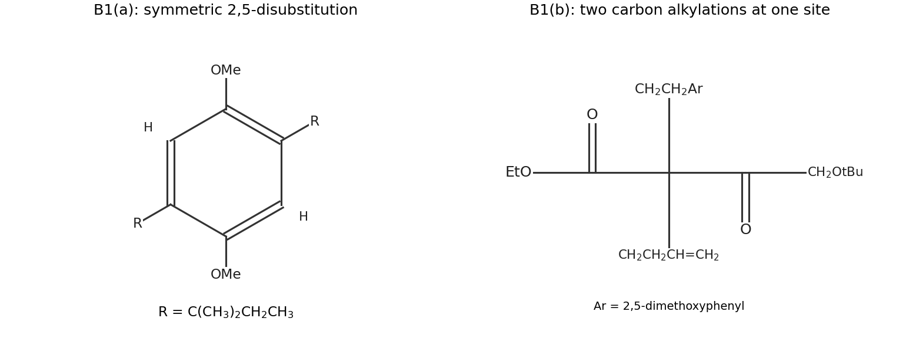

<h1 id="b1/a/i/solution">Solution</h1>

↑ **Parent:** [I](../i.md)

**The product is 1,4-dimethoxy-2,5-bis(2-methylbutan-2-yl)[benzene](../../../../../../benzene.md).** Each new substituent is $\mathrm{-C(CH_3)_2CH_2CH_3}$, a [tert-amyl group](../../../../../../tert-amyl-group.md), rather than the unrearranged secondary alkyl group of the [alcohol](../../../../../../alcohol.md). The two substituents are related by the [symmetry](../../../../../../symmetry-physics.md) of the ring.

The [proton](../../../../../../proton.md) assignments are:

| [chemical shift](../../../../../../chemical-shift.md) / ppm | Assignment | Reason |
| --- | --- | --- |
| $6.75$ | **Two aromatic H, at positions 3 and 6** | [symmetry](../../../../../../symmetry-physics.md) makes them equivalent; neither has an adjacent aromatic H to give a resolved ordinary ortho splitting. |
| $3.79$ | **Two [methoxy groups](../../../../../../methoxy-group.md), six H** | Equivalent $\mathrm{OCH_3}$ groups give a [NMR singlet](../../../../../../nmr-singlet.md). |
| $1.81$ | **Two ethyl $\mathrm{CH_2}$ groups, four H** | Each couples to a terminal three-proton [methyl group](../../../../../../methyl-group.md), giving a [NMR quartet](../../../../../../nmr-quartet.md). |
| $1.33$ | **Four [methyl groups](../../../../../../methyl-group.md) attached to the two quaternary benzylic [carbons](../../../../../../carbon.md), twelve H** | These [methyl groups](../../../../../../methyl-group.md) have no neighboring [methine group](../../../../../../methine-group.md) [proton](../../../../../../proton.md) and give a [NMR singlet](../../../../../../nmr-singlet.md). |
| $0.65$ | **Two terminal ethyl [methyl groups](../../../../../../methyl-group.md), six H** | Each couples to two [methylene group](../../../../../../methylene-group.md) [protons](../../../../../../proton.md), giving a [NMR triplet](../../../../../../nmr-triplet.md) with the same coupling constant as the [NMR quartet](../../../../../../nmr-quartet.md). |

The integrals add to 30 H. The unusually shielded terminal ethyl methyl signal is compatible with an aryl-containing environment; its [NMR quartet](../../../../../../nmr-quartet.md)–[NMR triplet](../../../../../../nmr-triplet.md) partner and integral are the decisive assignment evidence. The [molecular formula](../../../../../../molecular-formula.md) and [degree of unsaturation](../../../../../../degree-of-unsaturation.md), $\mathrm{DBE}=4$, fit a [benzene](../../../../../../benzene.md) ring with saturated side chains.

**[Figure 1](#b1/a/i/image-original-structures-of-the-rearranged-aromatic-alkylation-product-and-dialkylated-beta-ketoester). Original structures of the rearranged aromatic alkylation product and dialkylated beta-ketoester**.

## ↑ Ancestors (14)

1. [I](../i.md)
2. [A](../../a.md)
3. [B1](../../../b1.md)
4. [Paper 1](../../../../paper-1-split.md)
5. [2021](../../../../split.md)
6. [Past exam of the chemistry B course of the University of Cambridge](../../../../../split.md)
7. [Chemistry B course of the University of Cambridge](../../../../../../chemistry-b-course-of-the-university-of-cambridge.md)
8. [Year 2 of the natural sciences course of the University of Cambridge](../../../../../../year-2-of-the-natural-sciences-course-of-the-university-of-cambridge.md)
9. [Year of the natural sciences course of the University of Cambridge](../../../../../../year-of-the-natural-sciences-course-of-the-university-of-cambridge.md)
10. [Natural sciences course of the University of Cambridge](../../../../../../natural-sciences-course-of-the-university-of-cambridge.md)
11. [Course of the University of Cambridge](../../../../../../course-of-the-university-of-cambridge.md)
12. [University of Cambridge](../../../../../../university-of-cambridge-split.md)
13. [List of universities](../../../../../../list-of-universities.md)
14. [Codex Wiki](../../../../../../split.md)
