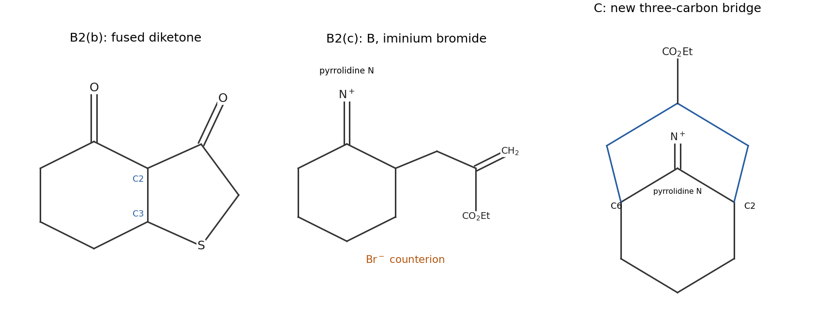

<h1 id="b2/b/solution">Solution</h1>

↑ **Parent:** [B](../b.md)

**A is a fused five-/six-membered bicyclic diketone containing [sulfur](../../../../../sulfur.md).** To specify its structure unambiguously, retain the [cyclohexanone](../../../../../cyclohexanone.md) numbering C1=O, C2 and C3 for the original [alkene](../../../../../alkene.md). Add the five-membered ring

$$
\boxed{\mathrm{C2-C3-S-CH_2-C(=O)-C2}}.
$$

The original C1 [ketone](../../../../../ketone.md) remains, and the former methyl-ester [carbonyl](../../../../../carbonyl-group.md) becomes the second [ketone](../../../../../ketone.md). The product is drawn in the first panel below.

[methoxide](../../../../../methoxide.md) first deprotonates the [thiol](../../../../../thiol.md). The soft [thiolate](../../../../../thiolate.md) attacks the beta [carbon](../../../../../carbon.md) C3 in a [Michael addition](../../../../../michael-addition.md), shifting the [enone](../../../../../enone.md) [electrons](../../../../../electron.md) onto [oxygen](../../../../../oxygen.md). The resulting [enolate](../../../../../enolate.md) is nucleophilic at C2. It then attacks its tethered [ester](../../../../../ester.md) [carbonyl](../../../../../carbonyl-group.md) intramolecularly, forming a five-membered ring through a [tetrahedral intermediate](../../../../../tetrahedral-intermediate.md). Collapse expels [methoxide](../../../../../methoxide.md). [proton transfers](../../../../../proton-transfer.md) and work-up give the neutral bicyclic beta-diketone.

The initial **1,4 addition followed by intramolecular Claisen acylation** explains the regiochemistry: it connects C3 to [sulfur](../../../../../sulfur.md) and C2 to the [ester](../../../../../ester.md) [carbonyl](../../../../../carbonyl-group.md), giving a favorable five-membered closure. Addition to the original [ketone](../../../../../ketone.md) would not give this same enolate-and-ester arrangement. The net loss of [methanol](../../../../../methanol.md) from the combined starting materials gives the observed $\mathrm{C_8H_{10}O_2S}$ formula.

**[Figure 2](#b2/b/image-original-connectivity-drawings-for-sulfur-annulation-and-the-bridged-iminium-sequence). Original connectivity drawings for sulfur annulation and the bridged iminium sequence**.

## ↑ Ancestors (13)

1. [B](../b.md)
2. [B2](../../b2.md)
3. [Paper 1](../../../paper-1-split.md)
4. [2021](../../../split.md)
5. [Past exam of the chemistry B course of the University of Cambridge](../../../../split.md)
6. [Chemistry B course of the University of Cambridge](../../../../../chemistry-b-course-of-the-university-of-cambridge.md)
7. [Year 2 of the natural sciences course of the University of Cambridge](../../../../../year-2-of-the-natural-sciences-course-of-the-university-of-cambridge.md)
8. [Year of the natural sciences course of the University of Cambridge](../../../../../year-of-the-natural-sciences-course-of-the-university-of-cambridge.md)
9. [Natural sciences course of the University of Cambridge](../../../../../natural-sciences-course-of-the-university-of-cambridge.md)
10. [Course of the University of Cambridge](../../../../../course-of-the-university-of-cambridge.md)
11. [University of Cambridge](../../../../../university-of-cambridge-split.md)
12. [List of universities](../../../../../list-of-universities.md)
13. [Codex Wiki](../../../../../split.md)
