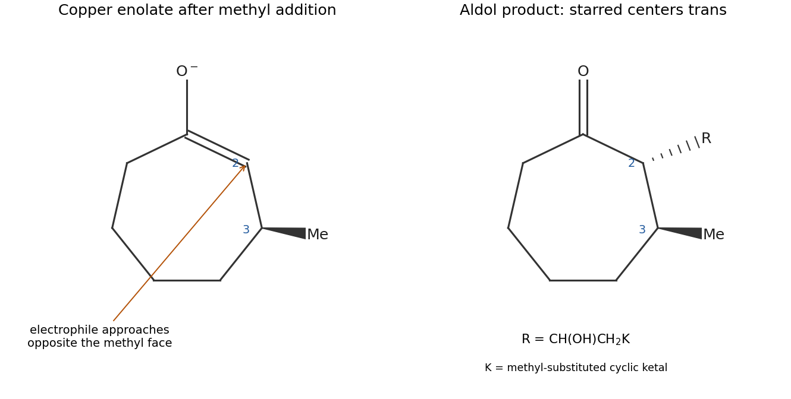

<h1 id="b2/d/solution">Solution</h1>

↑ **Parent:** [D](../d.md)

[copper](../../../../../copper.md)(I) converts the methyl [grignard reagent](../../../../../grignard-reagent.md) into a softer organocopper [nucleophile](../../../../../nucleophile.md). Methyl undergoes **1,4 addition** to the beta [carbon](../../../../../carbon.md) of the cycloheptenone, giving a metal [enolate](../../../../../enolate.md) rather than direct 1,2 addition to the [ketone](../../../../../ketone.md) [carbonyl](../../../../../carbonyl-group.md).

The [carbon](../../../../../carbon.md) nucleophilic site of this [enolate](../../../../../enolate.md), at the alpha [carbon](../../../../../carbon.md), attacks the [aldehyde](../../../../../aldehyde.md) [carbonyl](../../../../../carbonyl-group.md) in the second reagent. Its C=O $\pi$ [electrons](../../../../../electron.md) move to [oxygen](../../../../../oxygen.md); [protonation](../../../../../protonation.md) of the resulting [alkoxide](../../../../../alkoxide.md) gives the beta-hydroxy [ketone](../../../../../ketone.md) side chain. The cyclic [acetal](../../../../../acetal.md) is a protected [ketone](../../../../../ketone.md) and survives these nucleophilic conditions.

The beta [methyl group](../../../../../methyl-group.md) shields one face of the cyclic [enolate](../../../../../enolate.md). Aldol bond formation from the less crowded opposite face places the new alpha side chain **trans to the beta [methyl group](../../../../../methyl-group.md)**. Thus the two starred ring centers have an anti relationship; the two mirror-related products are possible from achiral starting materials and reagents. This argument does not assign the separate, unstarred [alcohol](../../../../../alcohol.md) center, for which the question gives no specified configuration.

**[Figure 3](#b2/d/image-conjugate-methyl-addition-followed-by-opposite-face-aldol-trapping-of-the-cyclic-enolate). Conjugate methyl addition followed by opposite-face aldol trapping of the cyclic enolate**.

## ↑ Ancestors (13)

1. [D](../d.md)
2. [B2](../../b2.md)
3. [Paper 1](../../../paper-1-split.md)
4. [2021](../../../split.md)
5. [Past exam of the chemistry B course of the University of Cambridge](../../../../split.md)
6. [Chemistry B course of the University of Cambridge](../../../../../chemistry-b-course-of-the-university-of-cambridge.md)
7. [Year 2 of the natural sciences course of the University of Cambridge](../../../../../year-2-of-the-natural-sciences-course-of-the-university-of-cambridge.md)
8. [Year of the natural sciences course of the University of Cambridge](../../../../../year-of-the-natural-sciences-course-of-the-university-of-cambridge.md)
9. [Natural sciences course of the University of Cambridge](../../../../../natural-sciences-course-of-the-university-of-cambridge.md)
10. [Course of the University of Cambridge](../../../../../course-of-the-university-of-cambridge.md)
11. [University of Cambridge](../../../../../university-of-cambridge-split.md)
12. [List of universities](../../../../../list-of-universities.md)
13. [Codex Wiki](../../../../../split.md)
