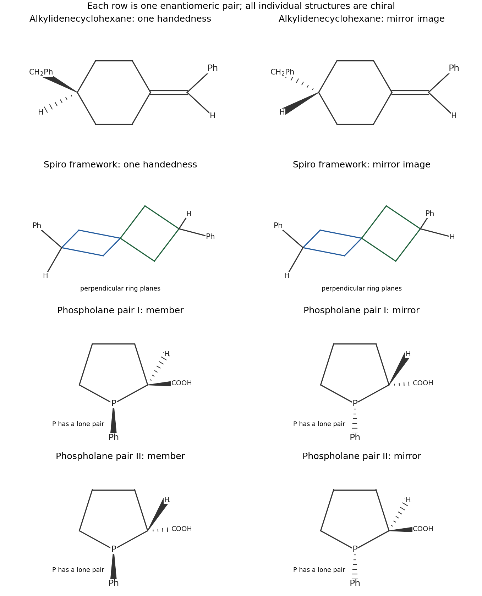

<h1 id="b3/a/solution">Solution</h1>

↑ **Parent:** [A](../a.md)

**There are two, two and four [stereoisomers](../../../../../stereoisomer.md), respectively; all eight individual [stereoisomers](../../../../../stereoisomer.md) are [chiral](../../../../../chirality-chemistry.md).** The drawings below give the mirror pairs. Solid and hashed wedges distinguish opposite faces; ordinary changes between conformers are not counted again.

- The benzyl-substituted alkylidenecyclohexane has an axial stereogenic element. At one end the exocyclic [alkene](../../../../../alkene.md) presents Ph and H; at the other end the substituted ring [carbon](../../../../../carbon.md) presents benzyl and H. The ring constrains the intervening paths, so exchanging one end pair gives the nonsuperposable mirror image. There is one enantiomeric pair, rather than an independent ordinary $E/Z$ pair multiplied by a carbon-center count.
- The diphenylspiro compound also has one [axial chirality](../../../../../axial-chirality.md). The two four-membered rings occupy different, approximately perpendicular planes. Their remote Ph/H substitutions distinguish the two handed arrangements. It gives one enantiomeric pair and no meso form. [axial chirality](../../../../../axial-chirality.md) of this spiro framework is experimentally established, for example by resolution of its 2,6-dicarboxylic-acid derivatives.[Abstract, isolation of enantiopure spiro derivatives](../../../../../enantiopure-spiro-3-3-heptane-2-6-dicarboxylic-acid-by-hong-zhi-tang-and-others.md)
- The phospholane has a stereogenic [carbon](../../../../../carbon.md) at the COOH-bearing position and a pyramidal [phosphorus stereocenter](../../../../../phosphorus-stereocenter.md). The [phosphorus](../../../../../phosphorus.md) has three different [carbon](../../../../../carbon.md) ligands and a [lone pair](../../../../../lone-pair.md): its two ring paths differ because only one encounters the substituted [carbon](../../../../../carbon.md) immediately. The four configurations are $(R_P,R_C)$, $(R_P,S_C)$, $(S_P,R_C)$ and $(S_P,S_C)$. The first and last form a mirror pair, as do the middle two. [carbon](../../../../../carbon.md) and [phosphorus](../../../../../phosphorus.md) cannot be interchanged by a [symmetry operation](../../../../../symmetry-operation.md), so there is no meso reduction in the count.

Unlike the usual rapidly inverting trialkylamine, a pyramidal [phosphine](../../../../../phosphine.md) can retain a [phosphorus](../../../../../phosphorus.md) configuration on an ordinary observational timescale; its two [phosphorus](../../../../../phosphorus.md) configurations must therefore be included.

**[Figure 4](#b3/a/image-eight-stereoisomers-grouped-into-four-mirror-pairs-with-axial-and-phosphorus-stereochemistry-shown). Eight stereoisomers grouped into four mirror pairs, with axial and phosphorus stereochemistry shown**.

## ↑ Ancestors (13)

1. [A](../a.md)
2. [B3](../../b3.md)
3. [Paper 1](../../../paper-1-split.md)
4. [2021](../../../split.md)
5. [Past exam of the chemistry B course of the University of Cambridge](../../../../split.md)
6. [Chemistry B course of the University of Cambridge](../../../../../chemistry-b-course-of-the-university-of-cambridge.md)
7. [Year 2 of the natural sciences course of the University of Cambridge](../../../../../year-2-of-the-natural-sciences-course-of-the-university-of-cambridge.md)
8. [Year of the natural sciences course of the University of Cambridge](../../../../../year-of-the-natural-sciences-course-of-the-university-of-cambridge.md)
9. [Natural sciences course of the University of Cambridge](../../../../../natural-sciences-course-of-the-university-of-cambridge.md)
10. [Course of the University of Cambridge](../../../../../course-of-the-university-of-cambridge.md)
11. [University of Cambridge](../../../../../university-of-cambridge-split.md)
12. [List of universities](../../../../../list-of-universities.md)
13. [Codex Wiki](../../../../../split.md)
