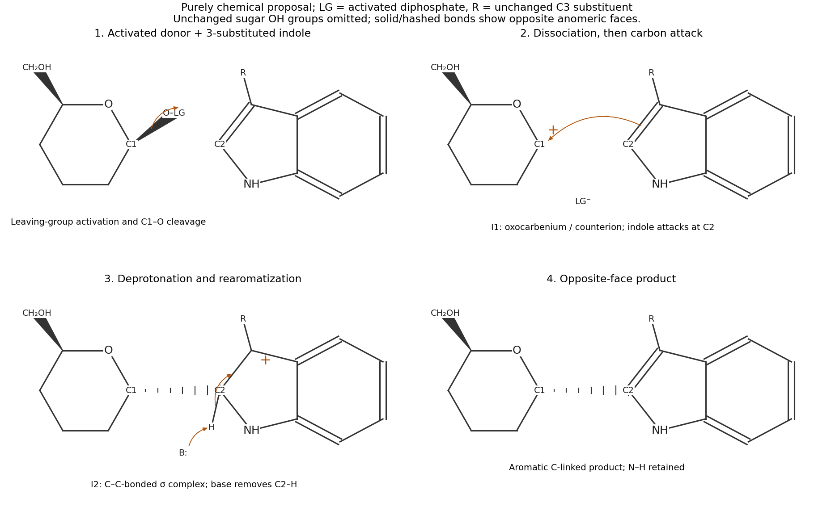

<h1 id="b10/a/i/solution">Solution</h1>

↑ **Parent:** [I](../i.md)

Treat the reacting [carbon](../../../../../../carbon.md) skeletons as an activated glycosyl donor and a 3-substituted [indole](../../../../../../indole.md). The new linkage is **an anomeric-carbon–indole-C2 [carbon](../../../../../../carbon.md)–[carbon](../../../../../../carbon.md) bond**, not a bond to [indole](../../../../../../indole.md) [nitrogen](../../../../../../nitrogen.md). A plausible purely chemical pathway is a dissociative [electrophilic aromatic substitution](../../../../../../electrophilic-aromatic-substitution.md):

- Activation of the anomeric diphosphate [leaving group](../../../../../../leaving-group.md), for example by acid, permits cleavage of its bond to the [anomeric carbon](../../../../../../anomeric-carbon.md). The ring [oxygen](../../../../../../oxygen.md) stabilizes the resulting [glycosyloxocarbenium ion](../../../../../../glycosyloxocarbenium-ion.md), represented by the resonance pair $\mathrm{O_{ring}-C_1^+\leftrightarrow O_{ring}^+=C_1}$. A nearby diphosphate counterion may remain in a [contact ion pair](../../../../../../contact-ion-pair.md).
- The [indole](../../../../../../indole.md) C2–C3 [pi bond](../../../../../../pi-bond.md) attacks C1 through C2. This makes the new C1–C2 bond and gives an [arenium ion](../../../../../../arenium-ion.md), with C2 temporarily tetrahedral and still bearing its original hydrogen. Positive charge can be delocalized over the pyrrolic portion, including an indolium resonance contributor.
- A base removes that C2 hydrogen. The C2–H bond [electrons](../../../../../../electron.md) restore the C2–C3 [pi bond](../../../../../../pi-bond.md) and [aromaticity](../../../../../../aromaticity.md), releasing the [C-glycosylation](../../../../../../c-glycosylation.md) product while retaining N–H.

The drawn donor and product have opposite anomeric faces: the anomeric [leaving group](../../../../../../leaving-group.md) is on the same face as the hydroxymethyl [substituent](../../../../../../substituent.md), while the new [carbon](../../../../../../carbon.md) [substituent](../../../../../../substituent.md) is on the opposite face. Thus the target has **net inversion at the [anomeric carbon](../../../../../../anomeric-carbon.md)**. A tight [ion pair](../../../../../../ion-pair.md) with the departing group shielding its original face can rationalize opposite-face capture in this proposed pathway. A freely solvated planar [oxocarbenium ion](../../../../../../oxocarbenium-ion.md) would not by itself guarantee exclusive inversion; competing faces, [hydrolysis](../../../../../../hydrolysis.md) and other products remain possible without an experimentally specified chemical promoter. This is a plausible non-enzymatic mechanism, not a claim that the uncatalysed reaction is rapid or clean in neutral water.

**[Figure 7](#b10/a/i/image-original-non-enzymatic-c-c-bond-forming-mechanism-with-explicit-reactive-atoms). Original non-enzymatic C–C bond-forming mechanism with explicit reactive atoms**.

## ↑ Ancestors (14)

1. [I](../i.md)
2. [A](../../a.md)
3. [B10](../../../b10.md)
4. [Paper 2](../../../../paper-2-split.md)
5. [2021](../../../../split.md)
6. [Past exam of the chemistry B course of the University of Cambridge](../../../../../split.md)
7. [Chemistry B course of the University of Cambridge](../../../../../../chemistry-b-course-of-the-university-of-cambridge.md)
8. [Year 2 of the natural sciences course of the University of Cambridge](../../../../../../year-2-of-the-natural-sciences-course-of-the-university-of-cambridge.md)
9. [Year of the natural sciences course of the University of Cambridge](../../../../../../year-of-the-natural-sciences-course-of-the-university-of-cambridge.md)
10. [Natural sciences course of the University of Cambridge](../../../../../../natural-sciences-course-of-the-university-of-cambridge.md)
11. [Course of the University of Cambridge](../../../../../../course-of-the-university-of-cambridge.md)
12. [University of Cambridge](../../../../../../university-of-cambridge-split.md)
13. [List of universities](../../../../../../list-of-universities.md)
14. [Codex Wiki](../../../../../../split.md)
