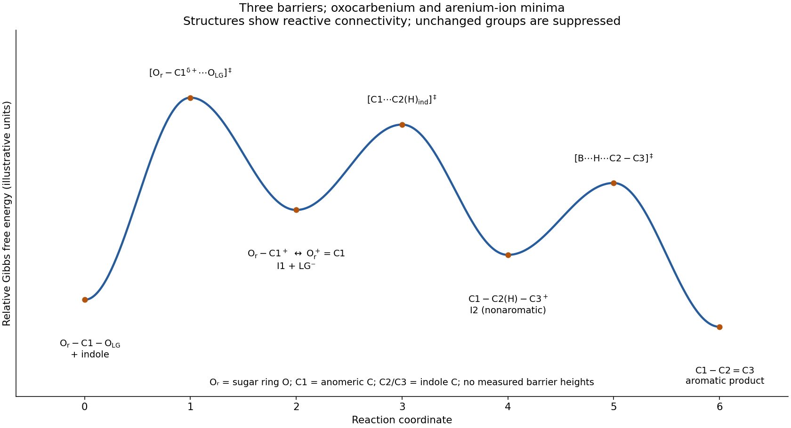

<h1 id="b10/a/ii/solution">Solution</h1>

↑ **Parent:** [Ii](../ii.md)

For the three elementary transformations just proposed, a qualitative free-energy profile has **three [transition states](../../../../../../transition-state.md) and two intermediates**. The sugar [substituents](../../../../../../substituent.md) and [indole](../../../../../../indole.md) C3 [substituent](../../../../../../substituent.md) stay unchanged, so the structural shorthand below suppresses them while retaining the reacting atoms.

**[Figure 8](#b10/a/ii/image-qualitative-three-step-free-energy-profile-with-intermediate-and-transition-state-connectivity). Qualitative three-step free-energy profile with intermediate and transition-state connectivity**.

The first [transition state](../../../../../../transition-state.md) has a partially broken anomeric C1–O([leaving group](../../../../../../leaving-group.md)) bond and developing oxocarbenium character, $[\mathrm{O_{ring}-C_1^{\delta+}\cdots O_{LG}}]^\ddagger$. Its following minimum is the [glycosyloxocarbenium ion](../../../../../../glycosyloxocarbenium-ion.md) plus counterion. The second [transition state](../../../../../../transition-state.md) has a forming C1–C2 bond, $[\mathrm{O_{ring}-C_1\cdots C_2(H)_{ind}}]^\ddagger$, and developing positive charge in the [indole](../../../../../../indole.md). Its following minimum is the covalently joined [arenium ion](../../../../../../arenium-ion.md) with an intact C2–H bond. The third [transition state](../../../../../../transition-state.md) has simultaneous C2–H cleavage, B–H formation and restoration of the [indole](../../../../../../indole.md) [pi bond](../../../../../../pi-bond.md), $[\mathrm{B\cdots H\cdots C_2-C_3}]^\ddagger$. It leads to the aromatic C-linked product and protonated base.

The vertical separations are illustrative because no [activation free energies](../../../../../../gibbs-energy-of-activation.md) or [equilibrium constants](../../../../../../equilibrium-constant.md) are supplied. In particular, the highest barrier cannot be identified experimentally from this drawing alone. [protonation](../../../../../../protonation.md) of the [leaving group](../../../../../../leaving-group.md) is treated as an initial rapid equilibrium in the chosen mechanism; explicitly resolving it would add the corresponding proton-transfer state and intermediate.

## ↑ Ancestors (14)

1. [Ii](../ii.md)
2. [A](../../a.md)
3. [B10](../../../b10.md)
4. [Paper 2](../../../../paper-2-split.md)
5. [2021](../../../../split.md)
6. [Past exam of the chemistry B course of the University of Cambridge](../../../../../split.md)
7. [Chemistry B course of the University of Cambridge](../../../../../../chemistry-b-course-of-the-university-of-cambridge.md)
8. [Year 2 of the natural sciences course of the University of Cambridge](../../../../../../year-2-of-the-natural-sciences-course-of-the-university-of-cambridge.md)
9. [Year of the natural sciences course of the University of Cambridge](../../../../../../year-of-the-natural-sciences-course-of-the-university-of-cambridge.md)
10. [Natural sciences course of the University of Cambridge](../../../../../../natural-sciences-course-of-the-university-of-cambridge.md)
11. [Course of the University of Cambridge](../../../../../../course-of-the-university-of-cambridge.md)
12. [University of Cambridge](../../../../../../university-of-cambridge-split.md)
13. [List of universities](../../../../../../list-of-universities.md)
14. [Codex Wiki](../../../../../../split.md)
