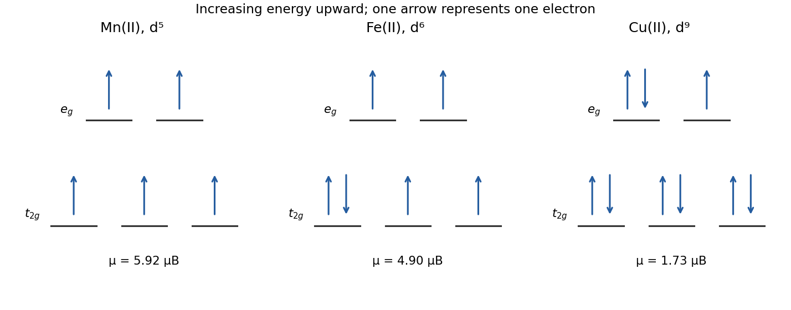

<h1 id="b6/b/solution">Solution</h1>

↑ **Parent:** [B](../b.md)

Charge balance fixes each [metal](../../../../../metal.md) as $\mathrm{M^{II}}$. In an octahedral crystal field the lower $t_{2g}$ set is $(d_{xy},d_{xz},d_{yz})$ and the upper $e_g$ set is $(d_{z^2},d_{x^2-y^2})$. The measured [spin-only magnetic moments](../../../../../spin-only-magnetic-moment.md) select the following occupations:

$$
\begin{array}{c|c|c|c|c}
&\text{configuration}&n_{\rm unpaired}&S&\mu_{\rm eff}/\mu_B\\\hline
\mathrm{Mn^{II}}&t_{2g}^{3}e_g^{2}&5&5/2&\sqrt{35}=5.92\\
\mathrm{Fe^{II}}&t_{2g}^{4}e_g^{2}&4&2&\sqrt{24}=4.90\\
\mathrm{Cu^{II}}&t_{2g}^{6}e_g^{3}&1&1/2&\sqrt3=1.73
\end{array}
$$

The result follows from $S=n_{\rm unpaired}/2$ and $2\sqrt{S(S+1)}=\sqrt{n_{\rm unpaired}(n_{\rm unpaired}+2)}$. **Manganese(II) and iron(II) are [high-spin complexes](../../../../../high-spin-complex.md)**: their octahedral splitting is too small to compensate the additional pairing cost of their low-spin alternatives. Copper(II) is $d^9$, with one unpaired [electron](../../../../../electron.md) regardless of which member of the upper pair is singly occupied. [spin-orbit coupling](../../../../../spin-orbit-interaction.md) and [exchange interactions](../../../../../exchange-interaction.md) can produce deviations from the spin-only estimate in real measurements; no such correction is required to explain the supplied values.

**[Figure 1](#b6/b/image-octahedral-occupations-consistent-with-the-three-magnetic-moments). Octahedral occupations consistent with the three magnetic moments**.

## ↑ Ancestors (13)

1. [B](../b.md)
2. [B6](../../b6.md)
3. [Paper 2](../../../paper-2-split.md)
4. [2021](../../../split.md)
5. [Past exam of the chemistry B course of the University of Cambridge](../../../../split.md)
6. [Chemistry B course of the University of Cambridge](../../../../../chemistry-b-course-of-the-university-of-cambridge.md)
7. [Year 2 of the natural sciences course of the University of Cambridge](../../../../../year-2-of-the-natural-sciences-course-of-the-university-of-cambridge.md)
8. [Year of the natural sciences course of the University of Cambridge](../../../../../year-of-the-natural-sciences-course-of-the-university-of-cambridge.md)
9. [Natural sciences course of the University of Cambridge](../../../../../natural-sciences-course-of-the-university-of-cambridge.md)
10. [Course of the University of Cambridge](../../../../../course-of-the-university-of-cambridge.md)
11. [University of Cambridge](../../../../../university-of-cambridge-split.md)
12. [List of universities](../../../../../list-of-universities.md)
13. [Codex Wiki](../../../../../split.md)
