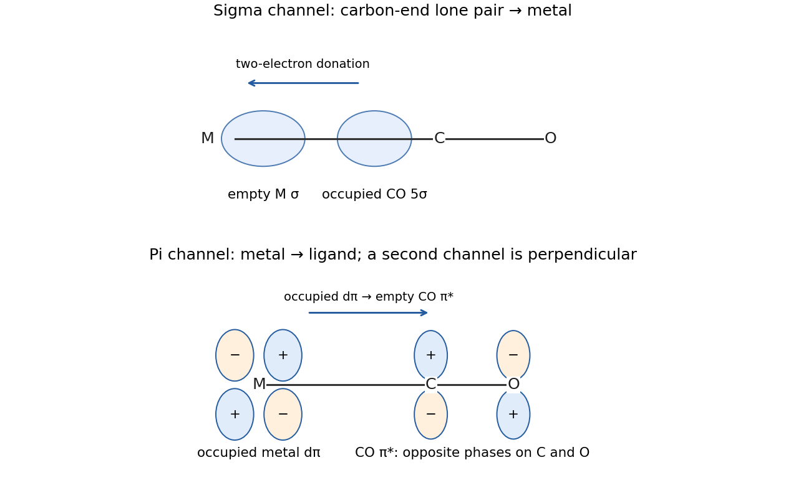

<h1 id="b7/a/solution">Solution</h1>

↑ **Parent:** [A](../a.md)

Take the M–C–O direction as $z$. [carbon monoxide](../../../../../carbon-monoxide.md) binds through [carbon](../../../../../carbon.md) because its occupied $5\sigma$ donor orbital has a substantial carbon-end lobe. End-on overlap with an empty [metal](../../../../../metal.md) orbital of sigma symmetry gives **CO-to-metal [sigma donation](../../../../../sigma-donation.md)**. At the same time, occupied [metal](../../../../../metal.md) $d_{xz}$ and $d_{yz}$ orbitals overlap sideways with the two corresponding empty CO $2\pi^*$ orbitals, giving **metal-to-CO [pi backbonding](../../../../../pi-backbonding.md)**. Both channels strengthen the [metal](../../../../../metal.md)–[carbon](../../../../../carbon.md) bond, while backbonding lowers the internal C–O [bond order](../../../../../bond-order.md). The processes are synergic: [sigma donation](../../../../../sigma-donation.md) helps supply [metal](../../../../../metal.md) [electron](../../../../../electron.md) density for backbonding, while backbonding relieves [electron](../../../../../electron.md) accumulation at the [metal](../../../../../metal.md).

**[Figure 2](#b7/a/image-complementary-sigma-donation-and-pi-backbonding-in-a-metal-carbonyl). Complementary sigma donation and pi backbonding in a metal carbonyl**.

The original orbital sketch shows one of the two perpendicular pi channels. It is the occupied [metal](../../../../../metal.md) orbital, rather than an empty [metal](../../../../../metal.md) orbital, that supplies [electrons](../../../../../electron.md) to CO [antibonding orbitals](../../../../../antibonding-orbital.md).

## ↑ Ancestors (13)

1. [A](../a.md)
2. [B7](../../b7.md)
3. [Paper 2](../../../paper-2-split.md)
4. [2021](../../../split.md)
5. [Past exam of the chemistry B course of the University of Cambridge](../../../../split.md)
6. [Chemistry B course of the University of Cambridge](../../../../../chemistry-b-course-of-the-university-of-cambridge.md)
7. [Year 2 of the natural sciences course of the University of Cambridge](../../../../../year-2-of-the-natural-sciences-course-of-the-university-of-cambridge.md)
8. [Year of the natural sciences course of the University of Cambridge](../../../../../year-of-the-natural-sciences-course-of-the-university-of-cambridge.md)
9. [Natural sciences course of the University of Cambridge](../../../../../natural-sciences-course-of-the-university-of-cambridge.md)
10. [Course of the University of Cambridge](../../../../../course-of-the-university-of-cambridge.md)
11. [University of Cambridge](../../../../../university-of-cambridge-split.md)
12. [List of universities](../../../../../list-of-universities.md)
13. [Codex Wiki](../../../../../split.md)
