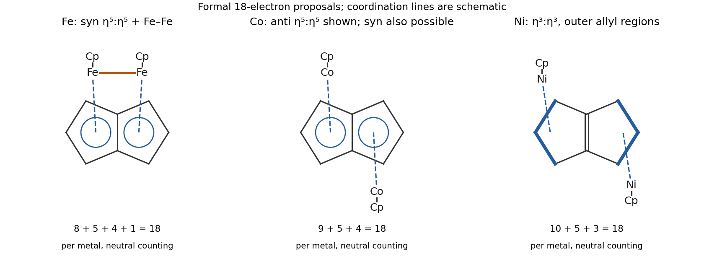

<h1 id="b8/c/solution">Solution</h1>

↑ **Parent:** [C](../c.md)

Use neutral [electron counting](../../../../../electron-counting.md) consistently: each terminal Cp supplies five [electrons](../../../../../electron.md), while the eight pi [electrons](../../../../../electron.md) of neutral [pentalene](../../../../../pentalene.md) must be allocated across the shared fused framework rather than counted twice as two independent Cp [coordination ligands](../../../../../ligand-in-coordination-chemistry.md). One set of **18-electron-consistent proposals** is:

- **Iron: syn $\mu$-$\eta^5:\eta^5$ [pentalene](../../../../../pentalene.md) with an Fe–Fe [single bond](../../../../../single-bond.md).** The two iron–Cp fragments lie on the same face. Assigning four [pentalene](../../../../../pentalene.md) [electrons](../../../../../electron.md) to each iron gives $8+5+4=17$ before direct bonding; the Fe–Fe bond contributes one [electron](../../../../../electron.md) to each count, giving 18. Its direct bond naturally accounts for the especially short [metal](../../../../../metal.md)–[metal](../../../../../metal.md) separation. An anti arrangement cannot retain this short same-face bond.
- **Cobalt: $\mu$-$\eta^5:\eta^5$ [pentalene](../../../../../pentalene.md) without a Co–Co bond.** The count is $9+5+4=18$ at each [metal](../../../../../metal.md). Syn and anti arrangements are possible at this formal level because there is no required direct bond. Removal of the bond relative to iron accounts for a larger separation.
- **Nickel: slipped $\mu$-$\eta^3:\eta^3$ coordination to the two outer allylic portions.** The fusion bond remains an uncoordinated [alkene](../../../../../alkene.md) in this limiting bonding picture, while each outer three-carbon portion contributes three [electrons](../../../../../electron.md) in neutral counting: $10+5+3=18$. Equivalent ionic counting gives a nickel(II) $d^8$ centre, a six-electron Cp and a four-electron [allyl ligand](../../../../../allyl-ligand.md). Moving the [metal](../../../../../metal.md) binding sites toward the outer three-carbon portions increases the separation further. Syn and anti arrangements can again be drawn.

The original schematic shows the donor regions and the required iron–iron bond; dashed metal-to-region lines denote delocalized coordination rather than localized [carbon](../../../../../carbon.md)–[metal](../../../../../metal.md) [single bonds](../../../../../single-bond.md).

**[Figure 3](#b8/c/image-formal-18-electron-models-for-the-fused-pentalene-complexes). Formal 18-electron models for the fused pentalene complexes**.

These proposals explain the requested [electron](../../../../../electron.md) counts and distance ordering. **[electron counting](../../../../../electron-counting.md) alone does not establish the unique ground-state structure**: orbital calculations on related [pentalene](../../../../../pentalene.md) complexes also identify stable formally electron-deficient arrangements. In particular, the formal requirement of a [metal](../../../../../metal.md)–[metal](../../../../../metal.md) bond in the proposed 18-electron iron model should not be converted into a claim that every known iron [pentalene](../../../../../pentalene.md) complex adopts that model.[Discussion of syn/anti coordination, hapticity and electron-count exceptions](../../../../../the-versatility-of-pentalene-coordination-to-transition-metals-a-density-functional-theory-investigation-by-s-bendjaballah-and-others.md)

## ↑ Ancestors (13)

1. [C](../c.md)
2. [B8](../../b8.md)
3. [Paper 2](../../../paper-2-split.md)
4. [2021](../../../split.md)
5. [Past exam of the chemistry B course of the University of Cambridge](../../../../split.md)
6. [Chemistry B course of the University of Cambridge](../../../../../chemistry-b-course-of-the-university-of-cambridge.md)
7. [Year 2 of the natural sciences course of the University of Cambridge](../../../../../year-2-of-the-natural-sciences-course-of-the-university-of-cambridge.md)
8. [Year of the natural sciences course of the University of Cambridge](../../../../../year-of-the-natural-sciences-course-of-the-university-of-cambridge.md)
9. [Natural sciences course of the University of Cambridge](../../../../../natural-sciences-course-of-the-university-of-cambridge.md)
10. [Course of the University of Cambridge](../../../../../course-of-the-university-of-cambridge.md)
11. [University of Cambridge](../../../../../university-of-cambridge-split.md)
12. [List of universities](../../../../../list-of-universities.md)
13. [Codex Wiki](../../../../../split.md)
