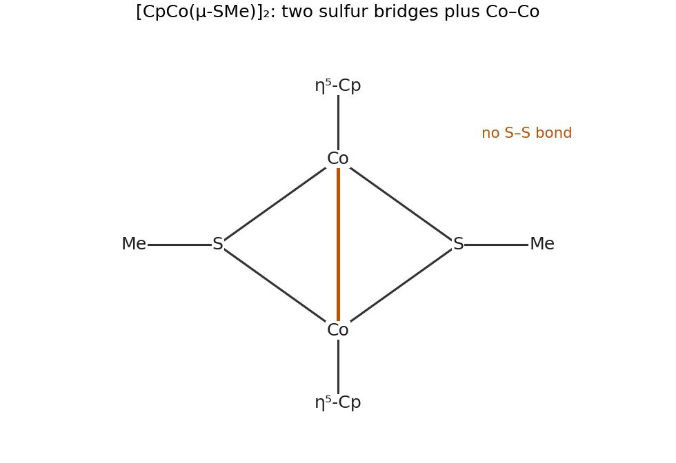

<h1 id="b8/d/ii/solution">Solution</h1>

↑ **Parent:** [Ii](../ii.md)

Cleavage of the [disulfide](../../../../../../disulfide.md) supplies one [methylthiolate](../../../../../../methylthiolate.md) per cobalt. A monomer $\mathrm{CpCo(SMe)}$ would have only $7+6+2=15$ [electrons](../../../../../../electron.md) by ionic counting. Dimerization with two bridging [thiolates](../../../../../../thiolate.md) supplies a second [sulfur](../../../../../../sulfur.md) interaction at each cobalt, and a direct Co–Co bond completes each count. Thus a suitable structure is **$[\mathrm{CpCo}(\mu\!\text{-}\mathrm{SMe})]_2$ with a Co–Co [single bond](../../../../../../single-bond.md)**, containing an $\mathrm{Co_2S_2}$ diamond:

$$
\mathrm{Co}:\quad d^7+6\ (\mathrm{Cp})+2+2\ (\text{two S donors})+1\ (\mathrm{Co-Co})=18.
$$

Each cobalt is formally $+2$: Cp and [methylthiolate](../../../../../../methylthiolate.md) each carry one negative charge. The stoichiometry is

$$
2\mathrm{CpCo(CO)_2}+\mathrm{MeSSMe}\longrightarrow[\mathrm{CpCo}(\mu\!\text{-}\mathrm{SMe})]_2+4\mathrm{CO}.
$$

The [molecular formula](../../../../../../molecular-formula.md) $\mathrm{C_{12}H_{16}Co_2S_2}$ reduces to the required empirical formula. The [sulfur](../../../../../../sulfur.md)–[sulfur](../../../../../../sulfur.md) bond has been cleaved, both [sulfur](../../../../../../sulfur.md) atoms now bridge the [metals](../../../../../../metal.md), and the loss of two CO molecules per cobalt is balanced. Formally cobalt(I) is oxidized to cobalt(II), while the [disulfide](../../../../../../disulfide.md) is reduced to [thiolate](../../../../../../thiolate.md).

**[Figure 4](#b8/d/ii/image-thiolate-bridges-and-a-direct-cobalt-cobalt-bond-satisfy-the-electron-count). Thiolate bridges and a direct cobalt–cobalt bond satisfy the electron count**.

## ↑ Ancestors (14)

1. [Ii](../ii.md)
2. [D](../../d.md)
3. [B8](../../../b8.md)
4. [Paper 2](../../../../paper-2-split.md)
5. [2021](../../../../split.md)
6. [Past exam of the chemistry B course of the University of Cambridge](../../../../../split.md)
7. [Chemistry B course of the University of Cambridge](../../../../../../chemistry-b-course-of-the-university-of-cambridge.md)
8. [Year 2 of the natural sciences course of the University of Cambridge](../../../../../../year-2-of-the-natural-sciences-course-of-the-university-of-cambridge.md)
9. [Year of the natural sciences course of the University of Cambridge](../../../../../../year-of-the-natural-sciences-course-of-the-university-of-cambridge.md)
10. [Natural sciences course of the University of Cambridge](../../../../../../natural-sciences-course-of-the-university-of-cambridge.md)
11. [Course of the University of Cambridge](../../../../../../course-of-the-university-of-cambridge.md)
12. [University of Cambridge](../../../../../../university-of-cambridge-split.md)
13. [List of universities](../../../../../../list-of-universities.md)
14. [Codex Wiki](../../../../../../split.md)
