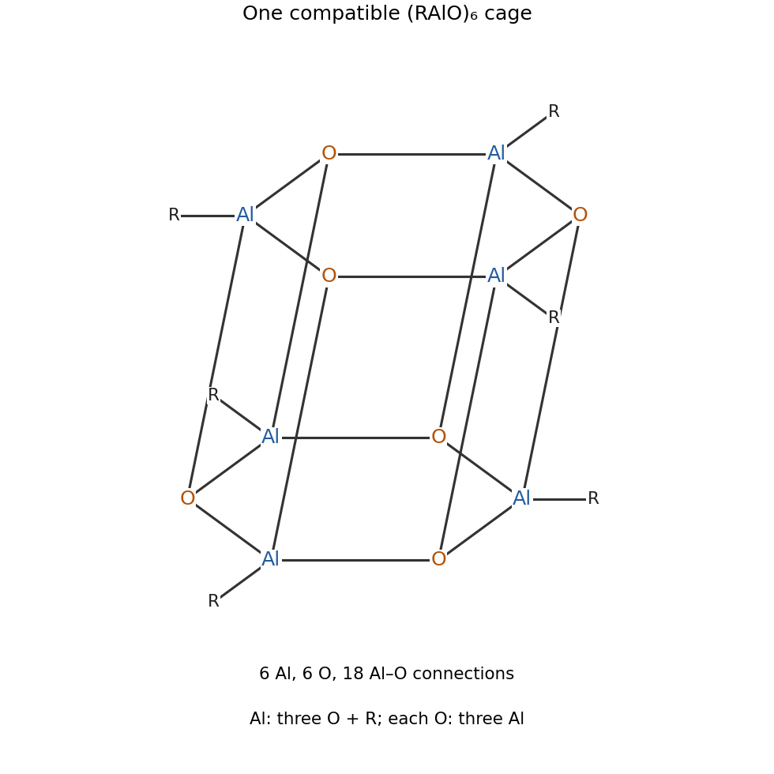

<h1 id="b9/c/solution">Solution</h1>

↑ **Parent:** [C](../c.md)

[boron](../../../../../boron.md) is sufficiently small for effective oxygen-$2p$/boron-$2p$ overlap, and three-coordinate planar [boron](../../../../../boron.md) benefits from the pi donation just described. A six-membered [boroxine](../../../../../boroxine.md) ring provides this overlap without severe angle strain. The larger [aluminium](../../../../../aluminium.md) centre has poorer oxygen-$2p$/aluminium-$3p$ matching and remains strongly Lewis acidic. It can lower its [electron](../../../../../electron.md) deficiency by accepting additional [oxygen](../../../../../oxygen.md) coordination, making a three-dimensional [aluminoxane](../../../../../aluminoxane.md) cage favourable. Four-coordinate [aluminium](../../../../../aluminium.md) does not require a boroxine-like planar pi system.

An appropriate **hexamer model is an alternating Al/O [hexagonal prism](../../../../../hexagonal-prism.md)**, with six [aluminium](../../../../../aluminium.md) and six [oxygen](../../../../../oxygen.md) vertices. Colour the twelve-vertex prism alternately Al and O: each [aluminium](../../../../../aluminium.md) then has three [oxygen](../../../../../oxygen.md) neighbours and an outward organic [substituent](../../../../../substituent.md), making it four-coordinate, while each [oxygen](../../../../../oxygen.md) bridges three [aluminium](../../../../../aluminium.md) centres. The graph has 18 Al–O edges, hence six Al centres with three Al–O bonds each. Different polyhedral connectivities and sizes can meet similar local coordination requirements, so the hexamer is a proposal rather than a claim that the empirical repeat unit fixes a unique cage.

**[Figure 5](#b9/c/image-an-alternating-aluminium-oxygen-prism-satisfying-the-hexamer-composition). An alternating aluminium–oxygen prism satisfying the hexamer composition**.

## ↑ Ancestors (13)

1. [C](../c.md)
2. [B9](../../b9.md)
3. [Paper 2](../../../paper-2-split.md)
4. [2021](../../../split.md)
5. [Past exam of the chemistry B course of the University of Cambridge](../../../../split.md)
6. [Chemistry B course of the University of Cambridge](../../../../../chemistry-b-course-of-the-university-of-cambridge.md)
7. [Year 2 of the natural sciences course of the University of Cambridge](../../../../../year-2-of-the-natural-sciences-course-of-the-university-of-cambridge.md)
8. [Year of the natural sciences course of the University of Cambridge](../../../../../year-of-the-natural-sciences-course-of-the-university-of-cambridge.md)
9. [Natural sciences course of the University of Cambridge](../../../../../natural-sciences-course-of-the-university-of-cambridge.md)
10. [Course of the University of Cambridge](../../../../../course-of-the-university-of-cambridge.md)
11. [University of Cambridge](../../../../../university-of-cambridge-split.md)
12. [List of universities](../../../../../list-of-universities.md)
13. [Codex Wiki](../../../../../split.md)
