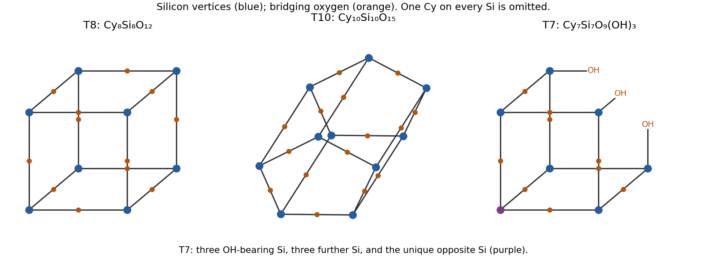

<h1 id="b9/e/i/solution">Solution</h1>

↑ **Parent:** [I](../i.md)

First count the organic groups and then the unsatisfied [oxygen](../../../../../../oxygen.md) valences. **A is the fully condensed [T8 silsesquioxane cage](../../../../../../t8-silsesquioxane-cage.md), $\mathrm{Cy_8Si_8O_{12}}$**, with [silicon](../../../../../../silicon.md) at the eight vertices of a [cube](../../../../../../cube.md) and bridging [oxygen](../../../../../../oxygen.md) on its twelve edges. Each [silicon](../../../../../../silicon.md) has one [cyclohexyl group](../../../../../../cyclohexyl-group.md) and three [siloxane](../../../../../../siloxane.md) bridges. Its eight [cyclohexyl groups](../../../../../../cyclohexyl-group.md) supply exactly $\mathrm{C_{48}H_{88}}$.

**B is a fully condensed [T10 silsesquioxane cage](../../../../../../t10-silsesquioxane-cage.md), $\mathrm{Cy_{10}Si_{10}O_{15}}$**, for which a pentagonal-prismatic [silicon](../../../../../../silicon.md) skeleton with an [oxygen](../../../../../../oxygen.md) on every edge is a standard compatible structure. Its ten groups give $\mathrm{C_{60}H_{110}}$. The formula establishes full condensation but does not, without more structural data, rule out every other possible ten-vertex cage connectivity.

**C is a corner-deficient [T7 trisilanol cage](../../../../../../t7-trisilanol-cage.md), $\mathrm{Cy_7Si_7O_9(OH)_3}$**. Seven [cyclohexyl groups](../../../../../../cyclohexyl-group.md) account for $\mathrm{C_{42}H_{77}}$, leaving three hydrogen atoms as Si–OH groups. Remove one [silicon](../../../../../../silicon.md) corner of the T8 [cube](../../../../../../cube.md) and replace the three severed connections by terminal hydroxyl groups. Nine [oxygen](../../../../../../oxygen.md) atoms remain as bridges and three become terminal [silanol](../../../../../../silanol.md) [oxygen](../../../../../../oxygen.md) atoms, giving precisely twelve [oxygen](../../../../../../oxygen.md) atoms. There are three [silicon](../../../../../../silicon.md) sites bearing OH, three further equivalent fully condensed sites, and one opposite fully condensed site, consistent with **three [silicon](../../../../../../silicon.md) environments in a 3:3:1 site-count ratio**. The less negative resonance is naturally associated with the three silanol-bearing sites; the remaining two resonances belong to the two fully condensed classes. Peak heights alone are not quantitative integrations.

**[Figure 6](#b9/e/i/image-silicon-skeletons-of-the-t8-t10-and-corner-deficient-t7-cages). Silicon skeletons of the T8, T10 and corner-deficient T7 cages**.

The source figure appears to label the spectrum $^{27}\mathrm{Si}$. The chemically appropriate routine experiment here is **[silicon-29 NMR](../../../../../../silicon-29-nuclear-magnetic-resonance.md)**, using the spin-one-half isotope $^{29}\mathrm{Si}$; the figure label is treated as an apparent isotope-label typographical error, not as evidence for another cage.

## ↑ Ancestors (14)

1. [I](../i.md)
2. [E](../../e.md)
3. [B9](../../../b9.md)
4. [Paper 2](../../../../paper-2-split.md)
5. [2021](../../../../split.md)
6. [Past exam of the chemistry B course of the University of Cambridge](../../../../../split.md)
7. [Chemistry B course of the University of Cambridge](../../../../../../chemistry-b-course-of-the-university-of-cambridge.md)
8. [Year 2 of the natural sciences course of the University of Cambridge](../../../../../../year-2-of-the-natural-sciences-course-of-the-university-of-cambridge.md)
9. [Year of the natural sciences course of the University of Cambridge](../../../../../../year-of-the-natural-sciences-course-of-the-university-of-cambridge.md)
10. [Natural sciences course of the University of Cambridge](../../../../../../natural-sciences-course-of-the-university-of-cambridge.md)
11. [Course of the University of Cambridge](../../../../../../course-of-the-university-of-cambridge.md)
12. [University of Cambridge](../../../../../../university-of-cambridge-split.md)
13. [List of universities](../../../../../../list-of-universities.md)
14. [Codex Wiki](../../../../../../split.md)
