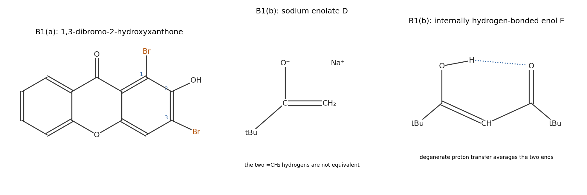
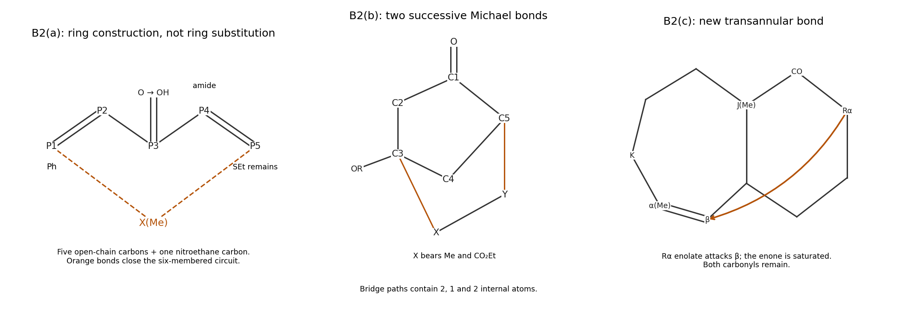
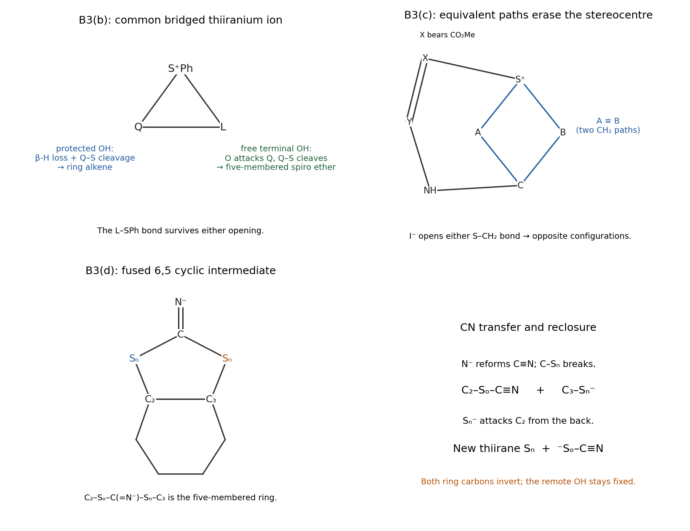
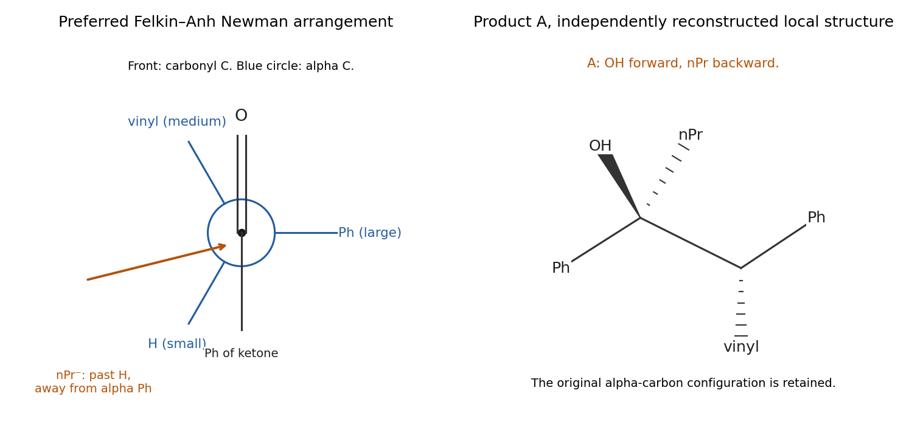

# Paper 1

↑ **Parent:** [2022](../2022.md)

[Original paper, physical PDF pages 33–38](https://www.whatdotheyknow.com/request/nst_chemistry_past_papers_2022/response/2088679/attach/3/FOI%202022%20476%20Whittaker%20materials.pdf?cookie_passthrough=1#page=33)

**Table of contents**

- [B1](#b1)
  - [a](#b1/a)
    - [i](#b1/a/i)
      - [Solution](#b1/a/i/solution)
    - [ii](#b1/a/ii)
      - [Solution](#b1/a/ii/solution)
    - [iii](#b1/a/iii)
      - [Solution](#b1/a/iii/solution)
  - [b](#b1/b)
    - [i](#b1/b/i)
      - [Solution](#b1/b/i/solution)
    - [ii](#b1/b/ii)
      - [Solution](#b1/b/ii/solution)
    - [iii](#b1/b/iii)
      - [Solution](#b1/b/iii/solution)
- [B2](#b2)
  - [a](#b2/a)
    - [Solution](#b2/a/solution)
  - [b](#b2/b)
    - [Solution](#b2/b/solution)
  - [c](#b2/c)
    - [Solution](#b2/c/solution)
  - [d](#b2/d)
    - [Solution](#b2/d/solution)
- [B3](#b3)
  - [a](#b3/a)
    - [Solution](#b3/a/solution)
  - [b](#b3/b)
    - [Solution](#b3/b/solution)
  - [c](#b3/c)
    - [Solution](#b3/c/solution)
  - [d](#b3/d)
    - [Solution](#b3/d/solution)
- [B4](#b4)
  - [a](#b4/a)
    - [Solution](#b4/a/solution)
  - [b](#b4/b)
    - [Solution](#b4/b/solution)
  - [c](#b4/c)
    - [Solution](#b4/c/solution)
  - [d](#b4/d)
    - [Solution](#b4/d/solution)
- [B5](#b5)
  - [a](#b5/a)
    - [i](#b5/a/i)
      - [Solution](#b5/a/i/solution)
    - [ii](#b5/a/ii)
      - [Solution](#b5/a/ii/solution)
    - [iii](#b5/a/iii)
      - [Solution](#b5/a/iii/solution)
  - [b](#b5/b)
    - [i](#b5/b/i)
      - [Solution](#b5/b/i/solution)
    - [ii](#b5/b/ii)
      - [Solution](#b5/b/ii/solution)
    - [iii](#b5/b/iii)
      - [Solution](#b5/b/iii/solution)
  - [c](#b5/c)
    - [Solution](#b5/c/solution)

## B1

↑ **Parent:** [Paper 1](paper-1.md)

<h3 id="b1/a">a</h3>

↑ **Parent:** [B1](#b1)

<h4 id="b1/a/i">i</h4>

↑ **Parent:** [A](#b1/a)

<h5 id="b1/a/i/solution">Solution</h5>

↑ **Parent:** [I](#b1/a/i)

For a monocyclic, approximately planar, continuously conjugated pi system, [Hückel's rule](../../molecule.md#huckel-s-rule) predicts aromatic closed-shell filling for $4n+2$ pi [electrons](../../physics.md#electron), with $n=0,1,2,\ldots$. Every atom on the circuit must have an appropriately oriented orbital; counting [double bonds](../../covalent-bond.md#double-bond) without checking [pi conjugation](../../chemical-bond.md#pi-conjugation) is insufficient.

**The two outer [benzene](../../chemical-substance.md#benzene) rings are clearly aromatic; the central [pyrone](../../molecule.md#pyrone) ring has a weaker, polarized six-pi aromatic contribution.** Each outer ring has the familiar six-[electron](../../physics.md#electron) circuit. For the central ring, a useful charge-separated contributor moves the exocyclic [carbonyl](../../chemical-bond.md#carbonyl-group) pi pair onto [oxygen](../../chemical-substance.md#oxygen) and donates one endocyclic [oxygen](../../chemical-substance.md#oxygen) [lone pair](../../covalent-bond.md#lone-pair) into the ring. Its four fused [carbon](../../chemical-substance.md#carbon) p centres contribute four [electrons](../../physics.md#electron) and the ring-[oxygen](../../chemical-substance.md#oxygen) [lone pair](../../covalent-bond.md#lone-pair) supplies two: a six-pi, pyrylium-like circuit, with positive charge on the ring [oxygen](../../chemical-substance.md#oxygen) and negative charge on the [carbonyl](../../chemical-bond.md#carbonyl-group) [oxygen](../../chemical-substance.md#oxygen). This does not make three independent [benzene](../../chemical-substance.md#benzene) rings of equal aromatic stabilization; localized [carbonyl](../../chemical-bond.md#carbonyl-group) bonding and the fused [benzene](../../chemical-substance.md#benzene) circuits remain important contributors.

The three [oxygens](../../chemical-substance.md#oxygen) play different roles. **The endocyclic [ether](../../chemical-substance.md#ether) [oxygen](../../chemical-substance.md#oxygen) donates a p-type [lone pair](../../covalent-bond.md#lone-pair) to [pi conjugation](../../chemical-bond.md#pi-conjugation). The [carbonyl](../../chemical-bond.md#carbonyl-group) [oxygen](../../chemical-substance.md#oxygen) accepts pi density in the charge-separated contributor. The phenolic [oxygen](../../chemical-substance.md#oxygen) donates into the outer ring as a [substituent](../../stereochemistry.md#substituent).** Its in-plane [lone pair](../../covalent-bond.md#lone-pair) is not an extra pair to add to every ring's [electron](../../physics.md#electron) count. In particular, neither the external C=O pair nor both [lone pairs](../../covalent-bond.md#lone-pair) on a ring [oxygen](../../chemical-substance.md#oxygen) should be counted as independent extra ring [electrons](../../physics.md#electron). Structural studies of [xanthone](../../chemical-substance.md#xanthone) support a largely planar conjugated framework, while the division into strongly aromatic outer rings and a more polarized central ring is an electronic-structure interpretation.[1990, pp. 1725–1727, molecular geometry](../../chemistry-bibliography.md#structure-of-xanthone-by-shigeki-onuma-and-others)

<h4 id="b1/a/ii">ii</h4>

↑ **Parent:** [A](#b1/a)

<h5 id="b1/a/ii/solution">Solution</h5>

↑ **Parent:** [Ii](#b1/a/ii)

**B is 1,3-dibromo-2-hydroxyxanthone:** both [bromines](../../chemical-substance.md#bromine) are on the hydroxy-substituted outer ring, at its two available positions ortho to OH. Define C2 as the OH-bearing [carbon](../../chemical-substance.md#carbon); C1 lies between it and the [carbonyl](../../chemical-bond.md#carbonyl-group)-side ring junction, and C3 lies on its other side. These labels specify the substitution independently of the orientation of the printed drawing.

Phenolic [lone pair](../../covalent-bond.md#lone-pair) donation strongly activates its ortho and para positions towards [electrophilic substitution](../../chemical-reaction.md#electrophilic-substitution). The para position is a fused junction and has no replaceable [hydrogen](../../chemical-substance.md#hydrogen), leaving C1 and C3 as the two directly activated sites. C1 also benefits from the conjugative influence of the ring [ether](../../chemical-substance.md#ether) [oxygen](../../chemical-substance.md#oxygen). Although other positions receive some activation from that [oxygen](../../chemical-substance.md#oxygen), they lack the stronger local phenolic activation of the selected pair. Excess [bromine](../../chemical-substance.md#bromine) can therefore replace both ortho [hydrogens](../../chemical-substance.md#hydrogen). Replacing two [hydrogens](../../chemical-substance.md#hydrogen) in $\mathrm{C_{13}H_8O_3}$ gives **$\mathrm{C_{13}H_6Br_2O_3}$**, consistent with the stated composition. Addition across an outer-ring [double bond](../../covalent-bond.md#double-bond) would sacrifice [aromaticity](../../molecule.md#aromaticity) and would not account for the [hydrogen](../../chemical-substance.md#hydrogen) loss.

**[Figure 1](#b1/a/ii/image-original-solution-structures-of-the-dibrominated-xanthone-sodium-enolate-d-and-hydrogen-bonded-enol-e). Original solution structures of the dibrominated xanthone, sodium enolate D and hydrogen-bonded enol E**.

<h4 id="b1/a/iii">iii</h4>

↑ **Parent:** [A](#b1/a)

<h5 id="b1/a/iii/solution">Solution</h5>

↑ **Parent:** [Iii](#b1/a/iii)

The activated aromatic pi system polarizes [bromine](../../chemical-substance.md#bromine) and attacks its [electrophilic](../../chemical-reaction.md#electrophilicity) end while Br–Br cleaves. This makes a C–Br bond at C1 or C3 and gives a [Wheland intermediate](../../chemical-reaction.md#arenium-ion). Donation from phenolic [oxygen](../../chemical-substance.md#oxygen) stabilizes contributors with positive charge at its attached ring [carbon](../../chemical-substance.md#carbon). [acetate](../../chemical-substance.md#acetate) or [bromide](../../chemistry.md#bromide) then removes the [proton](../../physics.md#proton) from the attacked [carbon](../../chemical-substance.md#carbon); the C–H bond [electrons](../../physics.md#electron) restore the aromatic pi system. Repetition at the other activated ortho site gives the dibrominated product.

**Each step replaces C–H by C–Br and restores [aromaticity](../../molecule.md#aromaticity).** No [radical](../../chemistry.md#radical-chemistry) initiator or benzylic abstraction is needed, and no [Lewis acid](../../acid-base-chemistry.md#lewis-acid) [catalyst](../../chemical-kinetics.md#catalyst) should be invented for this already activated phenolic substrate. The overall substitution balance is $\mathrm{ArH_2+2Br_2\rightarrow ArBr_2+2HBr}$.

<h3 id="b1/b">b</h3>

↑ **Parent:** [B1](#b1)

<h4 id="b1/b/i">i</h4>

↑ **Parent:** [B](#b1/b)

<h5 id="b1/b/i/solution">Solution</h5>

↑ **Parent:** [I](#b1/b/i)

Write $t=\mathrm{C(CH_3)_3}$. **D is the [sodium](../../chemical-substance.md#sodium) [enolate](../../chemical-substance.md#enolate) $\mathrm{t{-}C(O^-){=}CH_2\ Na^+}$.** Its two resonances in the [alkene](../../chemical-substance.md#alkene)-[proton](../../physics.md#proton) region belong to the two [hydrogens](../../chemical-substance.md#hydrogen) of the terminal [methylene group](../../chemistry.md#methylene-group). One is cis to [oxygen](../../chemical-substance.md#oxygen) and the other trans to [oxygen](../../chemical-substance.md#oxygen), so they are not related by a [symmetry](../../physics.md#symmetry-physics) operation even though both belong to the same [carbon](../../chemical-substance.md#carbon). Replacing one or the other gives different alkene geometries, so they are [diastereotopic](../../stereochemistry.md#diastereotopic). Their weak or unresolved [geminal coupling](../../nuclear-magnetic-resonance.md#geminal-coupling) is consistent with the reported singlet descriptions. Without an additional spatial assignment, it is not justified to decide uniquely which numerical shift belongs to which of those two orientations. The nine-[proton](../../physics.md#proton) singlet is the [tert-butyl group](../../chemical-substance.md#tert-butyl-group). The formula $\mathrm{C_6H_{11}ONa}$ follows from removing one alpha [hydrogen](../../chemical-substance.md#hydrogen) from [pinacolone](../../chemical-substance.md#pinacolone).

**E is the [enol](../../chemical-substance.md#enol)-dominated [1,3-diketone](../../chemical-substance.md#1-3-diketone) $\mathrm{tCO{-}CH_2{-}COt}$, observed as $\mathrm{tC(OH){=}CH{-}COt}$.** The very downfield broad signal belongs to the [enol](../../chemical-substance.md#enol) OH in a six-membered intramolecular O–H···O chelate. The one-[proton](../../physics.md#proton) signal in the vinyl region is its central [enol](../../chemical-substance.md#enol) CH; a predominantly diketo structure would instead require a two-[proton](../../physics.md#proton) central CH2 signal and no [enol](../../chemical-substance.md#enol) OH. The eighteen-[proton](../../physics.md#proton) singlet accounts for both [tert-butyl groups](../../chemical-substance.md#tert-butyl-group). Rapid exchange between the two degenerate [enol](../../chemical-substance.md#enol) orientations can average their different local environments; accidental unresolved equality cannot be excluded by the supplied spectrum alone. Thus one should not infer a permanently symmetric single [enol](../../chemical-substance.md#enol) [Lewis structure](../../covalent-bond.md#lewis-structure) from that singlet. The total integration is $1+1+18=20$, agreeing with **$\mathrm{C_{11}H_{20}O_2}$**.

<h4 id="b1/b/ii">ii</h4>

↑ **Parent:** [B](#b1/b)

<h5 id="b1/b/ii/solution">Solution</h5>

↑ **Parent:** [Ii](#b1/b/ii)

[amide ion](../../chemistry.md#amide-ion) removes a methyl-side alpha [proton](../../physics.md#proton) of [pinacolone](../../chemical-substance.md#pinacolone). The C–H [electrons](../../physics.md#electron) form the [enolate](../../chemical-substance.md#enolate) C=C bond as the [carbonyl](../../chemical-bond.md#carbonyl-group) pi pair moves onto [oxygen](../../chemical-substance.md#oxygen); [ammonia](../../chemical-substance.md#ammonia) is formed. The tert-butyl-side alpha [carbon](../../chemical-substance.md#carbon) has no [hydrogen](../../chemical-substance.md#hydrogen), fixing the ordinary [enolate](../../chemical-substance.md#enolate) regiochemistry.

The [carbon](../../chemical-substance.md#carbon) end of D attacks the [acyl chloride](../../chemical-substance.md#acyl-chloride) [carbonyl](../../chemical-bond.md#carbonyl-group) [carbon](../../chemical-substance.md#carbon). Move the C=O pi pair onto [oxygen](../../chemical-substance.md#oxygen), then collapse the [tetrahedral intermediate](../../chemical-kinetics.md#tetrahedral-intermediate) with [chloride](../../chemistry.md#chloride) departure. This [nucleophilic acyl substitution](../../chemical-reaction.md#nucleophilic-acyl-substitution) gives $\mathrm{tCO{-}CH_2{-}COt}$ and constructs the bond between the original [enolate](../../chemical-substance.md#enolate) methylene and the incoming [carbonyl](../../chemical-bond.md#carbonyl-group). **The observed product requires [carbon](../../chemical-substance.md#carbon) acylation, rather than an O-acyl [enol](../../chemical-substance.md#enol) [ester](../../chemical-substance.md#ester).** A further equivalent of D removes the much more acidic central [proton](../../physics.md#proton) of the new [1,3-diketone](../../chemical-substance.md#1-3-diketone), generating its extensively delocalized [enolate](../../chemical-substance.md#enolate) and returning that second D equivalent to [pinacolone](../../chemical-substance.md#pinacolone). Aqueous [acid](../../acid-base-chemistry.md#acid-chemistry) workup protonates the product [enolate](../../chemical-substance.md#enolate); keto–[enol](../../chemical-substance.md#enol) equilibration gives the conjugated, internally stabilized by a [hydrogen bond](../../chemical-bond.md#hydrogen-bond) [enol](../../chemical-substance.md#enol) observed by [NMR](../../nuclear-magnetic-resonance.md). The [acyl chloride](../../chemical-substance.md#acyl-chloride) contributes its entire pivaloyl group; neither [tert-butyl group](../../chemical-substance.md#tert-butyl-group) is lost.

<h4 id="b1/b/iii">iii</h4>

↑ **Parent:** [B](#b1/b)

<h5 id="b1/b/iii/solution">Solution</h5>

↑ **Parent:** [Iii](#b1/b/iii)

**One equivalent supplies [carbon](../../chemical-substance.md#carbon); the other acts as a [base](../../acid-base-chemistry.md#base-chemistry) for the product.** The newly formed [1,3-diketone](../../chemical-substance.md#1-3-diketone) is appreciably more acidic than the [ketone](../../chemical-substance.md#ketone) from which D was prepared. [proton transfer](../../acid-base-chemistry.md#proton-transfer) from its central CH2 to a second [enolate](../../chemical-substance.md#enolate) equivalent is therefore favourable. Product-[enolate](../../chemical-substance.md#enolate) stabilization also helps drive the acyl-substitution sequence towards completion.

The second [enolate](../../chemical-substance.md#enolate) is consequently consumed as [base](../../acid-base-chemistry.md#base-chemistry), yielding [pinacolone](../../chemical-substance.md#pinacolone), rather than supplying a second [carbon](../../chemical-substance.md#carbon) fragment to E. [acid](../../acid-base-chemistry.md#acid-chemistry) workup reverses the product [deprotonation](../../acid-base-chemistry.md#deprotonation). Ignoring this [acid](../../acid-base-chemistry.md#acid-chemistry)–[base](../../acid-base-chemistry.md#base-chemistry) step would predict that a single equivalent of D is sufficient to consume every equivalent of [acyl chloride](../../chemical-substance.md#acyl-chloride), despite the product immediately quenching part of the available [reagent](../../chemical-reaction.md#reagent).

## B2

↑ **Parent:** [Paper 1](paper-1.md)

<h3 id="b2/a">a</h3>

↑ **Parent:** [B2](#b2)

<h4 id="b2/a/solution">Solution</h4>

↑ **Parent:** [A](#b2/a)

The five-[carbon](../../chemical-substance.md#carbon) unit is initially an **open chain**, not a completed carbocycle. Label it $P_1{-}P_2{-}P_3{-}P_4{-}P_5$, with phenyl-bearing $P_1$, [carbonyl](../../chemical-bond.md#carbonyl-group) $P_3$, [amide](../../chemical-substance.md#amide)-substituted $P_4$, and the two ethylthio groups on $P_5$. Its [double bonds](../../covalent-bond.md#double-bond) are initially $P_1{=}P_2$ and $P_4{=}P_5$. Let $X$ be the nitro-bearing [carbon](../../chemical-substance.md#carbon) of [nitroethane](../../chemical-substance.md#nitroethane); its methyl remains a [substituent](../../stereochemistry.md#substituent) throughout.

[DBU](../../acid-base-chemistry.md#dbu) removes an alpha [proton](../../physics.md#proton) from [nitroethane](../../chemical-substance.md#nitroethane) to give a [nitronate](../../chemistry.md#nitronate). [carbon](../../chemical-substance.md#carbon) attack at the Michael acceptor $P_1$ forms $X{-}P_1$, with [electron](../../physics.md#electron) redistribution through $P_2{-}P_3$ onto the [carbonyl](../../chemical-bond.md#carbonyl-group) [oxygen](../../chemical-substance.md#oxygen). [proton transfer](../../acid-base-chemistry.md#proton-transfer) restores the [ketone](../../chemical-substance.md#ketone). Removing the remaining X–H [proton](../../physics.md#proton) gives another [carbon](../../chemical-substance.md#carbon)-nucleophilic [nitronate](../../chemistry.md#nitronate). It attacks the other conjugated end, $P_5$, intramolecularly, closing the six-membered circuit **$P_1{-}P_2{-}P_3{-}P_4{-}P_5{-}X$**. Addition to the [ketene dithioacetal](../../chemical-substance.md#ketene-dithioacetal) and ethylthiolate elimination restore the $P_4{=}P_5$ bond, leaving one SEt group at $P_5$.

[base](../../acid-base-chemistry.md#base-chemistry)-assisted loss of the [proton](../../physics.md#proton) at $P_1$, with C–NO2 cleavage at X, creates $P_1{=}X$ and expels [nitrite](../../chemical-substance.md#nitrite). Enolization at $P_2{-}P_3$ supplies the third aromatic [double bond](../../covalent-bond.md#double-bond) and the phenolic OH. [proton transfers](../../acid-base-chemistry.md#proton-transfer) to the leaving [anions](../../chemistry.md#anion) complete the [acid](../../acid-base-chemistry.md#acid-chemistry)–[base](../../acid-base-chemistry.md#base-chemistry) balance. **[nitroethane](../../chemical-substance.md#nitroethane) supplies the new ring [carbon](../../chemical-substance.md#carbon) X and its methyl [substituent](../../stereochemistry.md#substituent); its [nitro group](../../chemistry.md#nitro-group) is eliminated.** Aromatization, rather than a separate [oxidation](../../chemical-reaction.md#oxidation) of an intact six-membered starting ring, provides the final driving force. This is a proposed stepwise [nitroalkane benzannulation](../../chemical-reaction.md#nitroalkane-benzannulation); related [DBU](../../acid-base-chemistry.md#dbu)-promoted [tandem Michael addition](../../chemical-reaction.md#tandem-michael-addition)/cyclization/aromatization has direct primary precedent.[2022, abstract and pp. 2985–2996](../../chemistry-bibliography.md#green-tandem-5c-plus-1c-cycloaromatization-of-alpha-alkenoyl-ketene-dithioacetals-and-nitroethane-in-water-eco-friendly-synthesis-of-ortho-acylphenols-by-haifeng-yu-and-others)

**[Figure 2](#b2/a/image-original-atom-maps-for-the-open-chain-benzannulation-the-two-bonds-of-the-norbornanone-forming-tandem-michael-addition-and-the-intramolecular-michael-closure). Original atom maps for the open-chain benzannulation, the two bonds of the norbornanone-forming tandem Michael addition, and the intramolecular Michael closure**.

<h3 id="b2/b">b</h3>

↑ **Parent:** [B2](#b2)

<h4 id="b2/b/solution">Solution</h4>

↑ **Parent:** [B](#b2/b)

Number the cyclopentenone [carbonyl](../../chemical-bond.md#carbonyl-group) [carbon](../../chemical-substance.md#carbon) $C_1$, its [alkene](../../chemical-substance.md#alkene) [carbons](../../chemical-substance.md#carbon) $C_2$ and $C_3$ with OR at $C_3$, and its saturated [carbons](../../chemical-substance.md#carbon) $C_4$ and $C_5$. The [ester](../../chemical-substance.md#ester) [alkene](../../chemical-substance.md#alkene) has alpha [carbon](../../chemical-substance.md#carbon) $X$, bearing Me and CO2Et, and beta [carbon](../../chemical-substance.md#carbon) $Y$, bearing the protected carbon substituent. **[lithium diisopropylamide](../../chemical-substance.md#lithium-diisopropylamide) generates the ordinary [ketone](../../chemical-substance.md#ketone) [enolate](../../chemical-substance.md#enolate) at the saturated alpha [carbon](../../chemical-substance.md#carbon) $C_5$.** The [acetonide](../../chemical-substance.md#acetonide) is retained.

The [carbon](../../chemical-substance.md#carbon) end of this [enolate](../../chemical-substance.md#enolate) attacks [ester](../../chemical-substance.md#ester) beta [carbon](../../chemical-substance.md#carbon) Y. Its pi system shifts through X onto the [ester](../../chemical-substance.md#ester) [oxygen](../../chemical-substance.md#oxygen), forming the first new bond $C_5{-}Y$ and an [ester](../../chemical-substance.md#ester) [enolate](../../chemical-substance.md#enolate) at X. That [enolate](../../chemical-substance.md#enolate) now attacks the original cyclopentenone beta [carbon](../../chemical-substance.md#carbon) $C_3$ intramolecularly, giving the second new bond $X{-}C_3$. The original [enone](../../chemical-substance.md#enone) [electrons](../../physics.md#electron) move onto its [ketone](../../chemical-substance.md#ketone) [oxygen](../../chemical-substance.md#oxygen), and [protonation](../../chemical-reaction.md#protonation) of the final [ketone](../../chemical-substance.md#ketone) [enolate](../../chemical-substance.md#enolate) completes the product. The OR [substituent](../../stereochemistry.md#substituent) is retained at the new bridgehead; it need not leave in either [Michael addition](../../chemical-reaction.md#michael-addition).

The atom map provides a useful structural check. Between bridgeheads $C_3$ and $C_5$, the three paths are $C_3{-}C_2{-}C_1{-}C_5$, $C_3{-}C_4{-}C_5$, and $C_3{-}X{-}Y{-}C_5$. Their numbers of internal atoms are **2, 1 and 2**, establishing the [norbornane](../../chemical-substance.md#norbornane) skeleton. Both original [carbonyls](../../chemical-bond.md#carbonyl-group) survive and both initial [alkenes](../../chemical-substance.md#alkene) are consumed. The two successive [conjugate additions](../../chemical-reaction.md#conjugate-addition) give this atom map without requiring a concerted [cycloaddition](../../chemical-reaction.md#cycloaddition).

<h3 id="b2/c">c</h3>

↑ **Parent:** [B2](#b2)

<h4 id="b2/c/solution">Solution</h4>

↑ **Parent:** [C](#b2/c)

**The new bridge is made by an intramolecular [Michael addition](../../chemical-reaction.md#michael-addition).** On the [cyclohexanone](../../chemical-substance.md#cyclohexanone) side, the methyl-bearing fused alpha [carbon](../../chemical-substance.md#carbon) is quaternary and cannot be deprotonated there. [triethylamine](../../chemical-substance.md#triethylamine) can instead generate a small equilibrium population of the [enolate](../../chemical-substance.md#enolate) at the other, methylene alpha [carbon](../../chemical-substance.md#carbon). Its [carbon](../../chemical-substance.md#carbon) attacks the beta [carbon](../../chemical-substance.md#carbon) of the [enone](../../chemical-substance.md#enone) in the seven-membered ring. The [enone](../../chemical-substance.md#enone) pi [electrons](../../physics.md#electron) move towards its [carbonyl](../../chemical-bond.md#carbonyl-group) and then onto [oxygen](../../chemical-substance.md#oxygen), creating the new bridge and a second [enolate](../../chemical-substance.md#enolate).

[protonation](../../chemical-reaction.md#protonation) of that [enolate](../../chemical-substance.md#enolate) at the former methyl-substituted [enone](../../chemical-substance.md#enone) alpha [carbon](../../chemical-substance.md#carbon) restores the left-hand [ketone](../../chemical-substance.md#ketone). The initial [enone](../../chemical-substance.md#enone) C=C has therefore become a saturated C–C bond while one new transannular C–C bond forms. Both [ketones](../../chemical-substance.md#ketone) are retained, and the initial two-ring framework becomes a three-ring framework without changing the total [index of hydrogen deficiency](../../chemical-substance.md#degree-of-unsaturation). The methyl originally at the fused quaternary centre does not migrate; the other methyl ends up on a protonated, formerly unsaturated [carbon](../../chemical-substance.md#carbon). A strong-[base](../../acid-base-chemistry.md#base-chemistry) concentration large enough for quantitative [enolate](../../chemical-substance.md#enolate) generation is unnecessary for a favourable intramolecular trapping reaction, and neither an aldol [dehydration](../../chemical-reaction.md#dehydration) nor a methyl shift is needed.

<h3 id="b2/d">d</h3>

↑ **Parent:** [B2](#b2)

<h4 id="b2/d/solution">Solution</h4>

↑ **Parent:** [D](#b2/d)

Let $\mathrm{Ar}=\mathrm{4{-}NO_2C_6H_4}$ and number the carbon substituent from [oxygen](../../chemical-substance.md#oxygen): $\mathrm{ArO{-}CH_2(1){-}CH_2(2){-}CH_2(3){-}CN}$. [sodium hydride](../../chemical-substance.md#sodium-hydride) removes a [proton](../../physics.md#proton) from C3, alpha to the nitrile, forming [hydrogen](../../chemical-substance.md#hydrogen) and a nitrile-stabilized [carbon](../../chemical-substance.md#carbon) [anion](../../chemistry.md#anion). That [carbon](../../chemical-substance.md#carbon) attacks the nitroaryl ipso [carbon](../../chemical-substance.md#carbon) bearing O. The tether closes a five-membered cyclic Meisenheimer intermediate with sequence **C3–C2–C1–O–aryl ipso [carbon](../../chemical-substance.md#carbon)**. The para [nitro group](../../chemistry.md#nitro-group) stabilizes the negative charge generated by temporary loss of [aromaticity](../../molecule.md#aromaticity).

Rearomatization breaks the aryl–O bond, releasing the tether [oxygen](../../chemical-substance.md#oxygen) as an [alkoxide](../../mathematical-biology.md#alkoxide) while retaining the new aryl–C3 bond. [protonation](../../chemical-reaction.md#protonation) gives **$\mathrm{Ar{-}CH(CN){-}CH_2{-}CH_2OH}$**. This is a Truce–[Smiles rearrangement](../../chemical-reaction.md#smiles-rearrangement): the aryl group migrates from [oxygen](../../chemical-substance.md#oxygen) to [carbon](../../chemical-substance.md#carbon). The nitrile remains attached to its original side-chain [carbon](../../chemical-substance.md#carbon); the original [ether](../../chemical-substance.md#ether) [oxygen](../../chemical-substance.md#oxygen) becomes the terminal [alcohol](../../chemical-substance.md#alcohol) [oxygen](../../chemical-substance.md#oxygen). The substrate and product have identical atomic composition. Ordinary substitution at a saturated chain [carbon](../../chemical-substance.md#carbon) would not produce this aryl–[carbon](../../chemical-substance.md#carbon) bond or restore the terminal OH.

## B3

↑ **Parent:** [Paper 1](paper-1.md)

<h3 id="b3/a">a</h3>

↑ **Parent:** [B3](#b3)

<h4 id="b3/a/solution">Solution</h4>

↑ **Parent:** [A](#b3/a)

Number the OH-bearing [carbon](../../chemical-substance.md#carbon) C1 and the adjacent brominated [carbon](../../chemical-substance.md#carbon) C2. In the trans [bromohydrin](../../chemical-substance.md#bromohydrin), [base](../../acid-base-chemistry.md#base-chemistry) generates an [alkoxide](../../mathematical-biology.md#alkoxide). A [chair conformation](../../stereochemistry.md#chair-conformation) can place O at C1 and Br at C2 trans-diaxial, aligning the [oxygen](../../chemical-substance.md#oxygen) [nucleophile](../../chemical-reaction.md#nucleophile) for [backside attack](../../chemical-reaction.md#backside-attack) at C2. Intramolecular SN2 closure expels [bromide](../../chemistry.md#bromide) and inverts C2: **the retained C1–O bond and the newly formed C2–O bond are both on the original OH face**, giving the [epoxide](../../chemical-substance.md#epoxide) shown. [ring inversion](../../stereochemistry.md#ring-inversion) can provide the reactive chair even if it is not the dominant ground-state conformer.

The cis [bromohydrin](../../chemical-substance.md#bromohydrin) cannot place OH and Br trans-diaxial: one is axial when the other is equatorial. In the chair with Br axial, the [hydrogen](../../chemical-substance.md#hydrogen) on C1 can instead be antiperiplanar to C2–Br. An [alkoxide](../../mathematical-biology.md#alkoxide)-assisted semipinacol pathway moves the C1–H [bonding pair](../../covalent-bond.md#bond-pair) to C2 while the [oxygen](../../chemical-substance.md#oxygen) [lone pair](../../covalent-bond.md#lone-pair) forms C1=O and [bromide](../../chemistry.md#bromide) departs. **[hydride](../../chemical-substance.md#hydride) migration gives the [ketone](../../chemical-substance.md#ketone) without changing the [carbon](../../chemical-substance.md#carbon) skeleton.** The [hydrogen](../../chemical-substance.md#hydrogen) is transferred to C2 rather than expelled as a free [hydride](../../chemical-substance.md#hydride). The original phenyl-bearing stereocentre is not involved in either bond-reorganization sequence. Configuration controls which properly aligned displacement or migration can occur; a flat ring drawing alone conceals that distinction.

<h3 id="b3/b">b</h3>

↑ **Parent:** [B3](#b3)

<h4 id="b3/b/solution">Solution</h4>

↑ **Parent:** [B](#b3/b)

[protonation](../../chemical-reaction.md#protonation) of the secondary OH permits [water](../../chemical-substance.md#water) departure. The neighbouring phenylthio [sulfur](../../chemical-substance.md#sulfur) can assist this departure by forming a bond to the adjacent [alcohol](../../chemical-substance.md#alcohol) [carbon](../../chemical-substance.md#carbon), generating a [thiiranium ion](../../chemistry.md#thiiranium-ion) spanning that [carbon](../../chemical-substance.md#carbon) and the original [sulfur](../../chemical-substance.md#sulfur)-bearing [cyclohexane](../../chemical-substance.md#cyclohexane) [carbon](../../chemical-substance.md#carbon). Label the latter Q and the former L. **The temporary Q–S–L bridge transfers the phenylthio attachment from Q to L when its Q–S bond subsequently breaks.** [sulfur](../../chemical-substance.md#sulfur) attack opposite the departing OH accounts for the new C–S [stereochemistry](../../stereochemistry.md) without requiring a freely rotating [carbocation](../../chemical-substance.md#carbocation).

For the protected terminal [alcohol](../../chemical-substance.md#alcohol), no free tethered OH is available to trap the bridge. Removal of a beta [hydrogen](../../chemical-substance.md#hydrogen) from a [cyclohexane](../../chemical-substance.md#cyclohexane) [carbon](../../chemical-substance.md#carbon) adjacent to Q forms the ring [alkene](../../chemical-substance.md#alkene) while Q–S breaks. [sulfur](../../chemical-substance.md#sulfur) remains bonded to L, giving the allylic phenyl [thioether](../../chemistry.md#thioether). [acid](../../acid-base-chemistry.md#acid-chemistry) is regenerated by the [deprotonation](../../acid-base-chemistry.md#deprotonation), so the [catalyst](../../chemical-kinetics.md#catalyst) need not be consumed.

For the free terminal [alcohol](../../chemical-substance.md#alcohol), its [oxygen](../../chemical-substance.md#oxygen) attacks Q intramolecularly, opening Q–S instead. Count the new [ether](../../chemical-substance.md#ether) ring: **O–CH2–CH(Me)–L–Q**, a five-membered ring sharing Q with the [cyclohexane](../../chemical-substance.md#cyclohexane). [deprotonation](../../acid-base-chemistry.md#deprotonation) gives the spirocyclic [ether](../../chemical-substance.md#ether). This is capture of the same neighbouring-group-stabilized intermediate rather than migration of the [methyl group](../../chemistry.md#methyl-group). The pre-existing methyl-bearing [carbon](../../chemical-substance.md#carbon) retains its configuration; its wedge/dash appearance changes when the product is redrawn in a different ring projection. The two substrates differ in whether a suitably placed [oxygen](../../chemical-substance.md#oxygen) [nucleophile](../../chemical-reaction.md#nucleophile) is available for intramolecular trapping.

**[Figure 3](#b3/b/image-original-local-atom-maps-of-sulfur-participation-the-equivalent-paths-of-the-bridged-thietanium-ion-and-the-five-membered-intermediate-in-thiirane-sulfur-exchange). Original local atom maps of sulfur participation, the equivalent paths of the bridged thietanium ion, and the five-membered intermediate in thiirane sulfur exchange**.

<h3 id="b3/c">c</h3>

↑ **Parent:** [B3](#b3)

<h4 id="b3/c/solution">Solution</h4>

↑ **Parent:** [C](#b3/c)

Direct [iodide](../../chemical-substance.md#iodide) attack at the terminal CH2–OMs would replace the [leaving group](../../chemical-reaction.md#leaving-group) without disturbing the adjacent stereocentre, so it cannot by itself explain racemization. **[sulfur](../../chemical-substance.md#sulfur) participation produces an intermediate with two equivalent methylene paths.** Label the original S-adjacent methylene A, the stereogenic [carbon](../../chemical-substance.md#carbon) C, and its CH2–OMs [substituent](../../stereochemistry.md#substituent) B. The [thioether](../../chemistry.md#thioether) [sulfur](../../chemical-substance.md#sulfur) attacks B intramolecularly and expels [mesylate](../../chemical-substance.md#mesylate), forming a four-membered thietanium circuit S–A–C–B–S. The rest of the original six-membered ring remains as the other path between S and C.

In this bridged [sulfonium ion](../../chemistry.md#sulfonium-ion), A and B are both CH2 groups joining the same S and C centres. Exchanging them no longer changes the labelled molecular connectivity: the distinction that made C stereogenic has been removed. [iodide](../../chemical-substance.md#iodide) can open the strained intermediate by [backside attack](../../chemical-reaction.md#backside-attack) at either A or B. Opening one S–CH2 bond gives one configuration of the six-membered product, while opening its equivalent partner exchanges which methylene is in the ring and which is the iodomethyl [substituent](../../stereochemistry.md#substituent), giving the opposite configuration.

**The [carbon](../../chemical-substance.md#carbon) iodinated in each opening is a methylene; racemization appears at the adjacent [carbon](../../chemical-substance.md#carbon) through exchange of equivalent paths.** It is not inversion at a CH2 stereocentre, nor does the [mesylate](../../chemical-substance.md#mesylate) [carbon](../../chemical-substance.md#carbon) have to form a primary free [carbocation](../../chemical-substance.md#carbocation). An [achiral](../../stereochemistry.md#achirality) intermediate in an [achiral](../../stereochemistry.md#achirality) medium gives equal mirror-related outcomes. [nitrogen](../../chemical-substance.md#nitrogen) participation alone in a simple terminal displacement would not provide this specific equivalent-path explanation.

<h3 id="b3/d">d</h3>

↑ **Parent:** [B3](#b3)

<h4 id="b3/d/solution">Solution</h4>

↑ **Parent:** [D](#b3/d)

Distinguish the original [thiirane](../../molecule.md#thiirane) [sulfur](../../chemical-substance.md#sulfur) $S_o$ from the [sulfur](../../chemical-substance.md#sulfur) $S_n$ supplied by [thiocyanate](../../chemical-substance.md#thiocyanate). [sulfur](../../chemical-substance.md#sulfur) attack by $\mathrm{{}^-S_n{-}C\equiv N}$ at one [thiirane](../../molecule.md#thiirane) [carbon](../../chemical-substance.md#carbon) opens its C–$S_o$ bond with inversion. This produces a [thiolate](../../chemistry.md#thiolate) at the neighbouring [carbon](../../chemical-substance.md#carbon) and a C–$S_n$–CN group at the attacked [carbon](../../chemical-substance.md#carbon). The OH-bearing remote [carbon](../../chemical-substance.md#carbon) is unaffected.

The original [thiolate](../../chemistry.md#thiolate) $S_o^-$ now attacks the nitrile [carbon](../../chemical-substance.md#carbon) intramolecularly. Shift one C≡N pi pair onto [nitrogen](../../chemical-substance.md#nitrogen). The resulting cyclic imidodithiocarbonate has the five-membered sequence **ring [carbon](../../chemical-substance.md#carbon)–$S_o$–C(=N$^-$)–$S_n$–adjacent ring [carbon](../../chemical-substance.md#carbon)**; its two [carbon](../../chemical-substance.md#carbon) atoms are also part of the original six-membered carbocycle, exactly giving the hinted bicyclic intermediate.

Collapse can reform C≡N while breaking the nitrile-[carbon](../../chemical-substance.md#carbon)–$S_n$ bond. This transfers the CN group to $S_o$ and generates $S_n^-$ as the [thiolate](../../chemistry.md#thiolate) on the other ring [carbon](../../chemical-substance.md#carbon). That [thiolate](../../chemistry.md#thiolate) attacks the remaining C–$S_o$ bond from the back, expelling $\mathrm{{}^-S_o{-}C\equiv N}$ and reclosing the [thiirane](../../molecule.md#thiirane). **Each [thiirane](../../molecule.md#thiirane) [carbon](../../chemical-substance.md#carbon) has undergone one inversion, so the new [sulfur](../../chemical-substance.md#sulfur) bridge lies on the opposite face; the OH configuration is retained.** The [thiocyanate](../../chemical-substance.md#thiocyanate) [sulfur](../../chemical-substance.md#sulfur) has entered the ring and the original ring [sulfur](../../chemical-substance.md#sulfur) has left as [thiocyanate](../../chemical-substance.md#thiocyanate). This atom-labelled exchange mechanism explains how the same elemental formula can conceal [sulfur](../../chemical-substance.md#sulfur) replacement; [isotope](../../chemical-substance.md#isotope) labelling would be needed to test that exchange experimentally. A single [epimerization](../../stereochemistry.md#epimerization) at the OH [carbon](../../chemical-substance.md#carbon) would give the wrong [stereochemical](../../stereochemistry.md) outcome.

## B4

↑ **Parent:** [Paper 1](paper-1.md)

<h3 id="b4/a">a</h3>

↑ **Parent:** [B4](#b4)

<h4 id="b4/a/solution">Solution</h4>

↑ **Parent:** [A](#b4/a)

**A is the predicted major [diastereomer](../../stereochemistry.md#diastereomer).** At the [carbon](../../chemical-substance.md#carbon) adjacent to the [ketone](../../chemical-substance.md#ketone), take phenyl as the large group, vinyl as medium, and [hydrogen](../../chemical-substance.md#hydrogen) as small. There is no adjacent heteroatom donor that would force a five-membered chelate. The appropriate first model is therefore the non-chelating [Felkin-Anh model](../../stereochemistry.md#felkin-anh-model).

View along the [carbonyl](../../chemical-bond.md#carbonyl-group)-[carbon](../../chemical-substance.md#carbon)–stereocentre bond. Rotate to place the large alpha [phenyl group](../../chemical-substance.md#phenyl-group) approximately perpendicular to the [carbonyl](../../chemical-bond.md#carbonyl-group) plane. Of the two resulting approaches opposite that large group, the favourable [Bürgi-Dunitz trajectory](../../chemical-reaction.md#burgi-dunitz-trajectory) passes nearer [hydrogen](../../chemical-substance.md#hydrogen) rather than vinyl. Propyl transfer to the [carbonyl](../../chemical-bond.md#carbonyl-group) and [protonation](../../chemical-reaction.md#protonation) of its [oxygen](../../chemical-substance.md#oxygen) give the configuration labelled A: in the printed projection the new OH projects forward and the propyl bond backward, while the original vinyl bond remains backward. Rotation used to construct a [Newman projection](../../stereochemistry.md#newman-projection) must not be mistaken for inversion of the original stereocentre.

This is a relative-[selectivity](../../chemical-reaction.md#selectivity) prediction, not a numerical product ratio. Simple attack on the face that happens to look less crowded in the initial flat drawing is unreliable because the relevant C–C single bond can rotate. B is the competing product from the less favourable approach beside vinyl. The model and its preference for the trajectory beside the small group are described in the institutional treatment.[pp. 1–2, section 1, nonpolar alpha substituents and the small-group trajectory](../../chemistry-bibliography.md#felkin-anh-and-cram-chelate-by-university-of-windsor)

**[Figure 4](#b4/a/image-original-newman-construction-of-the-preferred-felkin-anh-approach-and-the-local-stereochemistry-corresponding-to-product-a). Original Newman construction of the preferred Felkin–Anh approach and the local stereochemistry corresponding to product A**.

<h3 id="b4/b">b</h3>

↑ **Parent:** [B4](#b4)

<h4 id="b4/b/solution">Solution</h4>

↑ **Parent:** [B](#b4/b)

The [alkene](../../chemical-substance.md#alkene) attacks [electrophilic](../../chemical-reaction.md#electrophilicity) [mercury](../../chemical-substance.md#mercury-element)(II), with [acetate](../../chemical-substance.md#acetate) departure as appropriate, to give a bridged [mercurinium ion](../../chemistry.md#mercurinium-ion) between the ring [carbon](../../chemical-substance.md#carbon) and the exocyclic methylene. That bridge is polarized: the more substituted ring [carbon](../../chemical-substance.md#carbon) can better stabilize developing positive charge than the terminal CH2 [carbon](../../chemical-substance.md#carbon). **[water](../../chemical-substance.md#water) attacks the ring [carbon](../../chemical-substance.md#carbon)**, opening the [mercury](../../chemical-substance.md#mercury-element) bridge there, and [deprotonation](../../acid-base-chemistry.md#deprotonation) gives the tertiary [alcohol](../../chemical-substance.md#alcohol) with an exocyclic CH2–HgOAc [substituent](../../stereochemistry.md#substituent).

Subsequent [sodium](../../chemical-substance.md#sodium)-borohydride [demercuration](../../chemical-reaction.md#demercuration) replaces the terminal C–Hg bond by C–H. Thus the original exocyclic CH2 becomes **Me**, and the new OH remains on the substituted ring [carbon](../../chemical-substance.md#carbon). The result is Markovnikov hydration of the exocyclic [alkene](../../chemical-substance.md#alkene). There is no need for a freely equilibrating tertiary [carbocation](../../chemical-substance.md#carbocation), and no rearrangement of the [carbohydrate](../../chemical-substance.md#carbohydrate) [carbon](../../chemical-substance.md#carbon) skeleton or cleavage of the methyl [acetal](../../chemical-substance.md#acetal) is required. The question does not require the [mercury](../../chemical-substance.md#mercury-element)-stage facial selection or a detailed [demercuration](../../chemical-reaction.md#demercuration) mechanism.

<h3 id="b4/c">c</h3>

↑ **Parent:** [B4](#b4)

<h4 id="b4/c/solution">Solution</h4>

↑ **Parent:** [C](#b4/c)

[protonation](../../chemical-reaction.md#protonation) activates the [oxygen](../../chemical-substance.md#oxygen) of the anomeric [acetal](../../chemical-substance.md#acetal) bridge. Cleavage of its bond to the [anomeric carbon](../../stereochemistry.md#anomeric-carbon) releases that tether [oxygen](../../chemical-substance.md#oxygen) as the terminal primary [alcohol](../../chemical-substance.md#alcohol), while the other ring [oxygen](../../chemical-substance.md#oxygen) stabilizes the developing anomeric [electrophile](../../chemical-reaction.md#electrophile) by [lone pair](../../covalent-bond.md#lone-pair) donation. The resulting [oxocarbenium](../../chemical-substance.md#oxocarbenium-ion) description has a nearly planar reactive anomeric centre; it need not be drawn as a long-lived free [carbocation](../../chemical-substance.md#carbocation).

[methanol](../../chemical-substance.md#methanol) attacks that centre, giving a protonated methyl [acetal](../../chemical-substance.md#acetal), and [deprotonation](../../acid-base-chemistry.md#deprotonation) regenerates [acid](../../acid-base-chemistry.md#acid-chemistry). **The former bridge becomes CH2OH; the anomeric [substituent](../../stereochemistry.md#substituent) becomes OMe.** The other C–O bonds and existing [carbon](../../chemical-substance.md#carbon) configurations are retained. The ring can adopt a different chair once the bridge constraint is removed, so an apparent movement of [substituents](../../stereochemistry.md#substituent) in the projection does not imply inversion at all the other [carbons](../../chemical-substance.md#carbon).

The depicted anomeric OMe is axial in the product chair. This geometry allows an endocyclic [oxygen](../../chemical-substance.md#oxygen) [lone pair](../../covalent-bond.md#lone-pair) to align antiperiplanar to the exocyclic C–OMe bond, providing $n_O\rightarrow\sigma^*_{C-O}$ stabilization associated with the [anomeric effect](../../stereochemistry.md#anomeric-effect). Acidic conditions also permit cleavage and recapture at the anomeric centre, so selection is not simply backside displacement at an unchanged tetrahedral starting [carbon](../../chemical-substance.md#carbon). The [anomeric effect](../../stereochemistry.md#anomeric-effect) rationalizes the specified axial product; the scheme alone gives neither its numerical equilibrium population nor evidence that every other [anomer](../../stereochemistry.md#anomer) is absent.

<h3 id="b4/d">d</h3>

↑ **Parent:** [B4](#b4)

<h4 id="b4/d/solution">Solution</h4>

↑ **Parent:** [D](#b4/d)

[triethylamine](../../chemical-substance.md#triethylamine) removes an alpha [proton](../../physics.md#proton) from [nitromethane](../../chemical-substance.md#nitromethane) to generate a [nitronate](../../chemistry.md#nitronate) population. Its [carbon](../../chemical-substance.md#carbon) attacks the cyclic [ketone](../../chemical-substance.md#ketone) [carbonyl](../../chemical-bond.md#carbonyl-group) of E, forming a new C–CH2NO2 bond while the C=O pi pair moves onto [oxygen](../../chemical-substance.md#oxygen). [protonation](../../chemical-reaction.md#protonation) by triethylammonium or another [proton](../../physics.md#proton) donor gives the tertiary [alcohol](../../chemical-substance.md#alcohol) F and regenerates [base](../../acid-base-chemistry.md#base-chemistry). **This is a [Henry reaction](../../chemical-reaction.md#henry-reaction), also called a [nitroaldol reaction](../../chemical-reaction.md#henry-reaction):** the former [ketone](../../chemical-substance.md#ketone) [carbon](../../chemical-substance.md#carbon) now bears both OH and CH2NO2.

The [nitro group](../../chemistry.md#nitro-group) remains attached to its original [nitromethane](../../chemical-substance.md#nitromethane) [carbon](../../chemical-substance.md#carbon); attack through [oxygen](../../chemical-substance.md#oxygen) would give a different connectivity. The methyl [acetal](../../chemical-substance.md#acetal) and the original [alcohol](../../chemical-substance.md#alcohol) [substituents](../../stereochemistry.md#substituent) need not be cleaved or displaced. This addition produces the isolated connectivity without requiring [dehydration](../../chemical-reaction.md#dehydration) to a [nitroalkene](../../chemical-substance.md#nitroalkene). The stated complex mixture is compatible with competing additions or [stereoisomers](../../stereochemistry.md#stereoisomer), but the scheme supplies no basis for claiming F is the unique or kinetically dominant product. Only its formation is being explained.

## B5

↑ **Parent:** [Paper 1](paper-1.md)

<h3 id="b5/a">a</h3>

↑ **Parent:** [B5](#b5)

<h4 id="b5/a/i">i</h4>

↑ **Parent:** [A](#b5/a)

<h5 id="b5/a/i/solution">Solution</h5>

↑ **Parent:** [I](#b5/a/i)

**[water](../../chemical-substance.md#water) achieves substantial binding through a localized O–H···O [hydrogen bond](../../chemical-bond.md#hydrogen-bond); [benzene](../../chemical-substance.md#benzene) achieves a comparable total through a larger set of weaker contacts.** In the [water dimer](../../chemical-bond.md#water-dimer), one [water](../../chemical-substance.md#water) is the [hydrogen](../../chemical-substance.md#hydrogen)-bond donor and the other presents an [oxygen](../../chemical-substance.md#oxygen) [lone pair](../../covalent-bond.md#lone-pair) region as acceptor. The interaction includes [electrostatics](../../electrostatics.md), [induction interaction](../../force.md#induction-interaction), dispersion and short-range [exchange repulsion](../../force.md#exchange-repulsion); a [hydrogen bond](../../chemical-bond.md#hydrogen-bond) is not a separate fundamental force that can simply be added to all those terms again.

For [benzene](../../chemical-substance.md#benzene), draw a T-shaped edge-to-face pair or a slipped parallel pair. Its larger, more polarizable [electron](../../physics.md#electron) clouds provide appreciable London dispersion. Its quadrupolar charge distribution also makes the energy orientation dependent, despite each [molecule](../../molecule.md) having no permanent dipole by [symmetry](../../physics.md#symmetry-physics). An edge C–H approaching the other ring's pi region is therefore preferable to a model of two structureless, noninteracting dipole-free objects. Dispersion attracts while [Pauli repulsion](../../force.md#exchange-repulsion) limits close overlap. Several distributed contacts can sum to the scale of one [water](../../chemical-substance.md#water)–[water](../../chemical-substance.md#water) [hydrogen bond](../../chemical-bond.md#hydrogen-bond); counting only the number of conventional [hydrogen bonds](../../chemical-bond.md#hydrogen-bond) would miss them.

The comparison concerns the given gas-phase pair interaction energies, not an equality of every [solvent](../../mixture.md#solvent)-dependent association free energy. Correlated primary calculations explicitly identify both T-shaped and parallel-displaced [benzene](../../chemical-substance.md#benzene)-dimer minima, rather than a uniquely preferred perfectly eclipsed sandwich.[2002, abstract and pp. 10887–10893, comparison of the three dimer geometries](../../chemistry-bibliography.md#estimates-of-the-ab-initio-limit-for-pi-pi-interactions-the-benzene-dimer-by-mutasem-omar-sinnokrot-and-others)

**[Figure 5](#b5/a/i/image-original-schematic-geometries-of-a-hydrogen-bonded-water-dimer-and-t-shaped-and-parallel-displaced-benzene-dimers). Original schematic geometries of a hydrogen-bonded water dimer and T-shaped and parallel-displaced benzene dimers**.

<h4 id="b5/a/ii">ii</h4>

↑ **Parent:** [A](#b5/a)

<h5 id="b5/a/ii/solution">Solution</h5>

↑ **Parent:** [Ii](#b5/a/ii)

**Association in solution includes replacement of solute–[solvent](../../mixture.md#solvent) contacts, not just formation of the isolated dimer.** [cyclohexane](../../chemical-substance.md#cyclohexane) solvates the [benzene](../../chemical-substance.md#benzene) surface well through dispersion. Much of the London dispersion gained on bringing two [benzene](../../chemical-substance.md#benzene) [molecules](../../molecule.md) together replaces comparable [benzene](../../chemical-substance.md#benzene)–[cyclohexane](../../chemical-substance.md#cyclohexane) contacts, leaving only a modest net gain before the translational and orientational [entropy](../../entropy.md) penalty. [cyclohexane](../../chemical-substance.md#cyclohexane) cannot provide the complementary donor/acceptor interactions available when two [waters](../../chemical-substance.md#water) [hydrogen](../../chemical-substance.md#hydrogen)-bond, so [water](../../chemical-substance.md#water) association gains a more distinctive interaction relative to its separated solvated monomers.

Using the same concentration [standard state](../../chemical-potential.md#standard-state), $K^\circ=K_c c^\circ$ and $\Delta G^\circ_{\rm assoc}=-RT\ln K^\circ$. For illustration at 298 K and $c^\circ=1\ \mathrm{mol\,L^{-1}}$, the ratio of the two supplied [association constants](../../chemical-potential.md#association-constant) corresponds to

$$
\Delta G^\circ_{\rm water}-\Delta G^\circ_{\rm benzene}=-RT\ln(1/0.03)\simeq\boxed{-8.69\ \mathrm{kJ\,mol^{-1}}}.
$$

Thus the [water](../../chemical-substance.md#water)-[molecule](../../molecule.md) pair can associate more favourably in this [solvent](../../mixture.md#solvent) even though the stipulated isolated-pair binding energies are similar. Gas-phase potential energy alone omits both differential [solvation](../../ionic-bonding.md#solvation) and the [entropy](../../entropy.md) of association.

<h4 id="b5/a/iii">iii</h4>

↑ **Parent:** [A](#b5/a)

<h5 id="b5/a/iii/solution">Solution</h5>

↑ **Parent:** [Iii](#b5/a/iii)

In [water](../../chemical-substance.md#water), separated [benzene](../../chemical-substance.md#benzene) [molecules](../../molecule.md) require separate hydration environments around nonpolar surface. Bringing them together buries part of that surface and reorganizes the surrounding [water](../../chemical-substance.md#water). The resulting [solvent](../../mixture.md#solvent) contribution favours association relative to [cyclohexane](../../chemical-substance.md#cyclohexane), where [benzene](../../chemical-substance.md#benzene) was already well solvated by dispersion. **This [solvent](../../mixture.md#solvent)-mediated contribution is the [hydrophobic effect](../../physical-chemistry.md#hydrophobic-effect)**, not formation of a new [covalent bond](../../covalent-bond.md) or a claim that [benzene](../../chemical-substance.md#benzene) has become a conventional [hydrogen](../../chemical-substance.md#hydrogen)-bond acceptor like [oxygen](../../chemical-substance.md#oxygen).

The supplied constants imply a thirtyfold enhancement. With matched [standard states](../../chemical-potential.md#standard-state),

$$
\Delta\Delta G^\circ=-RT\ln(0.9/0.03)=-RT\ln30\simeq\boxed{-8.43\ \mathrm{kJ\,mol^{-1}}}
$$

at an illustrative 298 K. The [water](../../chemical-substance.md#water) value is still slightly below $1\ \mathrm{M^{-1}}$, so enhancement relative to [cyclohexane](../../chemical-substance.md#cyclohexane) does not mean a negative standard association free energy for a 1 M [standard state](../../chemical-potential.md#standard-state), nor does it imply that dilute [benzene](../../chemical-substance.md#benzene) is all dimer. No universal “[entropy](../../entropy.md) only” explanation is needed: [solvent](../../mixture.md#solvent) [enthalpy](../../enthalpy.md) and [entropy](../../entropy.md) both contribute and depend on [temperature](../../temperature.md).

<h3 id="b5/b">b</h3>

↑ **Parent:** [B5](#b5)

<h4 id="b5/b/i">i</h4>

↑ **Parent:** [B](#b5/b)

<h5 id="b5/b/i/solution">Solution</h5>

↑ **Parent:** [I](#b5/b/i)

**TODO: user-deferred biology subquestion.** This part is intentionally unsolved under the instruction to skip biology. No biological mechanism, sequence analysis or protein-folding research has been undertaken.

<h4 id="b5/b/ii">ii</h4>

↑ **Parent:** [B](#b5/b)

<h5 id="b5/b/ii/solution">Solution</h5>

↑ **Parent:** [Ii](#b5/b/ii)

**TODO: user-deferred biology subquestion.** This part is intentionally unsolved under the instruction to skip biology. No biological mechanism, sequence analysis or protein-folding research has been undertaken.

<h4 id="b5/b/iii">iii</h4>

↑ **Parent:** [B](#b5/b)

<h5 id="b5/b/iii/solution">Solution</h5>

↑ **Parent:** [Iii](#b5/b/iii)

**TODO: user-deferred biology subquestion.** This part is intentionally unsolved under the instruction to skip biology. No biological mechanism, sequence analysis or protein-folding research has been undertaken.

<h3 id="b5/c">c</h3>

↑ **Parent:** [B5](#b5)

<h4 id="b5/c/solution">Solution</h4>

↑ **Parent:** [C](#b5/c)

**TODO: user-deferred biology subquestion.** This part is intentionally unsolved under the instruction to skip biology. No biological mechanism, sequence analysis or protein-folding research has been undertaken.

## ↑ Ancestors (10)

1. [2022](../2022.md)
2. [Past exam of the chemistry B course of the University of Cambridge](../../past-exam-of-the-chemistry-b-course-of-the-university-of-cambridge.md)
3. [Chemistry B course of the University of Cambridge](../../university-of-cambridge.md#chemistry-b-course-of-the-university-of-cambridge)
4. [Year 2 of the natural sciences course of the University of Cambridge](../../university-of-cambridge.md#year-2-of-the-natural-sciences-course-of-the-university-of-cambridge)
5. [Year of the natural sciences course of the University of Cambridge](../../university-of-cambridge.md#year-of-the-natural-sciences-course-of-the-university-of-cambridge)
6. [Natural sciences course of the University of Cambridge](../../university-of-cambridge.md#natural-sciences-course-of-the-university-of-cambridge)
7. [Course of the University of Cambridge](../../university-of-cambridge.md#course-of-the-university-of-cambridge)
8. [University of Cambridge](../../university-of-cambridge.md)
9. [List of universities](../../README.md#list-of-universities)
10. [Codex Wiki](../../README.md)
