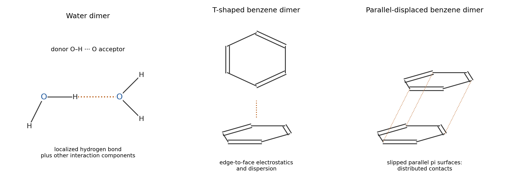

<h1 id="b5/a/i/solution">Solution</h1>

↑ **Parent:** [I](../i.md)

**[water](../../../../../../water.md) achieves substantial binding through a localized O–H···O [hydrogen bond](../../../../../../hydrogen-bond.md); [benzene](../../../../../../benzene.md) achieves a comparable total through a larger set of weaker contacts.** In the [water dimer](../../../../../../water-dimer.md), one [water](../../../../../../water.md) is the [hydrogen](../../../../../../hydrogen.md)-bond donor and the other presents an [oxygen](../../../../../../oxygen.md) [lone pair](../../../../../../lone-pair.md) region as acceptor. The interaction includes [electrostatics](../../../../../../electrostatics-split.md), [induction interaction](../../../../../../induction-interaction.md), dispersion and short-range [exchange repulsion](../../../../../../exchange-repulsion.md); a [hydrogen bond](../../../../../../hydrogen-bond.md) is not a separate fundamental force that can simply be added to all those terms again.

For [benzene](../../../../../../benzene.md), draw a T-shaped edge-to-face pair or a slipped parallel pair. Its larger, more polarizable [electron](../../../../../../electron.md) clouds provide appreciable London dispersion. Its quadrupolar charge distribution also makes the energy orientation dependent, despite each [molecule](../../../../../../molecule-split.md) having no permanent dipole by [symmetry](../../../../../../symmetry-physics.md). An edge C–H approaching the other ring's pi region is therefore preferable to a model of two structureless, noninteracting dipole-free objects. Dispersion attracts while [Pauli repulsion](../../../../../../exchange-repulsion.md) limits close overlap. Several distributed contacts can sum to the scale of one [water](../../../../../../water.md)–[water](../../../../../../water.md) [hydrogen bond](../../../../../../hydrogen-bond.md); counting only the number of conventional [hydrogen bonds](../../../../../../hydrogen-bond.md) would miss them.

The comparison concerns the given gas-phase pair interaction energies, not an equality of every [solvent](../../../../../../solvent.md)-dependent association free energy. Correlated primary calculations explicitly identify both T-shaped and parallel-displaced [benzene](../../../../../../benzene.md)-dimer minima, rather than a uniquely preferred perfectly eclipsed sandwich.[2002, abstract and pp. 10887–10893, comparison of the three dimer geometries](../../../../../../estimates-of-the-ab-initio-limit-for-pi-pi-interactions-the-benzene-dimer-by-mutasem-omar-sinnokrot-and-others.md)

**[Figure 5](#b5/a/i/image-original-schematic-geometries-of-a-hydrogen-bonded-water-dimer-and-t-shaped-and-parallel-displaced-benzene-dimers). Original schematic geometries of a hydrogen-bonded water dimer and T-shaped and parallel-displaced benzene dimers**.

## ↑ Ancestors (14)

1. [I](../i.md)
2. [A](../../a.md)
3. [B5](../../../b5.md)
4. [Paper 1](../../../../paper-1-split.md)
5. [2022](../../../../split.md)
6. [Past exam of the chemistry B course of the University of Cambridge](../../../../../split.md)
7. [Chemistry B course of the University of Cambridge](../../../../../../chemistry-b-course-of-the-university-of-cambridge.md)
8. [Year 2 of the natural sciences course of the University of Cambridge](../../../../../../year-2-of-the-natural-sciences-course-of-the-university-of-cambridge.md)
9. [Year of the natural sciences course of the University of Cambridge](../../../../../../year-of-the-natural-sciences-course-of-the-university-of-cambridge.md)
10. [Natural sciences course of the University of Cambridge](../../../../../../natural-sciences-course-of-the-university-of-cambridge.md)
11. [Course of the University of Cambridge](../../../../../../course-of-the-university-of-cambridge.md)
12. [University of Cambridge](../../../../../../university-of-cambridge-split.md)
13. [List of universities](../../../../../../list-of-universities.md)
14. [Codex Wiki](../../../../../../split.md)
